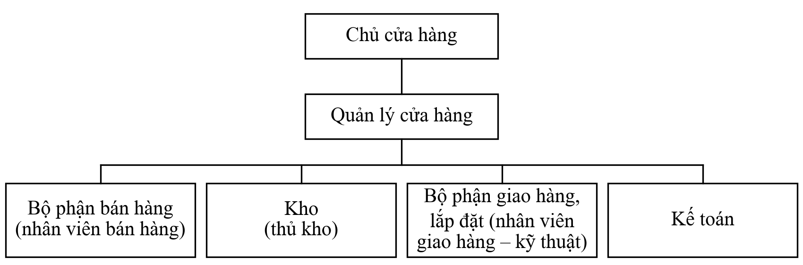

# Đánh giá hiện trạng tổ chức và thuật ngữ nghiệp vụ

Bản 0.2 (14/10/2026) · G1 giữ · việc t85 · làm theo **bước 1 và bước 2** của mô hình hoá nghiệp vụ (C3-7 đến C3-17)

> **Đối tượng phân tích là cửa hàng giả định**, dựng từ phỏng vấn mô phỏng (AI đóng vai người bán) và tài liệu công khai của ngành.
> Cách dựng, lý do và đoạn phương pháp cho báo cáo ở [`../../khao-sat/tinh-huong-gia-dinh.md`](../../khao-sat/tinh-huong-gia-dinh.md).
> Mã nguồn `MP1`, `MP2`, `MP3` + mã câu (theo kịch bản bản 1.2, riêng câu F theo bản 1.0) chỉ chỗ lấy trong [`../../khao-sat/mo-phong/phong-van-thu.md`](../../khao-sat/mo-phong/phong-van-thu.md); `TL-xx` là tài liệu thật.

Mục đích của bước đánh giá hiện trạng (C3-8): nắm thông tin tổ chức, xác định các đối tượng liên quan và khách hàng,
định nghĩa phạm vi mô hình hoá, tìm chỗ cần cải tiến và mục tiêu chính của tổ chức.

## 1. Cơ cấu tổ chức (C3-9, C3-10)

Cửa hàng giả định bán thiết bị bếp và đồ điện gia dụng (bếp từ, máy hút mùi, máy rửa chén, lò nướng, máy lọc nước, nồi cơm, quạt), bếp từ và máy hút mùi bán nhiều nhất (`MP1 A1`, `MP2 A1`, `MP3 A1`).
Khách đặt tại cửa hàng, qua Facebook, Zalo, TikTok, gian hàng sàn và gọi điện; chưa có website riêng (`MP2 C1`).

Mô tả từng bộ phận giống ví dụ siêu thị ở slide 10 (mỗi bộ phận: gồm ai, làm gì, báo cáo cho ai, bao lâu một lần). Số người theo `MP3 A2`:

- **Chủ cửa hàng:** 1 người. Duyệt giá bán, khuyến mãi, đơn đặt hàng nhà cung cấp và các trường hợp đổi trả, huỷ đơn lớn (`MP3 B1`, `B4`, `C4`, `D4`, `E1`); quyết định chi phí làm website (`MP3 F3`). Xem báo cáo doanh thu cuối ngày, tồn kho cuối tháng.
- **Quản lý cửa hàng:** 1 người. Điều phối hằng ngày, đề xuất giá, lập đề xuất đặt hàng cùng thủ kho, duyệt đổi trả thường, xếp lịch và phân công giao lắp trên Google Sheets (`MP3 B1`, `D4`, `E1`). Báo cáo cho chủ hằng ngày. Việc xếp lịch là **nhóm ghép**: ở shop nhỏ chủ tự xếp (`MP2 D6`), ở đại lý tư vấn cùng kỹ thuật xếp, quản lý duyệt (`MP3 D6`).
- **Bộ phận bán hàng:** 5 nhân viên: 4 tư vấn tại cửa hàng và qua tin nhắn, chốt đơn, gọi xác nhận, hẹn giờ giao lắp với khách, trả lời khách hỏi đơn; 1 chăm sóc khách hàng kiêm tiếp nhận bảo hành (`MP3 A2`, `D6`; `MP2 C2`, `C7`, `D1`).
- **Kho:** 1 thủ kho, kiêm soạn hàng giao. Nhận hàng, kiểm đếm, ghi phiếu nhập; soạn hàng theo đơn, ghi phiếu xuất; nhận lại máy khách không nhận; kiểm kê cuối tháng (`MP3 A2`; `MP2 E2`, `E3`, `C6`).
- **Bộ phận giao hàng, lắp đặt:** 4 nhân viên giao hàng – kỹ thuật. Khảo sát chỗ lắp, giao, lắp, chạy thử, lấy chữ ký biên bản, thu tiền khi giao rồi nộp kế toán trong ngày (`MP3 A2`, `D2`, `D5`).
- **Kế toán:** 1 người. Thu chi, nhận tiền thu khi giao và đối chiếu với đơn, đối soát với đơn vị vận chuyển, lập hoá đơn cho khách công ty, ghép báo cáo cuối tháng (`MP2 A4`, `C3`, `D5`).

Ai kiêm vai nào: thủ kho kiêm soạn hàng giao; một nhân viên bán hàng kiêm tiếp nhận bảo hành; tư vấn đôi khi đi đo đạc cùng kỹ thuật (`MP3 A2`).
Thừa tác viên là vai trò, không phải chức vụ (C3-45), nên vẫn tách 5 vai như ở `tac-nhan-va-thuc-the.md`.

## 2. Đối tượng liên quan và khách hàng (C3-11, C3-12)

Đối tượng liên quan (stakeholder) là người chịu ảnh hưởng trực tiếp của hệ thống; khách hàng là người dùng hệ thống, có thể đồng thời là đối tượng liên quan.

**Bảng 1. Đối tượng liên quan**

| Tên | Đại diện | Vai trò |
|---|---|---|
| Chủ cửa hàng | Chủ cửa hàng | Theo dõi tiến trình làm website và tình hình kinh doanh; quyết định có đưa website vào dùng không và chi bao nhiêu |
| Người quản lý | Quản lý cửa hàng | Dùng các chức năng quản lý sản phẩm, giá, khuyến mãi, đơn hàng, lịch giao lắp, báo cáo |
| Nhân viên | Nhân viên bán hàng, thủ kho, nhân viên giao hàng – kỹ thuật, kế toán | Nhập và cập nhật thông tin trên hệ thống trong công việc hằng ngày; kế toán xác nhận tiền thu và xem báo cáo |
| Khách hàng | Người mua máy | Xem sản phẩm, đặt hàng, theo dõi đơn, tra cứu bảo hành |

**Bảng 2. Khách hàng của hệ thống**

| Tên | Mô tả | Đối tượng liên quan |
|---|---|---|
| Người quản lý | Đáp ứng nhu cầu quản lý sản phẩm, giá, khuyến mãi, đơn hàng, lịch giao lắp, doanh thu | Chủ cửa hàng, Quản lý cửa hàng |
| Nhân viên | Đảm bảo hệ thống đáp ứng việc bán hàng, giao lắp, nhập xuất kho, bảo hành, đối chiếu tiền thu | Nhân viên bán hàng, Thủ kho, Nhân viên giao hàng – kỹ thuật, Kế toán |
| Khách hàng | Đáp ứng nhu cầu tra cứu sản phẩm, đặt hàng trực tuyến, theo dõi đơn và bảo hành | Khách hàng |

## 3. Giới hạn hệ thống phát triển (C3-13)

| Nhóm đối tượng | Gồm |
|---|---|
| Đối tượng thuộc hệ thống nghiệp vụ đang xét | Quản lý cửa hàng, Nhân viên bán hàng, Thủ kho, Nhân viên giao hàng – kỹ thuật, Kế toán; các giấy tờ ở mục 3 của `tac-nhan-va-thuc-the.md` |
| Đối tượng bên trong tổ chức nhưng nằm ngoài hệ thống nghiệp vụ | Chủ cửa hàng (yêu cầu, duyệt và nhận báo cáo, không trực tiếp làm nghiệp vụ) |
| Đối tượng môi trường của tổ chức | Khách hàng, Nhà cung cấp, Đơn vị vận chuyển, Trung tâm bảo hành hãng, Ngân hàng, công ty tài chính (trả góp) |
| Ngoài phạm vi đề tài | Chấm công, tính lương nhân viên; kế toán thuế; bán hàng và đồng bộ giá, tồn kho lên Facebook, sàn thương mại điện tử (`MP2 B6`); bán theo dự án qua kiến trúc sư (`MP3 C1`) |

Môi trường chia theo chương 1 (C1-9): **môi trường kinh tế** gồm khách hàng, nhà cung cấp, ngân hàng, công ty tài chính, đơn vị vận chuyển, trung tâm bảo hành hãng;
**môi trường xã hội** gồm cơ quan thuế, cơ quan quản lý thị trường (cửa hàng phải xuất hoá đơn, niêm yết giá).

## 4. Vấn đề của hệ thống hiện tại (C3-14, C3-15)

Mỗi vấn đề trình bày bằng một bảng 4 dòng đúng mẫu slide 14. Đây là căn cứ chọn chiến lược phân tích yêu cầu (C2-8):
**tự động hoá** (giữ cách làm, dùng máy làm thay), **cải tiến** (sửa quy trình đang có) hay **tái thiết kế** (đổi hẳn cách kinh doanh).
Nếu chỉ tự động hoá hoặc cải tiến thì chỉ cần mô hình hoá nghiệp vụ hiện tại (C3-5).

**Vấn đề 1. Giá và khuyến mãi không thống nhất** (`MP2 A3`, `A5`, `B4`, `B6`; `MP1 B6`)

| | |
|---|---|
| Vấn đề | Giá sửa tay ở phần mềm bán hàng rồi sửa lại ở từng kênh; ai cũng sửa được giá; khuyến mãi ghi trong Excel, nhân viên tự áp |
| Đối tượng chịu tác động | Khách hàng, Nhân viên bán hàng, Chủ cửa hàng |
| Ảnh hưởng của vấn đề | Khách thấy giá cũ, đặt món đã hết hàng rồi bị huỷ; có lần bán dưới giá vốn, có lần cộng nhầm hai mã giảm giá cho một đơn |
| Một giải pháp thành công | Giá, khuyến mãi, tồn kho nằm một chỗ trên website; chỉ quản lý được sửa giá, giá thấp hơn giá nhập phải ghi lý do và lưu vết cho chủ xem; mỗi đơn chỉ áp một mã |

**Vấn đề 2. Khách đặt rồi không nhận hàng** (`MP2 C4`, `C6`, `F1`)

| | |
|---|---|
| Vấn đề | Đơn chốt qua tin nhắn, chủ yếu thu tiền khi giao; chỉ máy trên 10 triệu mới xin cọc; gọi xác nhận rồi khách vẫn không nhận |
| Đối tượng chịu tác động | Nhân viên bán hàng, Nhân viên giao hàng – kỹ thuật, Thủ kho, Chủ cửa hàng |
| Ảnh hưởng của vấn đề | Mất phí giao hai chiều mỗi đơn, máy trả về móp hộp phải bán giảm giá |
| Một giải pháp thành công | Đơn đặt trên website có bước xác nhận rõ ràng, có đặt cọc trực tuyến cho đơn giá trị cao hoặc giao tỉnh; đơn không nhận được ghi lý do, máy nhận lại vào kho theo serial |

**Vấn đề 3. Lịch giao lắp chồng chéo** (`MP2 D2`, `D6`, `F1`; `MP3 D6`, `F1`)

| | |
|---|---|
| Vấn đề | Lịch giao lắp ghi Google Sheets, không có cảnh báo trùng giờ; hẹn giờ với khách bằng điện thoại |
| Đối tượng chịu tác động | Khách hàng, Nhân viên giao hàng – kỹ thuật, Quản lý cửa hàng |
| Ảnh hưởng của vấn đề | Hai đơn hẹn cùng giờ ở hai quận, khách chờ 2 tiếng, cửa hàng bị chê trên mạng, phải giảm tiền lắp để xin lỗi |
| Một giải pháp thành công | Xếp lịch trên hệ thống theo từng nhân viên kỹ thuật, báo trùng giờ; khách thấy ngày giờ hẹn khi tra đơn |

**Vấn đề 4. Không theo dõi được từng chiếc máy** (`MP2 E2`, `E4`, `E5`; `MP3 A5`, `F1`; `MP1 E2`, `E4`)

| | |
|---|---|
| Vấn đề | Chỉ ghi serial máy giá cao lúc nhập; hàng xuất mà chỉ báo trong Zalo thì không vào phần mềm; tra bảo hành dựa vào phiếu giấy của khách |
| Đối tượng chịu tác động | Khách hàng, Thủ kho, Nhân viên bán hàng |
| Ảnh hưởng của vấn đề | Lệch kho không biết ai xuất; khách mất phiếu thì phải lục hoá đơn; nhập serial bằng tay dễ ghi nhầm máy |
| Một giải pháp thành công | Ghi serial từng chiếc khi nhập, chọn đúng serial khi xuất theo đơn; tra theo serial, số điện thoại hoặc mã đơn ra ngay ngày bán, hạn bảo hành, các lần bảo hành |

**Vấn đề 5. Tiền thu khi giao và báo cáo phải ghép tay** (`MP2 A4`, `D5`; `MP1 F1`)

| | |
|---|---|
| Vấn đề | Thợ nộp tiền thu khi giao, kế toán ghi sổ tay; cuối tháng xuất phần mềm ra Excel ghép với số của sàn |
| Đối tượng chịu tác động | Kế toán, Nhân viên giao hàng – kỹ thuật, Chủ cửa hàng |
| Ảnh hưởng của vấn đề | Thỉnh thoảng lệch tiền; ghép báo cáo mất 3–4 tiếng mỗi lần |
| Một giải pháp thành công | Mỗi đơn có trạng thái thanh toán; kế toán xác nhận tiền thu ngay trong ngày; báo cáo doanh thu, tồn kho lấy ra từ dữ liệu có sẵn |

**Chiến lược chọn: cải tiến quy trình nghiệp vụ.** Cửa hàng giả định giữ cách bán đang có, thêm kênh đặt hàng trên website riêng và
thay Google Sheets, nhóm Zalo, sổ tay bằng dữ liệu chung. Không tái thiết kế vì vai người bán mô phỏng ngại làm rối quy trình đang chạy và ngại nhập hàng hai nơi (`MP3 F2`; `MP2 F2`).
Theo C3-5, nhóm mô hình hoá nghiệp vụ hiện tại của cửa hàng giả định rồi chỉ ra bước nào được cải tiến.

## 5. Thuật ngữ nghiệp vụ (C3-17)

Mẫu trình bày hai cột **Thuật ngữ | Diễn giải**. Ghi mọi từ người bán dùng mà người ngoài có thể hiểu sai.

| Thuật ngữ | Diễn giải |
|---|---|
| Mẫu máy (sản phẩm) | Một loại hàng bán ra, ví dụ một model bếp từ đôi của một hãng. Có giá bán, thời hạn bảo hành, ảnh, thông số |
| Chiếc máy (số serial) | Một chiếc cụ thể của mẫu máy, phân biệt bằng số serial in trên thân máy và trên thùng. Bảo hành, đổi trả tính theo chiếc |
| Số serial | Dãy ký tự hãng in trên tem dán sau mỗi chiếc máy. Cửa hàng giả định hiện chỉ ghi khi nhập máy giá cao; hệ thống mới ghi cho mọi chiếc khi nhập kho và khi xuất theo đơn |
| Kích thước khoét đá | Kích thước lỗ cắt trên mặt đá bếp để lắp bếp âm; khách và kiến trúc sư hỏi nhiều nhất trước khi mua (`MP3 B2`) |
| Khảo sát lắp đặt | Nhân viên kỹ thuật đến đo tủ, vị trí cắt đá, nguồn điện, nước trước khi lắp máy âm |
| Lắp đặt tận nơi | Nhân viên giao hàng – kỹ thuật đến nhà khách lắp máy âm, máy lọc nước; miễn phí theo giá trị đơn, ngoài ra thu công lắp và vật tư |
| Biên bản lắp đặt | Giấy khách và kỹ thuật viên ký sau khi lắp: máy và serial, kết quả chạy thử, phát sinh |
| Thu tiền khi giao (COD) | Khách trả tiền mặt hoặc chuyển khoản cho người giao lúc nhận hàng; người giao nộp lại cho kế toán trong ngày |
| Đối soát | Đơn vị vận chuyển chuyển lại tiền thu hộ của đơn tỉnh, kế toán so với danh sách đơn |
| Bom hàng | Từ người bán dùng: khách đặt rồi không nhận hàng khi giao tới. Trong tài liệu ghi là **khách không nhận hàng** |
| Còn seal | Máy chưa bóc niêm phong của hãng; điều kiện để đổi trả hoặc nhập lại kho bán tiếp |
| Hàng trưng bày | Máy đặt ở cửa hàng cho khách xem, bán giá riêng, vẫn có serial và bảo hành |
| Sổ nộp tiền | Sổ ghi số tiền người giao nộp lại mỗi ngày, dùng để đối chiếu với đơn đã giao |
| Đổi trả | Khách trả lại hoặc đổi máy khác trong thời hạn cửa hàng cho phép; khác bảo hành ở chỗ không sửa máy |
| Bảo hành hãng | Máy lỗi trong thời hạn được hãng sửa miễn phí; cửa hàng nhận máy rồi gửi trung tâm bảo hành hãng |
| Phiếu tiếp nhận bảo hành | Giấy cửa hàng ghi khi nhận máy lỗi của khách: số serial, lỗi, tình trạng, ngày hẹn trả |
| Khách vãng lai | Người xem website chưa đăng nhập |
| Quản lý cửa hàng | Người được chủ giao quyền điều hành hằng ngày; trên website là tài khoản có vai "Quản lý" |
