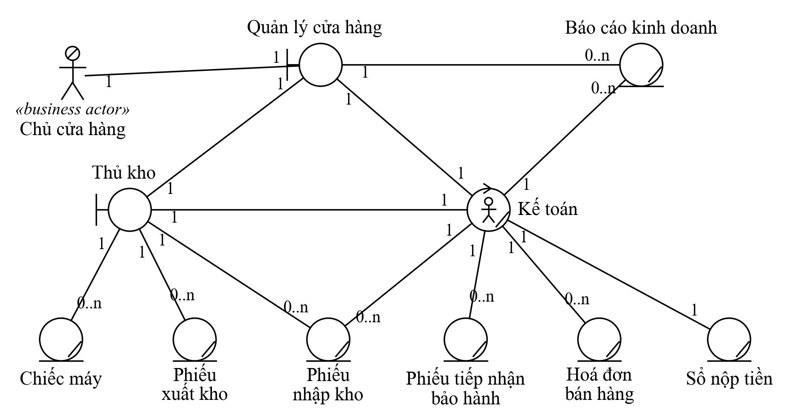
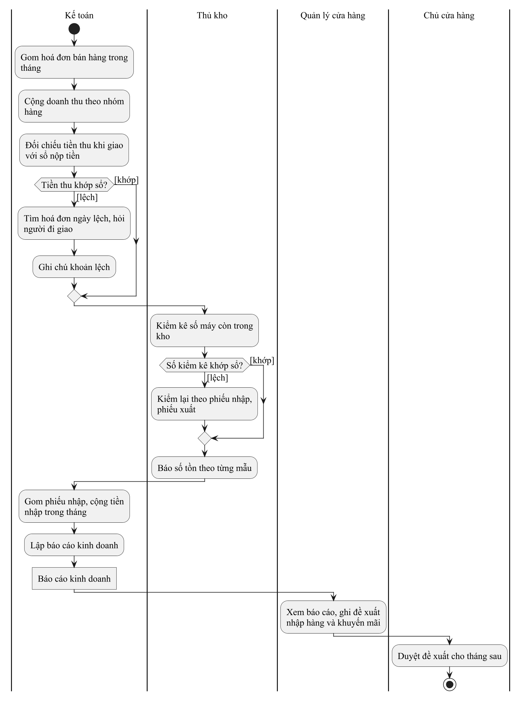
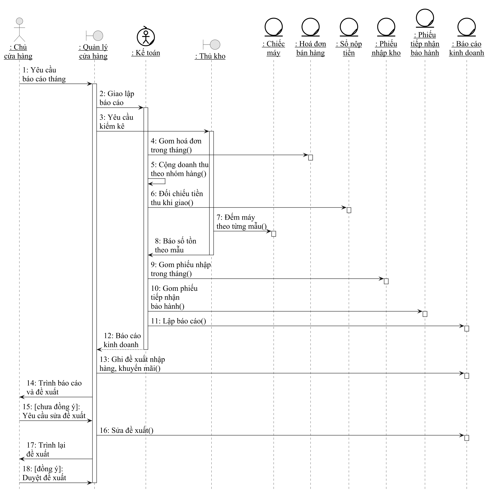

# G1 · Đặc tả use case nghiệp vụ

Bản 1.0 (14/10/2026) · Phạm Tuấn Kiệt · đối tượng phân tích là **cửa hàng giả định** ([`../../khao-sat/tinh-huong-gia-dinh.md`](../../khao-sat/tinh-huong-gia-dinh.md))

## BUC-07 Lập báo cáo kinh doanh

> **Use case nghiệp vụ:** Lập báo cáo kinh doanh (BUC-07, quy trình QT-01, gói G1)
>
> Use case bắt đầu khi chủ cửa hàng yêu cầu báo cáo tháng (cuối mỗi tháng hoặc đột xuất). Mục tiêu của use case nhằm cung cấp cho chủ cửa hàng
> doanh thu, hàng bán chạy, hàng tồn và số máy đang bảo hành để quyết định nhập hàng, khuyến mãi tháng sau.
>
> **Các dòng cơ bản:**
> 1. Quản lý cửa hàng tiếp nhận yêu cầu báo cáo tháng từ chủ cửa hàng.
> 2. Quản lý cửa hàng giao kế toán lập báo cáo và yêu cầu thủ kho kiểm kê kho.
> 3. Kế toán gom hoá đơn bán hàng trong tháng, cộng doanh thu theo nhóm hàng.
> 4. Kế toán đối chiếu tiền thu khi giao hàng với sổ nộp tiền.
> 5. Thủ kho kiểm kê máy còn trong kho, báo số tồn theo từng mẫu cho kế toán (làm song song với bước 3, 4).
> 6. Kế toán gom phiếu nhập kho, phiếu tiếp nhận bảo hành trong tháng.
> 7. Kế toán lập báo cáo kinh doanh, gửi quản lý cửa hàng.
> 8. Quản lý cửa hàng xem báo cáo, ghi đề xuất nhập hàng và khuyến mãi vào báo cáo.
> 9. Quản lý cửa hàng trình báo cáo và đề xuất cho chủ cửa hàng duyệt.
>
> **Các dòng thay thế:**
> - Tại bước 4. Xử lý tiền thu lệch: nếu tiền thu khi giao lệch với sổ nộp tiền, kế toán tìm hoá đơn của ngày lệch và ghi lại khoản lệch để đưa vào báo cáo ở bước 7.
> - Tại bước 5. Xử lý số kiểm kê lệch: nếu số máy đếm được lệch với sổ, thủ kho kiểm lại theo phiếu nhập kho, phiếu xuất kho trước khi báo số tồn.
> - Tại bước 9. Xử lý đề xuất chưa được duyệt: nếu chủ cửa hàng chưa đồng ý, quản lý cửa hàng sửa đề xuất theo ý chủ rồi trình lại (lặp lại bước 9).

| Mục | Nội dung |
|---|---|
| Tác nhân nghiệp vụ | Chủ cửa hàng |
| Thừa tác viên | Quản lý cửa hàng, Kế toán, Thủ kho |
| Thực thể nghiệp vụ | Hoá đơn bán hàng, Sổ nộp tiền, Phiếu nhập kho, Phiếu xuất kho, Phiếu tiếp nhận bảo hành, Chiếc máy, Báo cáo kinh doanh |
| Ràng buộc trước khi thực hiện | Hoá đơn, phiếu nhập, phiếu tiếp nhận bảo hành trong tháng đã được lưu đủ |
| Kết quả | Chủ cửa hàng nhận báo cáo kinh doanh tháng kèm đề xuất đã duyệt để quyết định nhập hàng, khuyến mãi |
| Quy tắc nghiệp vụ | QĐ1. Báo cáo chốt trước ngày 5 tháng sau. · QĐ2. Doanh thu tính theo ngày giao xong, không theo ngày đặt. · QĐ3. Kiểm kê kho mỗi tháng một lần (`MP2 E3`). |
| Biểu mẫu | Hoá đơn bán hàng, Sổ nộp tiền, Phiếu nhập kho, Phiếu xuất kho, Phiếu tiếp nhận bảo hành, Báo cáo kinh doanh |
| Vấn đề hiện tại | Vấn đề 5 ở `hien-trang-to-chuc.md`: tiền thu khi giao ghi sổ tay, ghép báo cáo mất 3–4 tiếng, hay lệch |
| Nguồn | `MP2 A4`, `D5`, `E3`; `MP3 A4`, `D5`; TL-27, TL-30 |

**Sơ đồ đối tượng nghiệp vụ**: tác nhân nối với thừa tác viên giao tiếp với nó, thừa tác viên nối với thực thể nó xử lý, ghi bản số hai đầu.

**Sơ đồ hoạt động**: bước 5 song song với bước 3, 4 nên dùng thanh tách và thanh kết hợp xử lý; báo cáo đi từ kế toán sang quản lý bằng dòng đối tượng nét đứt.

**Sơ đồ tuần tự nghiệp vụ**: thông điệp đánh số, gọi xử lý ghi `()`, trả về nét đứt, thông điệp có điều kiện ghi `[điều kiện]:`.

