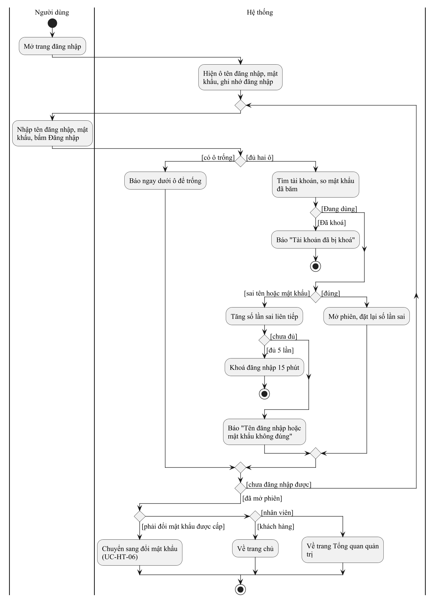
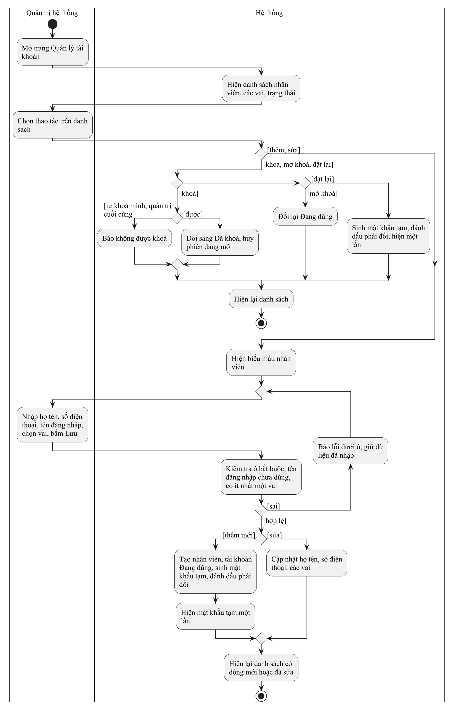
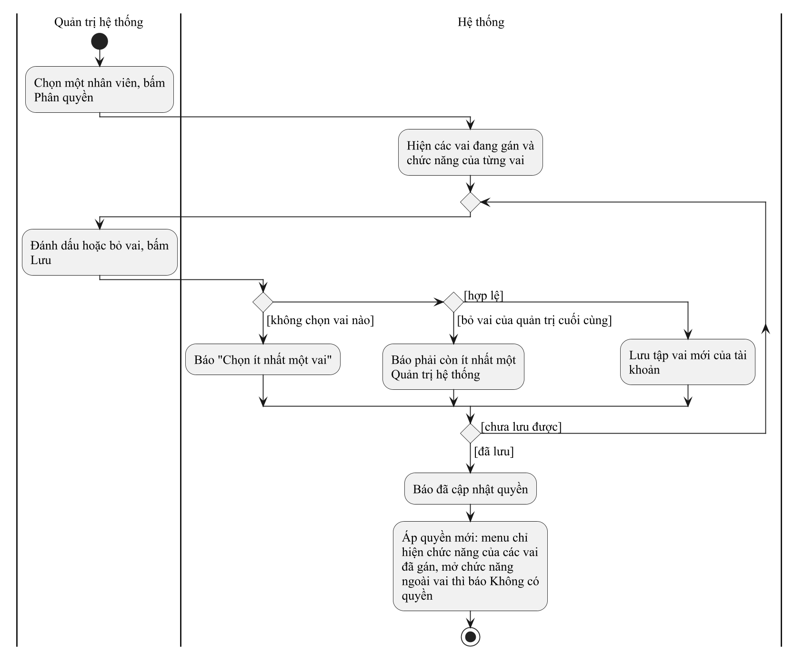
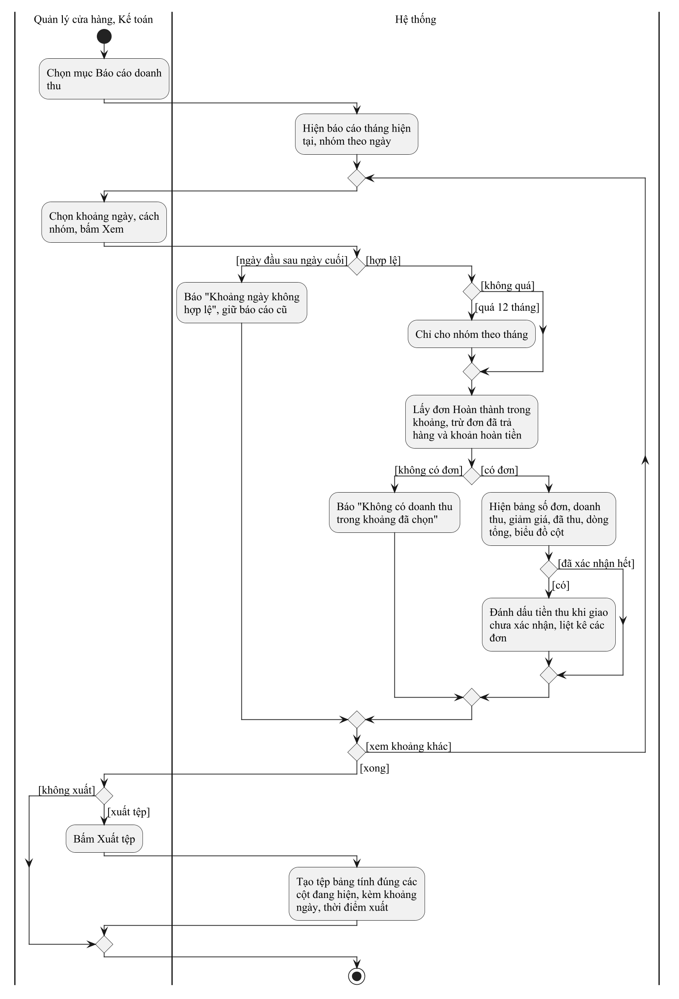
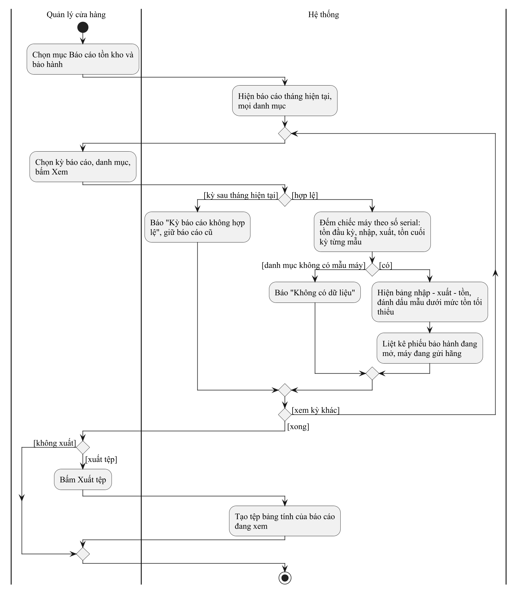
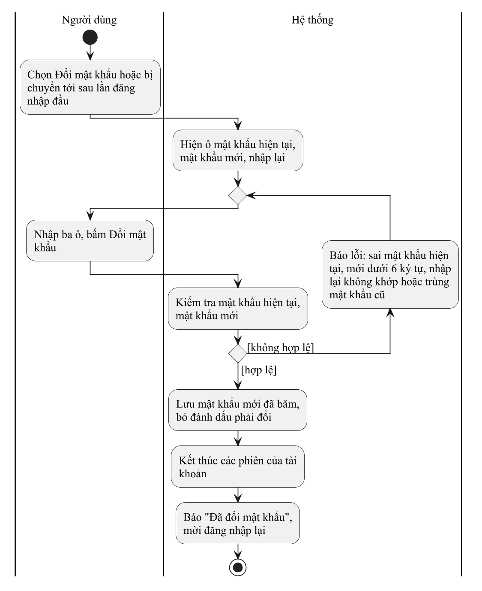
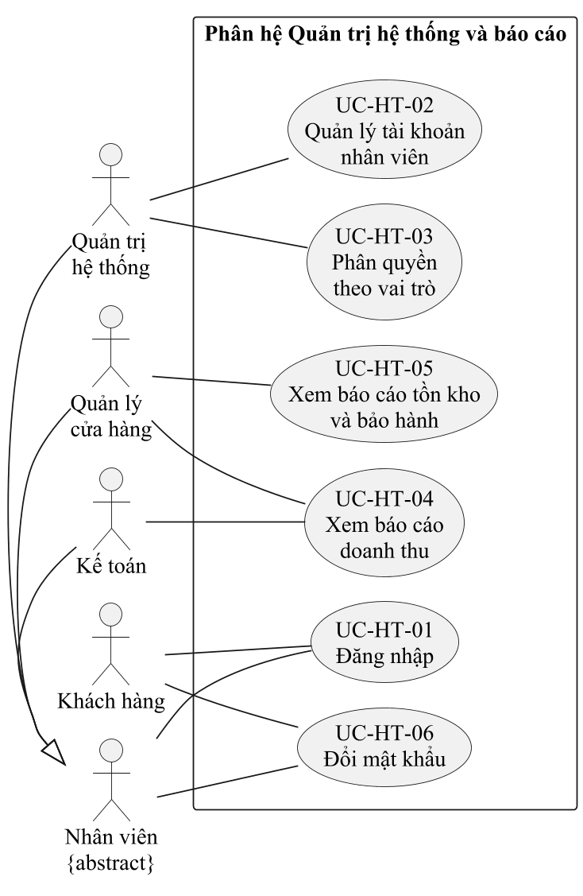

# G1 · Đặc tả use case hệ thống

Bản 1.0 (14/10/2026) · Phạm Tuấn Kiệt · khuôn theo mục 2 của [`../chung/mau-dac-ta.md`](../chung/mau-dac-ta.md)

## UC-HT-01 Đăng nhập

| Mục | Nội dung |
|---|---|
| Mã, tên | UC-HT-01 Đăng nhập |
| Gói | G1 |
| Tác nhân chính | Nhân viên, Khách hàng |
| Tác nhân phụ | Không có |
| Mô tả | Người dùng nhập tên đăng nhập và mật khẩu để dùng các chức năng theo vai trò của mình |
| Điều kiện trước | Người dùng đã có tài khoản ở trạng thái Đang dùng |
| Điều kiện sau | Người dùng ở trong phiên làm việc; hệ thống biết vai trò để hiện đúng menu |
| Màn hình | `giao-dien/khach/dang-nhap.html` |

| Bước | Tác nhân | Hệ thống |
|---|---|---|
| 1 | Mở trang đăng nhập | Hiện ô tên đăng nhập, ô mật khẩu, ô "ghi nhớ đăng nhập" |
| 2 | Nhập tên đăng nhập, mật khẩu, bấm Đăng nhập | Kiểm tra hai ô không để trống |
| 3 | | Tìm tài khoản theo tên đăng nhập, so mật khẩu đã băm |
| 4 | | Mở phiên làm việc; khách hàng về trang chủ, nhân viên về trang Tổng quan quản trị |

Luồng thay thế:
- `2a.` Để trống ô nào: báo ngay dưới ô đó, không gửi đi.
- `3a.` Sai tên đăng nhập hoặc mật khẩu: báo chung "Tên đăng nhập hoặc mật khẩu không đúng" (không nói rõ sai ô nào), cho nhập lại.
- `3b.` Sai quá 5 lần liên tiếp: khoá đăng nhập 15 phút.
- `3c.` Tài khoản ở trạng thái Đã khoá: báo "Tài khoản đã bị khoá, liên hệ cửa hàng".
- `4a.` Nhân viên đăng nhập lần đầu bằng mật khẩu được cấp: chuyển sang trang đổi mật khẩu (UC-HT-06) trước khi vào trang quản trị.

Ngoại lệ: mất kết nối cơ sở dữ liệu thì báo "Hệ thống đang bận, thử lại sau", không mở phiên.

Quy tắc nghiệp vụ: mật khẩu chỉ lưu dạng đã băm (YC-PCN-02); nhân viên đăng nhập lần đầu phải đổi mật khẩu được cấp; mỗi vai chỉ thấy chức năng của vai mình, một tài khoản kiêm được nhiều vai (YC-HT-01).

Ghi chú hiện thực: trang đăng nhập của website chưa có ô "ghi nhớ đăng nhập" (bước 1); luồng 2a do trình duyệt chặn bằng thuộc tính `required` của hai ô.

## UC-HT-02 Quản lý tài khoản nhân viên

| Mục | Nội dung |
|---|---|
| Mã, tên | UC-HT-02 Quản lý tài khoản nhân viên |
| Gói | G1 |
| Tác nhân chính | Quản trị hệ thống |
| Tác nhân phụ | Không có |
| Mô tả | Quản trị hệ thống thêm, sửa, khoá, mở khoá tài khoản nhân viên và gán một hoặc nhiều vai cho mỗi tài khoản |
| Điều kiện trước | Đã đăng nhập với vai Quản trị hệ thống |
| Điều kiện sau | Tài khoản được tạo hoặc cập nhật; vai được gán; tài khoản bị khoá không đăng nhập được nữa |
| Màn hình | `giao-dien/quan-tri/tai-khoan.html` |

| Bước | Tác nhân | Hệ thống |
|---|---|---|
| 1 | Mở trang Quản lý tài khoản | Hiện danh sách nhân viên: họ tên, số điện thoại, tên đăng nhập, các vai, trạng thái |
| 2 | Bấm Thêm nhân viên | Hiện biểu mẫu trống |
| 3 | Nhập họ tên, số điện thoại, tên đăng nhập; chọn một hoặc nhiều vai (Nhân viên bán hàng, Thủ kho, Nhân viên giao hàng – kỹ thuật, Quản lý cửa hàng, Kế toán, Quản trị hệ thống); bấm Lưu | Kiểm tra các ô bắt buộc và tên đăng nhập chưa có ai dùng |
| 4 | | Tạo nhân viên và tài khoản ở trạng thái Đang dùng, sinh mật khẩu tạm, đánh dấu phải đổi mật khẩu lần đầu |
| 5 | | Hiện mật khẩu tạm đúng một lần để quản trị hệ thống báo cho nhân viên; danh sách có thêm dòng mới |

Luồng thay thế:
- `2a.` Sửa: chọn một nhân viên, đổi họ tên, số điện thoại hoặc các vai rồi Lưu; hệ thống kiểm tra như bước 3 và cập nhật.
- `2b.` Khoá: chọn nhân viên, bấm Khoá, xác nhận; hệ thống đổi trạng thái tài khoản thành Đã khoá và huỷ các phiên đang mở của tài khoản đó.
- `2c.` Mở khoá: chọn tài khoản Đã khoá, bấm Mở khoá; hệ thống đổi lại Đang dùng.
- `2d.` Đặt lại mật khẩu: hệ thống sinh mật khẩu tạm mới, đánh dấu phải đổi mật khẩu, hiện mật khẩu tạm một lần.
- `3a.` Tên đăng nhập đã có người dùng: báo "Tên đăng nhập đã tồn tại", giữ nguyên các ô đã nhập.
- `3b.` Chưa chọn vai nào: báo "Chọn ít nhất một vai".

Ngoại lệ: không cho quản trị hệ thống tự khoá tài khoản đang dùng của chính mình; luôn phải còn ít nhất một tài khoản Quản trị hệ thống ở trạng thái Đang dùng.

Quy tắc nghiệp vụ: một tài khoản kiêm được nhiều vai vì cửa hàng có người kiêm việc (YC-HT-01, `lop-va-trang-thai-chung.md` lớp `VaiTro`); không xoá tài khoản nhân viên đã có thao tác, chỉ khoá, để giữ lưu vết (YC-HT-05); mật khẩu lưu dạng băm (YC-PCN-02).

Ghi chú hiện thực: website không huỷ phiên ngay lúc khoá (luồng 2b) mà bộ lọc `ChanTaiKhoanBiKhoa` kiểm trạng thái ở mỗi yêu cầu, gặp tài khoản Đã khoá thì huỷ phiên và đưa về trang đăng nhập; gán vai ở bước 3 cũng là chỗ thực hiện UC-HT-03.

## UC-HT-03 Phân quyền theo vai trò

| Mục | Nội dung |
|---|---|
| Mã, tên | UC-HT-03 Phân quyền theo vai trò |
| Gói | G1 |
| Tác nhân chính | Quản trị hệ thống |
| Tác nhân phụ | Không có |
| Mô tả | Quản trị hệ thống gán hoặc bỏ vai cho tài khoản nhân viên; hệ thống chỉ mở cho nhân viên các chức năng thuộc những vai đã gán |
| Điều kiện trước | Đã đăng nhập với vai Quản trị hệ thống; nhân viên đã có tài khoản (UC-HT-02) |
| Điều kiện sau | Tập vai của tài khoản được cập nhật; menu và quyền mở chức năng của nhân viên đó theo đúng các vai mới |
| Màn hình | `giao-dien/quan-tri/tai-khoan.html` |

| Bước | Tác nhân | Hệ thống |
|---|---|---|
| 1 | Chọn một nhân viên trong danh sách, bấm Phân quyền | Hiện các vai (Nhân viên bán hàng, Thủ kho, Nhân viên giao hàng – kỹ thuật, Quản lý cửa hàng, Kế toán, Quản trị hệ thống), đánh dấu sẵn các vai đang gán, kèm các chức năng mỗi vai được dùng |
| 2 | Đánh dấu thêm hoặc bỏ vai, bấm Lưu | Kiểm tra còn ít nhất một vai được chọn |
| 3 | | Kiểm tra việc bỏ vai không làm hệ thống mất tài khoản Quản trị hệ thống cuối cùng đang dùng |
| 4 | | Lưu tập vai mới của tài khoản, báo "Đã cập nhật quyền" |
| 5 | | Từ đó, menu của nhân viên chỉ hiện chức năng thuộc các vai đã gán; nhân viên mở thẳng địa chỉ của chức năng ngoài vai thì báo "Không có quyền" |

Luồng thay thế:
- `2a.` Bỏ hết các vai: báo "Chọn ít nhất một vai", giữ nguyên các ô đã chọn.
- `3a.` Bỏ vai Quản trị hệ thống của tài khoản quản trị cuối cùng đang dùng: báo "Phải còn ít nhất một tài khoản Quản trị hệ thống đang dùng", không lưu.
- `5a.` Nhân viên đang trong phiên làm việc khi bị bỏ vai: chức năng của vai bị bỏ không mở được nữa ở lần thao tác kế tiếp.

Ngoại lệ: mất kết nối cơ sở dữ liệu thì báo "Hệ thống đang bận, thử lại sau", tập vai cũ giữ nguyên.

Quy tắc nghiệp vụ: mỗi vai chỉ thấy chức năng của vai mình, một tài khoản kiêm được nhiều vai vì cửa hàng nhỏ có người kiêm việc (YC-HT-01, `lop-va-trang-thai-chung.md` lớp `VaiTro`, quan hệ `TaiKhoan` * – 1..* `VaiTro`); luôn còn ít nhất một tài khoản Quản trị hệ thống đang dùng (như ngoại lệ của UC-HT-02); vai Khách hàng không gán cho tài khoản nhân viên.

Ghi chú hiện thực: website không có trang Phân quyền riêng, việc gán vai nằm trong biểu mẫu sửa nhân viên `quan-tri/g1/tai-khoan-form.html` (dùng chung với UC-HT-02); bảng chức năng của từng vai cố định trong mã (`BaoMat.chuoiLoc()` và các `sec:authorize` của `layout/quan-tri.html`), quản trị hệ thống không xem, không sửa được trên giao diện; vai mới chỉ có hiệu lực từ lần đăng nhập sau vì quyền `ROLE_…` được nạp lúc đăng nhập (luồng 5a chưa làm).

## UC-HT-04 Xem báo cáo doanh thu

| Mục | Nội dung |
|---|---|
| Mã, tên | UC-HT-04 Xem báo cáo doanh thu |
| Gói | G1 |
| Tác nhân chính | Quản lý cửa hàng, Kế toán |
| Tác nhân phụ | Không có |
| Mô tả | Quản lý cửa hàng hoặc kế toán xem doanh thu theo ngày, tháng, nhóm hàng để lập báo cáo kinh doanh tháng và tự kê khai thuế |
| Điều kiện trước | Đã đăng nhập với vai Quản lý cửa hàng hoặc Kế toán |
| Điều kiện sau | Không đổi dữ liệu; nếu tác nhân chọn xuất tệp thì có tệp bảng tính của báo cáo đang xem |
| Màn hình | `giao-dien/quan-tri/tong-quan.html` (khung trang tổng quan); trang báo cáo chi tiết thiết kế ở tuần 14 |

| Bước | Tác nhân | Hệ thống |
|---|---|---|
| 1 | Chọn mục Báo cáo doanh thu | Hiện báo cáo mặc định của tháng hiện tại, nhóm theo ngày |
| 2 | Chọn khoảng ngày và cách nhóm (theo ngày, theo tháng, theo nhóm hàng), bấm Xem | Kiểm tra khoảng ngày hợp lệ |
| 3 | | Lấy các đơn **Hoàn thành** có ngày hoàn thành trong khoảng; trừ các đơn **Đã trả hàng** và các khoản đã hoàn tiền; tính doanh thu theo đơn giá lúc đặt |
| 4 | | Hiện bảng: số đơn, doanh thu, tiền giảm giá, tiền đã thu; dòng tổng; biểu đồ cột theo cách nhóm đã chọn |
| 5 | Bấm Xuất tệp | Tạo tệp bảng tính đúng các cột đang hiện, kèm khoảng ngày và thời điểm xuất |

Luồng thay thế:
- `2a.` Ngày bắt đầu sau ngày kết thúc: báo "Khoảng ngày không hợp lệ", giữ nguyên báo cáo cũ.
- `3a.` Không có đơn nào trong khoảng: hiện "Không có doanh thu trong khoảng đã chọn", không vẽ biểu đồ.
- `4a.` Có đơn đã giao nhưng tiền thu khi giao chưa được kế toán xác nhận: đánh dấu riêng số tiền này ở dòng tổng và liệt kê các đơn đó để kế toán xử lý (UC-DH-04).

Ngoại lệ: khoảng ngày quá 12 tháng thì chỉ cho nhóm theo tháng để trang không tải quá lâu.

Quy tắc nghiệp vụ: QĐ2 của BUC-07 (doanh thu tính theo ngày giao xong, không theo ngày đặt); giá lấy theo `ChiTietDonHang.donGia` lúc đặt (YC-SP-08); QĐ1 của BUC-07 (báo cáo tháng chốt trước ngày 5 tháng sau); YC-HT-03.

## UC-HT-05 Xem báo cáo tồn kho và bảo hành

| Mục | Nội dung |
|---|---|
| Mã, tên | UC-HT-05 Xem báo cáo tồn kho và bảo hành |
| Gói | G1 |
| Tác nhân chính | Quản lý cửa hàng |
| Tác nhân phụ | Không có |
| Mô tả | Quản lý cửa hàng xem số máy nhập – xuất – tồn theo từng mẫu máy và các máy đang bảo hành để quyết định nhập hàng, theo dõi bảo hành trong báo cáo kinh doanh tháng |
| Điều kiện trước | Đã đăng nhập với vai Quản lý cửa hàng |
| Điều kiện sau | Không đổi dữ liệu; nếu tác nhân chọn xuất tệp thì có tệp bảng tính của báo cáo đang xem |
| Màn hình | `giao-dien/quan-tri/tong-quan.html` (khung trang tổng quan); trang báo cáo chi tiết thiết kế ở tuần 14 |

| Bước | Tác nhân | Hệ thống |
|---|---|---|
| 1 | Chọn mục Báo cáo tồn kho và bảo hành | Hiện báo cáo của tháng hiện tại, mọi danh mục |
| 2 | Chọn kỳ báo cáo (tháng) và danh mục, bấm Xem | Kiểm tra kỳ báo cáo hợp lệ |
| 3 | | Đếm chiếc máy theo số serial cho từng mẫu máy: tồn đầu kỳ, nhập trong kỳ, xuất trong kỳ (bán, trả nhà cung cấp), tồn cuối kỳ |
| 4 | | Hiện bảng nhập – xuất – tồn theo mẫu máy, đánh dấu các mẫu còn bán mà số máy trong kho dưới mức tồn tối thiểu |
| 5 | | Liệt kê các phiếu bảo hành đang mở: số serial, mẫu máy, khách, ngày nhận, ngày hẹn trả, máy đang gửi hãng |
| 6 | Bấm Xuất tệp | Tạo tệp bảng tính đúng các cột đang hiện, kèm kỳ báo cáo và thời điểm xuất |

Luồng thay thế:
- `2a.` Kỳ báo cáo sau tháng hiện tại: báo "Kỳ báo cáo không hợp lệ", giữ nguyên báo cáo cũ.
- `3a.` Danh mục đã chọn không có mẫu máy nào: hiện "Không có dữ liệu", không hiện bảng.
- `5a.` Không có phiếu bảo hành nào đang mở: hiện "Không có phiếu bảo hành nào đang mở".

Ngoại lệ: mất kết nối cơ sở dữ liệu thì báo "Hệ thống đang bận, thử lại sau".

Quy tắc nghiệp vụ: báo cáo nhập – xuất – tồn theo mẫu máy dạng sổ S2d-HKD và báo cáo máy đang bảo hành (YC-HT-04, TL-30); số tồn đếm theo từng chiếc máy có số serial, không theo số nhập tay; cảnh báo mẫu máy dưới mức tồn tối thiểu (YC-KB-05); QĐ3 của BUC-07 (kiểm kê kho mỗi tháng một lần, báo cáo dùng để đối chiếu).

Ghi chú hiện thực: trang `/quan-tri/bao-cao/ton-kho` chỉ hiện số **tại thời điểm xem** theo trạng thái serial (đã nhập, trong kho, đã xuất, đã bán, đang bảo hành, trả về kho, lỗi chờ gửi hãng), chưa có chọn kỳ, lọc danh mục, tồn đầu kỳ – cuối kỳ và nút xuất tệp (bước 2, 6 và luồng 2a, 3a chưa làm); mức tồn tối thiểu cố định 2 máy cho mọi mẫu (`BaoCaoBUS.MUC_TON_TOI_THIEU`); vai Kế toán cũng mở được trang này.

## UC-HT-06 Đổi mật khẩu

| Mục | Nội dung |
|---|---|
| Mã, tên | UC-HT-06 Đổi mật khẩu |
| Gói | G1 |
| Tác nhân chính | Nhân viên, Khách hàng |
| Tác nhân phụ | Không có |
| Mô tả | Người dùng đã đăng nhập tự đổi mật khẩu của mình; nhân viên mới bắt buộc đổi mật khẩu được cấp ở lần đăng nhập đầu |
| Điều kiện trước | Người dùng đã đăng nhập (UC-HT-01) |
| Điều kiện sau | Mật khẩu mới được lưu dạng băm; bỏ đánh dấu phải đổi mật khẩu; các phiên đăng nhập cũ của tài khoản hết hiệu lực |
| Màn hình | Chưa có bản trong `giao-dien/`; trang trên website: `doi-mat-khau.html` |

| Bước | Tác nhân | Hệ thống |
|---|---|---|
| 1 | Chọn Đổi mật khẩu (menu tài khoản hoặc menu quản trị) | Hiện ô mật khẩu hiện tại, mật khẩu mới, nhập lại mật khẩu mới |
| 2 | Nhập ba ô, bấm Đổi mật khẩu | Kiểm tra mật khẩu hiện tại đúng |
| 3 | | Kiểm tra mật khẩu mới có ít nhất 6 ký tự, hai lần nhập giống nhau, khác mật khẩu hiện tại |
| 4 | | Lưu mật khẩu mới dạng băm, bỏ đánh dấu phải đổi mật khẩu, kết thúc mọi phiên đăng nhập của tài khoản |
| 5 | | Báo "Đã đổi mật khẩu", mời đăng nhập lại |

Luồng thay thế:
- `1a.` Nhân viên đăng nhập lần đầu bằng mật khẩu được cấp (UC-HT-01, 4a): hệ thống tự chuyển tới trang này, báo "Đây là lần đăng nhập đầu tiên, bạn cần đổi mật khẩu được cấp"; chưa đổi xong thì mở trang quản trị nào cũng bị chuyển lại đây.
- `2a.` Sai mật khẩu hiện tại: báo "Mật khẩu hiện tại không đúng", cho nhập lại.
- `3a.` Mật khẩu mới dưới 6 ký tự: báo "Mật khẩu mới phải có ít nhất 6 ký tự".
- `3b.` Hai lần nhập không giống nhau: báo "Hai lần nhập mật khẩu mới không giống nhau".
- `3c.` Mật khẩu mới trùng mật khẩu hiện tại: báo "Mật khẩu mới phải khác mật khẩu hiện tại".

Ngoại lệ: phiên đã hết hạn khi bấm Đổi mật khẩu thì chuyển về trang đăng nhập, không đổi gì.

Quy tắc nghiệp vụ: nhân viên và khách tự đổi mật khẩu, đổi xong các phiên đăng nhập cũ hết hiệu lực (YC-HT-09); mật khẩu chỉ lưu dạng băm (YC-PCN-02); nhân viên đăng nhập lần đầu phải đổi mật khẩu được cấp (UC-HT-01).

Ghi chú hiện thực: xử lý nằm thẳng trong `ChungController.doiMatKhau()`, không qua lớp BUS riêng; bước 4 chỉ đăng xuất phiên đang dùng, phiên của cùng tài khoản trên máy khác vẫn còn tới khi hết hạn (chưa đủ YC-HT-09).

## Sơ đồ use case phân hệ G1

