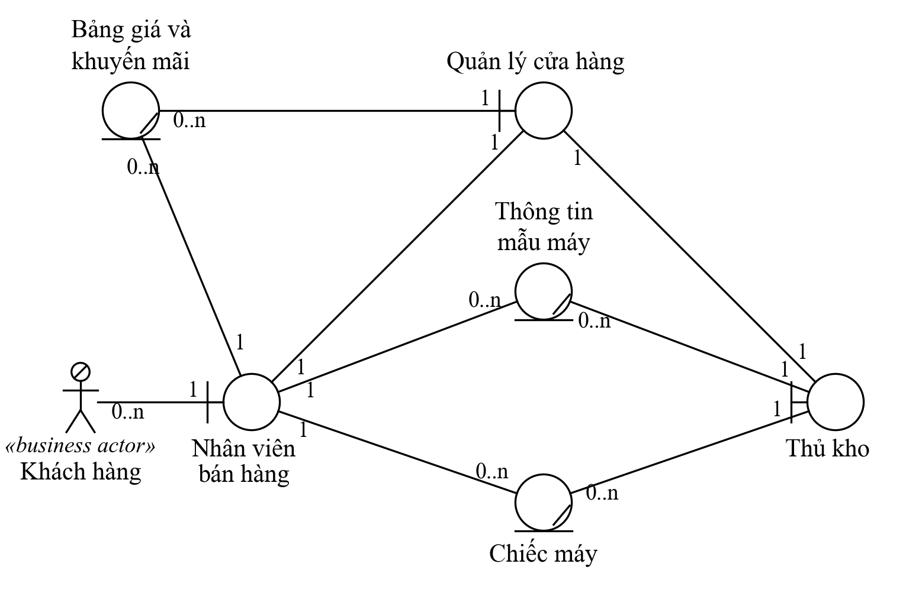
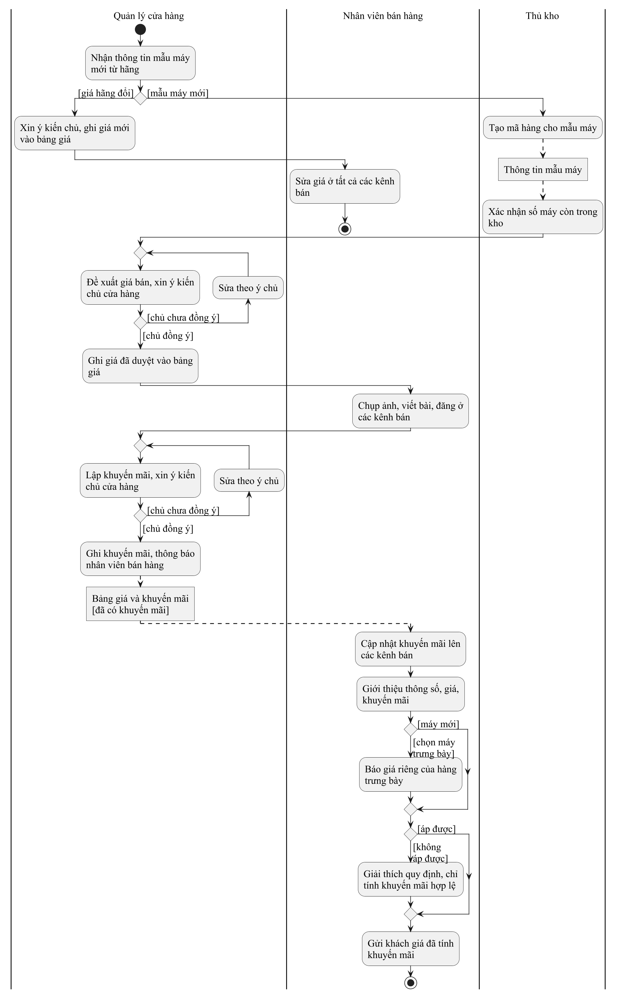
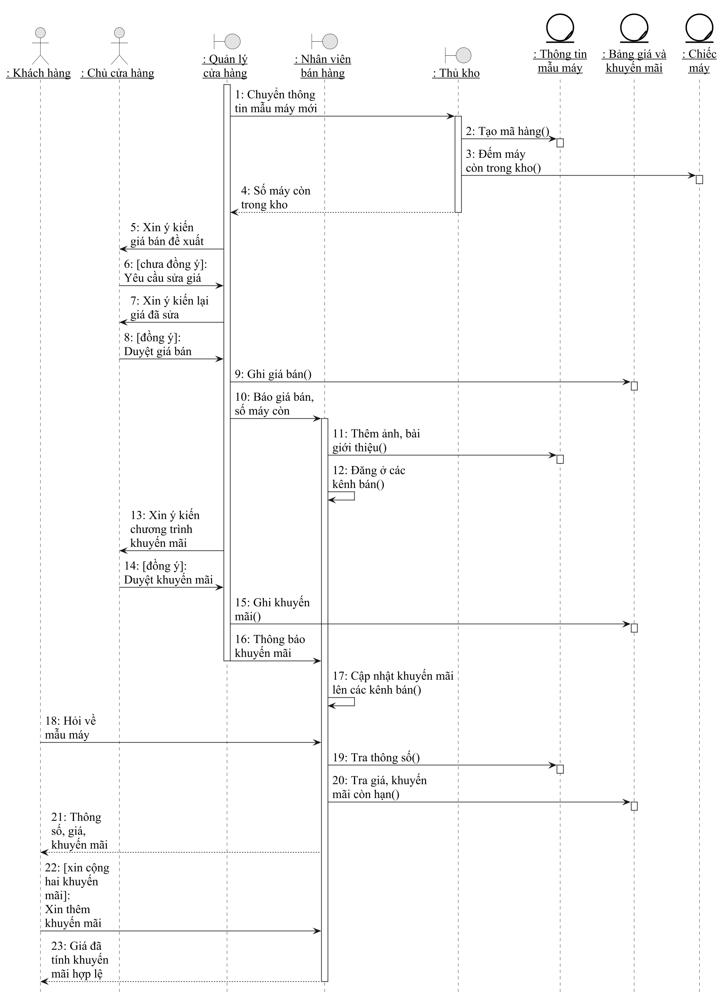

# Đặc tả use case nghiệp vụ · G2 Sản phẩm và khuyến mãi

Bản 0.1 (14/10/2026) · G2 · làm đúng khuôn mục 1 của [`../chung/mau-dac-ta.md`](../chung/mau-dac-ta.md)

Đối tượng phân tích là **cửa hàng giả định** dựng từ tài liệu công khai và phỏng vấn mô phỏng ([`../../khao-sat/tinh-huong-gia-dinh.md`](../../khao-sat/tinh-huong-gia-dinh.md)).
Mã `MP1`, `MP2`, `MP3` + mã câu là lời vai mô phỏng (giả định); `TL-xx` là tài liệu thật. Tên tác nhân, thừa tác viên, thực thể theo [`../chung/tac-nhan-va-thuc-the.md`](../chung/tac-nhan-va-thuc-the.md).

## BUC-01 Giới thiệu sản phẩm và khuyến mãi

**1. Đặc tả bằng văn bản**

> **Use case nghiệp vụ:** Giới thiệu sản phẩm và khuyến mãi (BUC-01, quy trình QT-02 Đưa sản phẩm mới lên bán và chạy khuyến mãi, gói G2)
>
> Use case bắt đầu khi quản lý cửa hàng nhận từ hãng thông tin một mẫu máy mới cửa hàng nhận bán (hoặc giá niêm yết mới của mẫu máy đang bán), và tiếp diễn mỗi khi khách hàng hỏi về sản phẩm.
> Mục tiêu của use case nhằm cho khách hàng biết thông số, giá bán và khuyến mãi còn hạn của từng mẫu máy, giống nhau ở mọi kênh bán, để khách chọn mua.
>
> **Các dòng cơ bản:**
> 1. Quản lý cửa hàng nhận từ hãng thông tin mẫu máy mới: bảng thông số kỹ thuật, ảnh, giá niêm yết.
> 2. Thủ kho tạo mã hàng cho mẫu máy, ghi tên, model, nhóm hàng, hãng vào thông tin mẫu máy.
> 3. Thủ kho kiểm số máy của mẫu đó đang có trong kho, báo cho quản lý cửa hàng.
> 4. Quản lý cửa hàng đề xuất giá bán theo giá niêm yết của hãng và giá của đối thủ, xin ý kiến chủ cửa hàng duyệt giá.
> 5. Quản lý cửa hàng ghi giá đã duyệt vào bảng giá và khuyến mãi, báo nhân viên bán hàng giá bán và số máy còn trong kho.
> 6. Nhân viên bán hàng chụp ảnh, viết bài giới thiệu mẫu máy theo các thông số khách hay hỏi, rồi đăng ở các kênh bán (tại cửa hàng, trang mạng xã hội, gian hàng sàn) với giá đã duyệt và tình trạng còn hàng.
> 7. Quản lý cửa hàng lập chương trình khuyến mãi theo đợt (giảm giá theo mẫu máy hoặc theo hãng, quà tặng, mã giảm giá; mẫu máy áp dụng; ngày bắt đầu, ngày kết thúc), xin ý kiến chủ cửa hàng duyệt.
> 8. Quản lý cửa hàng ghi khuyến mãi đã duyệt vào bảng giá và khuyến mãi, thông báo bằng văn bản cho nhân viên bán hàng.
> 9. Nhân viên bán hàng cập nhật khuyến mãi lên các kênh bán.
> 10. Nhân viên bán hàng tiếp nhận câu hỏi của khách hàng (tại cửa hàng, qua tin nhắn, điện thoại), tra thông tin mẫu máy, bảng giá và khuyến mãi, giới thiệu thông số, giá bán, khuyến mãi còn hạn.
> 11. Nhân viên bán hàng gửi khách hàng giá đã tính khuyến mãi; khách đồng ý mua thì chuyển sang use case Bán hàng (BUC-02).
>
> **Các dòng thay thế:**
> - Tại bước 1. Xử lý giá hãng thay đổi: nếu thông tin nhận từ hãng là giá niêm yết mới của mẫu máy đang bán, quản lý cửa hàng xin ý kiến chủ cửa hàng về giá mới rồi ghi vào bảng giá và khuyến mãi; nhân viên bán hàng sửa giá ở tất cả các kênh bán trong cùng một lần (kết thúc).
> - Tại bước 4 và bước 7. Xử lý đề xuất chưa được duyệt: nếu chủ cửa hàng chưa đồng ý giá bán hoặc chương trình khuyến mãi, quản lý cửa hàng sửa theo ý chủ rồi xin ý kiến lại (lặp lại bước 4 hoặc bước 7).
> - Tại bước 10. Xử lý hàng trưng bày: nếu khách hàng chọn chiếc máy đang trưng bày, nhân viên bán hàng báo giá riêng của hàng trưng bày theo mức chủ cửa hàng đã duyệt, nói rõ đó là máy trưng bày, ghi số serial của chiếc máy và cho khách biết máy vẫn được bảo hành theo hãng (làm tiếp bước 11).
> - Tại bước 11. Xử lý khuyến mãi không áp được: nếu khách nhắc khuyến mãi đã hết hạn, hoặc xin cộng thêm khuyến mãi ngoài một mã giảm giá và một quà tặng, nhân viên bán hàng giải thích quy định và chỉ tính khuyến mãi còn hạn, đúng QĐ4 (làm tiếp bước 11).

| Mục | Nội dung |
|---|---|
| Tác nhân nghiệp vụ | Khách hàng |
| Thừa tác viên | Quản lý cửa hàng, Nhân viên bán hàng, Thủ kho |
| Thực thể nghiệp vụ | Thông tin mẫu máy, Bảng giá và khuyến mãi, Chiếc máy (máy trong kho, máy trưng bày) |
| Ràng buộc trước khi thực hiện | Chủ cửa hàng đã đồng ý nhận bán mẫu máy; hãng đã gửi bảng thông số kỹ thuật, ảnh, giá niêm yết; máy đã về kho (BUC-05) trước khi đăng bán |
| Kết quả | Mẫu máy có mã hàng, bài giới thiệu và giá bán đã duyệt; bảng giá và khuyến mãi có chương trình còn hạn; các kênh bán đăng cùng một giá và một khuyến mãi; khách hàng nhận thông số và giá đã tính khuyến mãi để quyết định mua |
| Quy tắc nghiệp vụ | QĐ1. Chủ cửa hàng duyệt giá bán và chương trình khuyến mãi; quản lý cửa hàng chỉ đề xuất (`MP3 B1`, `B4`). · QĐ2. Mọi kênh bán dùng cùng một bảng giá và khuyến mãi đã duyệt; nhân viên bán hàng không tự đặt giá (`MP2 B1`; `MP3 B6`). · QĐ3. Giá giới thiệu cho khách đã gồm VAT; phí giao và phí lắp đặt ghi riêng (`TL-10`, `TL-11`; `TL-20 Đ12`). · QĐ4. Mỗi đơn tối đa một mã giảm giá và một quà tặng; muốn cộng thêm phải được chủ cửa hàng đồng ý (`MP2 B4`; `MP3 B4`). · QĐ5. Khuyến mãi chạy theo đợt, có ngày bắt đầu và ngày kết thúc; hết hạn thì không áp (`MP2 B3`, `B4`; `MP3 B3`, `B4`; `TL-19`). · QĐ6. Hàng trưng bày bán giá riêng theo mức chủ cửa hàng duyệt, phải nói rõ là hàng trưng bày, vẫn có số serial và được bảo hành theo hãng (`MP3 B5`; `MP2 B5`; `MP1 B5`). · QĐ7. Thông tin mẫu máy ghi đủ các thông số khách hay hỏi: công suất, kích thước, kích thước khoét đá với bếp âm, thời hạn bảo hành; thiết bị thuộc danh mục bắt buộc dán nhãn năng lượng (như nồi cơm điện, quạt) ghi thêm nhãn năng lượng (`MP2 B2`; `MP3 B2`; `MP1 B2`; `TL-31`). |
| Biểu mẫu | Bảng thông số kỹ thuật, catalogue và ảnh của hãng (`MP3 B1`, `B2`; `MP2 B2`); tờ chương trình khuyến mãi của hãng (`MP1 B4`); bảng giá và khuyến mãi, thông báo khuyến mãi bằng văn bản nội bộ (`MP3 B4`); tem giá tại cửa hàng (`MP2 B1`; `MP1 B1`). Chưa có ảnh mẫu thật nên chưa đánh số hình |
| Vấn đề hiện tại | **Vấn đề 1** ở [`../chung/hien-trang-to-chuc.md`](../chung/hien-trang-to-chuc.md) (giá và khuyến mãi không thống nhất): giá sửa tay ở từng kênh nên có kênh còn giá cũ cả ngày, bớt giá cho khách quen tại cửa hàng mà kênh khác vẫn để giá cũ (`MP2 B6`; `MP1 B6`); ai cũng sửa được giá, từng bán dưới giá vốn, mất gần 3 triệu đồng (`MP2 A3`, `A5`); khuyến mãi ghi riêng, nhân viên tự áp, từng cộng nhầm hai mã, lỗ 1,2 triệu đồng một đơn bếp từ (`MP2 B4`); kênh bán còn hiện hàng khi kho đã hết, phải huỷ đơn xin lỗi khách (`MP2 B6`). Thêm một chỗ chậm: thông số chép từ catalogue vào một tệp riêng rồi mỗi kênh đăng lại (`MP2 B2`). Hệ thống mới cải tiến bước 5 (UC-SP-03), bước 2, 6 (UC-SP-02), bước 8, 9 (UC-SP-04) và bước 10 (UC-SP-05) |
| Nguồn | `MP3 B1`, `B2`, `B3`, `B4`, `B5`, `B6`; `MP2 A3`, `A5`, `B1`, `B2`, `B3`, `B4`, `B5`, `B6`; `MP1 B1`, `B2`, `B4`, `B5`, `B6`; `TL-10`, `TL-11`, `TL-19`, `TL-20 Đ12`, `TL-31` |

**2. Sơ đồ đối tượng nghiệp vụ** (Khách hàng chỉ làm việc với nhân viên bán hàng; quản lý cửa hàng giữ bảng giá và khuyến mãi; thủ kho tạo thông tin mẫu máy và đếm chiếc máy; nhân viên bán hàng dùng cả ba thực thể, chiếc máy khi bán hàng trưng bày.
Chủ cửa hàng không vẽ vì chỉ duyệt từ bên ngoài hệ thống nghiệp vụ)

**3. Sơ đồ hoạt động** (ba luồng thừa tác viên, không có luồng chủ cửa hàng; nhánh `[giá hãng đổi]` kết thúc sớm sau khi sửa giá ở mọi kênh;
hai nhánh `[chủ chưa đồng ý]` quay về nút kết hợp trước bước 4 và bước 7; bảng giá đi từ quản lý sang nhân viên bán hàng bằng dòng đối tượng nét đứt;
hai nhánh cuối là dòng thay thế tại bước 10, bước 11)

**4. Sơ đồ tuần tự nghiệp vụ** (Chủ cửa hàng vẽ là tác nhân như ví dụ BUC-07; thông điệp 6, 8 thể hiện dòng thay thế chủ chưa duyệt giá, thông điệp 22 thể hiện dòng thay thế khách xin cộng hai khuyến mãi)

