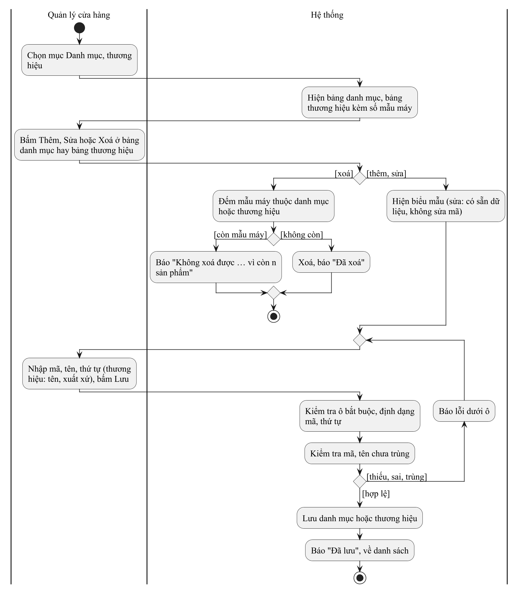
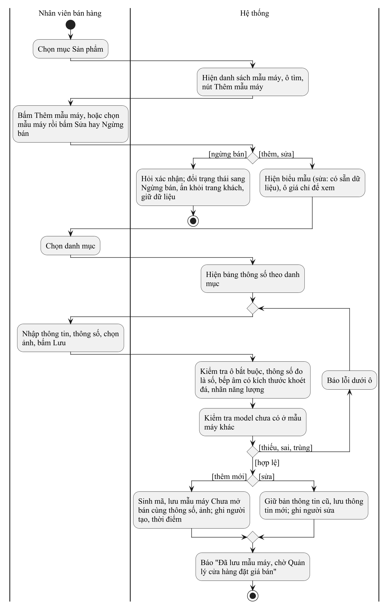
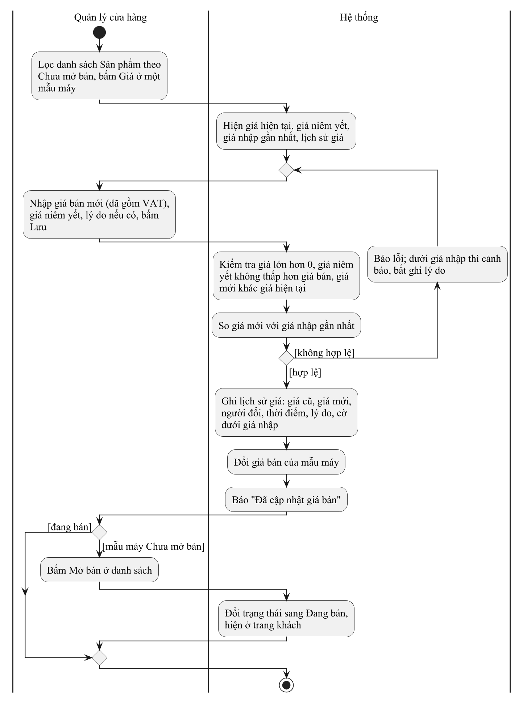
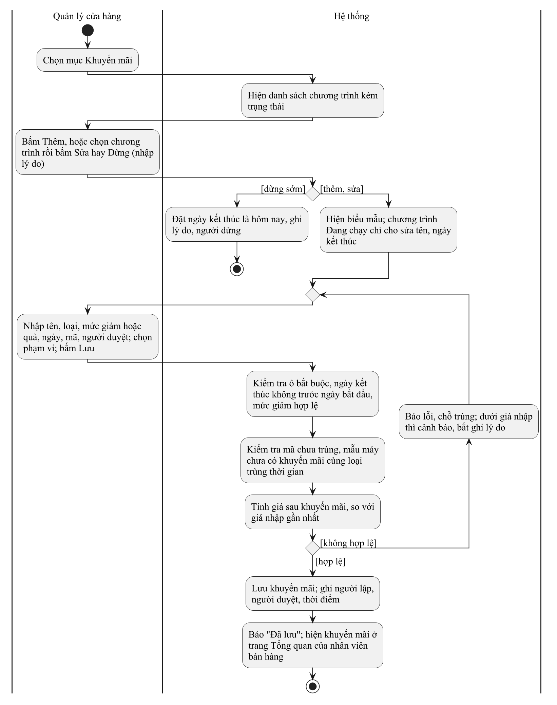
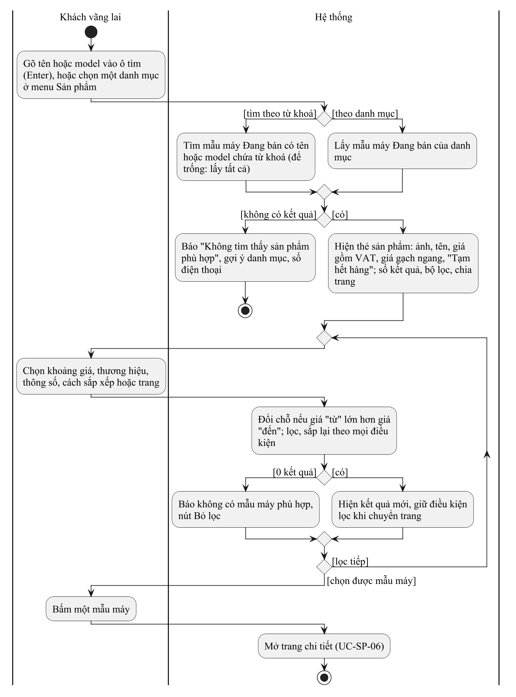
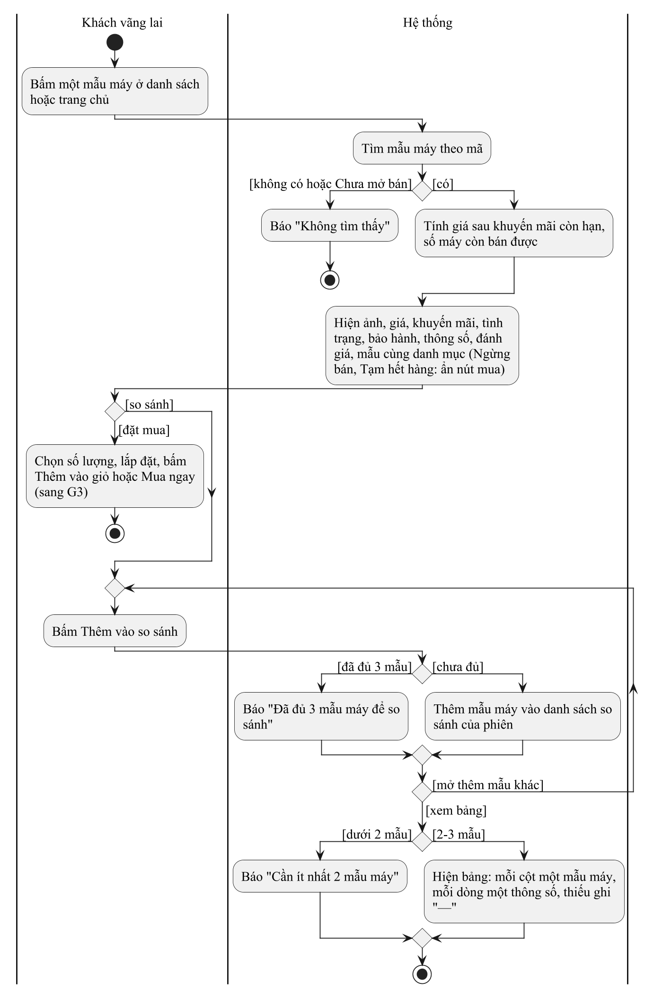
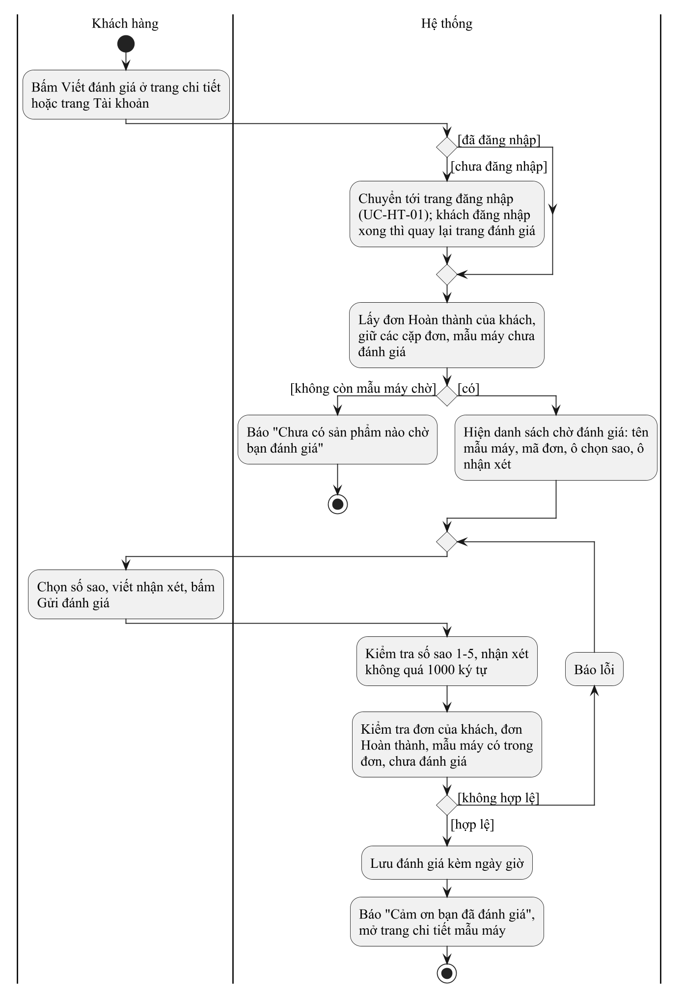

# Đặc tả use case hệ thống · G2 Sản phẩm và khuyến mãi

Bản 0.1 (14/10/2026) · G2 · làm đúng khuôn mục 2 của [`../chung/mau-dac-ta.md`](../chung/mau-dac-ta.md) · mã, tên, tác nhân theo [`../chung/danh-muc-use-case.md`](../chung/danh-muc-use-case.md)

`QĐx` dẫn lại quy tắc nghiệp vụ của BUC-01 ở [`dac-ta-nghiep-vu.md`](dac-ta-nghiep-vu.md); `YC-xx` là yêu cầu ở [`../chung/hien-trang-va-yeu-cau.md`](../chung/hien-trang-va-yeu-cau.md) mục 3, 4.

## Sơ đồ use case phân hệ G2

Bảy use case UC-SP-01 đến UC-SP-07 theo danh mục chung. Khách hàng kế thừa Khách vãng lai nên cũng tìm, xem, so sánh được.
Danh mục chưa ghi quan hệ include, extend nào trong G2 nên sơ đồ không có; chỗ G2 nối sang G3 (UC-SP-04 → UC-MH-08 Áp mã giảm giá) nằm ở phân hệ G3.

## UC-SP-01 Quản lý danh mục, thương hiệu

| Mục | Nội dung |
|---|---|
| Mã, tên | UC-SP-01 Quản lý danh mục, thương hiệu |
| Gói | G2 |
| Tác nhân chính | Quản lý cửa hàng |
| Tác nhân phụ | Không có |
| Mô tả | Quản lý cửa hàng thêm, sửa, xoá danh mục (nhóm hàng) và thương hiệu để mẫu máy được xếp đúng nhóm, đúng hãng và khách lọc được theo hai tiêu chí này |
| Điều kiện trước | Đã đăng nhập với vai Quản lý cửa hàng |
| Điều kiện sau | `DanhMuc` hoặc `ThuongHieu` được tạo, sửa hoặc xoá; danh mục mới hiện ở menu Sản phẩm của trang khách theo thứ tự hiển thị; thương hiệu mới có trong bộ lọc và trong biểu mẫu mẫu máy (UC-SP-02) |
| Màn hình | `giao-dien/quan-tri/danh-muc.html` (hai bảng danh mục, thương hiệu kèm số mẫu máy), `giao-dien/quan-tri/danh-muc-form.html` (biểu mẫu danh mục); biểu mẫu thương hiệu dùng chung khuôn |

**Luồng sự kiện chính**

| Bước | Tác nhân | Hệ thống |
|---|---|---|
| 1 | Chọn mục Danh mục, thương hiệu ở trang quản trị | Hiện bảng danh mục (mã, tên, thứ tự hiển thị, số mẫu máy) và bảng thương hiệu (tên, xuất xứ, số mẫu máy); nút Thêm danh mục, Thêm thương hiệu |
| 2 | Bấm Thêm danh mục | Hiện biểu mẫu: mã danh mục, tên danh mục, thứ tự hiển thị (điền sẵn số kế tiếp) |
| 3 | Nhập mã, tên, thứ tự, bấm Lưu | Kiểm tra ô bắt buộc; mã chỉ gồm chữ thường không dấu, số, gạch ngang; thứ tự là số nguyên không âm |
| 4 | | Kiểm tra mã và tên chưa có ở danh mục khác (tên so không phân biệt hoa thường) |
| 5 | | Lưu danh mục; báo "Đã lưu danh mục …"; về danh sách ở bước 1 |

**Luồng thay thế:**
- `2a.` Sửa danh mục: bấm Sửa ở một dòng; hệ thống hiện biểu mẫu có sẵn dữ liệu, mã không sửa được; làm tiếp bước 3 (bước 4 chỉ kiểm tên).
- `2b.` Thêm hoặc sửa thương hiệu: bấm Thêm thương hiệu hoặc Sửa ở bảng thương hiệu; biểu mẫu gồm tên thương hiệu (bắt buộc, không trùng) và xuất xứ; làm tiếp bước 3 đến 5 với thương hiệu.
- `2c.` Xoá danh mục hoặc thương hiệu: bấm Xoá, xác nhận; hệ thống đếm mẫu máy thuộc danh mục, thương hiệu đó; bằng 0 thì xoá và báo "Đã xoá …".
- `2c1.` Còn mẫu máy: báo "Không xoá được … vì còn n sản phẩm", không xoá (muốn bỏ thì chuyển mẫu máy sang danh mục khác ở UC-SP-02 hoặc để nguyên).
- `3a.` Thiếu ô hoặc sai định dạng: báo dưới ô đó, giữ dữ liệu đã nhập, không lưu.
- `4a.` Mã hoặc tên đã có: báo "Mã danh mục đã tồn tại" hoặc "Tên danh mục đã có", cho nhập lại.

**Ngoại lệ:** mất kết nối khi lưu: báo lỗi, giữ dữ liệu trên biểu mẫu · danh mục vừa bị người khác xoá khi đang sửa: báo "Không tìm thấy danh mục", về danh sách.

**Quy tắc nghiệp vụ:** YC-SP-01 (quản lý danh mục theo nhóm hàng và thương hiệu, `TL-19`); YC-PCN-01 (không xoá dữ liệu mẫu máy đã có: danh mục, thương hiệu còn mẫu máy thì không xoá được);
QĐ7 (danh mục quyết định bộ thông số gợi ý ở UC-SP-02, ví dụ bếp âm phải có kích thước khoét đá).

**Ghi chú hiện thực:** website làm đúng các bước trên (`QuanTriDanhMucBUS`); danh mục là danh sách phẳng, chưa có nhóm cha, nhóm con; xoá là xoá hẳn bản ghi (chỉ khi không còn mẫu máy), không có trạng thái ẩn danh mục.

## UC-SP-02 Quản lý sản phẩm và thông số kỹ thuật

| Mục | Nội dung |
|---|---|
| Mã, tên | UC-SP-02 Quản lý sản phẩm và thông số kỹ thuật |
| Gói | G2 |
| Tác nhân chính | Nhân viên bán hàng |
| Tác nhân phụ | Không có |
| Mô tả | Nhân viên bán hàng thêm, sửa, ngừng bán mẫu máy cùng thông số kỹ thuật, ảnh, thời hạn bảo hành, nhãn năng lượng, để thông tin chỉ nhập một lần và dùng chung cho mọi kênh |
| Điều kiện trước | Đã đăng nhập với vai Nhân viên bán hàng; danh mục và thương hiệu của mẫu máy đã có (UC-SP-01) |
| Điều kiện sau | Mẫu máy (`SanPham`) và thông số kỹ thuật (`ThongSoKyThuat`) được tạo hoặc sửa; mẫu máy mới ở trạng thái **Chưa mở bán** cho tới khi Quản lý cửa hàng đặt giá ở UC-SP-03 (trạng thái đề xuất thêm vào `SanPham.trangThai`); hệ thống ghi người sửa, thời điểm và giữ bản thông tin cũ |
| Màn hình | Chưa có, thiết kế ở tuần 14 (menu quản trị đã chừa mục "Sản phẩm") |

**Luồng sự kiện chính**

| Bước | Tác nhân | Hệ thống |
|---|---|---|
| 1 | Chọn mục Sản phẩm ở trang quản trị | Hiện danh sách mẫu máy: mã, ảnh, tên, model, danh mục, thương hiệu, giá bán, trạng thái; ô tìm theo tên hoặc model; nút Thêm mẫu máy |
| 2 | Bấm Thêm mẫu máy | Hiện biểu mẫu: tên, model, danh mục, thương hiệu, thời hạn bảo hành (tháng), cần lắp đặt (có, không), nhãn năng lượng, mô tả, ảnh; ô giá bán chỉ để xem |
| 3 | Chọn danh mục | Hiện bảng thông số theo danh mục, ví dụ bếp từ: công suất, điện áp, kích thước khoét đá; máy hút mùi: lưu lượng hút; máy rửa chén: số bộ chén |
| 4 | Nhập thông tin và thông số, chọn ảnh, bấm Lưu | Kiểm tra ô bắt buộc (tên, model, danh mục, thương hiệu, thời hạn bảo hành, ít nhất một ảnh) và kiểu số của các thông số đo được |
| 5 | | Kiểm tra model chưa có ở mẫu máy khác cùng thương hiệu |
| 6 | | Sinh mã mẫu máy; lưu mẫu máy ở trạng thái Chưa mở bán cùng thông số và ảnh; ghi người tạo, thời điểm |
| 7 | | Báo "Đã lưu mẫu máy, chờ Quản lý cửa hàng đặt giá bán"; mẫu máy hiện trong danh sách "Chờ đặt giá" của Quản lý cửa hàng |

**Luồng thay thế:**
- `2a.` Sửa mẫu máy: chọn một mẫu máy trong danh sách, bấm Sửa; hệ thống hiện biểu mẫu có sẵn dữ liệu, ô giá bán chỉ để xem; làm tiếp bước 4. Khi lưu, hệ thống giữ bản thông tin cũ kèm thời điểm thay; đơn đã đặt vẫn giữ tên và giá lúc đặt.
- `2b.` Ngừng bán: chọn mẫu máy, bấm Ngừng bán, xác nhận; hệ thống đổi trạng thái sang Ngừng bán, ẩn khỏi trang khách nhưng không xoá dữ liệu.
- `4a.` Thiếu ô bắt buộc hoặc thông số sai kiểu: báo ngay dưới ô đó, không lưu.
- `4b.` Mẫu máy thuộc danh mục bếp âm mà để trống kích thước khoét đá: báo "Cần nhập kích thước khoét đá", không lưu.
- `4c.` Mẫu máy thuộc danh mục bắt buộc dán nhãn năng lượng (như nồi cơm điện, quạt) mà để trống nhãn năng lượng: báo nhắc nhập, không lưu.
- `5a.` Model đã có: báo "Model này đã có", mở mẫu máy đã có để sửa thay vì tạo trùng.

**Ngoại lệ:** ảnh sai định dạng hoặc quá dung lượng cho phép: báo, bỏ ảnh đó, giữ phần còn lại của biểu mẫu · mất kết nối khi lưu: báo lỗi, giữ dữ liệu trên biểu mẫu để lưu lại · hai người cùng sửa một mẫu máy: người lưu sau được báo dữ liệu đã đổi và phải tải lại.

**Quy tắc nghiệp vụ:** QĐ7 (thông số khách hay hỏi, nhãn năng lượng); YC-SP-02 (nhập một lần thay cho tệp thông số riêng); YC-SP-08 (thông tin mẫu máy đã đăng giữ ít nhất 1 năm, đổi thông tin không làm đổi đơn cũ);
YC-SP-09 (Nhân viên bán hàng không sửa được giá, giá đặt ở UC-SP-03); YC-HT-05 (lưu vết người sửa); YC-PCN-01 (không xoá cứng mẫu máy đã có trên đơn).

**Ghi chú hiện thực:** website (`QuanTriSanPhamBUS.luu()`) chỉ ghi ngày tạo, chưa giữ bản thông tin cũ và người sửa (luồng `2a`); chưa có ô nhãn năng lượng (luồng `4c`);
ảnh nhập bằng đường dẫn, không tải tệp và chưa bắt buộc có ảnh; model kiểm trùng trên mọi thương hiệu; bảng thông số là các dòng tên, giá trị nhập tự do kèm gợi ý theo danh mục;
nút Ngừng bán (luồng `2b`) chỉ vai Quản lý cửa hàng bấm được; chưa phát hiện hai người cùng sửa.

## UC-SP-03 Cập nhật giá bán

| Mục | Nội dung |
|---|---|
| Mã, tên | UC-SP-03 Cập nhật giá bán |
| Gói | G2 |
| Tác nhân chính | Quản lý cửa hàng |
| Tác nhân phụ | Không có |
| Mô tả | Quản lý cửa hàng ghi giá bán đã được chủ cửa hàng duyệt cho mẫu máy (lần đầu hoặc khi giá hãng đổi), để mọi kênh dùng cùng một giá và mỗi lần đổi giá đều có lưu vết |
| Điều kiện trước | Đã đăng nhập với vai Quản lý cửa hàng; mẫu máy đã có (UC-SP-02); chủ cửa hàng đã đồng ý giá (ngoài hệ thống, QĐ1) |
| Điều kiện sau | `SanPham.giaBan` (và giá niêm yết để gạch ngang, nếu có) được đổi; một dòng `LichSuGia` ghi giá cũ, giá mới, người đổi, thời điểm, lý do, cờ dưới giá nhập; mẫu máy Chưa mở bán đủ điều kiện mở bán; đơn đã đặt giữ nguyên giá lúc đặt |
| Màn hình | Chưa có trong `giao-dien/`; nút Giá ở mỗi dòng trang Sản phẩm của quản trị mở trang giá của mẫu máy |

**Luồng sự kiện chính**

| Bước | Tác nhân | Hệ thống |
|---|---|---|
| 1 | Ở danh sách Sản phẩm (lọc trạng thái Chưa mở bán để thấy mẫu máy chờ đặt giá), bấm Giá ở một mẫu máy | Hiện trang giá: tên, model, giá bán hiện tại, giá niêm yết, giá nhập gần nhất (từ phiếu nhập kho); ô giá bán mới, giá niêm yết, lý do; bảng lịch sử giá |
| 2 | Nhập giá bán mới (đã gồm VAT), giá niêm yết nếu có, bấm Lưu | Kiểm tra giá bán mới là số tiền lớn hơn 0; giá niêm yết để trống hoặc không thấp hơn giá bán |
| 3 | | Kiểm tra giá mới khác giá hiện tại |
| 4 | | So giá mới với giá nhập gần nhất của mẫu máy |
| 5 | | Ghi lịch sử giá (giá cũ, giá mới, người đổi, thời điểm, lý do); đổi giá bán của mẫu máy |
| 6 | | Báo "Đã cập nhật giá bán"; trang khách hiện giá mới ngay ở mọi trang |

**Luồng thay thế:**
- `1a.` Người đăng nhập không phải Quản lý cửa hàng (ví dụ Nhân viên bán hàng): trang giá chỉ để xem, bấm Lưu thì hệ thống báo "Chỉ Quản lý cửa hàng được sửa giá", không lưu.
- `2a.` Giá không phải số, nhỏ hơn hoặc bằng 0, giá niêm yết thấp hơn giá bán: báo dưới ô, giữ dữ liệu đã nhập, không lưu.
- `3a.` Giá mới trùng giá hiện tại: báo "Không có gì để cập nhật", không ghi lịch sử.
- `4a.` Giá mới thấp hơn giá nhập gần nhất mà chưa ghi lý do: cảnh báo kèm hai con số, bắt ghi lý do; quản lý ghi lý do rồi bấm Lưu lại, hệ thống làm tiếp bước 5 và đánh dấu dòng lịch sử "dưới giá nhập" để chủ cửa hàng xem lại.
- `4b.` Mẫu máy chưa có phiếu nhập nào: bỏ qua so sánh, làm tiếp bước 5.
- `6a.` Mẫu máy đang Chưa mở bán: sau khi có giá, quản lý bấm Mở bán ở danh sách; hệ thống đổi trạng thái sang Đang bán, mẫu máy hiện ở trang khách (UC-SP-05). Bấm Mở bán khi chưa có giá thì báo "Chưa có giá bán", không đổi.

**Ngoại lệ:** mất kết nối khi lưu: báo lỗi, giữ dữ liệu trên biểu mẫu · mẫu máy không còn (đường dẫn sai): báo "Không tìm thấy mẫu máy", về danh sách.

**Quy tắc nghiệp vụ:** QĐ1, QĐ2 (chủ duyệt giá, mọi kênh dùng chung một giá, nhân viên bán hàng không tự đặt); QĐ3, YC-SP-05 (giá nhập vào đã gồm VAT; phí giao, lắp ghi riêng ở đơn);
YC-SP-09 (chỉ Quản lý cửa hàng sửa giá; dưới giá nhập gần nhất thì cảnh báo, bắt ghi lý do, lưu vết); YC-HT-05 (lưu vết ai sửa giá, lúc nào); YC-SP-08 (đổi giá không đổi giá trên đơn cũ, vì đơn lưu đơn giá lúc đặt).
Giá nhập gần nhất lấy từ đâu do G2 và G5 chốt (việc còn lại 2 ở `hien-trang-va-yeu-cau.md` mục 7); website tạm lấy đơn giá nhập ở `ChiTietPhieuNhap` của phiếu nhập mới nhất.

**Ghi chú hiện thực:** website (`QuanTriSanPhamBUS.capNhatGia()`, trang `quan-tri/g2/gia.html`) làm đúng các bước trên; chưa có danh sách riêng "Chờ đặt giá", quản lý dùng bộ lọc trạng thái Chưa mở bán;
mở bán (`6a`) là nút riêng ở danh sách, không tự mở bán khi đặt giá lần đầu; chưa có ô ghi người duyệt giá (chủ cửa hàng).

## UC-SP-04 Quản lý khuyến mãi, mã giảm giá

| Mục | Nội dung |
|---|---|
| Mã, tên | UC-SP-04 Quản lý khuyến mãi, mã giảm giá |
| Gói | G2 |
| Tác nhân chính | Quản lý cửa hàng |
| Tác nhân phụ | Không có |
| Mô tả | Quản lý cửa hàng nhập chương trình khuyến mãi theo mẫu máy, theo hãng, quà tặng hoặc mã giảm giá có hạn dùng mà chủ cửa hàng đã duyệt, để mọi kênh hiện cùng một khuyến mãi và khách áp được mã khi đặt hàng (UC-MH-08) |
| Điều kiện trước | Đã đăng nhập với vai Quản lý cửa hàng; chủ cửa hàng đã đồng ý chương trình (ngoài hệ thống, QĐ1) |
| Điều kiện sau | `KhuyenMai` được tạo hoặc sửa với loại, mức giảm hoặc quà, ngày bắt đầu, ngày kết thúc, phạm vi áp dụng, mã (nếu có), người duyệt; trong thời gian hiệu lực, giá sau khuyến mãi hiện ở trang danh sách và trang chi tiết sản phẩm |
| Màn hình | Chưa có, thiết kế ở tuần 14 (menu quản trị đã chừa mục "Khuyến mãi") |

**Luồng sự kiện chính**

| Bước | Tác nhân | Hệ thống |
|---|---|---|
| 1 | Chọn mục Khuyến mãi ở trang quản trị | Hiện danh sách chương trình: tên, loại, mức giảm hoặc quà, ngày bắt đầu, ngày kết thúc, trạng thái (Sắp chạy, Đang chạy, Đã kết thúc); nút Thêm |
| 2 | Bấm Thêm | Hiện biểu mẫu: tên chương trình; loại (giảm giá theo mẫu máy, giảm theo hãng, quà tặng, mã giảm giá); mức giảm (số tiền hoặc phần trăm) hoặc tên quà; ngày bắt đầu, ngày kết thúc; phạm vi (mẫu máy hoặc thương hiệu); mã giảm giá (với loại mã); người duyệt, ngày duyệt |
| 3 | Nhập thông tin, chọn mẫu máy hoặc thương hiệu áp dụng, bấm Lưu | Kiểm tra ô bắt buộc; ngày kết thúc không trước ngày bắt đầu; mức giảm lớn hơn 0, phần trăm không quá 100 |
| 4 | | Với loại mã giảm giá: kiểm tra mã chưa trùng với mã khác |
| 5 | | Kiểm tra mỗi mẫu máy trong phạm vi chưa có khuyến mãi cùng loại trùng thời gian |
| 6 | | Tính giá sau khuyến mãi của từng mẫu máy, so với giá nhập gần nhất |
| 7 | | Lưu khuyến mãi, ghi người lập, người duyệt, thời điểm; báo "Đã lưu"; khuyến mãi hiện ở trang Tổng quan của nhân viên bán hàng (thay cho thông báo bằng văn bản ở bước 8 của BUC-01) |

**Luồng thay thế:**
- `2a.` Sửa khuyến mãi Sắp chạy: sửa được mọi ô, làm tiếp bước 3. Khuyến mãi Đang chạy chỉ sửa được tên và ngày kết thúc; đơn đã áp giữ nguyên mức giảm lúc đặt.
- `2b.` Dừng sớm: chọn khuyến mãi Đang chạy, bấm Dừng, nhập lý do; hệ thống đặt ngày kết thúc là hôm nay, ghi lý do và người dừng. Khuyến mãi đã áp vào đơn không xoá được, chỉ dừng.
- `3a.` Thiếu ô hoặc ngày sai: báo dưới ô, không lưu.
- `4a.` Mã đã có: báo "Mã giảm giá đã tồn tại", cho nhập mã khác.
- `5a.` Mẫu máy đã có khuyến mãi cùng loại trùng thời gian: báo tên mẫu máy và chương trình đang trùng; quản lý bỏ mẫu máy đó khỏi phạm vi hoặc đổi ngày rồi lưu lại.
- `6a.` Giá sau khuyến mãi thấp hơn giá nhập gần nhất: cảnh báo, bắt nhập lý do mới cho lưu; lý do ghi vào lưu vết để chủ cửa hàng xem lại.

**Ngoại lệ:** mất kết nối khi lưu: báo lỗi, giữ dữ liệu trên biểu mẫu · hai người cùng sửa một khuyến mãi: người lưu sau được báo dữ liệu đã đổi và phải tải lại.

**Quy tắc nghiệp vụ:** QĐ1 (chủ cửa hàng duyệt, hệ thống chỉ ghi người duyệt); QĐ4 (mỗi đơn tối đa một mã giảm giá và một quà tặng; UC-MH-08 của G3 kiểm khi khách áp mã, YC-MH-07);
QĐ5 (ngoài thời gian hiệu lực thì không hiện, không áp; tới ngày kết thúc hệ thống tự chuyển Đã kết thúc); YC-SP-06 (ghi người duyệt); YC-SP-09, YC-HT-05 (cảnh báo dưới giá nhập, lưu vết; bước 6 là G2 mở rộng YC-SP-09 sang khuyến mãi).
Giá nhập gần nhất lấy từ đâu do G2 và G5 chốt (việc còn lại 2 ở `hien-trang-va-yeu-cau.md` mục 7).

**Ghi chú hiện thực:** website (`QuanTriKhuyenMaiBUS`) có hai loại: giảm theo sản phẩm và mã giảm giá, quà tặng là ô kèm theo chương trình, chưa có loại giảm theo hãng;
chỉ ghi người tạo, chưa có ô người duyệt, ngày duyệt; dừng sớm (`2b`) làm bằng Tạm dừng, Chạy lại, không ghi lý do dừng; lý do khi giá sau giảm dưới giá nhập (`6a`) được ghi nối vào tên chương trình;
kiểm trùng thời gian (`5a`) chỉ áp cho loại giảm theo sản phẩm; ngày bắt đầu không được trước hôm nay.

## UC-SP-05 Tìm kiếm, lọc sản phẩm

| Mục | Nội dung |
|---|---|
| Mã, tên | UC-SP-05 Tìm kiếm, lọc sản phẩm |
| Gói | G2 |
| Tác nhân chính | Khách vãng lai (Khách hàng kế thừa nên cũng dùng được) |
| Tác nhân phụ | Không có |
| Mô tả | Khách tìm mẫu máy theo tên hoặc model, lọc theo khoảng giá, thương hiệu, thông số để nhanh chóng ra những mẫu máy phù hợp |
| Điều kiện trước | Không cần đăng nhập; có mẫu máy ở trạng thái Đang bán |
| Điều kiện sau | Không thay đổi dữ liệu; khách thấy danh sách mẫu máy đúng điều kiện đã chọn |
| Màn hình | `giao-dien/khach/danh-sach.html` (kết quả, bộ lọc thương hiệu, sắp xếp; ô tìm ở đầu mọi trang khách dẫn về trang này), `giao-dien/khach/san-pham.html` (chọn danh mục). Bộ lọc khoảng giá và thông số chưa có trên màn hình, bổ sung ở tuần 14 |

**Luồng sự kiện chính**

| Bước | Tác nhân | Hệ thống |
|---|---|---|
| 1 | Gõ tên hoặc model vào ô tìm ở đầu trang, nhấn Enter | |
| 2 | | Tìm mẫu máy Đang bán có tên hoặc model chứa từ khoá, không phân biệt chữ hoa, chữ thường |
| 3 | | Hiện danh sách kết quả: ảnh, tên, giá bán đã gồm VAT, giá trước khuyến mãi gạch ngang nếu có khuyến mãi còn hạn, nhãn "Tạm hết hàng" nếu không còn chiếc máy nào Trong kho; số kết quả |
| 4 | | Hiện bộ lọc theo kết quả: khoảng giá, thương hiệu, thông số của danh mục (ví dụ bếp từ: công suất, kích thước khoét đá); ô sắp xếp |
| 5 | Chọn khoảng giá, đánh dấu thương hiệu, chọn thông số | Lọc lại theo mọi điều kiện đã chọn cùng lúc, cập nhật số kết quả |
| 6 | Chọn cách sắp xếp (mới nhất, giá thấp đến cao, giá cao đến thấp, tên A đến Z) | Sắp lại danh sách |
| 7 | Bấm một mẫu máy | Mở trang chi tiết mẫu máy (UC-SP-06) |

**Luồng thay thế:**
- `1a.` Khách chọn một danh mục ở menu Sản phẩm hoặc ở trang danh mục: hệ thống lấy mọi mẫu máy Đang bán của danh mục đó, làm tiếp bước 3.
- `2a.` Từ khoá để trống: hệ thống lấy mọi mẫu máy Đang bán, làm tiếp bước 3.
- `2b.` Không có kết quả: báo "Không tìm thấy sản phẩm phù hợp", gợi ý xem theo danh mục và hiện số điện thoại cửa hàng để khách hỏi.
- `3a.` Kết quả nhiều hơn một trang: chia trang, giữ nguyên điều kiện lọc khi chuyển trang.
- `5a.` Bộ lọc ra 0 kết quả: báo không có mẫu máy phù hợp, có nút "Bỏ lọc" để về kết quả ở bước 3.
- `5b.` Giá "từ" lớn hơn giá "đến": hệ thống đổi chỗ hai giá rồi lọc.

**Ngoại lệ:** lỗi khi tải dữ liệu: báo "Chưa tải được danh sách, vui lòng thử lại", giữ từ khoá đã gõ.

**Quy tắc nghiệp vụ:** YC-SP-03 (tìm theo tên hoặc model, lọc theo khoảng giá, hãng, thông số; `TL-19`: 4/4 website điện máy lọc theo hãng và thông số; `MK K9`: 6/10 vai khách mô phỏng gõ tên, 5/10 lọc giá, 4/10 lọc hãng);
chỉ hiện mẫu máy Đang bán (Chưa mở bán, Ngừng bán không hiện); QĐ3, YC-SP-05 (giá đã gồm VAT); QĐ5 (chỉ hiện khuyến mãi còn hạn);
tình trạng còn hàng tính từ số chiếc máy ở trạng thái Trong kho (`SanPhamSerial`, G5), sửa chỗ kênh bán còn hiện hàng khi kho đã hết (vấn đề 1); YC-PCN-05 (trang danh sách mở xong trong khoảng 3 giây trên điện thoại 4G).

**Ghi chú hiện thực:** website (`SanPhamKhachBUS.timKiem()`) lọc theo từ khoá, danh mục, thương hiệu, khoảng giá, sắp xếp bốn cách, 12 mẫu mỗi trang; chưa lọc theo thông số của danh mục (bước 4, 5);
còn hàng tính bằng số chiếc Trong kho trừ số chiếc đang giữ cho đơn chờ, đơn đã xác nhận chưa xuất kho; chỉ mẫu máy Đang bán **đã có giá** mới hiện.

## UC-SP-06 Xem chi tiết, so sánh sản phẩm

| Mục | Nội dung |
|---|---|
| Mã, tên | UC-SP-06 Xem chi tiết, so sánh sản phẩm |
| Gói | G2 |
| Tác nhân chính | Khách vãng lai (Khách hàng kế thừa nên cũng dùng được) |
| Tác nhân phụ | Không có |
| Mô tả | Khách xem đầy đủ thông tin một mẫu máy (ảnh, giá, khuyến mãi, tình trạng còn hàng, thông số, bảo hành, đánh giá) và đặt 2–3 mẫu máy cạnh nhau để so thông số trước khi mua |
| Điều kiện trước | Không cần đăng nhập; mẫu máy đã mở bán (Đang bán hoặc đã Ngừng bán) |
| Điều kiện sau | Không thay đổi dữ liệu cửa hàng; danh sách mẫu máy đang so sánh (tối đa 3) được giữ trong phiên của khách |
| Màn hình | `giao-dien/khach/chi-tiet.html` (chi tiết); trang so sánh chưa có trong `giao-dien/`, thiết kế theo bảng ba cột mẫu máy, mỗi dòng một thông số |

**Luồng sự kiện chính**

| Bước | Tác nhân | Hệ thống |
|---|---|---|
| 1 | Bấm một mẫu máy ở trang danh sách, trang chủ hoặc kết quả tìm (UC-SP-05) | |
| 2 | | Tìm mẫu máy theo mã; tính giá sau khuyến mãi còn hạn và số máy còn bán được |
| 3 | | Hiện trang chi tiết: ảnh (chọn được ảnh nhỏ), hãng, tên, model, giá đã gồm VAT, giá trước khuyến mãi gạch ngang, tên khuyến mãi, quà tặng và hạn; tình trạng Còn hàng (số chiếc) hoặc Tạm hết hàng; thời hạn bảo hành, cần lắp đặt hay không; nút Thêm vào giỏ, Mua ngay, Thêm vào so sánh |
| 4 | | Hiện ba thẻ: mô tả, bảng thông số kỹ thuật, đánh giá của khách đã mua (điểm trung bình, từng đánh giá); dưới cùng là mẫu máy cùng danh mục |
| 5 | Bấm Thêm vào so sánh | Thêm mẫu máy vào danh sách so sánh của phiên (bỏ qua nếu đã có), mở trang so sánh |
| 6 | Mở thêm mẫu máy khác, bấm Thêm vào so sánh (lặp bước 1 đến 5, tối đa 3 mẫu) | |
| 7 | | Hiện bảng so sánh: mỗi cột một mẫu máy (ảnh, tên, giá), mỗi dòng một thông số lấy hợp các thông số của các mẫu; mẫu nào không có thông số đó thì ghi "—" |
| 8 | Bấm Bỏ ở một cột, hoặc bấm tên mẫu máy | Bỏ mẫu máy khỏi danh sách so sánh và hiện lại bảng; hoặc mở trang chi tiết mẫu máy đó |

**Luồng thay thế:**
- `2a.` Mã không có hoặc mẫu máy Chưa mở bán: báo trang "Không tìm thấy sản phẩm", có liên kết về danh sách.
- `3a.` Mẫu máy Ngừng bán: vẫn hiện thông tin, tình trạng ghi "Ngừng bán", không có nút Thêm vào giỏ.
- `3b.` Tạm hết hàng: ẩn nút Thêm vào giỏ, hiện số điện thoại cửa hàng để khách hỏi ngày có hàng.
- `3c.` Khách đặt hàng: chọn số lượng (không quá số còn bán được), chọn lắp đặt nếu mẫu máy cần lắp, bấm Thêm vào giỏ hoặc Mua ngay; chuyển sang UC-MH của G3.
- `4a.` Chưa có đánh giá: ghi "Chưa có đánh giá cho mẫu máy này". Khách hàng đã nhận hàng mẫu máy này mà chưa đánh giá thì thấy nút Viết đánh giá (UC-SP-07).
- `5a.` Đã đủ 3 mẫu: báo "Đã đủ 3 mẫu máy để so sánh. Bỏ bớt một mẫu rồi thêm lại", giữ nguyên bảng.
- `7a.` Mới có 0 hoặc 1 mẫu: báo "Cần ít nhất 2 mẫu máy" kèm hướng dẫn mở thêm sản phẩm.

**Ngoại lệ:** lỗi khi tải dữ liệu: báo "Chưa tải được thông tin, vui lòng thử lại" · phiên hết hạn: danh sách so sánh trống, khách thêm lại.

**Quy tắc nghiệp vụ:** YC-SP-04 (so sánh 2–3 mẫu máy theo thông số, `TL-19`, `MK K17`); QĐ7 (trang chi tiết ghi đủ thông số khách hay hỏi, thời hạn bảo hành); QĐ3, YC-SP-05 (giá đã gồm VAT, phí giao, lắp ghi riêng);
QĐ5 (chỉ hiện khuyến mãi còn hạn); tình trạng còn hàng tính theo chiếc máy Trong kho như UC-SP-05; YC-SP-07 (chỉ khách đã nhận hàng thấy nút đánh giá).

**Ghi chú hiện thực:** website (`SanPhamKhachController.chiTiet()`, `soSanh()`; `SanPhamKhachBUS.chiTiet()`, `soSanh()`; danh sách so sánh ở `PhienKhach`) làm đúng các bước trên;
chưa có nhãn năng lượng trên trang chi tiết (thuộc tính chưa có, xem UC-SP-02); chưa có phần hỏi đáp dưới trang sản phẩm (YC-SP-07).

## UC-SP-07 Đánh giá sản phẩm

| Mục | Nội dung |
|---|---|
| Mã, tên | UC-SP-07 Đánh giá sản phẩm |
| Gói | G2 |
| Tác nhân chính | Khách hàng |
| Tác nhân phụ | Không có |
| Mô tả | Khách hàng đã nhận hàng chấm sao và viết nhận xét cho mẫu máy đã mua, để khách sau có thêm thông tin chọn mua và cửa hàng biết chất lượng sản phẩm |
| Điều kiện trước | Đã đăng nhập với vai Khách hàng; có đơn hàng của chính khách ở trạng thái **Hoàn thành** (UC-DH-03, UC-DH-05 của G4) chứa mẫu máy đó |
| Điều kiện sau | Một `DanhGia` (số sao, nội dung, ngày, gắn với khách, đơn, mẫu máy) được tạo; đánh giá hiện ở thẻ Đánh giá của trang chi tiết, điểm trung bình được tính lại |
| Màn hình | Chưa có trong `giao-dien/`; trang "Đánh giá sản phẩm" liệt kê các mẫu máy chờ đánh giá, mỗi mẫu một khung chọn sao và ô nhận xét; mở từ nút Viết đánh giá ở trang chi tiết hoặc từ trang Tài khoản |

**Luồng sự kiện chính**

| Bước | Tác nhân | Hệ thống |
|---|---|---|
| 1 | Bấm Viết đánh giá ở trang chi tiết mẫu máy (hoặc mục Chờ đánh giá ở trang Tài khoản) | |
| 2 | | Lấy các đơn Hoàn thành của khách; với mỗi mẫu máy trong đơn, giữ lại những cặp đơn, mẫu máy chưa có đánh giá |
| 3 | | Hiện danh sách chờ đánh giá (lọc theo mẫu máy nếu mở từ trang chi tiết): tên mẫu máy lúc mua, mã đơn, ngày hoàn thành; chọn số sao 1–5, ô nhận xét (tối đa 1000 ký tự) |
| 4 | Chọn số sao, viết nhận xét (không bắt buộc), bấm Gửi đánh giá | Kiểm tra số sao từ 1 đến 5, nhận xét không quá 1000 ký tự |
| 5 | | Kiểm tra đơn thuộc tài khoản của khách, đơn ở trạng thái Hoàn thành, mẫu máy có trong đơn |
| 6 | | Kiểm tra cặp đơn, mẫu máy chưa được đánh giá |
| 7 | | Lưu đánh giá kèm ngày giờ; báo "Cảm ơn bạn đã đánh giá"; mở trang chi tiết mẫu máy, đánh giá mới hiện đầu danh sách |

**Luồng thay thế:**
- `1a.` Chưa đăng nhập: hệ thống chuyển tới trang đăng nhập (UC-HT-01), đăng nhập xong quay lại.
- `3a.` Không còn mẫu máy nào chờ đánh giá: báo "Chưa có sản phẩm nào chờ bạn đánh giá. Sản phẩm hiện ở đây sau khi đơn hàng hoàn thành."
- `4a.` Chưa chọn sao hoặc nhận xét quá dài: báo lỗi, giữ trang đánh giá, không lưu.
- `5a.` Đơn không thuộc khách, đơn chưa Hoàn thành, hoặc mẫu máy không có trong đơn: báo lý do (ví dụ "Chỉ đánh giá được sau khi đơn đã hoàn thành"), không lưu.
- `6a.` Đã đánh giá mẫu máy này cho đơn này rồi: báo "Bạn đã đánh giá sản phẩm này cho đơn … rồi", không lưu. Mua cùng mẫu máy ở đơn khác thì được đánh giá thêm một lần cho đơn đó.

**Ngoại lệ:** mất kết nối khi gửi: báo lỗi, khách gửi lại · hai lần bấm Gửi gần như cùng lúc: CSDL chặn bản trùng (khoá duy nhất đơn, mẫu máy), lần sau được báo đã đánh giá.

**Quy tắc nghiệp vụ:** YC-SP-07 (chỉ khách đã nhận hàng mới được đánh giá; `MP2 B7`, `TL-19`, `MK K8`); mỗi đơn, mỗi mẫu máy một đánh giá; nối với G4 qua trạng thái đơn Hoàn thành (`danh-muc-use-case.md` mục 3);
đánh giá chỉ gắn với mẫu máy, không đổi giá, không đổi đơn.

**Ghi chú hiện thực:** website (`TaiKhoanKhachController.danhGia()`, `guiDanhGia()`; `TaiKhoanKhachBUS.canDanhGia()`, `danhGia()`) làm đúng các bước trên;
lỗi ở bước 4–6 quay về trang danh sách chờ đánh giá thay vì giữ khung đang nhập; chưa có chức năng cho cửa hàng ẩn đánh giá sai sự thật và chưa có phần hỏi đáp (YC-SP-07).

