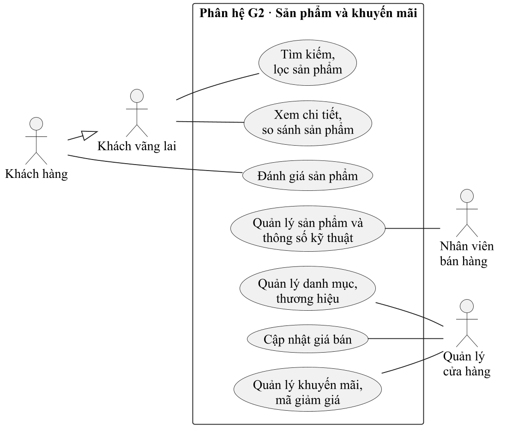

# Đặc tả use case hệ thống · G2 Sản phẩm và khuyến mãi

Bản 0.1 (14/10/2026) · G2 · làm đúng khuôn mục 2 của [`../chung/mau-dac-ta.md`](../chung/mau-dac-ta.md) · mã, tên, tác nhân theo [`../chung/danh-muc-use-case.md`](../chung/danh-muc-use-case.md)

`QĐx` dẫn lại quy tắc nghiệp vụ của BUC-01 ở [`dac-ta-nghiep-vu.md`](dac-ta-nghiep-vu.md); `YC-xx` là yêu cầu ở [`../chung/hien-trang-va-yeu-cau.md`](../chung/hien-trang-va-yeu-cau.md) mục 3, 4.

## Sơ đồ use case phân hệ G2

Bảy use case UC-SP-01 đến UC-SP-07 theo danh mục chung. Khách hàng kế thừa Khách vãng lai nên cũng tìm, xem, so sánh được.
Danh mục chưa ghi quan hệ include, extend nào trong G2 nên sơ đồ không có; chỗ G2 nối sang G3 (UC-SP-04 → UC-MH-08 Áp mã giảm giá) nằm ở phân hệ G3.

## UC-SP-02 Quản lý sản phẩm và thông số kỹ thuật

| Mục | Nội dung |
|---|---|
| Mã, tên | UC-SP-02 Quản lý sản phẩm và thông số kỹ thuật |
| Gói | G2 |
| Tác nhân chính | Nhân viên bán hàng |
| Tác nhân phụ | Không có |
| Mô tả | Nhân viên bán hàng thêm, sửa, ngừng bán mẫu máy cùng thông số kỹ thuật, ảnh, thời hạn bảo hành, nhãn năng lượng, để thông tin chỉ nhập một lần và dùng chung cho mọi kênh |
| Điều kiện trước | Đã đăng nhập với vai Nhân viên bán hàng; danh mục và thương hiệu của mẫu máy đã có (UC-SP-01) |
| Điều kiện sau | Mẫu máy (`SanPham`) và thông số kỹ thuật (`ThongSoKyThuat`) được tạo hoặc sửa; mẫu máy mới ở trạng thái **Chưa mở bán** cho tới khi Quản lý cửa hàng đặt giá ở UC-SP-03 (trạng thái đề xuất thêm vào `SanPham.trangThai`); hệ thống ghi người sửa, thời điểm và giữ bản thông tin cũ |
| Màn hình | Chưa có, thiết kế ở tuần 14 (menu quản trị đã chừa mục "Sản phẩm") |

**Luồng sự kiện chính**

| Bước | Tác nhân | Hệ thống |
|---|---|---|
| 1 | Chọn mục Sản phẩm ở trang quản trị | Hiện danh sách mẫu máy: mã, ảnh, tên, model, danh mục, thương hiệu, giá bán, trạng thái; ô tìm theo tên hoặc model; nút Thêm mẫu máy |
| 2 | Bấm Thêm mẫu máy | Hiện biểu mẫu: tên, model, danh mục, thương hiệu, thời hạn bảo hành (tháng), cần lắp đặt (có, không), nhãn năng lượng, mô tả, ảnh; ô giá bán chỉ để xem |
| 3 | Chọn danh mục | Hiện bảng thông số theo danh mục, ví dụ bếp từ: công suất, điện áp, kích thước khoét đá; máy hút mùi: lưu lượng hút; máy rửa chén: số bộ chén |
| 4 | Nhập thông tin và thông số, chọn ảnh, bấm Lưu | Kiểm tra ô bắt buộc (tên, model, danh mục, thương hiệu, thời hạn bảo hành, ít nhất một ảnh) và kiểu số của các thông số đo được |
| 5 | | Kiểm tra model chưa có ở mẫu máy khác cùng thương hiệu |
| 6 | | Sinh mã mẫu máy; lưu mẫu máy ở trạng thái Chưa mở bán cùng thông số và ảnh; ghi người tạo, thời điểm |
| 7 | | Báo "Đã lưu mẫu máy, chờ Quản lý cửa hàng đặt giá bán"; mẫu máy hiện trong danh sách "Chờ đặt giá" của Quản lý cửa hàng |

**Luồng thay thế:**
- `2a.` Sửa mẫu máy: chọn một mẫu máy trong danh sách, bấm Sửa; hệ thống hiện biểu mẫu có sẵn dữ liệu, ô giá bán chỉ để xem; làm tiếp bước 4. Khi lưu, hệ thống giữ bản thông tin cũ kèm thời điểm thay; đơn đã đặt vẫn giữ tên và giá lúc đặt.
- `2b.` Ngừng bán: chọn mẫu máy, bấm Ngừng bán, xác nhận; hệ thống đổi trạng thái sang Ngừng bán, ẩn khỏi trang khách nhưng không xoá dữ liệu.
- `4a.` Thiếu ô bắt buộc hoặc thông số sai kiểu: báo ngay dưới ô đó, không lưu.
- `4b.` Mẫu máy thuộc danh mục bếp âm mà để trống kích thước khoét đá: báo "Cần nhập kích thước khoét đá", không lưu.
- `4c.` Mẫu máy thuộc danh mục bắt buộc dán nhãn năng lượng (như nồi cơm điện, quạt) mà để trống nhãn năng lượng: báo nhắc nhập, không lưu.
- `5a.` Model đã có: báo "Model này đã có", mở mẫu máy đã có để sửa thay vì tạo trùng.

**Ngoại lệ:** ảnh sai định dạng hoặc quá dung lượng cho phép: báo, bỏ ảnh đó, giữ phần còn lại của biểu mẫu · mất kết nối khi lưu: báo lỗi, giữ dữ liệu trên biểu mẫu để lưu lại · hai người cùng sửa một mẫu máy: người lưu sau được báo dữ liệu đã đổi và phải tải lại.

**Quy tắc nghiệp vụ:** QĐ7 (thông số khách hay hỏi, nhãn năng lượng); YC-SP-02 (nhập một lần thay cho tệp thông số riêng); YC-SP-08 (thông tin mẫu máy đã đăng giữ ít nhất 1 năm, đổi thông tin không làm đổi đơn cũ);
YC-SP-09 (Nhân viên bán hàng không sửa được giá, giá đặt ở UC-SP-03); YC-HT-05 (lưu vết người sửa); YC-PCN-01 (không xoá cứng mẫu máy đã có trên đơn).

## UC-SP-04 Quản lý khuyến mãi, mã giảm giá

| Mục | Nội dung |
|---|---|
| Mã, tên | UC-SP-04 Quản lý khuyến mãi, mã giảm giá |
| Gói | G2 |
| Tác nhân chính | Quản lý cửa hàng |
| Tác nhân phụ | Không có |
| Mô tả | Quản lý cửa hàng nhập chương trình khuyến mãi theo mẫu máy, theo hãng, quà tặng hoặc mã giảm giá có hạn dùng mà chủ cửa hàng đã duyệt, để mọi kênh hiện cùng một khuyến mãi và khách áp được mã khi đặt hàng (UC-MH-08) |
| Điều kiện trước | Đã đăng nhập với vai Quản lý cửa hàng; chủ cửa hàng đã đồng ý chương trình (ngoài hệ thống, QĐ1) |
| Điều kiện sau | `KhuyenMai` được tạo hoặc sửa với loại, mức giảm hoặc quà, ngày bắt đầu, ngày kết thúc, phạm vi áp dụng, mã (nếu có), người duyệt; trong thời gian hiệu lực, giá sau khuyến mãi hiện ở trang danh sách và trang chi tiết sản phẩm |
| Màn hình | Chưa có, thiết kế ở tuần 14 (menu quản trị đã chừa mục "Khuyến mãi") |

**Luồng sự kiện chính**

| Bước | Tác nhân | Hệ thống |
|---|---|---|
| 1 | Chọn mục Khuyến mãi ở trang quản trị | Hiện danh sách chương trình: tên, loại, mức giảm hoặc quà, ngày bắt đầu, ngày kết thúc, trạng thái (Sắp chạy, Đang chạy, Đã kết thúc); nút Thêm |
| 2 | Bấm Thêm | Hiện biểu mẫu: tên chương trình; loại (giảm giá theo mẫu máy, giảm theo hãng, quà tặng, mã giảm giá); mức giảm (số tiền hoặc phần trăm) hoặc tên quà; ngày bắt đầu, ngày kết thúc; phạm vi (mẫu máy hoặc thương hiệu); mã giảm giá (với loại mã); người duyệt, ngày duyệt |
| 3 | Nhập thông tin, chọn mẫu máy hoặc thương hiệu áp dụng, bấm Lưu | Kiểm tra ô bắt buộc; ngày kết thúc không trước ngày bắt đầu; mức giảm lớn hơn 0, phần trăm không quá 100 |
| 4 | | Với loại mã giảm giá: kiểm tra mã chưa trùng với mã khác |
| 5 | | Kiểm tra mỗi mẫu máy trong phạm vi chưa có khuyến mãi cùng loại trùng thời gian |
| 6 | | Tính giá sau khuyến mãi của từng mẫu máy, so với giá nhập gần nhất |
| 7 | | Lưu khuyến mãi, ghi người lập, người duyệt, thời điểm; báo "Đã lưu"; khuyến mãi hiện ở trang Tổng quan của nhân viên bán hàng (thay cho thông báo bằng văn bản ở bước 8 của BUC-01) |

**Luồng thay thế:**
- `2a.` Sửa khuyến mãi Sắp chạy: sửa được mọi ô, làm tiếp bước 3. Khuyến mãi Đang chạy chỉ sửa được tên và ngày kết thúc; đơn đã áp giữ nguyên mức giảm lúc đặt.
- `2b.` Dừng sớm: chọn khuyến mãi Đang chạy, bấm Dừng, nhập lý do; hệ thống đặt ngày kết thúc là hôm nay, ghi lý do và người dừng. Khuyến mãi đã áp vào đơn không xoá được, chỉ dừng.
- `3a.` Thiếu ô hoặc ngày sai: báo dưới ô, không lưu.
- `4a.` Mã đã có: báo "Mã giảm giá đã tồn tại", cho nhập mã khác.
- `5a.` Mẫu máy đã có khuyến mãi cùng loại trùng thời gian: báo tên mẫu máy và chương trình đang trùng; quản lý bỏ mẫu máy đó khỏi phạm vi hoặc đổi ngày rồi lưu lại.
- `6a.` Giá sau khuyến mãi thấp hơn giá nhập gần nhất: cảnh báo, bắt nhập lý do mới cho lưu; lý do ghi vào lưu vết để chủ cửa hàng xem lại.

**Ngoại lệ:** mất kết nối khi lưu: báo lỗi, giữ dữ liệu trên biểu mẫu · hai người cùng sửa một khuyến mãi: người lưu sau được báo dữ liệu đã đổi và phải tải lại.

**Quy tắc nghiệp vụ:** QĐ1 (chủ cửa hàng duyệt, hệ thống chỉ ghi người duyệt); QĐ4 (mỗi đơn tối đa một mã giảm giá và một quà tặng; UC-MH-08 của G3 kiểm khi khách áp mã, YC-MH-07);
QĐ5 (ngoài thời gian hiệu lực thì không hiện, không áp; tới ngày kết thúc hệ thống tự chuyển Đã kết thúc); YC-SP-06 (ghi người duyệt); YC-SP-09, YC-HT-05 (cảnh báo dưới giá nhập, lưu vết; bước 6 là G2 mở rộng YC-SP-09 sang khuyến mãi).
Giá nhập gần nhất lấy từ đâu do G2 và G5 chốt (việc còn lại 2 ở `hien-trang-va-yeu-cau.md` mục 7).

## UC-SP-05 Tìm kiếm, lọc sản phẩm

| Mục | Nội dung |
|---|---|
| Mã, tên | UC-SP-05 Tìm kiếm, lọc sản phẩm |
| Gói | G2 |
| Tác nhân chính | Khách vãng lai (Khách hàng kế thừa nên cũng dùng được) |
| Tác nhân phụ | Không có |
| Mô tả | Khách tìm mẫu máy theo tên hoặc model, lọc theo khoảng giá, thương hiệu, thông số để nhanh chóng ra những mẫu máy phù hợp |
| Điều kiện trước | Không cần đăng nhập; có mẫu máy ở trạng thái Đang bán |
| Điều kiện sau | Không thay đổi dữ liệu; khách thấy danh sách mẫu máy đúng điều kiện đã chọn |
| Màn hình | `giao-dien/khach/danh-sach.html` (kết quả, bộ lọc thương hiệu, sắp xếp; ô tìm ở đầu mọi trang khách dẫn về trang này), `giao-dien/khach/san-pham.html` (chọn danh mục). Bộ lọc khoảng giá và thông số chưa có trên màn hình, bổ sung ở tuần 14 |

**Luồng sự kiện chính**

| Bước | Tác nhân | Hệ thống |
|---|---|---|
| 1 | Gõ tên hoặc model vào ô tìm ở đầu trang, nhấn Enter | |
| 2 | | Tìm mẫu máy Đang bán có tên hoặc model chứa từ khoá, không phân biệt chữ hoa, chữ thường |
| 3 | | Hiện danh sách kết quả: ảnh, tên, giá bán đã gồm VAT, giá trước khuyến mãi gạch ngang nếu có khuyến mãi còn hạn, nhãn "Tạm hết hàng" nếu không còn chiếc máy nào Trong kho; số kết quả |
| 4 | | Hiện bộ lọc theo kết quả: khoảng giá, thương hiệu, thông số của danh mục (ví dụ bếp từ: công suất, kích thước khoét đá); ô sắp xếp |
| 5 | Chọn khoảng giá, đánh dấu thương hiệu, chọn thông số | Lọc lại theo mọi điều kiện đã chọn cùng lúc, cập nhật số kết quả |
| 6 | Chọn cách sắp xếp (mới nhất, giá thấp đến cao, giá cao đến thấp, tên A đến Z) | Sắp lại danh sách |
| 7 | Bấm một mẫu máy | Mở trang chi tiết mẫu máy (UC-SP-06) |

**Luồng thay thế:**
- `1a.` Khách chọn một danh mục ở menu Sản phẩm hoặc ở trang danh mục: hệ thống lấy mọi mẫu máy Đang bán của danh mục đó, làm tiếp bước 3.
- `2a.` Từ khoá để trống: hệ thống lấy mọi mẫu máy Đang bán, làm tiếp bước 3.
- `2b.` Không có kết quả: báo "Không tìm thấy sản phẩm phù hợp", gợi ý xem theo danh mục và hiện số điện thoại cửa hàng để khách hỏi.
- `3a.` Kết quả nhiều hơn một trang: chia trang, giữ nguyên điều kiện lọc khi chuyển trang.
- `5a.` Bộ lọc ra 0 kết quả: báo không có mẫu máy phù hợp, có nút "Bỏ lọc" để về kết quả ở bước 3.
- `5b.` Giá "từ" lớn hơn giá "đến": hệ thống đổi chỗ hai giá rồi lọc.

**Ngoại lệ:** lỗi khi tải dữ liệu: báo "Chưa tải được danh sách, vui lòng thử lại", giữ từ khoá đã gõ.

**Quy tắc nghiệp vụ:** YC-SP-03 (tìm theo tên hoặc model, lọc theo khoảng giá, hãng, thông số; `TL-19`: 4/4 website điện máy lọc theo hãng và thông số; `MK K9`: 6/10 vai khách mô phỏng gõ tên, 5/10 lọc giá, 4/10 lọc hãng);
chỉ hiện mẫu máy Đang bán (Chưa mở bán, Ngừng bán không hiện); QĐ3, YC-SP-05 (giá đã gồm VAT); QĐ5 (chỉ hiện khuyến mãi còn hạn);
tình trạng còn hàng tính từ số chiếc máy ở trạng thái Trong kho (`SanPhamSerial`, G5), sửa chỗ kênh bán còn hiện hàng khi kho đã hết (vấn đề 1); YC-PCN-05 (trang danh sách mở xong trong khoảng 3 giây trên điện thoại 4G).
