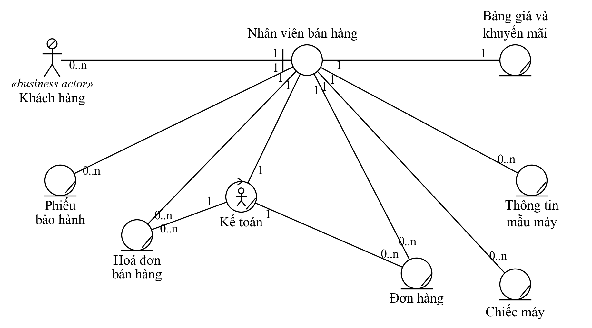
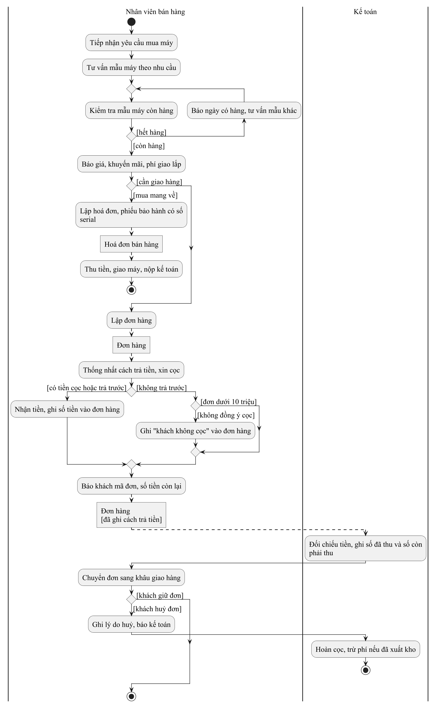
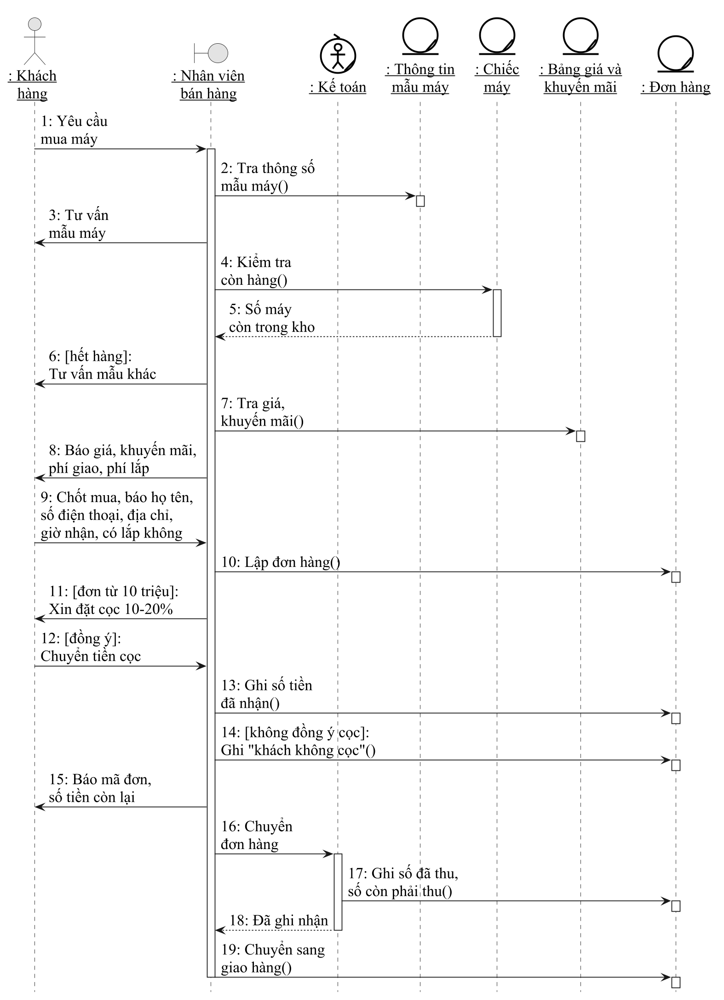

# Đặc tả use case nghiệp vụ · G3 Mua hàng trực tuyến và thanh toán

Bản 0.1 (14/10/2026) · G3 · việc t92 · theo khuôn mục 1 của [`../chung/mau-dac-ta.md`](../chung/mau-dac-ta.md)

> Đối tượng phân tích là **cửa hàng giả định** ([`../../khao-sat/tinh-huong-gia-dinh.md`](../../khao-sat/tinh-huong-gia-dinh.md)).
> Mã `MP1`, `MP2`, `MP3` + mã câu là phỏng vấn mô phỏng (giả định); `TL-xx` là tài liệu công khai thật. Mức cụ thể mà nguồn không có thì ghi "theo mức chủ cửa hàng quy định".
> Tên tác nhân, thừa tác viên, thực thể theo [`../chung/tac-nhan-va-thuc-the.md`](../chung/tac-nhan-va-thuc-the.md).

## BUC-02 Bán hàng

**1. Đặc tả bằng văn bản**

> **Use case nghiệp vụ:** Bán hàng (BUC-02, quy trình QT-03 Đặt hàng và thanh toán, gói G3)
>
> Use case bắt đầu khi khách hàng đến cửa hàng, gọi điện hoặc nhắn tin hỏi mua một mẫu máy. Mục tiêu của use case nhằm giúp khách chọn đúng mẫu máy
> với giá và khuyến mãi đúng quy định, chốt đơn hàng có đủ thông tin nhận hàng, lắp đặt, cách trả tiền và tiền cọc, rồi chuyển đơn sang khâu giao hàng;
> khách mua mang về thì nhận máy, hoá đơn bán hàng và phiếu bảo hành ngay tại cửa hàng.
>
> **Các dòng cơ bản:**
> 1. Nhân viên bán hàng tiếp nhận yêu cầu mua máy của khách hàng tại cửa hàng, qua điện thoại hoặc tin nhắn.
> 2. Nhân viên bán hàng hỏi nhu cầu và chỗ đặt máy (kích thước khoét đá, công suất, số bộ chén, có cần lắp đặt không), tư vấn mẫu máy phù hợp theo thông tin mẫu máy.
> 3. Nhân viên bán hàng kiểm tra mẫu máy khách chọn còn hàng trong kho.
> 4. Nhân viên bán hàng báo giá bán và khuyến mãi đang áp dụng theo bảng giá và khuyến mãi, kèm phí giao và phí lắp đặt theo địa chỉ nhận và giá trị đơn.
> 5. Nhân viên bán hàng lập đơn hàng khi khách chốt mua: họ tên, số điện thoại, địa chỉ nhận, mẫu máy, số lượng, giá, khuyến mãi, giờ nhận, có lắp đặt hay không.
> 6. Nhân viên bán hàng thống nhất với khách cách trả tiền (tiền mặt khi nhận hàng, chuyển khoản, quẹt thẻ tại cửa hàng, trả góp qua công ty tài chính) và xin đặt cọc 10–20% giá trị đơn nếu đơn từ 10 triệu đồng.
> 7. Nhân viên bán hàng nhận tiền cọc hoặc tiền khách trả trước (tiền mặt tại cửa hàng hoặc chuyển khoản), ghi số tiền vào đơn hàng.
> 8. Nhân viên bán hàng báo khách mã đơn và số tiền còn phải trả khi nhận hàng, rồi chuyển đơn hàng cho kế toán.
> 9. Kế toán đối chiếu tiền đã nhận với đơn hàng, ghi số tiền đã thu và số tiền còn phải thu khi giao.
> 10. Nhân viên bán hàng chuyển đơn hàng sang khâu giao hàng (Thực hiện use case Giao hàng).
>
> **Các dòng thay thế:**
> - Tại bước 3. Xử lý mẫu máy hết hàng: nếu mẫu máy khách chọn đã hết, nhân viên bán hàng báo ngày dự kiến có hàng và tư vấn mẫu máy tương đương; khách chọn mẫu khác thì quay lại bước 3.
> - Tại bước 5. Xử lý khách mua mang về: nếu khách mua tại cửa hàng và nhận máy ngay, nhân viên bán hàng lập hoá đơn bán hàng và phiếu bảo hành ghi số serial của chiếc máy, thu tiền, giao máy kèm giấy tờ cho khách rồi nộp tiền cho kế toán; kết thúc.
> - Tại bước 7. Xử lý đơn không trả trước: nếu đơn dưới 10 triệu đồng và khách chọn trả tiền khi nhận hàng, nhân viên bán hàng không nhận tiền, chuyển sang bước 8.
> - Tại bước 7. Xử lý khách không đồng ý cọc: nếu đơn từ 10 triệu đồng mà khách không đồng ý đặt cọc, nhân viên bán hàng ghi "khách không cọc" vào đơn hàng để khâu giao hàng gọi xác nhận kỹ trước khi giao, rồi chuyển sang bước 8.
> - Tại bước 10. Xử lý khách huỷ đơn: nếu khách báo huỷ khi máy chưa giao tới, nhân viên bán hàng ghi lý do huỷ vào đơn hàng và báo kế toán; kế toán hoàn đủ tiền cọc nếu máy chưa xuất kho, hoặc hoàn sau khi trừ phí theo mức chủ cửa hàng quy định nếu máy đã xuất kho; kết thúc.

| Mục | Nội dung |
|---|---|
| Tác nhân nghiệp vụ | Khách hàng |
| Thừa tác viên | Nhân viên bán hàng (giao tiếp với môi trường), Kế toán (làm việc bên trong) |
| Thực thể nghiệp vụ | Thông tin mẫu máy, Bảng giá và khuyến mãi, Chiếc máy, Đơn hàng, Hoá đơn bán hàng, Phiếu bảo hành |
| Ràng buộc trước khi thực hiện | Bảng giá và khuyến mãi đang áp dụng đã được chủ cửa hàng duyệt; thông tin mẫu máy và số máy còn trong kho đã được cập nhật |
| Kết quả | Đơn giao tận nơi: đơn hàng ghi đủ thông tin nhận hàng, lắp đặt, cách trả tiền, số tiền đã thu và còn phải thu, đã chuyển sang khâu giao hàng. Khách mua mang về: khách nhận máy kèm hoá đơn bán hàng và phiếu bảo hành có số serial, tiền bán đã nộp kế toán |
| Quy tắc nghiệp vụ | QĐ1. Giá bán và khuyến mãi do chủ cửa hàng duyệt; nhân viên bán hàng báo theo bảng giá và khuyến mãi, không tự đặt giá (`MP3 B1`, `B4`; `MP2 B1`). QĐ2. Mỗi đơn hàng được tối đa một khuyến mãi giảm giá và một quà tặng, không cộng hai mã giảm giá (`MP2 B4`). QĐ3. Giá báo cho khách đã gồm VAT; phí giao và phí lắp đặt ghi riêng (`TL-10`, `TL-11`, `TL-13`; `TL-20 Đ12`). QĐ4. Đơn nội thành do cửa hàng tự giao kèm lắp; đơn đi tỉnh gửi đơn vị vận chuyển và cửa hàng không lắp (`MP2 D3`). QĐ5. Lắp đặt nội thành miễn phí với đơn từ 5 triệu đồng; đơn dưới 5 triệu thu 200–300 nghìn đồng (`MP2 D2`). QĐ6. Khách trả bằng tiền mặt khi nhận hàng, chuyển khoản hoặc quẹt thẻ tại cửa hàng; trả góp do công ty tài chính làm, cửa hàng không tự cho trả góp (`MP2 C3`; `TL-05`, `TL-13`). QĐ7. Đơn từ 10 triệu đồng xin đặt cọc 10–20% giá trị đơn và ghi số tiền cọc vào đơn hàng (`MP2 C3`, `C6`). QĐ8. Khách huỷ trước khi xuất kho được hoàn đủ tiền cọc; huỷ sau khi xuất kho thì trừ phí theo mức chủ cửa hàng quy định (`MP2 C4`). QĐ9. Tiền hoàn lại trả theo đúng cách khách đã trả (`TL-22 Đ38`; `YC-DH-08`). QĐ10. Máy giao cho khách phải kèm phiếu bảo hành ghi đúng số serial trên máy (`TL-16`; `MP1 E4`). QĐ11. Hoá đơn bán hàng lập lúc giao máy cho khách, kể cả khi chưa thu tiền: khách mua mang về thì lập ngay tại cửa hàng, đơn giao tận nơi thì lập ở khâu giao hàng (`TL-26`; `MP1 C2`) |
| Biểu mẫu | Đơn hàng (tên khách, số điện thoại, địa chỉ, sản phẩm, giá, thu tiền khi giao hay chuyển khoản, có lắp đặt không, giờ hẹn, ghi chú; `MP2 C2`); Hoá đơn bán lẻ (số, ngày, tên khách, địa chỉ, tên hàng, số lượng, đơn giá, thành tiền; `MP1 D1`); Phiếu bảo hành (tên khách, tên hàng, số serial, ngày mua, thời hạn bảo hành, dấu cửa hàng; `MP1 E4`). Chưa có ảnh chụp, các ô lấy từ mô tả mẫu trắng trong mô phỏng |
| Vấn đề hiện tại | Vấn đề 1 ở `hien-trang-to-chuc.md`: giá và khuyến mãi sửa tay ở từng kênh nên lệch nhau, có lần cộng nhầm hai mã giảm giá cho một đơn, có lần kênh khác còn hiện hàng khi kho đã hết nên phải huỷ đơn (bước 3, 4; `MP2 B4`, `B6`). Vấn đề 2: đơn chốt qua tin nhắn, phần lớn trả tiền khi nhận, chỉ đơn từ 10 triệu mới xin cọc nên khách đặt rồi không nhận, mỗi đơn tỉnh mất 300–500 nghìn đồng phí giao hai chiều (bước 6, 7; `MP2 C4`, `C6`). Vấn đề 4: serial chỉ ghi với máy giá cao, khách mất phiếu bảo hành thì phải lục hoá đơn (dòng thay thế bước 5; `MP2 E2`, `E4`). Ngoài năm vấn đề: khách hỏi đơn tới đâu ngày nào cũng có, nhân viên phải tra rồi hỏi người giao, lúc đông đơn khách chờ lâu (`MP2 C7`). Hệ thống mới cải tiến bước 1–8 cho kênh website bằng UC-MH-04 Đặt hàng, UC-MH-05 Thanh toán trực tuyến (cọc trực tuyến) và UC-MH-06 Theo dõi đơn hàng |
| Nguồn | `MP2 B1`, `B4`, `B6`, `C1`, `C2`, `C3`, `C4`, `C6`, `C7`, `D2`, `D3`, `E2`, `E4`; `MP3 B1`, `B4`, `C2`, `C3`, `C4`; `MP1 C2`, `C3`, `C4`, `D1`, `E4`; `TL-02`, `TL-05`, `TL-10`, `TL-11`, `TL-13`, `TL-16`, `TL-17`, `TL-18`, `TL-20`, `TL-22`, `TL-26` |

Các bước khớp với cửa hàng giả định: tư vấn hỏi kích thước khoét đá rồi báo giá, xin tên, số điện thoại, địa chỉ, giờ nhận, có lắp đặt không (`MP2 C2`; `MP3 C2`);
xin cọc máy từ 10 triệu (`MP2 C3`); tiệm nhỏ ghi đơn vào sổ, lúc giao mới xuất hoá đơn (`MP1 C2`). Ngành có cùng các cách trả tiền (`TL-05`, `TL-13`),
một nơi bắt đặt trước 20–30% với đơn trả tiền khi nhận (`TL-17`), các chuỗi lớn gọi xác nhận đơn qua điện thoại (`TL-02`) và cho đặt không cần tài khoản (`TL-18`).

**2. Sơ đồ đối tượng nghiệp vụ** (khách hàng chỉ làm việc với nhân viên bán hàng, thừa tác viên giao tiếp với môi trường; kế toán làm việc bên trong, chỉ xử lý đơn hàng và hoá đơn bán hàng để ghi nhận tiền)

**3. Sơ đồ hoạt động** (hai luồng Nhân viên bán hàng và Kế toán; nhánh `[mua mang về]` kết thúc sớm; nhánh `[hết hàng]` quay về nút kết hợp đặt trước bước 3;
đơn hàng đi từ nhân viên bán hàng sang kế toán bằng dòng đối tượng nét đứt, nút đối tượng thứ hai ghi trạng thái `[đã ghi cách trả tiền]`)

**4. Sơ đồ tuần tự nghiệp vụ** (vẽ dòng cơ bản; hai dòng thay thế quan trọng nhất là hết hàng (thông điệp 6) và đặt cọc (thông điệp 11, 12, 14) ghi bằng thông điệp có điều kiện)

