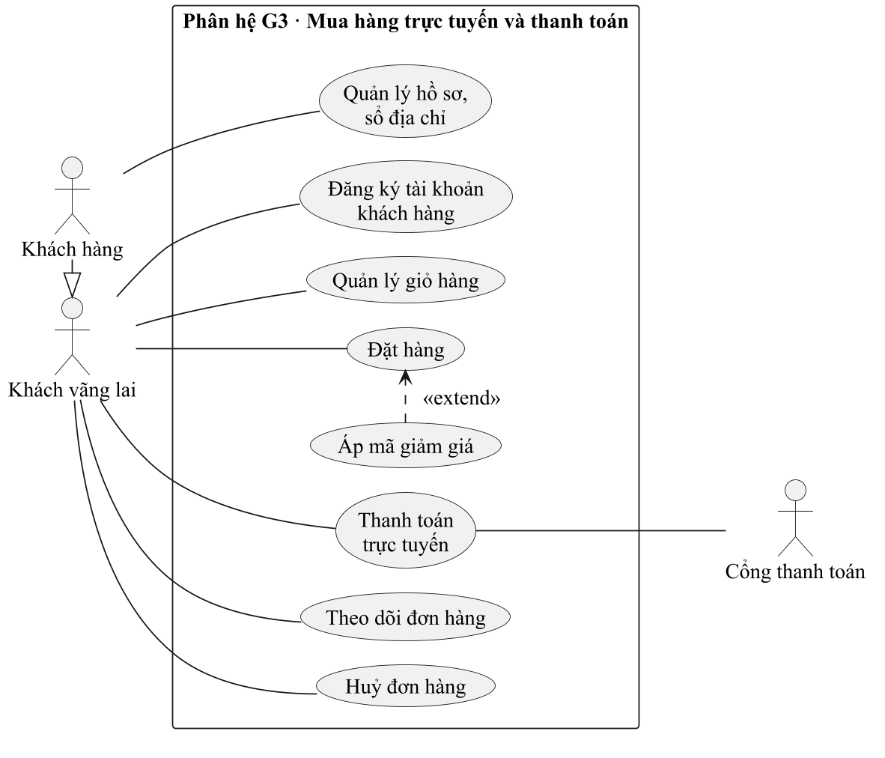
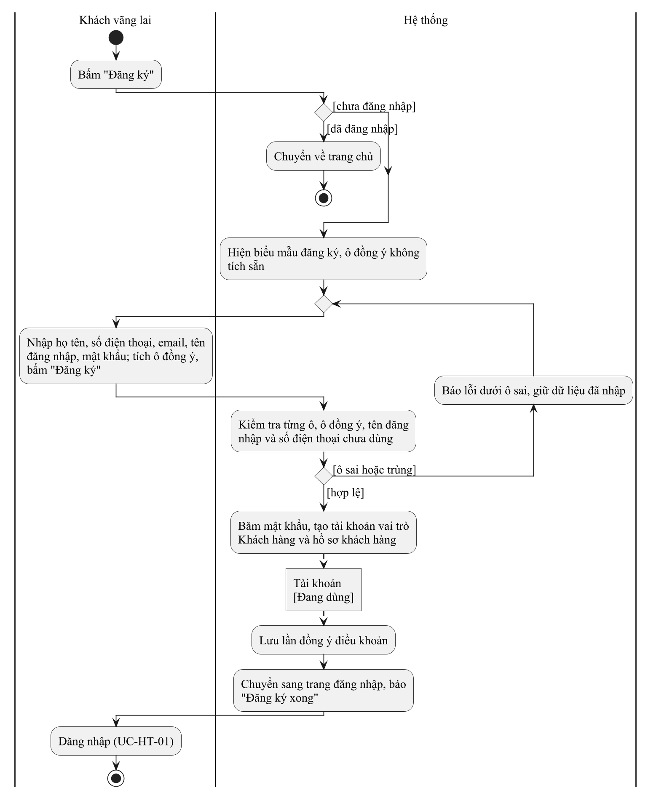
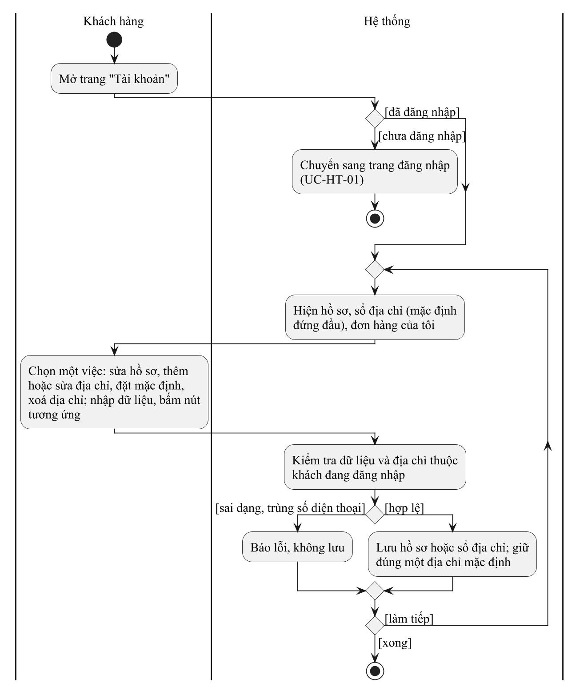
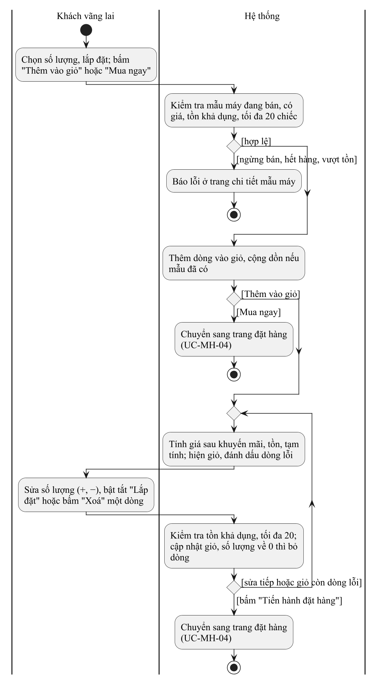
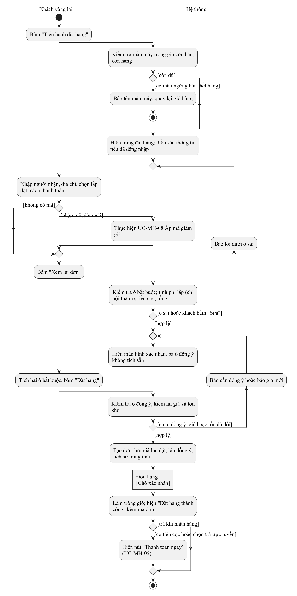
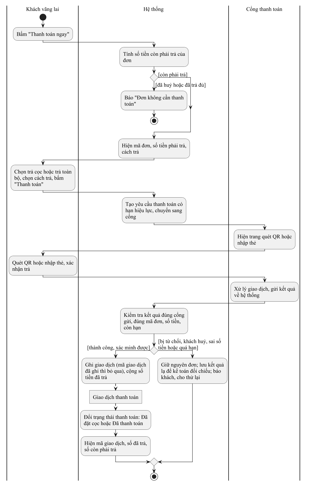
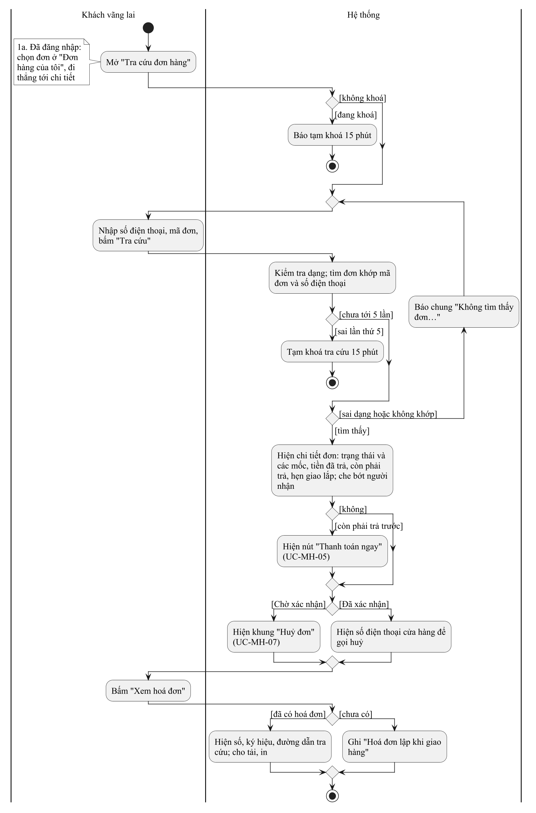
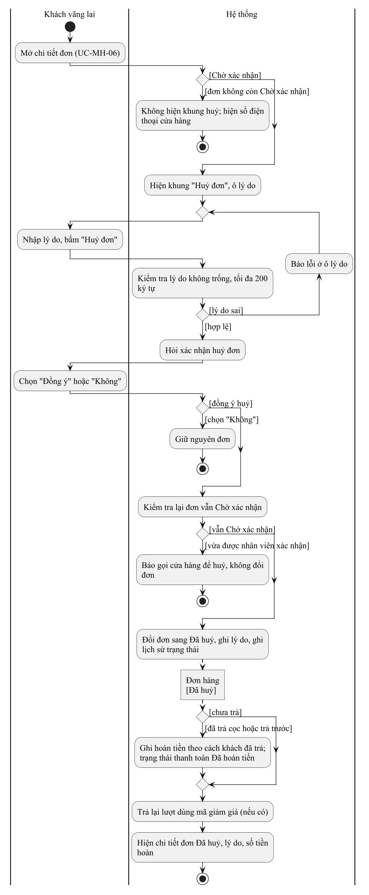
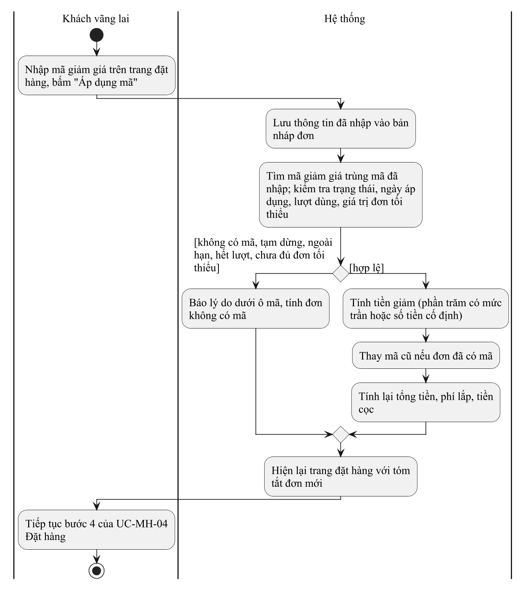

# Đặc tả use case hệ thống · G3 Mua hàng trực tuyến và thanh toán

Bản 0.1 (14/10/2026) · G3 · việc t102, t103 · theo khuôn mục 2 của [`../chung/mau-dac-ta.md`](../chung/mau-dac-ta.md); mã, tên use case theo [`../chung/danh-muc-use-case.md`](../chung/danh-muc-use-case.md)

Quy tắc `QĐx` dẫn lại từ use case nghiệp vụ BUC-02 ở [`dac-ta-nghiep-vu.md`](dac-ta-nghiep-vu.md); mã `YC-…` ở [`../chung/hien-trang-va-yeu-cau.md`](../chung/hien-trang-va-yeu-cau.md) mục 3, 4.
Trạng thái đơn hàng dùng đúng tên ở [`../chung/lop-va-trang-thai-chung.md`](../chung/lop-va-trang-thai-chung.md) mục 4.

## Sơ đồ use case phân hệ G3

G3 chốt (14/10/2026): **khách vãng lai được đặt hàng** chỉ với họ tên, số điện thoại, địa chỉ (`YC-MH-01`; `TL-18`; 3/10 vai khách mô phỏng chỉ muốn nhập số điện thoại, `MK K11`).
Vì vậy Đặt hàng, Thanh toán trực tuyến, Theo dõi đơn hàng, Huỷ đơn hàng nối với **Khách vãng lai**; Khách hàng kế thừa Khách vãng lai nên dùng được tất cả, riêng Quản lý hồ sơ, sổ địa chỉ chỉ Khách hàng có.
Áp mã giảm giá chỉ chạy bên trong Đặt hàng khi khách nhập mã (`<<extend>>`), nên không nối riêng với tác nhân. Cổng thanh toán là tác nhân phụ của Thanh toán trực tuyến.

| Mã | Use case | Tác nhân | Quan hệ | Đặc tả |
|---|---|---|---|---|
| UC-MH-01 | Đăng ký tài khoản khách hàng | Khách vãng lai | | |
| UC-MH-02 | Quản lý hồ sơ, sổ địa chỉ | Khách hàng | | |
| UC-MH-03 | Quản lý giỏ hàng | Khách vãng lai | | |
| UC-MH-04 | Đặt hàng | Khách vãng lai | | ★ |
| UC-MH-05 | Thanh toán trực tuyến | Khách vãng lai; Cổng thanh toán (phụ) | | ★ |
| UC-MH-06 | Theo dõi đơn hàng | Khách vãng lai | | ✓ |
| UC-MH-07 | Huỷ đơn hàng | Khách vãng lai | | |
| UC-MH-08 | Áp mã giảm giá | (qua UC-MH-04) | `<<extend>>` UC-MH-04 | |

## UC-MH-01 Đăng ký tài khoản khách hàng

| Mục | Nội dung |
|---|---|
| Mã, tên | UC-MH-01 Đăng ký tài khoản khách hàng |
| Gói | G3 |
| Tác nhân chính | Khách vãng lai |
| Tác nhân phụ | Không có |
| Mô tả | Khách vãng lai tự tạo tài khoản bằng họ tên, số điện thoại, email, tên đăng nhập và mật khẩu để lần sau đặt hàng có sẵn địa chỉ và xem lại các đơn đã đặt |
| Điều kiện trước | Chưa đăng nhập. Số điện thoại chưa gắn với tài khoản khách hàng nào |
| Điều kiện sau | Có một `TaiKhoan` mới ở trạng thái Đang dùng, vai trò Khách hàng, mật khẩu đã băm, và một `KhachHang` (họ tên, số điện thoại, email, ngày đăng ký) gắn với tài khoản đó; lưu lần đồng ý Điều khoản sử dụng và Chính sách bảo mật (mục đích, thời điểm). Khách đăng nhập được ngay bằng UC-HT-01 |
| Màn hình | `giao-dien/khach/dang-ky.html` → `giao-dien/khach/dang-nhap.html` |

**Luồng sự kiện chính**

| Bước | Tác nhân | Hệ thống |
|---|---|---|
| 1 | Bấm "Đăng ký" ở đầu trang hoặc "Đăng ký ngay" ở trang đăng nhập | Hiện biểu mẫu: họ tên, số điện thoại, email, tên đăng nhập, mật khẩu, nhập lại mật khẩu, ô đồng ý Điều khoản sử dụng và Chính sách bảo mật (**không tích sẵn**) |
| 2 | Nhập các ô, tích ô đồng ý, bấm "Đăng ký" | Kiểm tra từng ô: họ tên 2–60 ký tự; số điện thoại 10 chữ số, bắt đầu bằng 0; email đúng dạng; tên đăng nhập 4–50 ký tự gồm chữ không dấu, số, dấu chấm, gạch dưới; mật khẩu ít nhất 6 ký tự; hai lần nhập mật khẩu khớp; ô đồng ý đã tích |
| 3 | | Kiểm tra tên đăng nhập chưa có người dùng, số điện thoại chưa đăng ký tài khoản |
| 4 | | Băm mật khẩu, tạo tài khoản vai trò Khách hàng (Đang dùng, không bắt đổi mật khẩu) và hồ sơ khách hàng; lưu lần đồng ý |
| 5 | | Chuyển sang trang đăng nhập với thông báo "Đăng ký xong, mời bạn đăng nhập" |

**Luồng thay thế:**
- `1a.` Khách đã đăng nhập mà mở trang đăng ký: hệ thống chuyển về trang chủ.
- `2a.` Ô nào sai dạng hoặc để trống: báo đỏ ngay dưới ô đó, giữ dữ liệu đã nhập (trừ mật khẩu), khách sửa rồi bấm lại.
- `2b.` Chưa tích ô đồng ý: báo "Bạn cần đồng ý với Điều khoản sử dụng và Chính sách bảo mật", không tạo tài khoản.
- `3a.` Tên đăng nhập đã có người dùng: báo dưới ô tên đăng nhập, khách chọn tên khác (quay lại bước 2).
- `3b.` Số điện thoại đã đăng ký tài khoản: báo "Số điện thoại này đã đăng ký tài khoản", gợi ý đăng nhập (UC-HT-01).

**Ngoại lệ:** hai người cùng lúc đăng ký một tên đăng nhập thì người lưu sau nhận báo "Tên đăng nhập này đã có người dùng"; tài khoản và hồ sơ khách hàng ghi trong cùng một giao dịch nên lỗi giữa chừng không để lại tài khoản thiếu hồ sơ.

**Quy tắc nghiệp vụ:** `YC-MH-02` (khách muốn thì tạo tài khoản để lưu địa chỉ, xem đơn cũ), `YC-MH-01` (không bắt buộc đăng ký mới đặt được hàng), `YC-PCN-02` (mật khẩu lưu dạng băm),
`YC-MH-04` (ô đồng ý không tích sẵn, lưu lần đồng ý); mỗi số điện thoại chỉ gắn một tài khoản khách hàng vì tra đơn và tra bảo hành theo số điện thoại.

**Ghi chú hiện thực:** website (`TaiKhoanKhachBUS.dangKy()`) kiểm ô đồng ý nhưng chưa lưu lần đồng ý (mục đích, thời điểm) cho tài khoản; đăng ký xong không tự đăng nhập mà chuyển sang trang đăng nhập.

## UC-MH-02 Quản lý hồ sơ, sổ địa chỉ

| Mục | Nội dung |
|---|---|
| Mã, tên | UC-MH-02 Quản lý hồ sơ, sổ địa chỉ |
| Gói | G3 |
| Tác nhân chính | Khách hàng |
| Tác nhân phụ | Không có |
| Mô tả | Khách hàng xem, sửa họ tên, số điện thoại, email và quản lý các địa chỉ nhận hàng (thêm, sửa, xoá, chọn địa chỉ mặc định) để lần đặt sau hệ thống điền sẵn |
| Điều kiện trước | Đã đăng nhập với vai trò Khách hàng (UC-HT-01) |
| Điều kiện sau | `KhachHang` được cập nhật; `DiaChiGiaoHang` được thêm, sửa hoặc xoá; sổ không trống thì có đúng một địa chỉ mặc định. Đơn đã đặt không đổi vì địa chỉ giao đã chép riêng vào `DonHang` |
| Màn hình | Trang "Tài khoản" (`website/…/templates/khach/tai-khoan.html`); `giao-dien/khach/` chưa có trang mẫu |

**Luồng sự kiện chính** (bước 2 đến 6 làm theo thứ tự bất kỳ, mỗi lần một việc)

| Bước | Tác nhân | Hệ thống |
|---|---|---|
| 1 | Mở "Tài khoản" | Hiện hồ sơ (họ tên, số điện thoại, email), sổ địa chỉ (địa chỉ mặc định đứng đầu, mỗi dòng có nút Sửa, Xoá, Đặt mặc định), biểu mẫu thêm địa chỉ, danh sách đơn hàng của tôi |
| 2 | Sửa họ tên, số điện thoại, email, bấm "Lưu hồ sơ" | Kiểm tra họ tên 2–60 ký tự, số điện thoại 10 chữ số bắt đầu bằng 0, email đúng dạng nếu có nhập; số điện thoại không trùng tài khoản khác; lưu, báo "Đã lưu hồ sơ" |
| 3 | Nhập họ tên người nhận, số điện thoại, địa chỉ, chọn nội thành hay đi tỉnh, tích "Đặt làm mặc định" nếu muốn, bấm "Thêm địa chỉ" | Kiểm tra các ô; lưu vào sổ; địa chỉ đầu tiên hoặc có tích mặc định thì thành mặc định và địa chỉ mặc định cũ bỏ mặc định; báo "Đã thêm địa chỉ vào sổ" |
| 4 | Bấm "Sửa" ở một địa chỉ, đổi nội dung, bấm "Lưu địa chỉ" | Kiểm tra địa chỉ thuộc khách đang đăng nhập và các ô; lưu, báo "Đã sửa địa chỉ" |
| 5 | Bấm "Đặt mặc định" ở một địa chỉ | Đặt địa chỉ đó làm mặc định, các địa chỉ khác bỏ mặc định |
| 6 | Bấm "Xoá" ở một địa chỉ | Hỏi xác nhận rồi xoá khỏi sổ; xoá địa chỉ mặc định thì địa chỉ còn lại đứng đầu thành mặc định |

**Luồng thay thế:**
- `1a.` Chưa đăng nhập: chuyển sang trang đăng nhập (UC-HT-01), đăng nhập xong quay lại trang Tài khoản.
- `2a.` Ô sai dạng: báo lỗi, không lưu.
- `2b.` Số điện thoại đã dùng cho tài khoản khác: báo "Số điện thoại này đã dùng cho tài khoản khác", không lưu.
- `3a.` Để trống họ tên người nhận, số điện thoại sai dạng hoặc địa chỉ trống, dài quá 255 ký tự: báo lỗi, giữ biểu mẫu để sửa.
- `4a.` Địa chỉ không thuộc khách đang đăng nhập (sửa tay đường dẫn): báo "Không tìm thấy địa chỉ", không đổi gì.

**Ngoại lệ:** lỗi khi lưu thì dữ liệu giữ như cũ, báo khách thử lại; việc đặt mặc định và bỏ mặc định ở địa chỉ khác làm trong một giao dịch nên không có lúc hai địa chỉ cùng mặc định.

**Quy tắc nghiệp vụ:** `YC-MH-02` (tài khoản để lưu địa chỉ, xem đơn cũ); `YC-PCN-02` (khách chỉ thấy và sửa hồ sơ, địa chỉ của chính mình); địa chỉ mới nhập ở UC-MH-04 vào sổ khi khách tích "Lưu địa chỉ này" (luồng `2b` của UC-MH-04);
đổi mật khẩu thuộc UC-HT-06, không làm ở đây.

**Ghi chú hiện thực:** địa chỉ trong sổ lưu một ô chữ kèm cờ nội thành, chưa tách tỉnh hoặc thành phố, quận hoặc huyện như trang đặt hàng; nút "Xoá" xoá ngay, không hỏi xác nhận.

## UC-MH-03 Quản lý giỏ hàng

| Mục | Nội dung |
|---|---|
| Mã, tên | UC-MH-03 Quản lý giỏ hàng |
| Gói | G3 |
| Tác nhân chính | Khách vãng lai; Khách hàng (kế thừa Khách vãng lai) |
| Tác nhân phụ | Không có |
| Mô tả | Khách gom các mẫu máy muốn mua vào giỏ, sửa số lượng, chọn có lắp đặt hay không, bỏ mẫu máy và xem tạm tính trước khi đặt hàng |
| Điều kiện trước | Không bắt buộc đăng nhập. Mẫu máy đang bán và đã có giá (UC-SP-03) |
| Điều kiện sau | Giỏ hàng (giữ theo phiên làm việc của trình duyệt, không lưu CSDL) có các dòng: mẫu máy, số lượng, có lắp đặt hay không. Không dữ liệu nào trong CSDL đổi; giỏ không giữ hàng trong kho |
| Màn hình | `giao-dien/khach/chi-tiet.html` (nút "Thêm vào giỏ", "Mua ngay") → `giao-dien/khach/gio-hang.html` |

**Luồng sự kiện chính**

| Bước | Tác nhân | Hệ thống |
|---|---|---|
| 1 | Ở trang chi tiết mẫu máy, chọn số lượng, tích "Cần lắp đặt" nếu mẫu máy cần lắp, bấm "Thêm vào giỏ" | Kiểm tra mẫu máy đang bán, đã có giá; số lượng cộng với số đã có trong giỏ không vượt tồn khả dụng và không quá 20 chiếc mỗi mẫu |
| 2 | | Thêm dòng vào giỏ (mẫu đã có thì cộng số lượng), báo "Đã thêm vào giỏ hàng", hiện trang giỏ |
| 3 | Xem giỏ | Hiện từng dòng: ảnh, tên, đơn giá sau khuyến mãi, số lượng, thành tiền, ô lắp đặt (mẫu cần lắp), cảnh báo "Đã ngừng bán", "Tạm hết hàng", "Chỉ còn n chiếc"; khung tạm tính: tiền hàng, giảm giá, phí lắp đặt dự kiến, tổng, ghi chú ngưỡng miễn phí lắp và ngưỡng đặt cọc |
| 4 | Bấm "+", "−" ở một dòng | Kiểm tra số lượng mới không vượt tồn khả dụng, không quá 20; cập nhật dòng và tạm tính |
| 5 | Bật hoặc tắt "Lắp đặt" ở một dòng | Ghi lựa chọn, tính lại phí lắp dự kiến |
| 6 | Bấm "Xoá" ở một dòng | Bỏ mẫu máy khỏi giỏ, báo "Đã bỏ sản phẩm khỏi giỏ hàng" |
| 7 | Bấm "Tiến hành đặt hàng" | Chuyển sang UC-MH-04 Đặt hàng |

**Luồng thay thế:**
- `1a.` Khách bấm "Mua ngay": thêm vào giỏ như bước 1, 2 rồi chuyển thẳng sang trang đặt hàng (UC-MH-04).
- `1b.` Mẫu máy ngừng bán hoặc chưa có giá: báo "Sản phẩm … hiện không bán", ở lại trang chi tiết.
- `1c.` Hết hàng hoặc số lượng vượt tồn khả dụng: báo "Sản phẩm … chỉ còn n chiếc, giỏ của bạn đã có m", không thêm.
- `1d.` Quá 20 chiếc một mẫu: báo "Mỗi mẫu máy đặt tối đa 20 chiếc trên một đơn".
- `3a.` Giỏ trống: hiện "Giỏ hàng đang trống" và nút tiếp tục mua sắm; không cho đặt hàng.
- `3b.` Có dòng ngừng bán, hết hàng hoặc vượt tồn (giá, tồn đổi sau khi thêm): đánh dấu dòng đó, ẩn nút "Tiến hành đặt hàng" tới khi khách sửa số lượng hoặc xoá dòng.
- `4a.` Giảm số lượng về 0: bỏ dòng khỏi giỏ.
- `4b.` Tăng quá tồn khả dụng: báo "Mẫu máy này chỉ còn n chiếc", giữ số lượng cũ.

**Ngoại lệ:** phiên làm việc hết hạn (bỏ trình duyệt lâu) thì giỏ mất; mẫu máy không còn trong CSDL thì tự bỏ khỏi giỏ khi tính lại.

**Quy tắc nghiệp vụ:** `YC-MH-11` (thêm nhiều mẫu máy, sửa số lượng, chọn lắp đặt, giữ giỏ khi chưa đăng nhập); QĐ1 (giá, khuyến mãi theo bảng giá đã duyệt), QĐ3 (giá đã gồm VAT, phí ghi riêng), QĐ5 (miễn phí lắp đơn trên 5 triệu đồng) của BUC-02.
Tồn khả dụng là số chiếc còn trong kho trừ số đang giữ cho đơn Chờ xác nhận, Đã xác nhận; giỏ không giữ hàng nên tồn được kiểm lại ở UC-MH-04.

**Ghi chú hiện thực:** giỏ lưu trong phiên (chốt ở chương 5), đăng nhập giữa chừng vẫn giữ giỏ nhưng giỏ không đi theo tài khoản sang thiết bị khác; tạm tính ở trang giỏ luôn tính như đơn nội thành, phí lắp thật tính lại ở UC-MH-04 khi biết địa chỉ.

## UC-MH-04 Đặt hàng

| Mục | Nội dung |
|---|---|
| Mã, tên | UC-MH-04 Đặt hàng |
| Gói | G3 |
| Tác nhân chính | Khách vãng lai; Khách hàng (kế thừa Khách vãng lai) dùng được và có sẵn địa chỉ trong sổ địa chỉ |
| Tác nhân phụ | Không có |
| Mô tả | Khách xác nhận các mẫu máy trong giỏ, nhập thông tin nhận hàng, chọn lắp đặt và cách thanh toán, xem lại đủ chi tiết đơn rồi đồng ý đặt, để cửa hàng có đơn hàng chờ gọi xác nhận |
| Điều kiện trước | Giỏ hàng có ít nhất một mẫu máy đang bán (UC-MH-03). Không bắt buộc đăng nhập |
| Điều kiện sau | Có một `DonHang` mới (mã đơn, ngày đặt, họ tên và số điện thoại người đặt, người nhận, địa chỉ giao, có lắp đặt hay không, cách thanh toán, số tiền cọc phải trả nếu có) với các `ChiTietDonHang` lưu giá lúc đặt; đơn ở trạng thái **Chờ xác nhận**, `trangThaiThanhToan` là Chưa thanh toán; thêm một dòng `LichSuTrangThaiDon`; lưu lần đồng ý xử lý dữ liệu (mục đích, thời điểm); giỏ hàng trống. Đơn hiện đầu danh sách chờ xác nhận của UC-DH-01 |
| Màn hình | `giao-dien/khach/gio-hang.html` → `giao-dien/khach/dat-hang.html` → `giao-dien/khach/hoan-tat.html`. Trang `dat-hang.html` chưa có ô mã giảm giá, ô chọn lắp đặt, ô đồng ý xử lý dữ liệu và dòng tiền cọc: bổ sung khi thiết kế ở tuần 14 |

**Luồng sự kiện chính**

| Bước | Tác nhân | Hệ thống |
|---|---|---|
| 1 | Bấm "Tiến hành đặt hàng" ở trang giỏ hàng | Kiểm tra từng mẫu máy trong giỏ còn bán, còn hàng; hiện trang đặt hàng kèm tóm tắt giỏ. Khách đã đăng nhập thì điền sẵn họ tên, số điện thoại và địa chỉ mặc định trong sổ địa chỉ |
| 2 | Nhập họ tên, số điện thoại, tỉnh hoặc thành phố, quận hoặc huyện, địa chỉ cụ thể; email và ghi chú nếu muốn | Kiểm tra các ô bắt buộc không để trống, số điện thoại đủ 10 chữ số |
| 3 | Chọn có lắp đặt hay không với từng mẫu máy cần lắp | Tính phí giao và phí lắp theo địa chỉ và giá trị đơn, hiện ngay trên tóm tắt đơn |
| 4 | Chọn cách thanh toán: tiền mặt khi nhận hàng, chuyển khoản hoặc QR, thẻ, trả góp qua công ty tài chính | Nếu đơn thuộc diện phải cọc thì hiện số tiền cọc phải trả trực tuyến |
| 5 | Bấm "Xem lại đơn" | Hiện màn hình xác nhận: mẫu máy, số lượng, đơn giá, thời hạn giao dự kiến, khuyến mãi, tiền hàng, phí giao, phí lắp, tiền cọc, tổng tiền, cách thanh toán; ô đồng ý điều kiện giao dịch, ô đồng ý dùng dữ liệu để giao hàng và bảo hành, ô đồng ý nhận tin khuyến mãi, cả ba ô **không tích sẵn** |
| 6 | Tích ô đồng ý điều kiện giao dịch và ô đồng ý dùng dữ liệu để giao hàng, bảo hành; bấm "Đặt hàng" | Kiểm tra hai ô bắt buộc đã tích; kiểm tra lại giá và tồn kho |
| 7 | | Tạo đơn hàng với mã đơn mới, lưu giá lúc đặt, trạng thái Chờ xác nhận; lưu lần đồng ý; ghi lịch sử trạng thái; làm trống giỏ |
| 8 | | Hiện trang "Đặt hàng thành công": mã đơn, tóm tắt đơn, lời nhắn nhân viên sẽ gọi xác nhận trong giờ làm việc, hướng dẫn tra đơn bằng số điện thoại và mã đơn. Đơn có tiền cọc hoặc chọn trả trực tuyến thì hiện thêm nút "Thanh toán ngay" dẫn sang UC-MH-05 |

**Luồng thay thế:**
- `1a.` Có mẫu máy đã ngừng bán hoặc hết hàng: báo tên mẫu máy đó, cho khách bỏ khỏi đơn hoặc quay lại giỏ hàng.
- `2a.` Để trống ô bắt buộc hoặc số điện thoại sai dạng: báo ngay dưới ô đó, không cho đi tiếp.
- `2b.` Khách hàng đã đăng nhập chọn địa chỉ khác trong sổ địa chỉ hoặc nhập địa chỉ mới; địa chỉ mới chỉ lưu vào sổ khi khách tích "Lưu địa chỉ này".
- `3a.` Địa chỉ ngoài nội thành: báo đơn gửi đơn vị vận chuyển và cửa hàng không lắp đặt, ẩn ô chọn lắp đặt (QĐ4).
- `4a.` Khách nhập mã giảm giá: thực hiện UC-MH-08 Áp mã giảm giá, tính lại tổng tiền rồi quay lại bước 4. Đơn đã có một mã thì mã mới thay mã cũ, không cộng hai mã (QĐ2).
- `5a.` Khách bấm "Sửa": quay lại bước 2 (thông tin nhận hàng) hoặc trang giỏ hàng (số lượng), giữ nguyên dữ liệu đã nhập.
- `6a.` Chưa tích ô đồng ý điều kiện giao dịch hoặc ô đồng ý dùng dữ liệu để giao hàng: báo cần đồng ý mới đặt được. Ô nhận tin khuyến mãi không bắt buộc.
- `6b.` Giá hoặc tồn kho đã đổi từ lúc khách mở trang: báo mẫu máy và giá mới, quay lại bước 5 để khách xem lại.
- `8a.` Khách không trả cọc trực tuyến: đơn vẫn ở trạng thái Chờ xác nhận, ghi "chưa cọc"; nhân viên bán hàng xử lý khi gọi xác nhận (UC-DH-01).

**Ngoại lệ:** mất kết nối hoặc lỗi lưu khi bấm "Đặt hàng" thì không tạo đơn dở dang, giỏ hàng giữ nguyên, báo "Chưa đặt được đơn, vui lòng thử lại"; khách bấm "Đặt hàng" hai lần liên tiếp thì chỉ tạo một đơn.

**Quy tắc nghiệp vụ:** QĐ2 (một mã giảm giá và một quà tặng), QĐ3 (giá đã gồm VAT, phí ghi riêng), QĐ4, QĐ5 (giao và lắp nội thành, đơn tỉnh), QĐ7 (cọc 10–20% đơn có tiền hàng trên 10 triệu đồng; trên website mức đơn và tỷ lệ cọc do chủ cửa hàng đặt) của BUC-02;
`YC-MH-01` (đặt không cần tài khoản), `YC-MH-03` (màn hình xác nhận đủ thông tin, khách sửa được rồi đồng ý điều kiện giao dịch), `YC-MH-04` (ô đồng ý không tích sẵn, tách mục đích), `YC-MH-06` (cọc cho đơn giá trị cao và đơn giao tỉnh), `YC-DH-03` (hiện phí giao trước khi đặt), `YC-SP-08` (đổi giá không làm đổi giá trên đơn đã đặt).

## UC-MH-05 Thanh toán trực tuyến

| Mục | Nội dung |
|---|---|
| Mã, tên | UC-MH-05 Thanh toán trực tuyến |
| Gói | G3 |
| Tác nhân chính | Khách vãng lai; Khách hàng (kế thừa Khách vãng lai) |
| Tác nhân phụ | Cổng thanh toán (hệ thống bên ngoài nhận tiền và báo kết quả) |
| Mô tả | Khách trả tiền cọc hoặc toàn bộ tiền đơn qua cổng thanh toán (chuyển khoản hoặc QR, thẻ) để giữ đơn, hệ thống ghi số tiền đã trả vào đơn theo kết quả cổng gửi về |
| Điều kiện trước | Đơn đã tạo ở UC-MH-04, đang ở trạng thái Chờ xác nhận hoặc Đã xác nhận và còn số tiền phải trả trực tuyến (tiền cọc chưa trả hoặc khách chọn trả trước); khách mở từ trang Đặt hàng thành công hoặc từ kết quả tra đơn (UC-MH-06) |
| Điều kiện sau | Thành công: có một giao dịch thanh toán gắn với đơn (mã giao dịch của cổng, số tiền, loại tiền cọc hay trả đủ, thời điểm); số tiền đã trả của đơn tăng; trả đủ thì `trangThaiThanhToan` là Đã thanh toán, mới trả cọc thì đơn ghi tiền cọc đã nhận. Không thành công: đơn và trạng thái thanh toán giữ nguyên |
| Màn hình | Chưa có, thiết kế ở tuần 14 (trang chọn cách trả và trang kết quả; trang quét QR, nhập thẻ do cổng thanh toán cung cấp) |

**Luồng sự kiện chính**

| Bước | Tác nhân | Hệ thống |
|---|---|---|
| 1 | Bấm "Thanh toán ngay" | Hiện mã đơn, số tiền phải trả (tiền cọc hoặc phần còn lại), hai cách trả: chuyển khoản hoặc QR, thẻ |
| 2 | Chọn cách trả, bấm "Thanh toán" | Tạo yêu cầu thanh toán (mã đơn, số tiền, hạn hiệu lực), gửi sang Cổng thanh toán và chuyển khách sang trang của cổng |
| 3 | Quét QR hoặc nhập thẻ trên trang của Cổng thanh toán, xác nhận trả tiền | Chờ kết quả từ Cổng thanh toán |
| 4 | Cổng thanh toán gửi kết quả giao dịch về hệ thống | Kiểm tra kết quả đúng do cổng gửi, đúng mã đơn và số tiền; ghi giao dịch, cộng số tiền đã trả vào đơn, cập nhật trạng thái thanh toán |
| 5 | | Hiện trang kết quả: mã giao dịch, số tiền đã trả, số tiền còn phải trả khi nhận hàng; gửi email xác nhận nếu đơn có email |

**Luồng thay thế:**
- `1a.` Đơn đã ở trạng thái Đã huỷ hoặc đã trả đủ: báo "Đơn không cần thanh toán", không cho đi tiếp.
- `1b.` Đơn phải cọc nhưng khách muốn trả hết: khách chọn "Trả toàn bộ", số tiền phải trả đổi thành phần còn lại của đơn.
- `3a.` Khách bấm huỷ trên trang cổng hoặc giao dịch bị từ chối: cổng báo không thành công, hệ thống giữ nguyên đơn, báo khách và cho thử lại từ bước 1; đơn không thuộc diện phải cọc thì khách được đổi sang trả tiền khi nhận hàng.
- `3b.` Hết hạn hiệu lực của yêu cầu mà chưa có kết quả: hệ thống huỷ yêu cầu, đơn giữ nguyên; khách thanh toán lại từ trang tra đơn (UC-MH-06).
- `4a.` Kết quả có số tiền khác số tiền yêu cầu hoặc không xác minh được do cổng gửi: không cộng vào đơn, lưu lại để kế toán đối chiếu.

**Ngoại lệ:** khách mất kết nối sau khi đã trả trên trang cổng thì kết quả cổng gửi về vẫn được ghi, khách xem lại ở UC-MH-06; cổng gửi lại cùng một kết quả nhiều lần thì chỉ ghi một lần theo mã giao dịch.

**Quy tắc nghiệp vụ:** QĐ6 (các cách trả tiền), QĐ7 (cọc), QĐ8, QĐ9 (hoàn cọc khi huỷ, hoàn theo cách khách đã trả) của BUC-02; `YC-MH-05` (tiền mặt khi nhận, chuyển khoản hoặc QR, thẻ, trả góp qua công ty tài chính),
`YC-MH-06` (cọc trực tuyến, mức cọc do chủ đặt, ghi số tiền cọc trên đơn), `YC-PCN-06` (phí cổng thanh toán tính riêng theo giao dịch). Website không lưu số thẻ của khách, chỉ lưu mã giao dịch do cổng trả về (nhóm đặt, cùng hướng `YC-PCN-02`).

## UC-MH-06 Theo dõi đơn hàng

| Mục | Nội dung |
|---|---|
| Mã, tên | UC-MH-06 Theo dõi đơn hàng |
| Gói | G3 |
| Tác nhân chính | Khách vãng lai (tra bằng số điện thoại kèm mã đơn); Khách hàng (kế thừa Khách vãng lai, xem thêm danh sách đơn của tài khoản) |
| Tác nhân phụ | Không có |
| Mô tả | Khách nhập số điện thoại đã dùng khi đặt và mã đơn để biết đơn đang ở trạng thái nào, ngày giờ hẹn giao lắp, tiền đã trả và còn phải trả, chứng từ của đơn, không phải nhắn hỏi nhân viên |
| Điều kiện trước | Đơn đã được tạo (UC-MH-04). Không bắt buộc đăng nhập |
| Điều kiện sau | Không dữ liệu đơn nào bị sửa; hệ thống chỉ đếm số lần tra sai để chống dò mã đơn |
| Màn hình | Chưa có, thiết kế ở tuần 14 (trang tra cứu đơn đặt link ở chân trang và trang chi tiết đơn) |

**Luồng sự kiện chính**

| Bước | Tác nhân | Hệ thống |
|---|---|---|
| 1 | Mở "Tra cứu đơn hàng" ở chân trang hoặc từ trang Đặt hàng thành công | Hiện ô số điện thoại và ô mã đơn |
| 2 | Nhập số điện thoại, mã đơn, bấm "Tra cứu" | Kiểm tra hai ô không để trống, đúng dạng |
| 3 | | Tìm đơn có mã đơn trùng và số điện thoại người đặt trùng |
| 4 | | Hiện chi tiết đơn: mã đơn, ngày đặt, mẫu máy, số lượng, tổng tiền, tiền đã trả, tiền còn phải trả, cách thanh toán; trạng thái đơn (Chờ xác nhận, Đã xác nhận, Đang giao, Hoàn thành, Giao không thành công, Đã huỷ, Đã trả hàng, nhãn màu theo phần chung) kèm các mốc đổi trạng thái; ngày và khung giờ hẹn giao lắp nếu đã hẹn; đơn vị vận chuyển và mã vận đơn với đơn đi tỉnh; số điện thoại cửa hàng. Địa chỉ và số điện thoại người nhận hiện che bớt một phần |
| 5 | Bấm "Xem hoá đơn" | Hiện số, ký hiệu hoá đơn và đường dẫn tra cứu hoá đơn điện tử; cho tải, in |

**Luồng thay thế:**
- `1a.` Khách hàng đã đăng nhập mở "Đơn hàng của tôi": hệ thống liệt kê các đơn gắn tài khoản, mới nhất trước; khách chọn một đơn rồi đi tiếp bước 4, không cần nhập số điện thoại và mã đơn.
- `2a.` Để trống hoặc sai dạng: báo ngay dưới ô đó.
- `3a.` Không có đơn khớp: báo chung "Không tìm thấy đơn với số điện thoại và mã đơn này", không nói rõ sai ô nào.
- `3b.` Tra sai 5 lần liên tiếp: tạm khoá tra cứu 15 phút (cùng mức của UC-HT-01).
- `4a.` Đơn còn tiền cọc hoặc tiền trả trước chưa trả: hiện nút "Thanh toán ngay" (UC-MH-05).
- `4b.` Đơn đang Chờ xác nhận: hiện nút "Huỷ đơn" (UC-MH-07). Đơn Đã xác nhận: hiện số điện thoại cửa hàng để khách gọi huỷ, nhân viên bán hàng huỷ ở UC-DH-01 nếu máy chưa xuất kho.
- `4c.` Đơn Đã huỷ hoặc Giao không thành công: hiện lý do và số tiền đã hoàn (trạng thái thanh toán Đã hoàn tiền).
- `5a.` Đơn chưa có hoá đơn: không hiện nút, ghi "Hoá đơn lập khi giao hàng" (QĐ11).

**Ngoại lệ:** lỗi truy vấn hoặc mất kết nối thì báo "Chưa tra được, vui lòng thử lại", không hiện dữ liệu dở dang.

**Quy tắc nghiệp vụ:** `YC-MH-08` (tra bằng số điện thoại kèm mã đơn, thấy trạng thái và ngày giờ hẹn giao lắp), `YC-MH-09` (huỷ khi chưa xuất kho), `YC-MH-10` (xem, tải, in hoá đơn và chứng từ),
`YC-PCN-02` (chỉ vai được giao mới xem đủ số điện thoại, địa chỉ khách, nên trang tra cứu che bớt), `YC-PCN-04` (hoá đơn lấy từ phần mềm hoá đơn điện tử, website chỉ lưu số, ký hiệu, đường dẫn tra cứu); QĐ11 của BUC-02.

## UC-MH-07 Huỷ đơn hàng

| Mục | Nội dung |
|---|---|
| Mã, tên | UC-MH-07 Huỷ đơn hàng |
| Gói | G3 |
| Tác nhân chính | Khách vãng lai; Khách hàng (kế thừa Khách vãng lai) |
| Tác nhân phụ | Không có |
| Mô tả | Khách tự huỷ đơn còn Chờ xác nhận và nêu lý do, để cửa hàng không phải gọi xác nhận đơn khách không mua nữa và khách được hoàn số tiền đã trả |
| Điều kiện trước | Khách đã mở được chi tiết đơn qua UC-MH-06 (tra đúng số điện thoại và mã đơn, hoặc đơn của tài khoản đang đăng nhập); đơn đang ở trạng thái Chờ xác nhận |
| Điều kiện sau | Đơn ở trạng thái **Đã huỷ**, có lý do huỷ; thêm một dòng `LichSuTrangThaiDon` (Chờ xác nhận → Đã huỷ, ghi "Khách huỷ"); đơn đã trả cọc hoặc trả trước thì thêm `GiaoDichThanhToan` loại Hoàn tiền theo đúng cách khách đã trả và `trangThaiThanhToan` là Đã hoàn tiền; mã giảm giá đơn đã dùng được trả lại một lượt; số máy đang giữ cho đơn trở lại tồn khả dụng |
| Màn hình | Trang chi tiết đơn, khung "Huỷ đơn" (`website/…/templates/khach/chi-tiet-don.html`); `giao-dien/khach/` chưa có trang mẫu |

**Luồng sự kiện chính**

| Bước | Tác nhân | Hệ thống |
|---|---|---|
| 1 | Ở trang chi tiết đơn (UC-MH-06), xem khung "Huỷ đơn" | Hiện lời nhắn đơn đang chờ xác nhận nên khách tự huỷ được, tiền cọc đã trả được hoàn đủ theo cách đã trả; ô lý do huỷ |
| 2 | Nhập lý do, bấm "Huỷ đơn" | Kiểm tra lý do không để trống, không quá 200 ký tự; hỏi "Bạn chắc chắn huỷ đơn DH…?" |
| 3 | Bấm "Đồng ý" | Kiểm tra khách được xem đơn này và đơn vẫn Chờ xác nhận |
| 4 | | Đổi đơn sang Đã huỷ, ghi lý do, ghi lịch sử trạng thái |
| 5 | | Ghi khoản hoàn số tiền đã trả theo đúng cách khách đã trả, đổi trạng thái thanh toán sang Đã hoàn tiền; trả lại lượt dùng mã giảm giá của đơn |
| 6 | | Hiện lại chi tiết đơn với thông báo "Đã huỷ đơn DH…", nhãn Đã huỷ, lý do huỷ và số tiền đã hoàn |

**Luồng thay thế:**
- `1a.` Đơn Đã xác nhận: không có khung huỷ, hiện số điện thoại cửa hàng để khách gọi; nhân viên bán hàng huỷ ở UC-DH-01 nếu máy chưa xuất kho (`YC-MH-09`).
- `1b.` Đơn Đang giao trở đi: không huỷ trên website; khách từ chối nhận thì đơn thành Giao không thành công (UC-DH-03), đã nhận thì đổi trả (UC-DH-06).
- `2a.` Lý do trống hoặc quá 200 ký tự: báo ngay ở ô lý do, không huỷ.
- `3a.` Khách bấm "Không": giữ nguyên đơn, quay lại chi tiết đơn.
- `3b.` Đơn vừa được nhân viên xác nhận trong lúc khách đang mở trang: báo "Đơn đã được cửa hàng xác nhận, bạn gọi 0339 999 999 để được hỗ trợ huỷ", không đổi gì.
- `3c.` Phiên không có quyền xem đơn (mở thẳng đường dẫn): chuyển về trang tra cứu đơn (UC-MH-06).
- `5a.` Đơn chưa trả đồng nào: không tạo khoản hoàn tiền, trạng thái thanh toán giữ Chưa thanh toán.

**Ngoại lệ:** lỗi khi ghi thì không đổi gì; đổi trạng thái, ghi hoàn tiền và trả lượt mã giảm giá chạy trong một giao dịch nên không có đơn đã huỷ mà chưa ghi hoàn tiền.

**Quy tắc nghiệp vụ:** QĐ8 (huỷ trước khi xuất kho được hoàn đủ tiền cọc), QĐ9 (tiền hoàn trả theo đúng cách khách đã trả) của BUC-02; `YC-MH-09` (khách tự huỷ đơn còn Chờ xác nhận);
bảng chuyển trạng thái ở `lop-va-trang-thai-chung.md` mục 4 (Chờ xác nhận → Đã huỷ do khách, UC-MH-07); `YC-PCN-01` (không xoá đơn, chỉ đổi trạng thái).

**Ghi chú hiện thực:** website không hỏi lại "Bạn chắc chắn…" (ô lý do bắt buộc thay cho bước xác nhận, bước 3 gộp vào bước 2); khoản hoàn tiền được ghi ngay ở trạng thái Thành công với mã `HOAN-<mã đơn>-<thời điểm>`, chưa có bước kế toán chuyển trả tiền thật qua cổng hoặc chuyển khoản.

## UC-MH-08 Áp mã giảm giá

| Mục | Nội dung |
|---|---|
| Mã, tên | UC-MH-08 Áp mã giảm giá |
| Gói | G3 |
| Tác nhân chính | Khách vãng lai (chạy bên trong UC-MH-04, `<<extend>>` tại bước 4) |
| Tác nhân phụ | Không có |
| Mô tả | Khi đặt hàng, khách nhập một mã giảm giá cửa hàng đã phát hành (UC-SP-04); hệ thống kiểm mã còn dùng được và trừ tiền giảm vào đơn |
| Điều kiện trước | Khách đang ở bước 4 của UC-MH-04 (trang đặt hàng), giỏ không trống; mã do Quản lý cửa hàng tạo ở UC-SP-04 |
| Điều kiện sau | Bản nháp đơn gắn mã và tổng tiền mới đã trừ tiền giảm; lượt dùng của mã chỉ tăng khi đơn đặt thành công (bước 7 của UC-MH-04), khách không đặt thì mã không đổi |
| Màn hình | `giao-dien/khach/dat-hang.html`: ô "Nhập mã (mỗi đơn một mã)", nút "Áp dụng mã" |

**Luồng sự kiện chính**

| Bước | Tác nhân | Hệ thống |
|---|---|---|
| 1 | Nhập mã, bấm "Áp dụng mã" | Giữ lại các thông tin khách đã nhập trên trang đặt hàng |
| 2 | | Tìm khuyến mãi loại mã giảm giá có mã trùng mã đã nhập (không phân biệt chữ hoa, chữ thường) |
| 3 | | Kiểm tra mã: đang chạy, đã tới ngày bắt đầu, chưa qua ngày kết thúc, còn lượt dùng, giá trị đơn (sau khuyến mãi theo mẫu máy) đạt mức đơn tối thiểu |
| 4 | | Tính tiền giảm: theo phần trăm (không quá mức giảm tối đa của mã) hoặc số tiền cố định, không vượt giá trị đơn |
| 5 | | Hiện lại trang đặt hàng: dòng "Mã giảm giá" với số tiền giảm; tổng tiền, phí lắp, tiền cọc tính lại; thông báo "Đã áp mã …. Mỗi đơn chỉ dùng một mã, mã mới sẽ thay mã cũ"; quay lại bước 4 của UC-MH-04 |

**Luồng thay thế:**
- `2a.` Không có mã: báo "Mã giảm giá không tồn tại" dưới ô mã, đơn tính như không có mã.
- `3a.` Mã đang tạm dừng: báo "Mã giảm giá đang tạm dừng".
- `3b.` Chưa tới ngày áp dụng hoặc đã hết hạn: báo "Mã giảm giá chưa tới ngày áp dụng" hoặc "Mã giảm giá đã hết hạn".
- `3c.` Hết lượt dùng: báo "Mã giảm giá đã hết lượt dùng".
- `3d.` Chưa đủ đơn tối thiểu: báo "Mã này áp cho đơn từ … trở lên".
- `5a.` Đơn đã có mã, khách nhập mã khác: mã mới thay mã cũ, không cộng hai mã (QĐ2).
- `5b.` Khách xoá ô mã rồi bấm "Áp dụng mã": bỏ tiền giảm của mã.
- `5c.` Tới lúc bấm "Đặt hàng" (bước 6 của UC-MH-04) mã vừa hết hạn hoặc hết lượt: báo lý do, không tạo đơn, khách xem lại đơn.

**Ngoại lệ:** lỗi truy vấn khi kiểm mã thì báo "Chưa áp được mã, vui lòng thử lại", đơn giữ nguyên.

**Quy tắc nghiệp vụ:** QĐ2 (mỗi đơn tối đa một khuyến mãi giảm giá và một quà tặng, không cộng hai mã giảm giá) của BUC-02; `YC-MH-07` (áp một mã còn hạn, không cộng hai mã);
UC-SP-04 (mã không trùng, có hạn dùng, có số lượt); huỷ đơn thì trả lại lượt dùng (UC-MH-07).

**Ghi chú hiện thực:** website cộng tiền giảm của mã với khuyến mãi giảm theo mẫu máy đang chạy (`BangTinh.getTienGiam()` = giảm theo mẫu máy + giảm theo mã), tức một đơn có thể nhận hai khuyến mãi giảm giá, lệch QĐ2; mã áp cho cả đơn, chưa xét phạm vi mẫu máy, thương hiệu của mã.

## Điểm cần cập nhật ở phần chung

| Tệp chung | Đề xuất của G3 | Lý do |
|---|---|---|
| `danh-muc-use-case.md` mục 2 | UC-MH-04, 05, 06, 07 đổi tác nhân thành **Khách vãng lai** (Khách hàng kế thừa); UC-MH-08 không nối tác nhân riêng | Quyết định 14/10 cho khách vãng lai đặt hàng; đặt được thì phải trả cọc, tra đơn, huỷ đơn được |
| `lop-va-trang-thai-chung.md` mục 2 | `DonHang` thêm `hoTenNguoiDat`, `soDienThoaiNguoiDat` (bắt buộc khi đơn không gắn `KhachHang`), `tienCoc`, `/soTienDaTra`; `trangThaiThanhToan` thêm giá trị **Đã đặt cọc** | UC-MH-06 tra theo số điện thoại người đặt; UC-MH-05 ghi tiền cọc (`YC-MH-06`) |
| `lop-va-trang-thai-chung.md` mục 2 | Lớp mới `GiaoDichThanhToan` (maGiaoDich, maGiaoDichCong, soTien, loai: Tiền cọc, Trả đủ, Hoàn tiền, phuongThuc, thoiDiem, ketQua), `DonHang` 1 – * `GiaoDichThanhToan` | Một đơn có thể trả cọc rồi trả nốt, hoặc hoàn tiền; chống ghi trùng theo mã giao dịch của cổng |
| `lop-va-trang-thai-chung.md` mục 2 | Lớp `LanDongY` (mucDich, dongY, thoiDiem) gắn với `DonHang` hoặc `KhachHang` | `YC-MH-04`: lưu lần đồng ý theo từng mục đích |
| `lop-va-trang-thai-chung.md` (`HoaDon`) | Không tách lớp `HoaDon`; `DonHang` thêm `soHoaDon`, `kyHieuHoaDon`, `duongDanTraCuuHoaDon` | `YC-PCN-04`: website không tự phát hành hoá đơn, chỉ lưu số, ký hiệu và đường dẫn |
