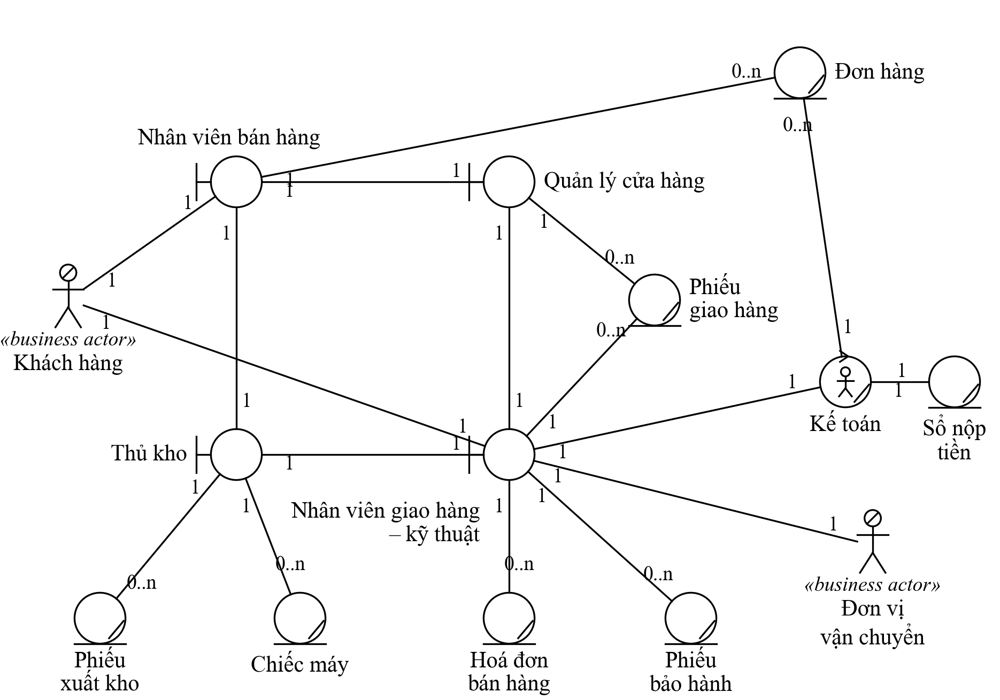
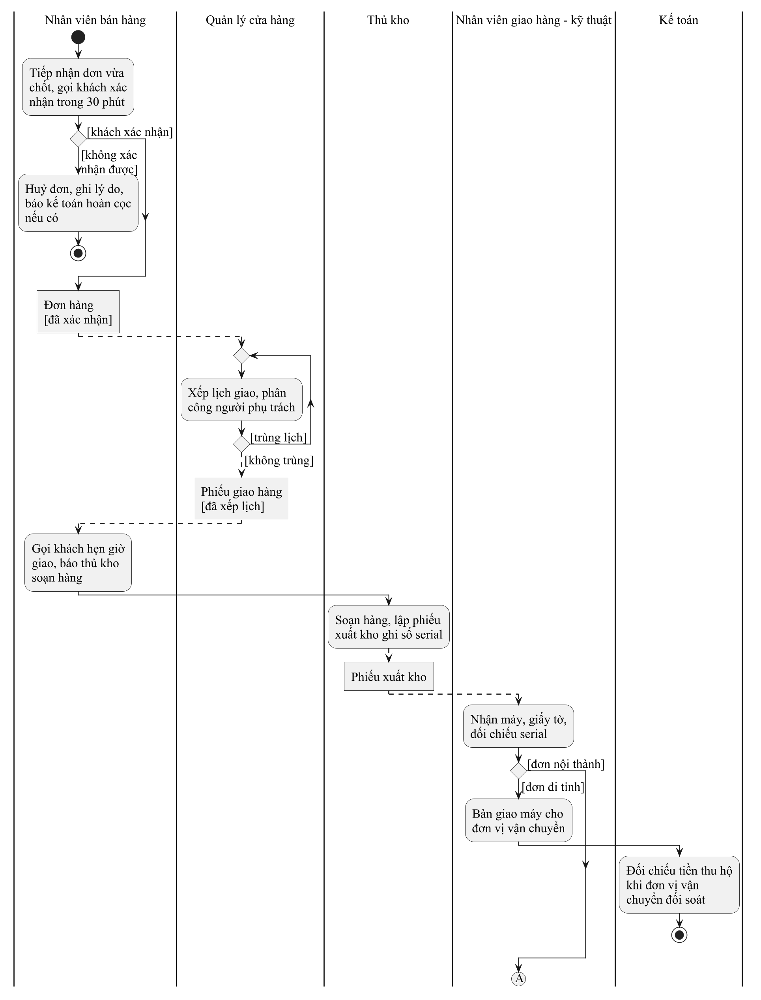
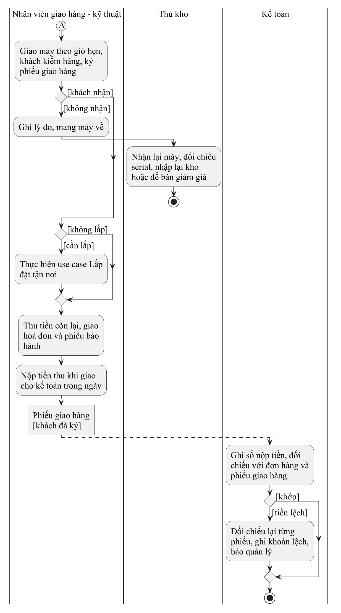
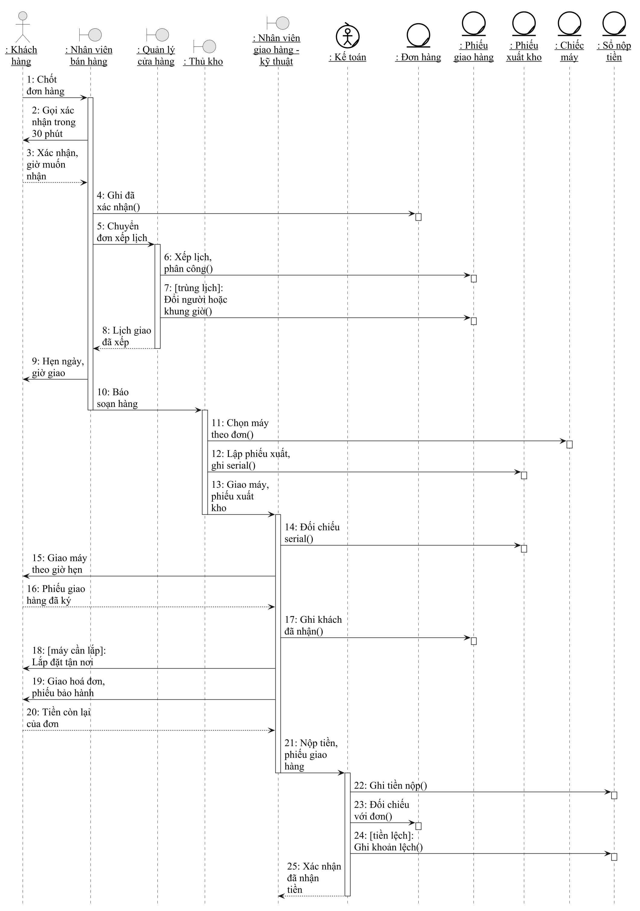
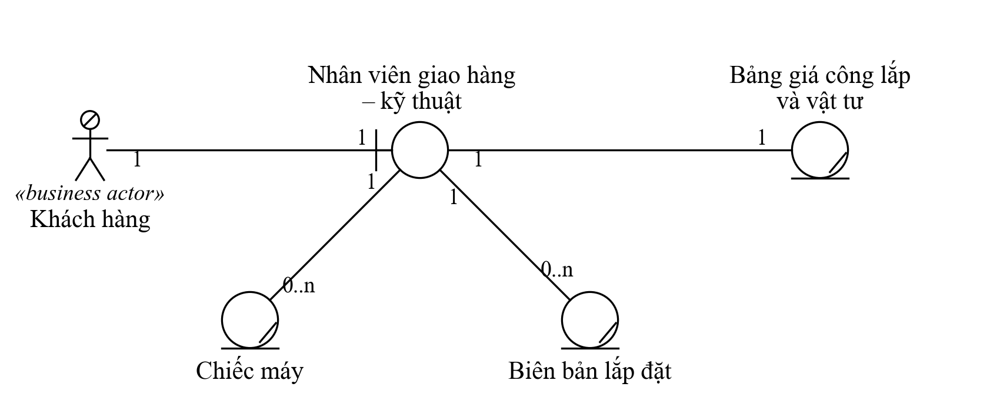
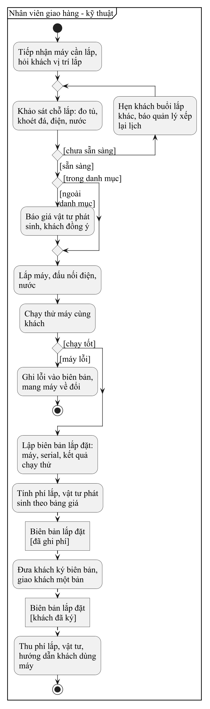
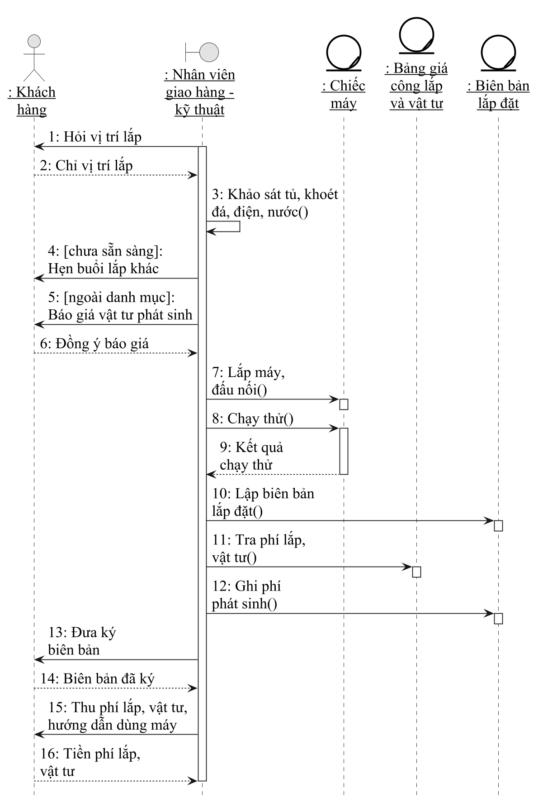
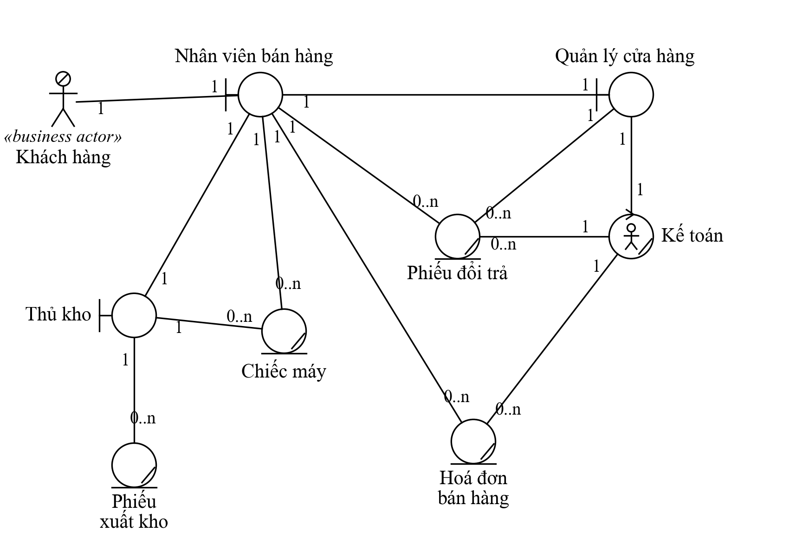
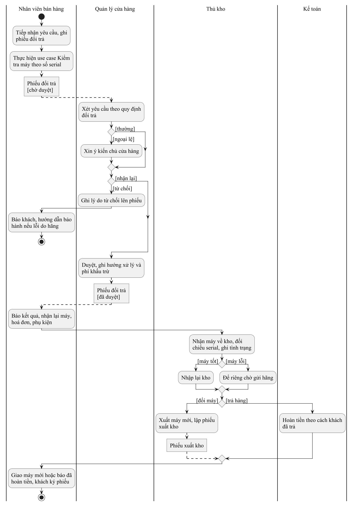
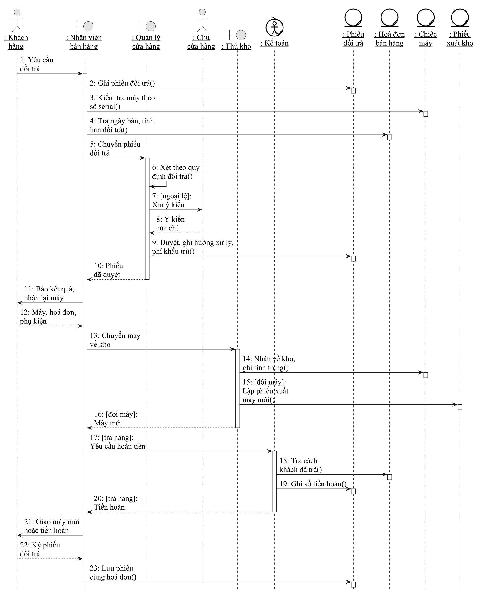

# Đặc tả use case nghiệp vụ · G4 Xử lý đơn, giao hàng, lắp đặt, đổi trả

Bản 0.1 (14/10/2026) · G4 · việc t92, t93, t94 · làm theo khuôn mục 1 của [`../chung/mau-dac-ta.md`](../chung/mau-dac-ta.md)

> Đối tượng phân tích là **cửa hàng giả định** ([`../../khao-sat/tinh-huong-gia-dinh.md`](../../khao-sat/tinh-huong-gia-dinh.md)).
> Mã `MP1`, `MP2`, `MP3` kèm mã câu là phỏng vấn mô phỏng (giả định); `TL-xx` là tài liệu công khai thật.
> Tên tác nhân, thừa tác viên, thực thể theo [`../chung/tac-nhan-va-thuc-the.md`](../chung/tac-nhan-va-thuc-the.md); vấn đề 1–5 theo mục 4 của [`../chung/hien-trang-to-chuc.md`](../chung/hien-trang-to-chuc.md).

Gói G4 có ba use case nghiệp vụ: **BUC-03 Giao hàng** (QT-04), **BUC-08 Lắp đặt tận nơi** («extend» BUC-03 khi sản phẩm cần lắp đặt)
và **BUC-04 Đổi trả hàng** (QT-07, «include» BUC-09 Kiểm tra máy theo số serial do G5 đặc tả).

## BUC-03 Giao hàng

**1. Đặc tả bằng văn bản**

> **Use case nghiệp vụ:** Giao hàng (BUC-03, quy trình QT-04, gói G4)
>
> Use case bắt đầu khi khách hàng chốt đơn mua máy với cửa hàng (tại cửa hàng, qua tin nhắn hoặc gọi điện). Mục tiêu của use case nhằm đưa đúng chiếc máy khách đã mua
> tới tận nơi theo giờ đã hẹn, thu đủ tiền, giao cho khách hoá đơn và phiếu bảo hành, đồng thời đưa tiền thu khi giao về kế toán ngay trong ngày.
>
> **Các dòng cơ bản:**
> 1. Nhân viên bán hàng tiếp nhận đơn hàng vừa chốt, gọi khách hàng xác nhận sản phẩm, địa chỉ, cách thanh toán và ngày giờ muốn nhận trong vòng 30 phút, rồi chuyển đơn đã xác nhận cho quản lý cửa hàng xếp lịch.
> 2. Quản lý cửa hàng xếp lịch giao, phân công nhân viên giao hàng – kỹ thuật phụ trách đơn, ghi ngày giờ và người phụ trách lên phiếu giao hàng; đơn có máy cần lắp thì xếp giao kèm lắp trong một lần.
> 3. Nhân viên bán hàng gọi khách hàng hẹn ngày, giờ giao theo lịch đã xếp, báo thủ kho soạn hàng.
> 4. Thủ kho soạn hàng theo đơn, chọn đúng chiếc máy, lập phiếu xuất kho ghi số serial từng chiếc.
> 5. Nhân viên giao hàng – kỹ thuật nhận máy cùng phiếu xuất kho, phiếu giao hàng, hoá đơn bán hàng, phiếu bảo hành; đối chiếu serial trên máy với phiếu xuất kho rồi ký nhận.
> 6. Nhân viên giao hàng – kỹ thuật giao máy tới khách hàng theo giờ hẹn; khách kiểm hàng, ký phiếu giao hàng và giữ một liên.
> 7. Nhân viên giao hàng – kỹ thuật lắp đặt máy tại chỗ nếu đơn có máy cần lắp (Thực hiện use case Lắp đặt tận nơi).
> 8. Nhân viên giao hàng – kỹ thuật thu số tiền còn lại của đơn, giao hoá đơn bán hàng và phiếu bảo hành cho khách hàng.
> 9. Nhân viên giao hàng – kỹ thuật nộp tiền thu khi giao kèm liên phiếu giao hàng có chữ ký khách cho kế toán ngay trong ngày.
> 10. Kế toán ghi số tiền nhận vào sổ nộp tiền, đối chiếu với đơn hàng và phiếu giao hàng.
>
> **Các dòng thay thế:**
> - Tại bước 1. Xử lý không xác nhận được đơn: nếu không liên lạc được khách hoặc khách báo huỷ, nhân viên bán hàng huỷ đơn, ghi lý do; đơn đã đặt cọc thì báo kế toán hoàn đủ cọc vì máy chưa xuất kho (kết thúc).
> - Tại bước 2. Xử lý trùng lịch: nếu người định phân công đã có đơn khác trong cùng khung giờ hoặc hai địa chỉ quá xa không kịp đi, quản lý cửa hàng chọn người khác hoặc khung giờ khác rồi xếp lại (quay lại bước 2).
> - Tại bước 5. Xử lý đơn đi tỉnh: nếu địa chỉ giao ở tỉnh, nhân viên giao hàng – kỹ thuật đóng gói, bàn giao máy và phiếu giao hàng cho đơn vị vận chuyển, cửa hàng không lắp đặt;
>   khi đơn vị vận chuyển đối soát tiền thu hộ (sau 3–5 ngày), kế toán đối chiếu với đơn hàng (kết thúc).
> - Tại bước 6. Xử lý khách không nhận hàng: nếu khách từ chối nhận, nhân viên giao hàng – kỹ thuật ghi lý do lên phiếu giao hàng, mang máy về; thủ kho nhận lại máy, đối chiếu serial,
>   máy còn seal thì nhập lại kho, hộp móp thì để riêng bán giảm giá; tiền cọc (nếu có) xử lý theo QĐ3 (kết thúc).
> - Tại bước 10. Xử lý tiền nộp lệch: nếu tiền nộp lệch với tổng tiền các đơn đã giao, kế toán đối chiếu lại từng phiếu giao hàng với nhân viên giao hàng – kỹ thuật, ghi khoản lệch vào sổ nộp tiền và báo quản lý cửa hàng.

| Mục | Nội dung |
|---|---|
| Tác nhân nghiệp vụ | Khách hàng, Đơn vị vận chuyển |
| Thừa tác viên | Nhân viên bán hàng, Quản lý cửa hàng, Thủ kho, Nhân viên giao hàng – kỹ thuật, Kế toán |
| Thực thể nghiệp vụ | Đơn hàng, Phiếu giao hàng, Phiếu xuất kho, Chiếc máy, Hoá đơn bán hàng, Phiếu bảo hành, Sổ nộp tiền |
| Ràng buộc trước khi thực hiện | Đơn hàng đã chốt ở use case Bán hàng, có đủ tên, số điện thoại, địa chỉ, sản phẩm, cách thanh toán, có lắp đặt hay không; máy của đơn còn trong kho |
| Kết quả | Khách hàng nhận đúng chiếc máy (đã lắp nếu cần), hoá đơn bán hàng, phiếu bảo hành và một liên phiếu giao hàng; cửa hàng giữ phiếu xuất kho có serial và liên phiếu giao hàng có chữ ký khách; tiền thu khi giao đã ghi sổ nộp tiền, đối chiếu xong trong ngày |
| Quy tắc nghiệp vụ | QĐ1. Gọi xác nhận đơn trong 30 phút sau khi chốt (`MP2 D1`). · QĐ2. Nội thành cửa hàng tự giao kèm lắp; đơn đi tỉnh gửi đơn vị vận chuyển, cửa hàng không lắp (`MP2 D3`). · QĐ3. Huỷ trước khi xuất kho thì hoàn đủ cọc; huỷ hoặc không nhận sau khi xuất kho thì trừ phí theo mức chủ cửa hàng quy định (`MP2 C4`). · QĐ4. Mỗi nhân viên giao hàng – kỹ thuật chỉ nhận một đơn trong một khung giờ; độ dài khung giờ theo mức chủ cửa hàng quy định (`MP2 D2`, `D6`; `MP3 D6`). · QĐ5. Phiếu xuất kho ghi đúng serial từng chiếc giao cho đơn; người nhận máy đi giao đối chiếu lại serial (`MP3 D1`, `E5`). · QĐ6. Khách kiểm hàng rồi ký phiếu giao hàng 2 liên, khách giữ một liên (`MP2 D1`; TL-14). · QĐ7. Hoá đơn giao cho khách lúc giao máy, kể cả khi khách chưa trả tiền (TL-26). · QĐ8. Tiền thu khi giao nộp kế toán trong ngày, không giữ qua đêm (`MP3 D5`; `MP2 D5`). · QĐ9. Đơn vị vận chuyển đối soát tiền thu hộ sau 3–5 ngày (`MP2 D5`). · QĐ10. Máy khách không nhận còn seal thì nhập lại kho bán tiếp; hộp móp thì bán giảm giá 5–10% (`MP2 C6`). |
| Biểu mẫu | Phiếu xuất kho (số phiếu, ngày xuất, người nhận, địa chỉ giao, tên hàng, model, số serial, số lượng, ghi chú, chữ ký thủ kho, người giao, người nhận; `MP3 D1`); Phiếu giao hàng 2 liên (`MP2 D1`); Hoá đơn bán hàng; Phiếu bảo hành của hãng; Sổ nộp tiền |
| Vấn đề hiện tại | Vấn đề 3: lịch giao lắp ghi trên bảng tính dùng chung, không báo trùng giờ; hai đơn cùng 2 giờ chiều ở hai quận, khách chờ 2 tiếng (`MP2 D2`, `D6`). Vấn đề 2: đơn đi tỉnh khách không nhận, mất 300–500 nghìn phí giao hai chiều mỗi đơn (`MP2 C4`, `C6`). Vấn đề 5: tiền thu khi giao ghi sổ tay, thỉnh thoảng lệch vài chục nghìn (`MP2 D5`). Vấn đề 4: có lần xuất máy chỉ báo trong nhóm nhắn tin, không lập phiếu, lệch 2 máy hút mùi không rõ ai xuất (`MP2 A5`, `E5`). Khách hỏi đơn tới đâu thì nhân viên phải tra nhiều chỗ, hỏi người giao rồi mới trả lời (`MP2 C7`) |
| Nguồn | `MP2 A5`, `C2`, `C4`, `C6`, `C7`, `D1`, `D2`, `D3`, `D5`, `D6`, `E5`; `MP3 C7`, `D1`, `D3`, `D5`, `D6`, `E5`; `MP1 D1`, `D3`, `D5`, `D6`; TL-02, TL-10, TL-11, TL-14, TL-26 |

**2. Sơ đồ đối tượng nghiệp vụ** (Khách hàng giao tiếp với nhân viên bán hàng khi xác nhận, hẹn giờ và với nhân viên giao hàng – kỹ thuật khi nhận máy; Đơn vị vận chuyển chỉ giao tiếp với nhân viên giao hàng – kỹ thuật;
Kế toán làm việc bên trong, nhận tiền và phiếu giao hàng từ nhân viên giao hàng – kỹ thuật)

**3. Sơ đồ hoạt động** (năm luồng, dài quá một trang A4 nên tách hai phần nối bằng điểm nối `A`: phần 1 từ xác nhận đơn tới nhận máy đi giao, phần 2 từ giao máy tới đối chiếu tiền.
Trùng lịch là vòng quay về nút kết hợp trước bước 2; không xác nhận được đơn, đơn đi tỉnh, khách không nhận là ba nhánh kết thúc sớm; bước 7 là điểm mở rộng gọi Lắp đặt tận nơi khi `[cần lắp]`)

**4. Sơ đồ tuần tự nghiệp vụ** (vẽ dòng cơ bản; dòng thay thế trùng lịch và tiền nộp lệch là thông điệp có điều kiện 7 và 24; lắp đặt là thông điệp có điều kiện 18, chi tiết ở sơ đồ tuần tự BUC-08)

## BUC-08 Lắp đặt tận nơi

**1. Đặc tả bằng văn bản**

> **Use case nghiệp vụ:** Lắp đặt tận nơi (BUC-08, nhánh lắp đặt của quy trình QT-04, gói G4; «extend» Giao hàng khi [sản phẩm cần lắp đặt])
>
> Use case bắt đầu khi nhân viên giao hàng – kỹ thuật giao tới khách hàng một đơn có máy cần lắp đặt (bếp từ âm, máy hút mùi, máy rửa chén, lò âm tủ, máy lọc nước), tại bước 7 của use case Giao hàng.
> Mục tiêu của use case nhằm để khách hàng có máy được lắp đúng chỗ, chạy thử tốt, và có biên bản lắp đặt ghi rõ máy, số serial, phí lắp và vật tư phát sinh.
>
> **Các dòng cơ bản:**
> 1. Nhân viên giao hàng – kỹ thuật tiếp nhận máy cần lắp sau khi khách hàng đã kiểm hàng, hỏi khách vị trí muốn lắp.
> 2. Nhân viên giao hàng – kỹ thuật khảo sát chỗ lắp: đo tủ, vị trí và kích thước khoét đá, nguồn điện, đường nước.
> 3. Nhân viên giao hàng – kỹ thuật lắp máy vào vị trí, đấu nối điện, nước.
> 4. Nhân viên giao hàng – kỹ thuật chạy thử máy cùng khách hàng.
> 5. Nhân viên giao hàng – kỹ thuật lập biên bản lắp đặt: mã đơn, thông tin khách, địa chỉ công trình, máy và số serial, kết quả chạy thử, tình trạng công trình, ghi chú phát sinh.
> 6. Nhân viên giao hàng – kỹ thuật tính phí lắp và vật tư phát sinh theo bảng giá công lắp và vật tư, ghi vào biên bản lắp đặt.
> 7. Nhân viên giao hàng – kỹ thuật đưa khách hàng ký biên bản lắp đặt, ký tên người lắp, giao khách một bản.
> 8. Nhân viên giao hàng – kỹ thuật thu phí lắp và vật tư phát sinh (nếu có), hướng dẫn khách dùng máy, rồi tiếp tục bước 8 của use case Giao hàng.
>
> **Các dòng thay thế:**
> - Tại bước 2. Xử lý chỗ lắp chưa sẵn sàng: nếu tủ chưa đóng xong, mặt đá chưa khoét hoặc chưa có nguồn điện, nước phù hợp, nhân viên giao hàng – kỹ thuật ghi lại tình trạng công trình,
>   hẹn với khách buổi lắp khác và báo quản lý cửa hàng xếp lại lịch; tới buổi hẹn thì quay lại bước 2.
> - Tại bước 3. Xử lý vật tư ngoài danh mục: nếu chỗ lắp cần việc hoặc vật tư không có trong bảng giá (ví dụ đi dây điện riêng), nhân viên giao hàng – kỹ thuật báo giá cho khách trước khi làm;
>   khách đồng ý thì ghi vào phần phát sinh rồi lắp (tiếp tục bước 3).
> - Tại bước 4. Xử lý máy lỗi khi chạy thử: nếu máy chạy thử bị lỗi không do lắp đặt, nhân viên giao hàng – kỹ thuật ghi lỗi vào biên bản lắp đặt, mang máy về cửa hàng để đổi máy khác cùng mẫu
>   và hẹn khách lắp lại (kết thúc).

| Mục | Nội dung |
|---|---|
| Tác nhân nghiệp vụ | Khách hàng (tác nhân của use case gốc Giao hàng; trên sơ đồ use case nghiệp vụ tổng, use case mở rộng không nối trực tiếp với tác nhân) |
| Thừa tác viên | Nhân viên giao hàng – kỹ thuật |
| Thực thể nghiệp vụ | Chiếc máy, Biên bản lắp đặt, Bảng giá công lắp và vật tư |
| Ràng buộc trước khi thực hiện | Đơn giao nội thành, có máy cần lắp đặt; khách đã kiểm hàng và ký phiếu giao hàng (bước 6 của Giao hàng); người lắp mang theo bảng giá công lắp và vật tư |
| Kết quả | Máy đã lắp và chạy thử tốt; biên bản lắp đặt có chữ ký khách và người lắp, khách giữ một bản; phí lắp và vật tư phát sinh đã thu, nộp kế toán cùng tiền thu khi giao (bước 9 của Giao hàng) |
| Quy tắc nghiệp vụ | QĐ1. Máy âm tủ (bếp từ âm, máy hút mùi, máy rửa chén, lò âm tủ) và máy lọc nước do cửa hàng lắp tận nơi (`MP2 D2`; `MP3 D2`; `MP1 D2`). · QĐ2. Chỉ lắp cho đơn nội thành; đơn đi tỉnh cửa hàng không lắp (`MP2 D3`). · QĐ3. Công lắp miễn phí với đơn nội thành từ 5 triệu đồng; dưới 5 triệu thu 200–300 nghìn đồng (`MP2 D2`; `MP1 D2`). · QĐ4. Vật tư phát sinh tính riêng với công lắp, theo bảng giá công lắp và vật tư (TL-01, TL-08). · QĐ5. Việc hoặc vật tư ngoài danh mục phải báo giá, khách đồng ý rồi mới làm (TL-01; TL-14). · QĐ6. Phải khảo sát chỗ lắp (tủ, khoét đá, điện, nước) trước khi lắp máy âm (`MP3 D2`). · QĐ7. Biên bản lắp đặt ghi đủ mã đơn, địa chỉ công trình, máy và serial, kết quả chạy thử, phát sinh, có chữ ký khách và người lắp (`MP3 D2`; `MP2 D2`). |
| Biểu mẫu | Biên bản lắp đặt (mã đơn, thông tin khách, địa chỉ công trình, danh sách máy và serial, kết quả chạy thử, tình trạng công trình, ghi chú phát sinh, chữ ký khách và người lắp; `MP3 D2`); Bảng giá công lắp và vật tư (TL-08) |
| Vấn đề hiện tại | Vấn đề 3: giờ lắp hẹn qua điện thoại, lịch không báo trùng; công trình chưa sẵn sàng thì phải dời buổi, dễ trễ hẹn các đơn sau (`MP3 D6`, `F1`; `MP2 D6`). Vấn đề 4: serial chép tay lên biên bản, dễ ghi nhầm máy (`MP3 F1`) |
| Nguồn | `MP2 D2`, `D3`, `D6`; `MP3 B2`, `D2`, `D6`, `F1`; `MP1 D2`; TL-01, TL-08, TL-14 |

**2. Sơ đồ đối tượng nghiệp vụ** (chỉ một thừa tác viên giao tiếp với môi trường; khách hàng là tác nhân của use case gốc nhưng trực tiếp ký biên bản và trả phí lắp nên vẫn vẽ nối với nhân viên giao hàng – kỹ thuật)

**3. Sơ đồ hoạt động** (một luồng; PlantUML không hiện tên khi chỉ có một luồng nên tên thừa tác viên ghi ở khung bao. Chỗ lắp chưa sẵn sàng là vòng quay về nút kết hợp trước bước khảo sát;
vật tư ngoài danh mục là nhánh trước bước lắp; máy lỗi khi chạy thử là nhánh kết thúc sớm; biên bản lắp đặt đi qua hai trạng thái `[đã ghi phí]` và `[khách đã ký]`)

**4. Sơ đồ tuần tự nghiệp vụ** (vẽ riêng vì sơ đồ BUC-03 đã đủ rộng; hai dòng thay thế chỗ lắp chưa sẵn sàng và vật tư ngoài danh mục là thông điệp có điều kiện 4 và 5)

## BUC-04 Đổi trả hàng

**1. Đặc tả bằng văn bản**

> **Use case nghiệp vụ:** Đổi trả hàng (BUC-04, quy trình QT-07, gói G4; «include» Kiểm tra máy theo số serial)
>
> Use case bắt đầu khi khách hàng đã nhận máy quay lại cửa hàng (hoặc gọi điện, nhắn tin) yêu cầu đổi máy khác hoặc trả lại máy. Mục tiêu của use case nhằm giải quyết yêu cầu đúng quy định đổi trả:
> khách nhận máy mới hoặc nhận lại tiền theo cách đã trả, hoặc biết rõ lý do bị từ chối; máy trả về được đưa về kho đúng tình trạng.
>
> **Các dòng cơ bản:**
> 1. Nhân viên bán hàng tiếp nhận yêu cầu đổi trả của khách hàng, ghi phiếu đổi trả: số điện thoại, mã đơn, lý do (lỗi do hãng, không đúng mô tả, đổi ý), tình trạng máy (còn seal hay không, đã lắp hay chưa).
> 2. Nhân viên bán hàng kiểm tra chiếc máy: đúng máy cửa hàng đã bán, ngày bán, còn hạn đổi trả; ghi kết quả lên phiếu rồi chuyển quản lý cửa hàng duyệt (Thực hiện use case Kiểm tra máy theo số serial).
> 3. Quản lý cửa hàng xét yêu cầu theo quy định đổi trả (QĐ1–QĐ3).
> 4. Quản lý cửa hàng duyệt, ghi hướng xử lý (đổi máy hay trả hàng) và phí khấu trừ nếu có lên phiếu đổi trả.
> 5. Nhân viên bán hàng báo kết quả cho khách hàng, nhận lại máy kèm hoá đơn bán hàng, phụ kiện.
> 6. Thủ kho nhận máy về kho, đối chiếu serial, ghi tình trạng máy; máy còn tốt thì nhập lại kho.
> 7. Thủ kho xuất chiếc máy mới cùng mẫu, lập phiếu xuất kho ghi serial máy mới khi hướng xử lý là đổi máy.
> 8. Kế toán hoàn tiền theo đúng cách khách đã trả, trừ phí khấu trừ nếu có, khi hướng xử lý là trả hàng.
> 9. Nhân viên bán hàng giao máy mới hoặc báo đã hoàn tiền, khách hàng ký phiếu đổi trả; nhân viên lưu phiếu cùng hoá đơn bán hàng.
>
> **Các dòng thay thế:**
> - Tại bước 3. Xử lý trường hợp ngoại lệ: nếu yêu cầu không đúng quy định nhưng là trường hợp ngoại lệ, quản lý cửa hàng xin ý kiến chủ cửa hàng; chủ đồng ý thì tiếp tục bước 4, không đồng ý thì xử lý như dòng thay thế kế tiếp.
> - Tại bước 3. Xử lý quá hạn hoặc không còn seal: nếu quá 7 ngày, máy đã bóc seal hoặc đã lắp mà không phải lỗi do hãng, hoặc lỗi do hãng nhưng quá 30 ngày, quản lý cửa hàng từ chối và ghi lý do lên phiếu;
>   nhân viên bán hàng báo khách, máy lỗi do hãng thì hướng dẫn chuyển sang bảo hành (kết thúc).
> - Tại bước 3. Xử lý hàng không đúng mô tả: nếu máy giao không đúng mô tả cửa hàng đã đăng bán, quản lý cửa hàng bắt buộc nhận lại dù không thoả QĐ1–QĐ3 (tiếp tục bước 4).
> - Tại bước 6. Xử lý máy trả về bị lỗi: nếu máy trả về bị lỗi, thủ kho không nhập lại để bán mà để riêng, ghi tình trạng lỗi chờ gửi hãng (tiếp tục bước 7).

| Mục | Nội dung |
|---|---|
| Tác nhân nghiệp vụ | Khách hàng |
| Thừa tác viên | Nhân viên bán hàng, Quản lý cửa hàng, Thủ kho, Kế toán |
| Thực thể nghiệp vụ | Phiếu đổi trả, Hoá đơn bán hàng, Chiếc máy, Phiếu xuất kho (máy đổi) |
| Ràng buộc trước khi thực hiện | Đơn đã giao xong; khách còn hoá đơn hoặc cho biết mã đơn, số điện thoại lúc mua; chiếc máy có số serial trên phiếu xuất kho của đơn |
| Kết quả | Phiếu đổi trả có hướng xử lý, chữ ký người duyệt và khách; máy trả về đã vào kho (nhập lại để bán hoặc để riêng chờ gửi hãng); khách nhận máy mới kèm phiếu xuất kho hoặc nhận lại tiền theo cách đã trả. Yêu cầu bị từ chối thì khách biết lý do, máy lỗi do hãng được hướng dẫn sang bảo hành |
| Quy tắc nghiệp vụ | QĐ1. Khách đổi ý được đổi trả trong 7 ngày kể từ ngày bán nếu máy còn seal, chưa lắp (`MP2 D4`; `MP3 D4`; `MP1 D4`). · QĐ2. Máy lỗi do hãng được đổi trả trong 30 ngày kể từ ngày bán; quá 30 ngày thì chuyển sang bảo hành (`MP2 D4`; `MP3 D4`). · QĐ3. Máy đã lắp chỉ được đổi khi lỗi do hãng (`MP3 D4`). · QĐ4. Hàng không đúng mô tả thì bắt buộc nhận lại (TL-20 Đ16). · QĐ5. Quản lý cửa hàng duyệt đổi trả thường; trường hợp ngoại lệ xin ý kiến chủ cửa hàng (`MP3 D4`). · QĐ6. Phí khấu trừ khi trả hàng (nếu có) theo mức chủ cửa hàng quy định; ngành tính theo phần trăm giá máy (TL-03, TL-12, TL-15). · QĐ7. Hoàn tiền theo đúng cách khách đã trả (TL-22 Đ38 k3, k4; TL-03). · QĐ8. Máy trả về còn seal thì nhập lại kho bán tiếp; máy lỗi để riêng chờ gửi hãng (`MP2 C6`, `E4`). · QĐ9. Phiếu đổi trả ghi đủ số điện thoại, mã đơn, lý do, tình trạng máy, hướng xử lý (`MP2 D4`). |
| Biểu mẫu | Phiếu đổi trả (số điện thoại, mã đơn, lý do, tình trạng máy, hướng xử lý; `MP2 D4`); Hoá đơn bán hàng; Phiếu xuất kho của máy đổi |
| Vấn đề hiện tại | Vấn đề 4: yêu cầu đổi trả ghi trong nhóm nhắn tin và phiếu giấy, không gắn với số serial; khách mất phiếu thì phải lục hoá đơn tìm ngày bán (`MP2 D4`, `E4`). Quyết định đổi trả không lưu ai duyệt, hướng xử lý ra sao, nên khó tra lại khi khách khiếu nại (`MP2 D4`) |
| Nguồn | `MP2 C6`, `D4`, `E4`; `MP3 C4`, `C6`, `D4`; `MP1 D4`; TL-03, TL-12, TL-15, TL-20 Đ16, TL-22 Đ38 |

**2. Sơ đồ đối tượng nghiệp vụ** (chỉ nhân viên bán hàng giao tiếp với khách hàng; kế toán làm việc bên trong, nhận phiếu đổi trả đã duyệt và tra cách khách đã trả trên hoá đơn)

**3. Sơ đồ hoạt động** (bước 2 gọi use case Kiểm tra máy theo số serial; ba dòng thay thế tại bước 3 gộp thành hai nút quyết định: `[ngoại lệ]` thì xin ý kiến chủ, rồi `[từ chối]` hoặc `[nhận lại]`
(nhận lại gồm cả đúng quy định, hàng không đúng mô tả và ngoại lệ được chủ đồng ý); máy trả về lỗi là nhánh tại bước 6; đổi máy và trả hàng là hai nhánh ở hai luồng Thủ kho và Kế toán)

**4. Sơ đồ tuần tự nghiệp vụ** (vẽ dòng cơ bản; dòng thay thế trường hợp ngoại lệ là thông điệp có điều kiện 7, 8 với Chủ cửa hàng; hai hướng xử lý đổi máy và trả hàng là các thông điệp có điều kiện 15–17 và 20)

