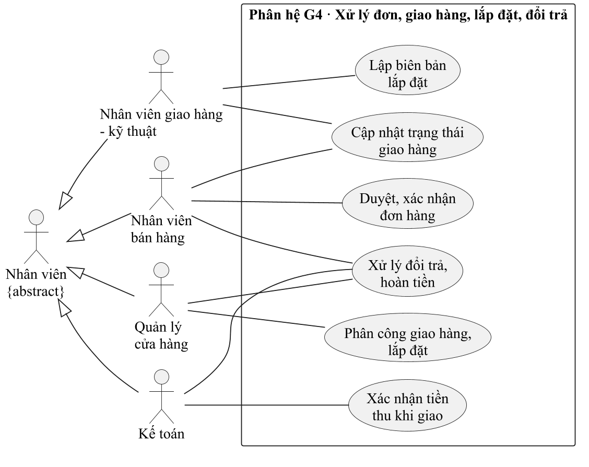

# Đặc tả use case hệ thống · G4 Xử lý đơn, giao hàng, lắp đặt, đổi trả

Bản 0.1 (14/10/2026) · G4 · việc t102, t103 · làm theo khuôn mục 2 của [`../chung/mau-dac-ta.md`](../chung/mau-dac-ta.md)

Tên, mã use case theo [`../chung/danh-muc-use-case.md`](../chung/danh-muc-use-case.md); trạng thái đơn và trạng thái chiếc máy theo mục 4, 5 của [`../chung/lop-va-trang-thai-chung.md`](../chung/lop-va-trang-thai-chung.md).
Quy tắc `QĐx` dẫn lại từ [`dac-ta-nghiep-vu.md`](dac-ta-nghiep-vu.md); mã `YC-…` từ mục 3 của [`../chung/hien-trang-va-yeu-cau.md`](../chung/hien-trang-va-yeu-cau.md).

## Sơ đồ use case phân hệ G4

Sáu use case UC-DH-01 đến UC-DH-06. So với danh mục chung có hai chỗ đổi, theo quyết định ngày 14/10/2026:
**Kế toán** là tác nhân mới kế thừa Nhân viên, làm tác nhân của UC-DH-04 Xác nhận tiền thu khi giao (thay Quản lý cửa hàng),
và tham gia UC-DH-06 ở bước ghi đã hoàn tiền (vì trong use case nghiệp vụ Đổi trả hàng, kế toán là người hoàn tiền).
Danh mục chung không có quan hệ include, extend nào giữa các use case của G4 nên sơ đồ không vẽ.

| Mã | Use case | Tác nhân | Đặc tả |
|---|---|---|---|
| UC-DH-01 | Duyệt, xác nhận đơn hàng | Nhân viên bán hàng | ★ dưới đây |
| UC-DH-02 | Phân công giao hàng, lắp đặt | Quản lý cửa hàng | ✓ dưới đây |
| UC-DH-03 | Cập nhật trạng thái giao hàng | Nhân viên giao hàng – kỹ thuật; Nhân viên bán hàng (đơn gửi đơn vị vận chuyển) | |
| UC-DH-04 | Xác nhận tiền thu khi giao | Kế toán | |
| UC-DH-05 | Lập biên bản lắp đặt | Nhân viên giao hàng – kỹ thuật | |
| UC-DH-06 | Xử lý đổi trả, hoàn tiền | Nhân viên bán hàng (tiếp nhận), Quản lý cửa hàng (duyệt), Kế toán (hoàn tiền) | ★ dưới đây |

## UC-DH-01 Duyệt, xác nhận đơn hàng

| Mục | Nội dung |
|---|---|
| Mã, tên | UC-DH-01 Duyệt, xác nhận đơn hàng |
| Gói | G4 |
| Tác nhân chính | Nhân viên bán hàng |
| Tác nhân phụ | Không có |
| Mô tả | Nhân viên bán hàng gọi khách xác nhận đơn vừa đặt rồi chuyển đơn sang Đã xác nhận để xếp lịch và xuất kho, hoặc huỷ đơn kèm lý do |
| Điều kiện trước | Đã đăng nhập với vai Nhân viên bán hàng; có đơn ở trạng thái Chờ xác nhận (tạo ở UC-MH-04) |
| Điều kiện sau | Đơn ở trạng thái Đã xác nhận, hoặc Đã huỷ kèm lý do; đơn ghi nhân viên duyệt; thêm một dòng `LichSuTrangThaiDon` (người đổi, thời điểm); đơn Đã xác nhận hiện trong danh sách chờ xếp lịch (UC-DH-02) và chờ xuất kho (UC-KB-04) |
| Màn hình | `giao-dien/quan-tri/don-hang.html` (danh sách đơn lọc theo trạng thái); màn hình chi tiết đơn chưa có, thiết kế ở tuần 14 |

**Luồng sự kiện chính**

| Bước | Tác nhân | Hệ thống |
|---|---|---|
| 1 | Mở trang Đơn hàng, chọn lọc "Chờ xác nhận" | Hiện danh sách đơn Chờ xác nhận, đơn mới ở đầu; mỗi dòng có mã đơn, ngày giờ đặt, người nhận, số điện thoại, tổng tiền và số phút đã chờ; đơn chờ quá 30 phút được tô nổi |
| 2 | Chọn một đơn | Hiện chi tiết: người nhận, số điện thoại, địa chỉ giao (nội thành hay tỉnh), sản phẩm, số lượng, đơn giá lúc đặt, khuyến mãi, phí giao, phí lắp, cách thanh toán, tiền cọc đã nhận, có cần lắp đặt không; số máy còn trong kho của từng mẫu |
| 3 | Gọi điện cho khách (ngoài hệ thống) xác nhận sản phẩm, địa chỉ, cách thanh toán; ghi ngày giờ khách muốn nhận vào ô ghi chú, sửa địa chỉ nếu khách đổi | Lưu ghi chú và địa chỉ đã sửa |
| 4 | Bấm "Xác nhận đơn" | Kiểm tra đơn vẫn ở Chờ xác nhận và mỗi mẫu máy trong đơn còn đủ số lượng trong kho |
| 5 | | Chuyển đơn sang Đã xác nhận, ghi nhân viên duyệt, thêm dòng lịch sử trạng thái |
| 6 | | Đưa đơn vào danh sách chờ xếp lịch giao lắp (đơn nội thành) hoặc chờ gửi đơn vị vận chuyển (đơn tỉnh) và danh sách chờ xuất kho; báo "Đã xác nhận đơn #…" |

**Luồng thay thế**
- `1a.` Không có đơn chờ: hiện "Không có đơn chờ xác nhận".
- `1b.` Khách gọi huỷ đơn đã xác nhận nhưng chưa xuất kho: nhân viên lọc "Đã xác nhận", mở đơn, bấm "Huỷ đơn" và làm như `3b`; nút Huỷ chỉ hiện khi đơn chưa có phiếu xuất. Đơn đã sang Đang giao thì không huỷ ở đây; khách từ chối nhận xử lý ở UC-DH-03.
- `3a.` Khách chưa nghe máy: nhân viên bấm "Gọi lại sau"; hệ thống tăng số lần đã gọi, giữ đơn ở Chờ xác nhận và hiện số lần gọi trên danh sách.
- `3b.` Khách báo huỷ, hoặc đã gọi đủ số lần theo mức chủ cửa hàng quy định mà không liên lạc được: nhân viên bấm "Huỷ đơn", chọn lý do (Khách huỷ, Không liên lạc được, Hết hàng, Khác); hệ thống bắt buộc có lý do, chuyển đơn sang Đã huỷ, thêm dòng lịch sử; đơn đã nhận cọc thì hiện số tiền phải hoàn đủ cho khách (QĐ3 của BUC-03).
- `4a.` Không đủ hàng: hệ thống báo mẫu máy thiếu và số còn; khách đồng ý chờ thì nhân viên ghi ngày dự kiến có hàng vào ghi chú, đơn giữ Chờ xác nhận; khách không chờ thì huỷ như `3b` với lý do Hết hàng.
- `4b.` Đơn đã đổi trạng thái trong lúc nhân viên đang gọi (khách tự huỷ ở UC-MH-07, hoặc nhân viên khác đã xác nhận): hệ thống báo "Đơn #… đã ở trạng thái …", không ghi đè.
- `4c.` Đơn có tiền hàng trên 10 triệu đồng chưa có tiền cọc: hệ thống nhắc "Đơn trên 10 triệu: xin cọc 10–20%" kèm số tiền gợi ý; khách chuyển cọc (UC-MH-05) thì đơn hiện số tiền cọc rồi tiếp tục bước 5; khách không cọc thì xử lý theo mức chủ cửa hàng quy định.

**Ngoại lệ**
- Mất kết nối hoặc lỗi máy chủ khi bấm Xác nhận, Huỷ: không đổi trạng thái, không thêm dòng lịch sử; báo "Chưa lưu được, thử lại".
- Phiên đăng nhập hết hạn: chuyển về trang đăng nhập, đơn giữ nguyên trạng thái.

**Quy tắc nghiệp vụ:** QĐ1 (gọi xác nhận trong 30 phút), QĐ3 (huỷ trước khi xuất kho hoàn đủ cọc) của BUC-03; đơn trên 10 triệu xin cọc 10–20% (`MP2 C3`);
YC-DH-01; YC-HT-05 (lưu vết ai đổi trạng thái đơn); chuyển trạng thái theo mục 4 của `lop-va-trang-thai-chung.md` (Chờ xác nhận sang Đã xác nhận hoặc Đã huỷ; Đã xác nhận sang Đã huỷ chỉ khi chưa xuất kho).

## UC-DH-06 Xử lý đổi trả, hoàn tiền

| Mục | Nội dung |
|---|---|
| Mã, tên | UC-DH-06 Xử lý đổi trả, hoàn tiền |
| Gói | G4 |
| Tác nhân chính | Nhân viên bán hàng (tiếp nhận yêu cầu) |
| Tác nhân phụ | Quản lý cửa hàng (duyệt hoặc từ chối); Kế toán (ghi đã hoàn tiền) |
| Mô tả | Nhân viên bán hàng lập yêu cầu đổi trả cho chiếc máy khách mang lại, hệ thống đối chiếu hạn theo serial, quản lý cửa hàng duyệt; máy về kho, khách được đổi máy mới hoặc hoàn tiền theo cách đã trả |
| Điều kiện trước | Người làm từng bước đã đăng nhập với vai tương ứng; đơn ở trạng thái Hoàn thành; chiếc máy khách mang lại ở trạng thái Đã bán |
| Điều kiện sau | Có một `YeuCauDoiTra` ở trạng thái Đã duyệt hoặc Từ chối, ghi người duyệt. Khi duyệt: chiếc máy chuyển Đã bán sang Trả về kho. Trả hàng: số tiền hoàn ghi trên yêu cầu; khách trả toàn bộ đơn thì đơn sang Đã trả hàng, `trangThaiThanhToan` sang Đã hoàn tiền. Đổi máy: đơn có thêm phiếu xuất máy mới, đơn giữ Hoàn thành |
| Màn hình | Chưa có, thiết kế ở tuần 14 |

**Luồng sự kiện chính**

| Bước | Tác nhân | Hệ thống |
|---|---|---|
| 1 | Nhân viên bán hàng: tìm đơn theo mã đơn, số điện thoại hoặc số serial, bấm "Tạo yêu cầu đổi trả" | Hiện các chiếc máy của đơn: tên, model, serial, ngày bán, số ngày đã qua từ ngày bán, đã lắp hay chưa |
| 2 | Chọn chiếc máy khách mang lại, chọn hình thức (Đổi máy, Trả hàng), loại lý do (Lỗi nhà sản xuất, Không đúng mô tả, Đổi ý), ghi tình trạng máy (còn seal, đã lắp, bên ngoài), bấm "Gửi duyệt" | Kiểm tra serial thuộc đơn này và đang ở trạng thái Đã bán |
| 3 | | Đối chiếu điều kiện: đổi ý thì trong 7 ngày, còn seal, chưa lắp; lỗi nhà sản xuất thì trong 30 ngày; không đúng mô tả thì luôn nhận; hiện "Đủ điều kiện" hoặc điều kiện nào không đạt |
| 4 | | Tạo `YeuCauDoiTra` trạng thái Chờ duyệt, lưu kết quả đối chiếu; báo Quản lý cửa hàng có yêu cầu chờ duyệt |
| 5 | Quản lý cửa hàng: mở yêu cầu chờ duyệt | Hiện yêu cầu, hoá đơn, các lần bảo hành của chiếc máy, phí khấu trừ tính theo mức chủ cửa hàng đặt |
| 6 | Sửa phí khấu trừ nếu cần, bấm "Duyệt" | Chuyển yêu cầu sang Đã duyệt, ghi người duyệt, thời điểm; báo nhân viên bán hàng |
| 7 | Nhân viên bán hàng: nhận lại máy, hoá đơn, phụ kiện từ khách, bấm "Đã nhận máy" | Chuyển chiếc máy sang Trả về kho; đưa vào danh sách chờ thủ kho nhận về kho (UC-KB-08) |
| 8 | Kế toán: mở yêu cầu đã duyệt hình thức Trả hàng | Hiện số tiền phải hoàn (số khách đã trả cho chiếc máy trừ phí khấu trừ) và cách khách đã trả |
| 9 | Hoàn tiền cho khách theo đúng cách đó (ngoài hệ thống), nhập mã giao dịch hoặc ghi chú, bấm "Đã hoàn tiền" | Lưu số tiền, ngày hoàn, người hoàn; khách trả toàn bộ đơn thì chuyển đơn sang Đã trả hàng, `trangThaiThanhToan` sang Đã hoàn tiền; thêm dòng lịch sử trạng thái; báo nhân viên bán hàng |

**Luồng thay thế**
- `2a.` Serial không thuộc đơn hoặc không phải máy cửa hàng bán: báo "Serial không khớp đơn", không tạo yêu cầu.
- `2b.` Chiếc máy đã có một yêu cầu đổi trả Chờ duyệt: báo trùng và mở yêu cầu đang có.
- `3a.` Không đủ điều kiện (quá 7 ngày, mất seal, đã lắp mà không phải lỗi nhà sản xuất, lỗi nhà sản xuất quá 30 ngày): hệ thống ghi rõ điều kiện không đạt; lỗi nhà sản xuất quá 30 ngày thì gợi ý chuyển sang Tiếp nhận bảo hành (UC-KB-06); khách xin xét ngoại lệ thì nhân viên vẫn gửi duyệt, yêu cầu được đánh dấu "Ngoại lệ".
- `6a.` Từ chối: quản lý bấm "Từ chối", bắt buộc nhập lý do; yêu cầu sang Từ chối, chiếc máy giữ Đã bán; nhân viên bán hàng báo khách; use case kết thúc.
- `6b.` Yêu cầu đánh dấu Ngoại lệ: quản lý xin ý kiến chủ cửa hàng (ngoài hệ thống), ghi ý kiến của chủ vào yêu cầu rồi Duyệt hoặc Từ chối theo ý chủ.
- `6c.` Lý do Không đúng mô tả: hệ thống không cho Từ chối; quản lý chỉ chọn đổi máy hoặc trả hàng theo ý khách.
- `8a.` Hình thức Đổi máy: không qua kế toán; hệ thống tạo yêu cầu xuất một máy cùng mẫu cho đơn, thủ kho lập phiếu xuất chọn serial mới (UC-KB-04); nhân viên bán hàng giao máy mới, bấm "Đã giao máy đổi"; hệ thống chuyển chiếc máy mới sang Đã bán, đơn giữ Hoàn thành.
- `9a.` Khách chỉ trả một phần đơn: đơn giữ Hoàn thành, `trangThaiThanhToan` giữ nguyên; số tiền hoàn chỉ ghi trên yêu cầu đổi trả (quy tắc chung 4).
- `9b.` Kế toán chọn cách hoàn khác cách khách đã trả: hệ thống không cho lưu, báo "Hoàn tiền theo cách khách đã trả".

**Ngoại lệ**
- Mất kết nối khi lưu: yêu cầu đổi trả và trạng thái chiếc máy lưu cùng một lần; lỗi thì không lưu gì, báo "Chưa lưu được, thử lại".
- Hai người cùng xử lý một yêu cầu: người lưu sau nhận báo "Yêu cầu đã được … xử lý lúc …", không ghi đè.

**Quy tắc nghiệp vụ:** QĐ1–QĐ9 của BUC-04 (hạn 7 ngày, 30 ngày; máy đã lắp chỉ đổi khi lỗi hãng; không đúng mô tả bắt buộc nhận lại; ngoại lệ hỏi chủ; phí khấu trừ theo mức chủ quy định; hoàn theo cách khách đã trả; máy lỗi để riêng);
YC-DH-07, YC-DH-08; YC-HT-05; trạng thái chiếc máy theo mục 5 (Đã bán sang Trả về kho), trạng thái đơn theo mục 4 (Hoàn thành sang Đã trả hàng) của `lop-va-trang-thai-chung.md`.

## UC-DH-02 Phân công giao hàng, lắp đặt

| Mục | Nội dung |
|---|---|
| Mã, tên | UC-DH-02 Phân công giao hàng, lắp đặt |
| Gói | G4 |
| Tác nhân chính | Quản lý cửa hàng |
| Tác nhân phụ | Nhân viên giao hàng – kỹ thuật (nhận việc được phân công trong lịch của mình) |
| Mô tả | Quản lý cửa hàng xếp ngày, khung giờ giao (kèm lắp nếu có) cho đơn đã xác nhận và phân công nhân viên giao hàng – kỹ thuật; hệ thống cảnh báo khi người được chọn trùng giờ |
| Điều kiện trước | Đã đăng nhập với vai Quản lý cửa hàng; đơn ở trạng thái Đã xác nhận |
| Điều kiện sau | Phiếu giao hàng của đơn có ngày, khung giờ hẹn và người phụ trách (hoặc ghi gửi đơn vị vận chuyển); trạng thái đơn không đổi; lưu người xếp, thời điểm và lý do nếu lưu khi trùng giờ; khách thấy ngày giờ hẹn khi tra đơn (UC-MH-06) |
| Màn hình | Chưa có, thiết kế ở tuần 14 |

**Luồng sự kiện chính**

| Bước | Tác nhân | Hệ thống |
|---|---|---|
| 1 | Mở trang "Lịch giao lắp" | Hiện danh sách đơn Đã xác nhận chưa xếp lịch (mã đơn, địa chỉ, nội thành hay tỉnh, ngày giờ khách muốn nhận, có lắp đặt không) và lịch theo ngày của từng nhân viên giao hàng – kỹ thuật, chia theo khung giờ |
| 2 | Chọn một đơn | Hiện chi tiết đơn và các máy cần lắp; đánh dấu đơn giao kèm lắp |
| 3 | Chọn ngày, khung giờ, nhân viên giao hàng – kỹ thuật phụ trách (có thể thêm người đi cùng), loại việc (Giao, Giao kèm lắp), bấm "Lưu lịch" | Kiểm tra từng người được chọn đã có việc khác trong cùng ngày, cùng khung giờ chưa |
| 4 | | Không trùng: lưu ngày, khung giờ, người phụ trách lên phiếu giao hàng của đơn; ghi người xếp, thời điểm |
| 5 | | Thêm việc vào lịch của nhân viên giao hàng – kỹ thuật; đơn hiện ngày giờ hẹn cho nhân viên bán hàng gọi báo khách và cho khách khi tra đơn |

**Luồng thay thế**
- `2a.` Đơn giao tỉnh: quản lý chọn "Gửi đơn vị vận chuyển" thay cho người phụ trách và nhập ngày gửi dự kiến; hệ thống không kiểm tra trùng; việc theo dõi giao làm ở UC-DH-03 (Nhân viên bán hàng cập nhật).
- `2b.` Đơn có máy âm tủ mà khách chưa có số đo tủ, khoét đá: quản lý xếp thêm một buổi Khảo sát trước buổi giao lắp, làm như bước 3–5.
- `3a.` Trùng khung giờ: hệ thống cảnh báo "Nhân viên … đã có đơn #… lúc …, địa chỉ …", gợi ý người khác còn trống cùng khung giờ và khung giờ trống gần nhất của người đã chọn; quản lý chọn lại (quay lại bước 3), hoặc vẫn lưu khi nhập lý do (ví dụ hai đơn cùng một toà nhà), hệ thống lưu lý do để xem lại.
- `3b.` Ngày giờ chọn đã qua: báo "Chọn ngày giờ sau thời điểm hiện tại", không lưu.
- `5a.` Đổi lịch đã xếp (khách xin đổi giờ, hoặc nhân viên giao hàng – kỹ thuật báo chỗ lắp chưa sẵn sàng): quản lý mở đơn đã xếp, sửa ngày, khung giờ hoặc người; hệ thống kiểm tra trùng như bước 3, giữ lịch cũ trong lịch sử thay đổi.

**Ngoại lệ**
- Hai lần lưu gần như cùng lúc cho cùng một người, cùng khung giờ: hệ thống kiểm tra lại lúc ghi, lần lưu sau nhận cảnh báo trùng như `3a`.
- Mất kết nối khi lưu: không lưu lịch, báo "Chưa lưu được, thử lại".

**Quy tắc nghiệp vụ:** QĐ2 (nội thành tự giao kèm lắp, tỉnh gửi đơn vị vận chuyển), QĐ4 (mỗi người một đơn trong một khung giờ, độ dài khung giờ theo mức chủ cửa hàng quy định) của BUC-03;
QĐ6 của BUC-08 (khảo sát trước khi lắp máy âm); YC-DH-02 (giải quyết vấn đề 3 ở `hien-trang-to-chuc.md`).
