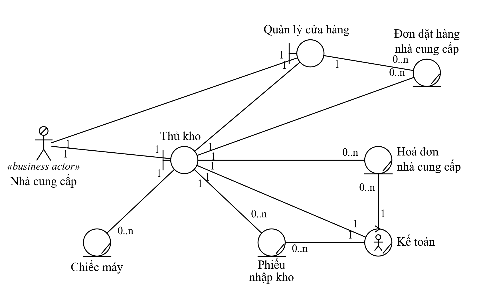
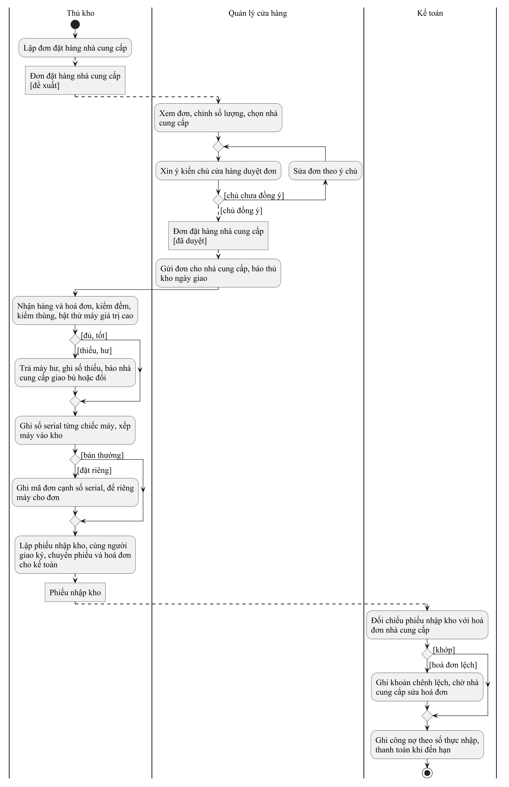
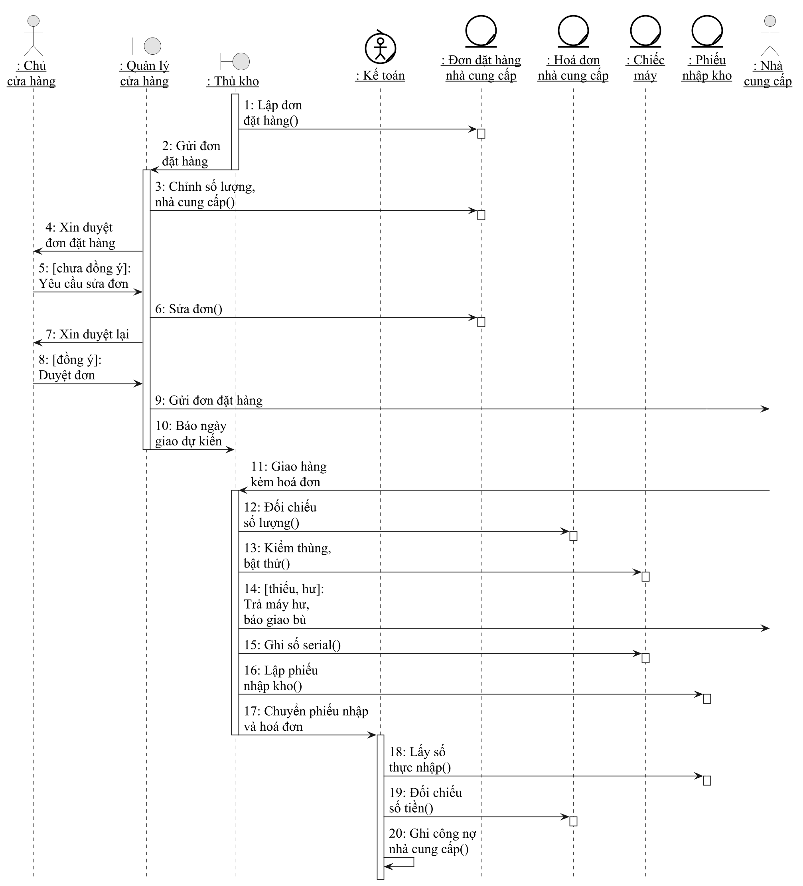
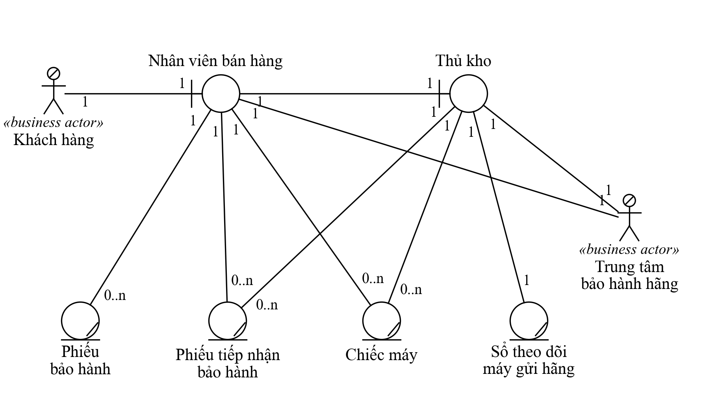
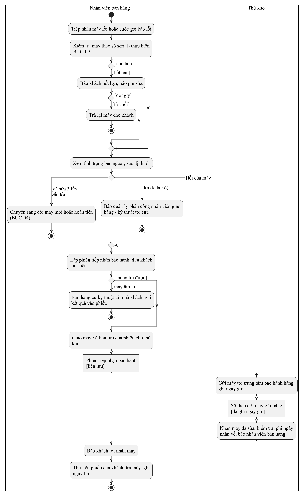
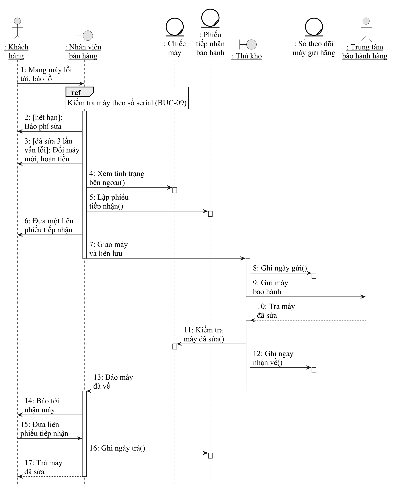
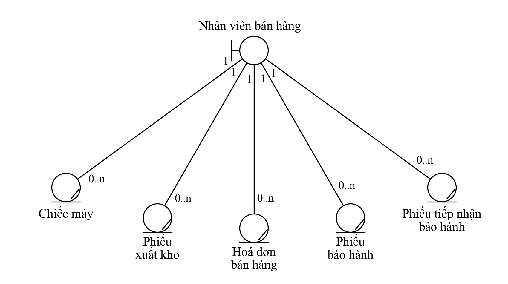
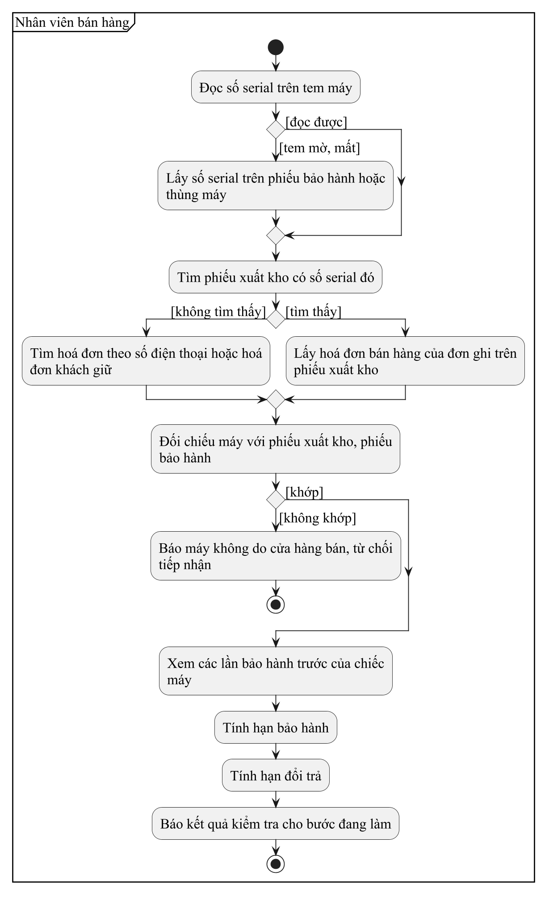
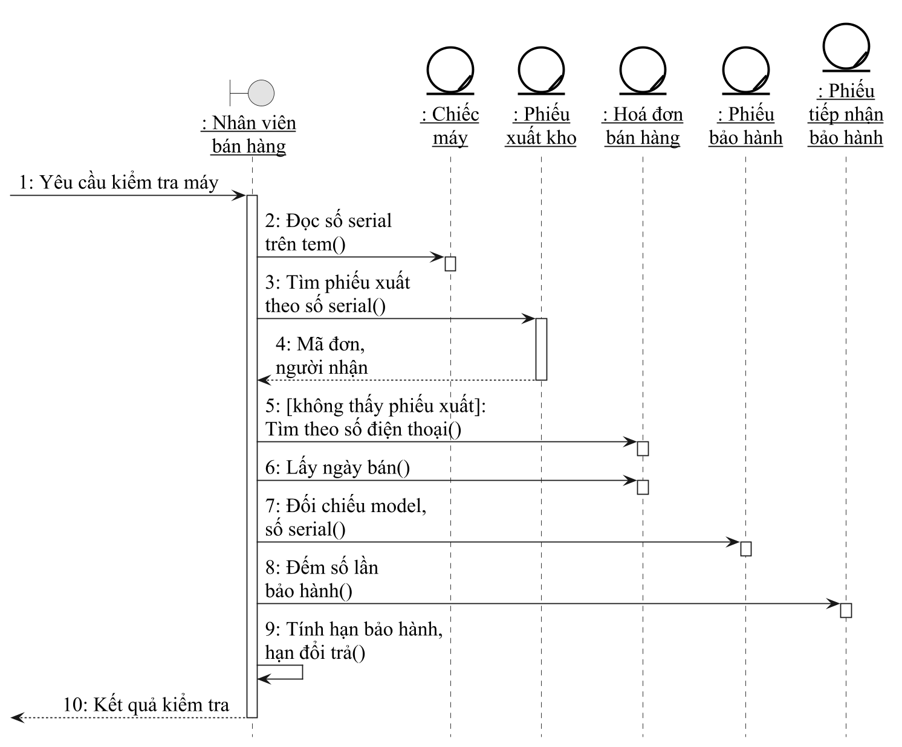

# Đặc tả use case nghiệp vụ · G5 Kho, nhà cung cấp, bảo hành

Bản 0.1 (14/10/2026) · G5 · việc t92 · theo khuôn mục 1 của [`../chung/mau-dac-ta.md`](../chung/mau-dac-ta.md)

> Đối tượng phân tích là **cửa hàng giả định** ([`../../khao-sat/tinh-huong-gia-dinh.md`](../../khao-sat/tinh-huong-gia-dinh.md)).
> Mã `MP1`, `MP2`, `MP3` + mã câu là phỏng vấn mô phỏng (giả định); `TL-xx` là tài liệu công khai thật. Mức cụ thể mà nguồn không có thì ghi "theo mức chủ cửa hàng quy định"; quy tắc nhóm tự đặt thì ghi "(nhóm đặt)".
> Tên tác nhân, thừa tác viên, thực thể theo [`../chung/tac-nhan-va-thuc-the.md`](../chung/tac-nhan-va-thuc-the.md). Ba thực thể chưa có trong bảng chung (Hoá đơn nhà cung cấp, Sổ theo dõi máy gửi hãng; Phiếu xuất kho và Phiếu tiếp nhận bảo hành ở BUC-09) ghi rõ ở từng bảng.

Gói G5 có ba use case nghiệp vụ: **BUC-05 Nhập hàng**, **BUC-06 Bảo hành sản phẩm** và **BUC-09 Kiểm tra máy theo số serial**.
BUC-09 là phần dùng chung được BUC-06 (gói G5) và BUC-04 Đổi trả hàng (gói G4) «include»; G4 dẫn lại BUC-09 ở bước tương ứng, không đặc tả lại.

## BUC-05 Nhập hàng

**1. Đặc tả bằng văn bản**

> **Use case nghiệp vụ:** Nhập hàng (BUC-05, quy trình QT-05 Đặt hàng nhà cung cấp và nhập kho, gói G5)
>
> Use case bắt đầu khi thủ kho thấy một mẫu máy sắp hết hàng, hoặc có đơn của khách cần mẫu máy không còn trong kho. Mục tiêu của use case nhằm
> đặt đúng hàng với nhà cung cấp sau khi chủ cửa hàng đồng ý, nhận đủ hàng tốt về kho với số serial của từng chiếc máy, có phiếu nhập kho ghi số theo chứng từ và thực nhập,
> và ghi đúng công nợ phải trả nhà cung cấp.
>
> **Các dòng cơ bản:**
> 1. Thủ kho lập đơn đặt hàng nhà cung cấp dạng đề xuất (mẫu máy, số lượng, nhà cung cấp quen) cho mẫu máy sắp hết hoặc mẫu máy khách cần, gửi quản lý cửa hàng.
> 2. Quản lý cửa hàng xem đơn đặt hàng, đối chiếu số tồn và hàng bán chạy, chỉnh số lượng và chọn nhà cung cấp.
> 3. Quản lý cửa hàng xin ý kiến chủ cửa hàng duyệt đơn đặt hàng nhà cung cấp.
> 4. Quản lý cửa hàng gửi đơn đặt hàng đã duyệt cho nhà cung cấp và báo thủ kho ngày giao dự kiến.
> 5. Thủ kho nhận hàng cùng hoá đơn nhà cung cấp do người giao mang tới; đếm số lượng, đối chiếu với hoá đơn và đơn đặt hàng, kiểm thùng, bật thử máy giá trị cao.
> 6. Thủ kho ghi số serial của từng chiếc máy đạt yêu cầu rồi xếp máy vào kho.
> 7. Thủ kho lập phiếu nhập kho ghi số lượng theo chứng từ, số lượng thực nhập, số serial, đơn giá và tình trạng hàng; thủ kho và người giao cùng ký, rồi chuyển phiếu nhập kho kèm hoá đơn nhà cung cấp cho kế toán.
> 8. Kế toán đối chiếu phiếu nhập kho với hoá đơn nhà cung cấp (mẫu máy, số lượng thực nhập, đơn giá).
> 9. Kế toán ghi công nợ phải trả nhà cung cấp theo số lượng thực nhập và thanh toán khi đến hạn đã thoả thuận.
>
> **Các dòng thay thế:**
> - Tại bước 3. Xử lý đơn chưa được duyệt: nếu chủ cửa hàng chưa đồng ý (số lượng, nhà cung cấp hoặc giá nhập), quản lý cửa hàng sửa đơn đặt hàng theo ý chủ rồi xin ý kiến lại (lặp lại bước 3).
> - Tại bước 5. Xử lý hàng thiếu, hư: nếu hàng giao thiếu so với hoá đơn, thùng móp hoặc máy bật thử không chạy, thủ kho trả lại chiếc máy hư cho người giao, ghi số thiếu, hư để đưa vào cột thực nhập của phiếu nhập kho
>   và báo nhà cung cấp giao bù hoặc đổi máy; phần hàng đạt tiếp tục bước 6. Hàng giao bù về sau được nhận như một lần giao mới (từ bước 5).
> - Tại bước 6. Xử lý hàng đặt riêng cho đơn của khách: nếu lô hàng được đặt riêng cho đơn của khách, thủ kho ghi mã đơn của khách cạnh số serial của những chiếc máy đó và để riêng, không bán cho đơn khác; tiếp tục bước 7.
> - Tại bước 8. Xử lý hoá đơn lệch: nếu số lượng hoặc số tiền trên hoá đơn nhà cung cấp khác với hàng thực nhập, kế toán ghi khoản chênh lệch và chờ nhà cung cấp sửa hoá đơn; công nợ ở bước 9 vẫn ghi theo số thực nhập.

| Mục | Nội dung |
|---|---|
| Tác nhân nghiệp vụ | Nhà cung cấp |
| Thừa tác viên | Thủ kho, Quản lý cửa hàng (giao tiếp với môi trường); Kế toán (làm việc bên trong) |
| Thực thể nghiệp vụ | Đơn đặt hàng nhà cung cấp, Hoá đơn nhà cung cấp (**đề xuất thêm** vào bảng chung), Phiếu nhập kho, Chiếc máy |
| Ràng buộc trước khi thực hiện | Mỗi mẫu máy đã có một đến hai nhà cung cấp quen; thủ kho nắm số tồn của từng mẫu máy |
| Kết quả | Hàng đạt đã vào kho, mỗi chiếc máy có số serial; phiếu nhập kho ghi số theo chứng từ và thực nhập, có chữ ký thủ kho và người giao; công nợ phải trả nhà cung cấp ghi theo số thực nhập; hàng thiếu, hư đã báo nhà cung cấp giao bù hoặc đổi |
| Quy tắc nghiệp vụ | QĐ1. Đơn đặt hàng nhà cung cấp phải được chủ cửa hàng duyệt trước khi gửi (`MP3 E1`). QĐ2. Mỗi mẫu máy đặt từ một hoặc hai nhà cung cấp là hãng hoặc nhà phân phối chính thức (`MP2 E1`; `MP3 E1`). QĐ3. Hàng đặt riêng theo đơn của khách phải đặt trước, thời gian chờ khoảng 2–4 tuần (`MP3 E1`, `C7`). QĐ4. Máy giá trị cao phải bật thử trước khi nhận; mức "giá trị cao" theo mức chủ cửa hàng quy định (`MP2 E2`). QĐ5. Mọi chiếc máy nhập kho đều được ghi số serial, kể cả hàng giá thấp; số serial trên máy phải khớp phiếu bảo hành của hãng (`MP3 A3`, `E2`; `TL-16`). QĐ6. Phiếu nhập kho theo mẫu 01-VT: ghi cả số lượng theo chứng từ và số lượng thực nhập, lập 2 liên, có chữ ký người lập phiếu, người giao hàng, thủ kho; cửa hàng thêm cột số serial và tình trạng hàng vì mẫu cho phép thêm trường (`TL-28`, `TL-29`; `MP3 E2`). QĐ7. Phiếu nhập đã ký thì không sửa; ghi sai thì lập phiếu điều chỉnh (`TL-28`, Thông tư 99 Đ10; `MP3 A5`). QĐ8. Công nợ nhà cung cấp ghi theo số lượng thực nhập, không theo số trên hoá đơn (nhóm suy ra từ hai cột của mẫu 01-VT, `TL-28`) |
| Biểu mẫu | Đơn đặt hàng nhà cung cấp (mẫu máy, số lượng, nhà cung cấp, ngày giao dự kiến; mô phỏng không tả mẫu, các ô do nhóm đặt); Hoá đơn hoặc phiếu giao của nhà cung cấp (tên hàng, số lượng, đơn giá, thành tiền, chữ ký người giao; `MP1 E2`); Phiếu nhập kho (số phiếu, ngày nhập, nhà cung cấp, số hoá đơn, tên hàng, model, số serial, số lượng theo chứng từ và thực nhập, đơn giá, tình trạng hàng, chữ ký thủ kho và người giao; `MP3 E2`, `MP2 E2`, mẫu 01-VT `TL-28`). Chưa có ảnh chụp, các ô lấy từ mô tả mẫu trắng trong mô phỏng |
| Vấn đề hiện tại | Vấn đề 4 ở `hien-trang-to-chuc.md`: serial chỉ ghi với máy giá cao như máy rửa chén, bếp cao cấp, đồ rẻ không ghi; ghi serial bằng tay dễ nhầm (bước 6; `MP2 E2`, `E5`; `MP3 F1`). Ngoài năm vấn đề: không có mức tồn tối thiểu, thủ kho tự nhìn kệ rồi báo sắp hết nên hay báo muộn (bước 1; `MP2 E1`; `MP1 E1`); công nợ nhà cung cấp ghi riêng, cuối tháng cộng tay hay sai, có lần nhà cung cấp đòi nhiều hơn số đã ghi tới cả triệu đồng (bước 9; `MP1 E1`, `F1`). Hệ thống mới cải tiến bước 1–7 bằng UC-KB-02 Lập đơn đặt hàng nhà cung cấp, UC-KB-03 Lập phiếu nhập kho, ghi số serial và UC-KB-05 Kiểm kê, cảnh báo tồn thấp |
| Nguồn | `MP2 E1`, `E2`, `E5`; `MP3 A3`, `A5`, `C7`, `E1`, `E2`, `F1`; `MP1 E1`, `E2`, `F1`; `TL-16`, `TL-28`, `TL-29` |

Các bước khớp với cửa hàng giả định: thủ kho báo sắp hết, quản lý cùng thủ kho lập đề xuất, chủ duyệt rồi mới đặt (`MP3 E1`); hàng về thì đếm, kiểm thùng, bật thử máy giá trị cao, ghi phiếu nhập (`MP2 E2`);
đối chiếu hàng thực tế với đơn đặt, ghi số serial từng máy (`MP3 E2`). Mẫu phiếu nhập chính thức có hai cột "theo chứng từ" và "thực nhập" (`TL-28`, `TL-29`), đúng chỗ cửa hàng hay lệch khi hàng thiếu, hư.

**2. Sơ đồ đối tượng nghiệp vụ** (nhà cung cấp làm việc với quản lý cửa hàng khi nhận đơn đặt hàng và với thủ kho khi giao hàng; kế toán làm việc bên trong, chỉ xử lý phiếu nhập kho và hoá đơn nhà cung cấp để ghi công nợ)

**3. Sơ đồ hoạt động** (ba luồng Thủ kho, Quản lý cửa hàng, Kế toán; đơn đặt hàng đi từ thủ kho sang quản lý bằng dòng đối tượng nét đứt, nút đối tượng thứ hai ghi trạng thái `[đã duyệt]`;
nhánh `[chủ chưa đồng ý]` quay về nút kết hợp đặt trước bước 3; ba dòng thay thế còn lại là ba nhánh `[thiếu, hư]`, `[đặt riêng]`, `[hoá đơn lệch]`)

**4. Sơ đồ tuần tự nghiệp vụ** (chủ cửa hàng vẽ là tác nhân vì chỉ duyệt đơn từ bên ngoài hệ thống nghiệp vụ; thông điệp 5 và 8 là hai nhánh có điều kiện của bước 3, thông điệp 14 là dòng thay thế hàng thiếu, hư)

## BUC-06 Bảo hành sản phẩm

**1. Đặc tả bằng văn bản**

> **Use case nghiệp vụ:** Bảo hành sản phẩm (BUC-06, quy trình QT-06 Tiếp nhận bảo hành theo số serial, gói G5)
>
> Use case bắt đầu khi khách hàng mang máy lỗi tới cửa hàng hoặc gọi điện báo máy lỗi. Mục tiêu của use case nhằm xác định đúng chiếc máy cửa hàng đã bán còn hạn bảo hành,
> giao khách văn bản tiếp nhận, chuyển máy tới trung tâm bảo hành hãng sửa và trả lại khách máy đã sửa đúng ngày hẹn.
>
> **Các dòng cơ bản:**
> 1. Nhân viên bán hàng tiếp nhận máy lỗi khách hàng mang tới hoặc cuộc gọi báo lỗi, ghi lời khách tả lỗi.
> 2. Nhân viên bán hàng kiểm tra chiếc máy (Thực hiện use case Kiểm tra máy theo số serial).
> 3. Nhân viên bán hàng xem tình trạng bên ngoài của máy (trầy, móp, thiếu phụ kiện) và xác định đây là lỗi của máy hay lỗi do lắp đặt.
> 4. Nhân viên bán hàng lập phiếu tiếp nhận bảo hành hai liên ghi thông tin khách, tên máy, model, số serial, ngày mua, mô tả lỗi, tình trạng bên ngoài, ngày hẹn trả; hai bên ký, đưa (hoặc gửi) khách một liên.
> 5. Nhân viên bán hàng giao máy cùng liên lưu của phiếu tiếp nhận bảo hành cho thủ kho.
> 6. Thủ kho gửi máy tới trung tâm bảo hành hãng, ghi ngày gửi vào sổ theo dõi máy gửi hãng.
> 7. Thủ kho nhận máy đã sửa từ trung tâm bảo hành hãng, kiểm tra máy chạy được, ghi ngày nhận về vào sổ theo dõi và báo nhân viên bán hàng.
> 8. Nhân viên bán hàng báo khách tới nhận máy.
> 9. Nhân viên bán hàng thu lại liên phiếu tiếp nhận của khách, trả máy, khách ký nhận; nhân viên bán hàng ghi ngày trả lên phiếu tiếp nhận bảo hành.
>
> **Các dòng thay thế:**
> - Tại bước 2. Xử lý máy hết hạn bảo hành: nếu máy đã hết hạn, nhân viên bán hàng báo khách việc sửa sẽ tính phí theo báo giá của trung tâm bảo hành hãng; khách đồng ý thì tiếp tục bước 3 và ghi "sửa có phí" lên phiếu tiếp nhận;
>   khách từ chối thì nhân viên bán hàng trả lại máy, kết thúc.
> - Tại bước 3. Xử lý máy đã sửa 3 lần chưa được: nếu chiếc máy đã bảo hành từ 3 lần trở lên mà vẫn lỗi, nhân viên bán hàng không gửi hãng nữa mà chuyển sang đổi máy mới hoặc hoàn tiền cho khách
>   (Thực hiện use case Đổi trả hàng), kết thúc.
> - Tại bước 3. Xử lý lỗi do lắp đặt: nếu lỗi do lắp đặt chứ không phải lỗi của máy, nhân viên bán hàng báo quản lý cửa hàng phân công nhân viên giao hàng – kỹ thuật tới sửa và hẹn giờ với khách; không gửi hãng, kết thúc.
> - Tại bước 5. Xử lý máy âm tủ, cồng kềnh: nếu máy đã lắp âm tủ hoặc cồng kềnh, khách không mang tới được, nhân viên bán hàng không nhận máy mà báo trung tâm bảo hành hãng cử kỹ thuật tới nhà khách;
>   khi hãng sửa xong, nhân viên bán hàng gọi khách xác nhận rồi ghi kết quả và ngày xong lên phiếu tiếp nhận bảo hành, kết thúc.

| Mục | Nội dung |
|---|---|
| Tác nhân nghiệp vụ | Khách hàng, Trung tâm bảo hành hãng |
| Thừa tác viên | Nhân viên bán hàng, Thủ kho (cả hai giao tiếp với môi trường). Nhánh lỗi lắp đặt chuyển cho nhân viên giao hàng – kỹ thuật qua quản lý cửa hàng, không vẽ thành luồng |
| Thực thể nghiệp vụ | Phiếu bảo hành, Phiếu tiếp nhận bảo hành, Chiếc máy, Sổ theo dõi máy gửi hãng (**đề xuất thêm** vào bảng chung) |
| Ràng buộc trước khi thực hiện | Khách có máy mua tại cửa hàng, còn giữ phiếu bảo hành, hoá đơn hoặc nhớ số điện thoại đã dùng khi mua; phiếu xuất kho và hoá đơn bán hàng của đơn cũ đã được lưu |
| Kết quả | Khách nhận lại máy đã sửa, hoặc được chuyển sang đổi máy mới, hoàn tiền, hoặc biết máy hết hạn và nhận lại máy; phiếu tiếp nhận bảo hành ghi đủ ngày nhận, ngày hẹn trả, ngày trả; sổ theo dõi ghi ngày gửi hãng và ngày nhận về; số lần bảo hành của chiếc máy tăng thêm một |
| Quy tắc nghiệp vụ | QĐ1. Khi nhận máy bảo hành phải giao khách văn bản tiếp nhận ghi lỗi, tình trạng bên ngoài và ngày hẹn trả (`TL-22 Đ30`; `MP3 E4`). QĐ2. Cửa hàng không tự sửa máy; máy lỗi trong hạn gửi trung tâm bảo hành hãng, thường mất 7–15 ngày, ngày hẹn trả đặt theo khoảng này (`MP2 E4`; `MP3 E4`). QĐ3. Nhân viên giao hàng – kỹ thuật của cửa hàng chỉ xử lý lỗi do lắp đặt (`MP2 E4`). QĐ4. Máy cồng kềnh được bảo hành tại nhà (`TL-12`); cửa hàng giả định áp dụng cho máy đã lắp âm tủ (nhóm đặt). QĐ5. Máy đã sửa bảo hành từ 3 lần trở lên mà vẫn không khắc phục được thì đổi máy mới hoặc hoàn tiền (`TL-22 Đ30`). QĐ6. Thời gian máy nằm ở trung tâm bảo hành không tính vào thời hạn bảo hành (`TL-22 Đ30`). QĐ7. Máy hết hạn bảo hành chỉ gửi sửa khi khách đồng ý trả phí theo báo giá của trung tâm bảo hành hãng (nhóm đặt). QĐ8. Đúng máy cửa hàng bán, hạn bảo hành và hạn đổi trả xác định theo QĐ1–QĐ4 của BUC-09 |
| Biểu mẫu | Phiếu bảo hành (tên khách, tên hàng, số serial, ngày mua, thời hạn bảo hành, dấu cửa hàng; `MP1 E4`) hoặc phiếu bảo hành của hãng đi kèm máy (`MP2 D1`); Phiếu tiếp nhận bảo hành (số phiếu, ngày nhận, thông tin khách, tên máy, model, serial, ngày mua, mô tả lỗi, tình trạng bên ngoài, ngày hẹn trả, chữ ký hai bên; `MP3 E4`), nhóm thêm ô ngày trả và "sửa có phí"; Sổ theo dõi máy gửi hãng (tên khách, serial, ngày gửi, ngày nhận, tình trạng; `MP2 E4`). Chưa có ảnh chụp |
| Vấn đề hiện tại | Vấn đề 4 ở `hien-trang-to-chuc.md`: tra bảo hành dựa vào phiếu giấy của khách, khách mất phiếu thì phải lục hoá đơn (bước 2; `MP2 E4`); tiệm nhỏ phải hỏi khách ngày mua (`MP1 E4`). Ngoài năm vấn đề: phối hợp bảo hành với hãng mất thời gian nhất vì phụ thuộc lịch hãng (bước 6, 7; `MP3 F1`); sổ theo dõi máy gửi hãng ghi riêng, không gắn với từng chiếc máy nên không đếm được một chiếc máy đã bảo hành mấy lần để áp dụng QĐ5 (nhận xét của nhóm). Hệ thống mới cải tiến bước 2–9 bằng UC-KB-06 Tiếp nhận bảo hành và UC-KB-07 Tra cứu bảo hành |
| Nguồn | `MP1 D1`, `E4`; `MP2 D1`, `E4`; `MP3 A2`, `E4`, `F1`; `TL-12`, `TL-16`, `TL-22 Đ30`; `MK K16`, `K17` |

Các bước khớp với cửa hàng giả định: khách mang máy tới hoặc gọi báo lỗi, bộ phận bảo hành kiểm tra serial, lập phiếu ghi lỗi rồi chuyển hãng, cửa hàng không tự sửa (`MP3 E4`);
gửi hãng 7–15 ngày, có sổ theo dõi ngày gửi, ngày nhận, thợ cửa hàng chỉ xử lý lỗi lắp đặt (`MP2 E4`). Một nhân viên bán hàng kiêm tiếp nhận bảo hành (`MP3 A2`).
Luật bắt giao văn bản tiếp nhận và đổi mới hoặc hoàn tiền sau 3 lần sửa không được (`TL-22 Đ30`); 2/10 vai khách mô phỏng muốn biết rõ ai chịu trách nhiệm bảo hành (`MK K16`, `K17`).

**2. Sơ đồ đối tượng nghiệp vụ** (khách hàng làm việc với nhân viên bán hàng; trung tâm bảo hành hãng nhận và trả máy qua thủ kho, riêng máy âm tủ thì nhân viên bán hàng báo hãng cử kỹ thuật tới nhà)

**3. Sơ đồ hoạt động** (hai luồng Nhân viên bán hàng và Thủ kho; bước 2 gọi BUC-09; hai dòng thay thế tại bước 3 vẽ chung một nút quyết định ba nhánh `[đã sửa 3 lần vẫn lỗi]`, `[lỗi do lắp đặt]`, `[lỗi của máy]`;
các nhánh kết thúc sớm dùng nút kết thúc hoạt động; phiếu tiếp nhận và sổ theo dõi đi bằng dòng đối tượng nét đứt)

**4. Sơ đồ tuần tự nghiệp vụ** (khung `ref` là chỗ thực hiện BUC-09, chi tiết ở sơ đồ tuần tự của BUC-09; thông điệp 2 và 3 là hai dòng thay thế quan trọng nhất ghi điều kiện `[hết hạn]`, `[đã sửa 3 lần vẫn lỗi]`;
máy đã sửa trả về theo nét đứt)

## BUC-09 Kiểm tra máy theo số serial

**1. Đặc tả bằng văn bản**

> **Use case nghiệp vụ:** Kiểm tra máy theo số serial (BUC-09, chuỗi bước dùng chung cho QT-06 và QT-07, gói G5)
>
> Use case bắt đầu khi use case Bảo hành sản phẩm hoặc Đổi trả hàng cần xác định chiếc máy khách mang tới hoặc báo lỗi. Mục tiêu của use case nhằm biết chắc
> chiếc máy có phải do cửa hàng bán không, bán ngày nào, còn hạn bảo hành, còn hạn đổi trả không và đã bảo hành mấy lần, để bước đang thực hiện xử lý tiếp.
>
> **Các dòng cơ bản:**
> 1. Nhân viên bán hàng đọc số serial trên tem dán ở thân máy (khách báo lỗi qua điện thoại thì nhờ khách đọc số serial).
> 2. Nhân viên bán hàng tìm phiếu xuất kho có số serial đó để biết máy đã xuất cho đơn nào, người nhận nào.
> 3. Nhân viên bán hàng lấy hoá đơn bán hàng của đơn ghi trên phiếu xuất kho, xem ngày bán.
> 4. Nhân viên bán hàng đối chiếu tên máy, model, số serial trên máy với phiếu xuất kho và phiếu bảo hành để chắc đúng chiếc máy cửa hàng đã bán.
> 5. Nhân viên bán hàng xem các phiếu tiếp nhận bảo hành trước đây của chiếc máy (nếu có): số lần đã bảo hành và số ngày máy nằm ở trung tâm bảo hành hãng.
> 6. Nhân viên bán hàng tính hạn bảo hành bằng ngày bán cộng thời hạn bảo hành ghi trên phiếu bảo hành, cộng thêm số ngày máy đã nằm ở hãng.
> 7. Nhân viên bán hàng tính hạn đổi trả: 7 ngày từ ngày bán nếu máy còn seal, 30 ngày nếu lỗi do hãng.
> 8. Nhân viên bán hàng báo kết quả kiểm tra (đúng máy cửa hàng bán, ngày bán, hạn bảo hành, hạn đổi trả, số lần đã bảo hành) để tiếp tục use case đang thực hiện.
>
> **Các dòng thay thế:**
> - Tại bước 1. Xử lý tem serial mờ, mất: nếu tem trên máy mờ hoặc đã bị bóc, nhân viên bán hàng lấy số serial trên phiếu bảo hành hoặc trên thùng máy khách còn giữ (tiếp tục bước 2).
> - Tại bước 2. Xử lý không tìm thấy theo số serial: nếu không có phiếu xuất kho nào ghi số serial đó (máy bán khi cửa hàng chưa ghi serial, ghi nhầm, hoặc không đọc được serial),
>   nhân viên bán hàng tìm hoá đơn bán hàng theo tên, số điện thoại người mua hoặc hoá đơn khách còn giữ, rồi tiếp tục bước 4.
> - Tại bước 4. Xử lý máy không phải cửa hàng bán: nếu không tìm được chứng từ nào khớp, hoặc số serial trên máy khác với phiếu xuất kho, phiếu bảo hành, nhân viên bán hàng báo khách máy không do cửa hàng bán
>   (hoặc không xác định được), từ chối tiếp nhận; kết thúc cả use case đang thực hiện.

| Mục | Nội dung |
|---|---|
| Tác nhân nghiệp vụ | Không có riêng: use case được BUC-04 Đổi trả hàng và BUC-06 Bảo hành sản phẩm «include», khách hàng làm việc qua use case gọi |
| Thừa tác viên | Nhân viên bán hàng (giao tiếp với môi trường) |
| Thực thể nghiệp vụ | Chiếc máy, Phiếu xuất kho, Hoá đơn bán hàng, Phiếu bảo hành, Phiếu tiếp nhận bảo hành. Bảng chung mục 5 mới ghi Chiếc máy, Hoá đơn bán hàng, Phiếu bảo hành: **đề xuất thêm** Phiếu xuất kho (chứng từ duy nhất có số serial theo đơn) và Phiếu tiếp nhận bảo hành (đếm số lần bảo hành) |
| Ràng buộc trước khi thực hiện | Use case gọi đã tiếp nhận máy hoặc yêu cầu của khách; phiếu xuất kho, hoá đơn bán hàng và phiếu tiếp nhận bảo hành các lần trước đã được lưu |
| Kết quả | Biết chiếc máy có phải do cửa hàng bán không, ngày bán, hạn bảo hành, hạn đổi trả và số lần đã bảo hành; kết quả trả về use case gọi |
| Quy tắc nghiệp vụ | QĐ1. Hạn bảo hành tính từ ngày bán (ngày khách nhận máy, cũng là ngày lập hoá đơn) cộng thời hạn bảo hành ghi trên phiếu bảo hành (`MP1 E4`; `TL-26`). QĐ2. Thời gian máy nằm ở trung tâm bảo hành không tính vào thời hạn bảo hành (`TL-22 Đ30`). QĐ3. Đổi trả trong 7 ngày nếu máy còn seal, lỗi do hãng trong 30 ngày; máy đã lắp chỉ đổi khi lỗi do hãng (`MP2 D4`; `MP3 D4`). QĐ4. Số serial trên máy phải khớp phiếu bảo hành và chứng từ bán; không khớp thì không nhận bảo hành (`TL-16`). QĐ5. Chỉ tiếp nhận máy do cửa hàng bán; máy mua nơi khác thì hướng dẫn khách tới nơi bán hoặc trung tâm bảo hành hãng (nhóm đặt). QĐ6. Tra được theo số serial, số điện thoại người mua hoặc mã đơn, hoá đơn (`TL-04`, `TL-18`; `MK K15`) |
| Biểu mẫu | Phiếu xuất kho (số phiếu, ngày xuất, tên người nhận, địa chỉ giao, tên hàng, model, số serial, số lượng, chữ ký; `MP3 D1`, `MP2 D1`); Hoá đơn bán lẻ (số, ngày, tên khách, địa chỉ, tên hàng, số lượng, đơn giá, thành tiền, **không có cột serial**; `MP1 D1`); Phiếu bảo hành (`MP1 E4`); Phiếu tiếp nhận bảo hành (`MP3 E4`) |
| Vấn đề hiện tại | Vấn đề 4 ở `hien-trang-to-chuc.md`: hoá đơn bán lẻ không có cột serial và đồ rẻ không ghi serial lúc nhập nên nhiều máy không tra được theo serial (bước 2; `MP1 D1`; `MP2 E2`, `E5`); khách mất phiếu thì phải lục hoá đơn (`MP2 E4`); tiệm nhỏ chỉ chép serial lúc bán, phải hỏi khách ngày mua (`MP1 E4`, `E5`); xuất nhầm serial hai máy cùng model làm phiếu bảo hành ghi sai (bước 4; `MP3 A5`). Hệ thống mới cải tiến bước 1–7 bằng UC-KB-07 Tra cứu bảo hành theo số serial, số điện thoại hoặc mã đơn (`YC-KB-06`) |
| Nguồn | `MP1 D1`, `E4`, `E5`; `MP2 D1`, `D4`, `E2`, `E4`, `E5`; `MP3 A5`, `D1`, `D4`, `E4`, `E5`; `TL-04`, `TL-16`, `TL-18`, `TL-22 Đ30`, `TL-26`; `MK K15` |

Các bước khớp với cửa hàng giả định: kho tra serial xem còn hạn, khách mất phiếu thì lục hoá đơn (`MP2 E4`); nơi quản lý theo serial thì phiếu xuất kho ghi serial từng máy, phần mềm lưu serial theo đơn và theo khách (`MP3 E5`).
Ngành định danh máy bảo hành bằng số điện thoại, serial hoặc IMEI và chứng từ mua (`TL-04`, `TL-16`, `TL-18`); vai khách mô phỏng muốn tra bằng mã đơn 4, serial 2, số điện thoại 2 trên 10 (`MK K15`).

**2. Sơ đồ đối tượng nghiệp vụ** (chỉ một thừa tác viên; nhân viên bán hàng đọc chiếc máy và bốn loại giấy tờ, không tạo giấy tờ mới)

**3. Sơ đồ hoạt động** (một luồng Nhân viên bán hàng, vẽ bằng vùng có tên vì PlantUML không vẽ cột khi chỉ có một luồng; nhánh `[không tìm thấy]` thay bước 2–3 bằng việc tìm theo số điện thoại;
nhánh `[không khớp]` kết thúc cả use case gọi)

**4. Sơ đồ tuần tự nghiệp vụ** (thông điệp 1 đi vào từ mép trái là lời gọi của use case bao hàm BUC-04 hoặc BUC-06, thông điệp 10 trả kết quả về đó; thông điệp 5 là dòng thay thế `[không thấy phiếu xuất]`)

