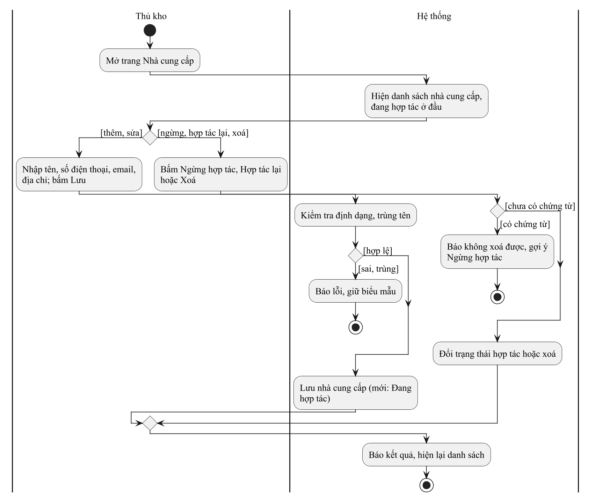
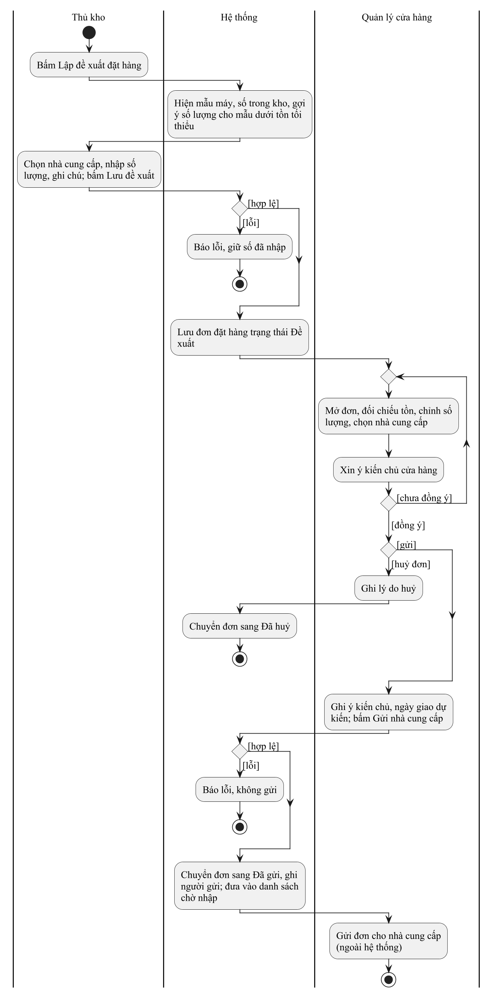
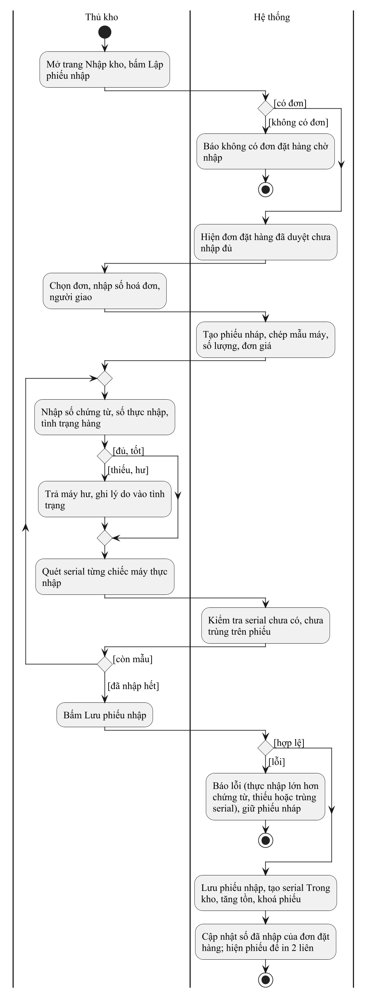
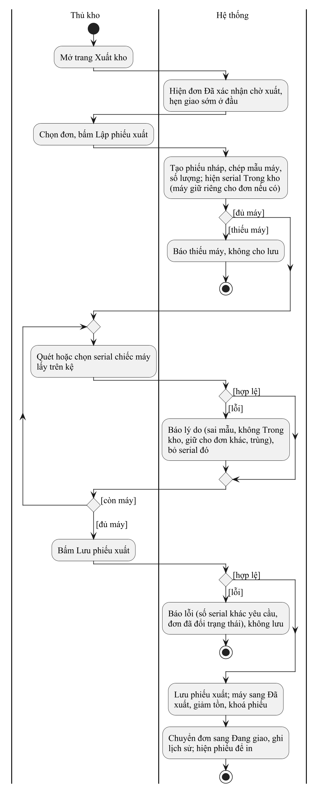
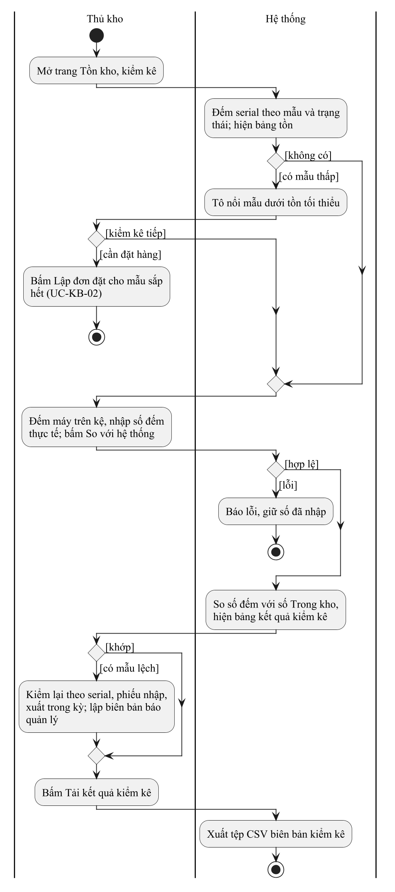
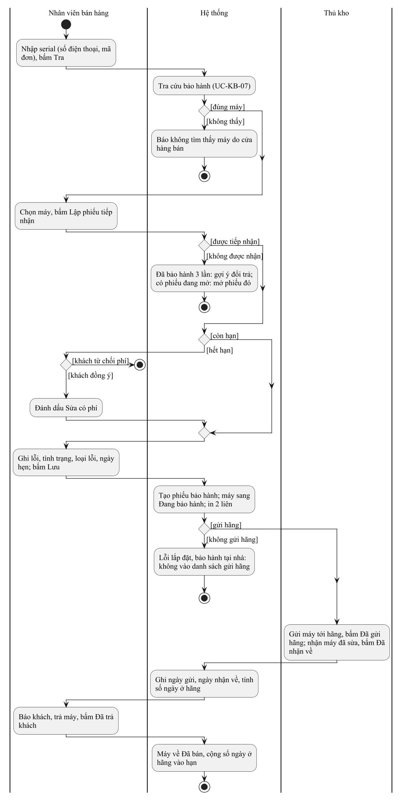
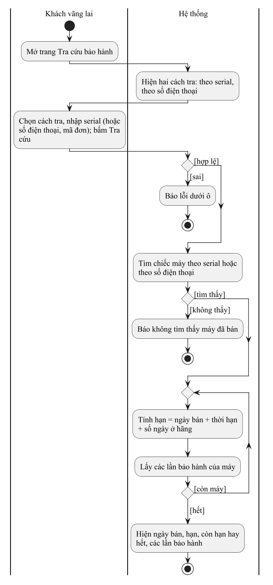
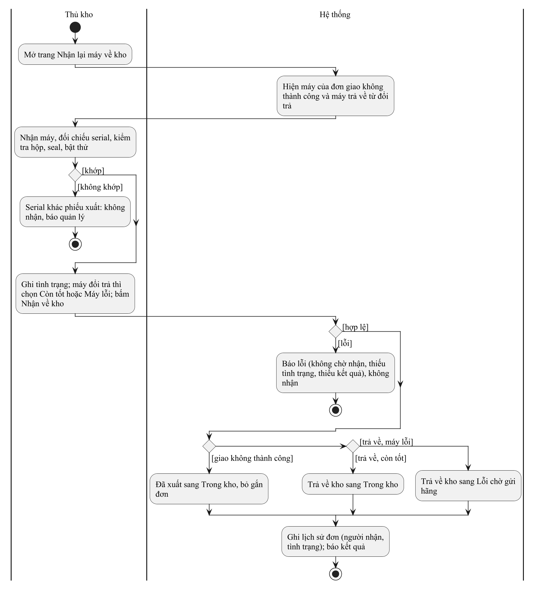
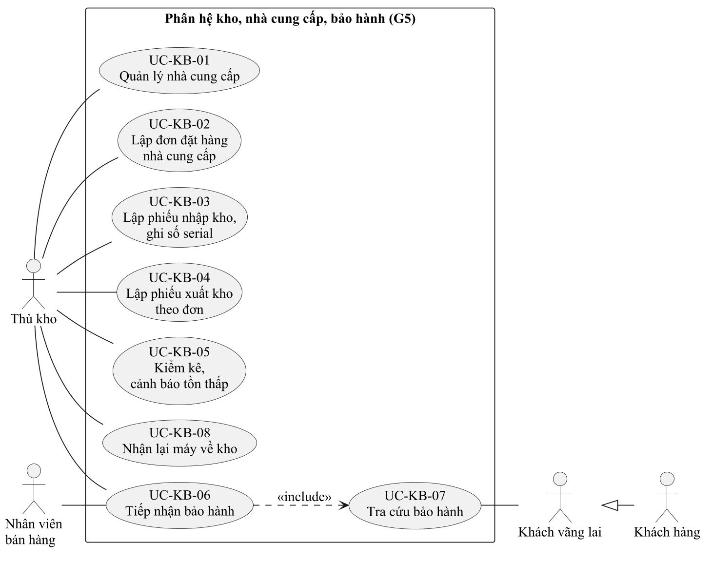

# Đặc tả use case hệ thống · G5 Kho, nhà cung cấp, bảo hành

Bản 0.2 (17/11/2026, thêm đặc tả UC-KB-01, 02, 05, 07, 08 và sơ đồ hoạt động cho cả 8 use case) · G5 · làm theo khuôn mục 2 của [`../chung/mau-dac-ta.md`](../chung/mau-dac-ta.md)

Tên, mã use case theo [`../chung/danh-muc-use-case.md`](../chung/danh-muc-use-case.md); trạng thái đơn và trạng thái chiếc máy theo mục 4, 5 của [`../chung/lop-va-trang-thai-chung.md`](../chung/lop-va-trang-thai-chung.md).
Quy tắc `QĐx` dẫn lại từ [`dac-ta-nghiep-vu.md`](dac-ta-nghiep-vu.md); mã `YC-…` từ mục 3 của [`../chung/hien-trang-va-yeu-cau.md`](../chung/hien-trang-va-yeu-cau.md).

| Mã | Use case | Tác nhân | Đặc tả |
|---|---|---|---|
| UC-KB-01 | Quản lý nhà cung cấp | Thủ kho | ✓ dưới đây |
| UC-KB-02 | Lập đơn đặt hàng nhà cung cấp | Thủ kho | ✓ dưới đây |
| UC-KB-03 | Lập phiếu nhập kho, ghi số serial | Thủ kho | ★ dưới đây |
| UC-KB-04 | Lập phiếu xuất kho theo đơn | Thủ kho | ✓ dưới đây |
| UC-KB-05 | Kiểm kê, cảnh báo tồn thấp | Thủ kho | ✓ dưới đây |
| UC-KB-06 | Tiếp nhận bảo hành («include» UC-KB-07) | Nhân viên bán hàng | ★ dưới đây |
| UC-KB-07 | Tra cứu bảo hành (theo số serial hoặc số điện thoại) | Khách vãng lai | ✓ dưới đây |
| UC-KB-08 | Nhận lại máy về kho (giao không thành công, đổi trả) | Thủ kho | ✓ dưới đây |

## UC-KB-01 Quản lý nhà cung cấp

| Mục | Nội dung |
|---|---|
| Mã, tên | UC-KB-01 Quản lý nhà cung cấp |
| Gói | G5 |
| Tác nhân chính | Thủ kho |
| Tác nhân phụ | Không có |
| Mô tả | Thủ kho thêm, sửa thông tin liên hệ của nhà cung cấp quen (hãng hoặc nhà phân phối chính thức), chuyển nhà cung cấp sang ngừng hợp tác hoặc hợp tác lại, và xoá nhà cung cấp nhập nhầm chưa có chứng từ nào, để khi lập đơn đặt hàng chỉ chọn được nhà cung cấp đang hợp tác |
| Điều kiện trước | Đã đăng nhập với vai Thủ kho |
| Điều kiện sau | Thêm: có một `NhaCungCap` mới ở trạng thái Đang hợp tác. Sửa: tên, số điện thoại, email, địa chỉ đã cập nhật. Ngừng hợp tác: nhà cung cấp không còn trong danh sách chọn khi lập đơn đặt hàng (UC-KB-02), đơn và phiếu nhập cũ giữ nguyên. Xoá: nhà cung cấp chưa có đơn đặt hàng, phiếu nhập nào bị xoá khỏi danh mục |
| Màn hình | Trang `quan-tri/g5/nha-cung-cap.html` (danh sách) và `quan-tri/g5/nha-cung-cap-form.html` (thêm, sửa) của website |

**Luồng sự kiện chính**

| Bước | Tác nhân | Hệ thống |
|---|---|---|
| 1 | Mở trang "Nhà cung cấp" | Hiện danh sách nhà cung cấp (mã, tên, điện thoại, email, địa chỉ, trạng thái); nhà cung cấp đang hợp tác ở đầu, xếp theo tên |
| 2 | Bấm "Thêm nhà cung cấp" | Hiện biểu mẫu trống: tên nhà cung cấp, số điện thoại, email, địa chỉ |
| 3 | Nhập thông tin, bấm Lưu | Chuẩn hoá (bỏ khoảng trắng thừa, dấu chấm trong số điện thoại); kiểm tra tên không trống, không quá 150 ký tự; số điện thoại bắt đầu bằng 0 và có 9–14 chữ số; email (nếu có) đúng định dạng |
| 4 | | Kiểm tra chưa có nhà cung cấp cùng tên (không phân biệt hoa thường) |
| 5 | | Lưu `NhaCungCap` ở trạng thái Đang hợp tác; quay về danh sách, báo "Đã thêm nhà cung cấp …" |

**Luồng thay thế**
- `2a.` Sửa: thủ kho bấm "Sửa" ở một dòng; hệ thống hiện biểu mẫu đã điền sẵn; thủ kho sửa rồi bấm Lưu; hệ thống làm như bước 3–4 (kiểm tra trùng tên với nhà cung cấp khác), lưu và báo "Đã cập nhật nhà cung cấp …".
- `2b.` Ngừng hợp tác: thủ kho bấm "Ngừng hợp tác"; hệ thống chuyển nhà cung cấp sang Ngừng hợp tác, báo "không lập đơn đặt hàng mới với nhà cung cấp này"; đơn đặt hàng đang mở và phiếu nhập cũ giữ nguyên.
- `2c.` Hợp tác lại: với nhà cung cấp đang ngừng, thủ kho bấm "Hợp tác lại"; hệ thống chuyển về Đang hợp tác.
- `2d.` Xoá: thủ kho bấm "Xoá" và xác nhận; hệ thống đếm đơn đặt hàng và phiếu nhập của nhà cung cấp; chưa có chứng từ nào thì xoá, báo "Đã xoá nhà cung cấp".
- `2e.` Xoá nhà cung cấp đã có đơn đặt hàng hoặc phiếu nhập: hệ thống báo "… đã có đơn đặt hàng hoặc phiếu nhập nên không xoá được; hãy chọn Ngừng hợp tác", không xoá.
- `3a.` Để trống tên, số điện thoại sai, email sai định dạng hoặc ô dài quá giới hạn: hệ thống giữ nguyên biểu mẫu với dữ liệu đã nhập, báo lỗi của ô đó, không lưu.
- `4a.` Trùng tên với nhà cung cấp đã có: báo "Đã có nhà cung cấp tên …", giữ biểu mẫu, không lưu.

**Ngoại lệ**
- Nhà cung cấp đã bị người khác xoá khi đang sửa: báo "Không tìm thấy nhà cung cấp #…", quay về danh sách.
- Mất kết nối khi lưu: không lưu gì, báo "Chưa lưu được, thử lại".

**Quy tắc nghiệp vụ:** QĐ2 của BUC-05 (mỗi mẫu máy đặt từ một hoặc hai nhà cung cấp là hãng hoặc nhà phân phối chính thức); nhà cung cấp đã có chứng từ thì chỉ ngừng hợp tác, không xoá, để phiếu nhập cũ vẫn tra được (nhóm đặt); YC-KB-01.

**Ghi chú hiện thực:** website chưa gắn nhà cung cấp với mẫu máy nên QĐ2 (một đến hai nhà cung cấp mỗi mẫu) chưa được kiểm; trang `/quan-tri/kho/nha-cung-cap` mở cho cả Thủ kho và Quản lý cửa hàng; không lưu vết người sửa thông tin nhà cung cấp.

## UC-KB-02 Lập đơn đặt hàng nhà cung cấp

| Mục | Nội dung |
|---|---|
| Mã, tên | UC-KB-02 Lập đơn đặt hàng nhà cung cấp |
| Gói | G5 |
| Tác nhân chính | Thủ kho |
| Tác nhân phụ | Quản lý cửa hàng (chỉnh số lượng, chọn nhà cung cấp, ghi ý kiến chủ cửa hàng và gửi nhà cung cấp) |
| Mô tả | Thủ kho lập đơn đặt hàng nhà cung cấp dạng đề xuất cho mẫu máy sắp hết hoặc mẫu khách cần; quản lý cửa hàng xin ý kiến chủ cửa hàng, chỉnh đơn rồi gửi nhà cung cấp; đơn đã gửi là căn cứ để nhận hàng ở UC-KB-03 |
| Điều kiện trước | Người làm từng bước đã đăng nhập với vai tương ứng; có ít nhất một nhà cung cấp Đang hợp tác (UC-KB-01); mẫu máy đã có trong danh mục sản phẩm |
| Điều kiện sau | Có một `DonDatHangNCC` ghi nhà cung cấp, ngày lập, người lập, ghi chú, từng mẫu máy và số lượng đặt, trạng thái Đề xuất. Khi gửi: đơn chuyển Đề xuất sang Đã gửi, ghi người gửi, ý kiến chủ cửa hàng và ngày giao dự kiến; đơn hiện trong danh sách chờ nhập của UC-KB-03. Khi nhận đủ hàng: đơn chuyển sang Đã nhận. Khi huỷ: đơn chuyển sang Đã huỷ, ghi lý do |
| Màn hình | Trang `quan-tri/g5/don-dat.html` (danh sách lọc theo trạng thái), `don-dat-lap.html` (lập đề xuất), `don-dat-chi-tiet.html` (duyệt, gửi, huỷ) của website |

**Luồng sự kiện chính**

| Bước | Tác nhân | Hệ thống |
|---|---|---|
| 1 | Thủ kho: mở trang "Đơn đặt hàng nhà cung cấp", bấm "Lập đề xuất đặt hàng" | Hiện mọi mẫu máy với số đang trong kho, mẫu dưới mức tồn tối thiểu ở đầu và có sẵn số lượng gợi ý; hiện danh sách nhà cung cấp đang hợp tác |
| 2 | Chọn nhà cung cấp, nhập số lượng đặt cho từng mẫu máy, ghi chú lý do đặt (mẫu sắp hết, mẫu khách cần), bấm "Lưu đề xuất" | Kiểm tra đã chọn nhà cung cấp và nhà cung cấp đang hợp tác; số lượng là số nguyên 0–999; có ít nhất một mẫu số lượng lớn hơn 0 |
| 3 | | Lưu `DonDatHangNCC` trạng thái Đề xuất cùng các dòng chi tiết, ghi người lập, ngày lập; hiện trang chi tiết đơn, báo "chờ quản lý cửa hàng xin ý kiến chủ và gửi nhà cung cấp" |
| 4 | Quản lý cửa hàng: mở đơn Đề xuất | Hiện từng mẫu máy: số lượng đặt, số trong kho hiện tại; ô chọn nhà cung cấp, ô ý kiến chủ cửa hàng, ô ngày giao dự kiến |
| 5 | Đối chiếu số tồn và hàng bán chạy, chỉnh số lượng (để 0 thì bỏ mẫu đó), đổi nhà cung cấp nếu cần; xin ý kiến chủ cửa hàng (ngoài hệ thống), ghi ý kiến chủ và ngày giao dự kiến; bấm "Gửi nhà cung cấp" | Kiểm tra đơn vẫn ở Đề xuất; ý kiến chủ cửa hàng không trống; nhà cung cấp đang hợp tác; đơn còn ít nhất một mẫu máy |
| 6 | | Lưu số lượng đã chỉnh, chuyển đơn sang Đã gửi, ghi người gửi, ý kiến chủ, ngày giao dự kiến; đơn hiện trong danh sách chờ nhập của thủ kho (UC-KB-03) |
| 7 | Quản lý cửa hàng: gửi đơn cho nhà cung cấp qua email, điện thoại hoặc cổng đặt hàng của hãng (ngoài hệ thống) | |

**Luồng thay thế**
- `1a.` Thủ kho đi từ trang Tồn kho (UC-KB-05), bấm "Lập đơn đặt cho mẫu sắp hết": hệ thống mở biểu mẫu như bước 1, đã điền sẵn số lượng cho các mẫu dưới mức tồn tối thiểu.
- `2a.` Chưa chọn nhà cung cấp, nhà cung cấp đã ngừng hợp tác, số lượng không phải số nguyên hoặc ngoài 0–999, hoặc không mẫu nào có số lượng: báo lỗi, giữ nguyên số đã nhập, không lưu.
- `2b.` Hàng đặt riêng cho đơn của khách: thủ kho ghi mã đơn của khách vào ghi chú; hệ thống lưu như bước 3; quản lý báo khách thời gian chờ khoảng 2–4 tuần (QĐ3 của BUC-05). Khi hàng về, UC-KB-03 gắn serial cho đơn đó.
- `5a.` Chủ cửa hàng chưa đồng ý (số lượng, nhà cung cấp hoặc giá nhập): quản lý cửa hàng không bấm gửi, chỉnh đơn theo ý chủ rồi xin ý kiến lại; đơn giữ trạng thái Đề xuất.
- `5b.` Chưa ghi ý kiến chủ cửa hàng: báo "Phải ghi ý kiến của chủ cửa hàng trước khi gửi nhà cung cấp", không gửi.
- `5c.` Đơn không còn ở Đề xuất (đã gửi hoặc đã huỷ trong lúc xem): báo "Đơn đặt hàng #… đang ở trạng thái …, không gửi được".
- `5d.` Huỷ đơn: thủ kho hoặc quản lý bấm "Huỷ đơn", ghi lý do; hệ thống chỉ cho huỷ đơn Đề xuất hoặc đơn Đã gửi chưa có phiếu nhập nào, chuyển đơn sang Đã huỷ và ghi lý do; đơn đã có phiếu nhập thì báo không huỷ được.
- `6a.` Nhận hàng: mỗi lần lưu phiếu nhập (UC-KB-03) hệ thống cộng số đã nhập theo mẫu; khi mọi mẫu đã nhận đủ số đặt, đơn chuyển Đã gửi sang Đã nhận.

**Ngoại lệ**
- Hai người cùng xử lý một đơn (một người gửi, một người huỷ): người lưu sau nhận báo trạng thái hiện tại của đơn, không ghi đè.
- Mất kết nối khi lưu: đơn và các dòng chi tiết lưu cùng một lần; lỗi thì không lưu gì, báo "Chưa lưu được, thử lại".

**Quy tắc nghiệp vụ:** QĐ1 (đơn phải được chủ cửa hàng duyệt trước khi gửi), QĐ2 (đặt từ nhà cung cấp quen, đang hợp tác), QĐ3 (hàng đặt riêng theo đơn khách, chờ 2–4 tuần) của BUC-05; YC-KB-01, YC-KB-05 (gợi ý số lượng cho mẫu dưới mức tồn tối thiểu).
Trạng thái đơn đặt hàng nhà cung cấp: Đề xuất → Đã gửi → Đã nhận; Đề xuất hoặc Đã gửi (chưa nhập) → Đã huỷ (nhóm đặt).

**Ghi chú hiện thực:** website chưa có ô ngày giao dự kiến; ý kiến chủ cửa hàng và lý do huỷ được nối vào cột `ghiChu` của đơn chứ không có cột riêng; mã đơn của khách đặt riêng chỉ ghi trong ghi chú tự do; số lượng gợi ý cho mẫu dưới tồn tối thiểu tính bằng `TON_TOI_THIEU + 3 − số trong kho`.

## UC-KB-03 Lập phiếu nhập kho, ghi số serial

| Mục | Nội dung |
|---|---|
| Mã, tên | UC-KB-03 Lập phiếu nhập kho, ghi số serial |
| Gói | G5 |
| Tác nhân chính | Thủ kho |
| Tác nhân phụ | Không có |
| Mô tả | Thủ kho nhận hàng nhà cung cấp giao, lập phiếu nhập kho theo mẫu 01-VT ghi số lượng theo chứng từ và số lượng thực nhập, ghi số serial của từng chiếc máy đạt yêu cầu; các chiếc máy vào kho ở trạng thái Trong kho |
| Điều kiện trước | Đã đăng nhập với vai Thủ kho; nhà cung cấp đã có trong danh mục (UC-KB-01); có đơn đặt hàng nhà cung cấp đã duyệt (UC-KB-02); mẫu máy đã có trong danh mục sản phẩm |
| Điều kiện sau | Có một `PhieuNhap` ghi nhà cung cấp, số hoá đơn, ngày nhập, người lập; mỗi dòng có mẫu máy, số lượng theo chứng từ, số lượng thực nhập, đơn giá, tình trạng hàng; mỗi chiếc máy thực nhập có một `SanPhamSerial` mới ở trạng thái Trong kho, ghi `ngayNhap`; số tồn của mẫu máy tăng theo số thực nhập; phiếu đã lưu thì khoá |
| Màn hình | Chưa có, thiết kế ở tuần 14 |

**Luồng sự kiện chính**

| Bước | Tác nhân | Hệ thống |
|---|---|---|
| 1 | Mở trang "Nhập kho", bấm "Lập phiếu nhập" | Hiện danh sách đơn đặt hàng nhà cung cấp đã duyệt chưa nhập đủ (mã đơn, nhà cung cấp, ngày giao dự kiến) |
| 2 | Chọn đơn đặt hàng của lô hàng vừa về, nhập số hoá đơn nhà cung cấp, ngày hoá đơn, tên người giao | Tạo phiếu nhập nháp; chép sẵn từng mẫu máy, số lượng đặt, đơn giá từ đơn đặt hàng |
| 3 | Với từng mẫu máy: nhập số lượng theo chứng từ (theo hoá đơn), số lượng thực nhập (sau khi đếm, kiểm thùng, bật thử máy giá trị cao), tình trạng hàng | Kiểm tra số thực nhập không lớn hơn số theo chứng từ; mẫu máy thuộc nhóm giá trị cao thì nhắc "Bật thử trước khi nhận" |
| 4 | Với từng chiếc máy thực nhập: quét hoặc gõ số serial | Kiểm tra serial không để trống, chưa có trong hệ thống và chưa nhập trùng trên phiếu này; đếm số serial đã ghi của từng mẫu máy so với số thực nhập |
| 5 | Bấm "Lưu phiếu nhập" | Kiểm tra mỗi mẫu máy có đủ số serial bằng số thực nhập |
| 6 | | Lưu `PhieuNhap` cùng các dòng chi tiết; tạo `SanPhamSerial` cho từng chiếc ở trạng thái Trong kho, ghi `ngayNhap`; tăng số tồn của mẫu máy; ghi người lập, thời điểm; khoá phiếu |
| 7 | | Cập nhật số đã nhập của đơn đặt hàng nhà cung cấp; hiện phiếu nhập để in 2 liên cho thủ kho và người giao ký; đưa phiếu vào danh sách chờ kế toán đối chiếu với hoá đơn nhà cung cấp |

**Luồng thay thế**
- `1a.` Không có đơn đặt hàng nào đã duyệt chưa nhập: hiện "Không có đơn đặt hàng chờ nhập"; hàng không có đơn đặt hàng thì không nhận vào kho (QĐ1 của BUC-05).
- `3a.` Hàng thiếu, thùng móp hoặc máy bật thử không chạy: thủ kho trả chiếc máy hư cho người giao, nhập số thực nhập nhỏ hơn số theo chứng từ và ghi lý do (thiếu, hư) vào tình trạng hàng; hệ thống ghi phần chênh lệch để báo nhà cung cấp giao bù hoặc đổi máy; hàng giao bù về sau lập phiếu nhập mới cho cùng đơn đặt hàng.
- `3b.` Số thực nhập lớn hơn số theo chứng từ: báo "Số thực nhập không được lớn hơn số theo chứng từ", không cho đi tiếp.
- `4a.` Serial đã có trong hệ thống hoặc đã gõ trên phiếu này: báo "Serial … đã tồn tại (phiếu nhập #…)", không nhận serial đó; thủ kho đọc lại tem trên máy rồi nhập lại.
- `4b.` Lô hàng đặt riêng cho đơn của khách: thủ kho chọn mã đơn của khách cho những chiếc máy đó; hệ thống gắn mã đơn vào serial để UC-KB-04 chỉ xuất những chiếc này cho đúng đơn đó.
- `5a.` Số serial đã ghi của một mẫu máy khác số thực nhập: báo "Mẫu … còn thiếu … serial" (hoặc thừa), không lưu.
- `7a.` Phát hiện sai sau khi phiếu đã khoá: không sửa phiếu; thủ kho lập phiếu điều chỉnh dẫn số phiếu gốc, ghi lý do; hệ thống cập nhật serial và số tồn theo phiếu điều chỉnh.

**Ngoại lệ**
- Mất kết nối khi lưu: phiếu nhập, các serial và số tồn lưu cùng một lần; lỗi thì không lưu gì, giữ nguyên phiếu nháp trên màn hình, báo "Chưa lưu được, thử lại".
- Hai thủ kho cùng nhập một serial gần như cùng lúc: hệ thống kiểm tra lại lúc ghi, người lưu sau nhận báo trùng như `4a`.

**Quy tắc nghiệp vụ:** QĐ1 (đơn đặt hàng đã duyệt mới nhận), QĐ4 (bật thử máy giá trị cao), QĐ5 (mọi chiếc máy đều ghi serial, kể cả hàng giá thấp), QĐ6 (mẫu 01-VT có số theo chứng từ và thực nhập, 2 liên), QĐ7 (phiếu đã ký không sửa, lập phiếu điều chỉnh), QĐ8 (công nợ theo số thực nhập) của BUC-05;
YC-KB-02, YC-KB-04; YC-HT-05; trạng thái chiếc máy theo mục 5 của `lop-va-trang-thai-chung.md` ((mới) sang Trong kho). Serial là duy nhất trong toàn hệ thống (nhóm đặt).

## UC-KB-04 Lập phiếu xuất kho theo đơn

| Mục | Nội dung |
|---|---|
| Mã, tên | UC-KB-04 Lập phiếu xuất kho theo đơn |
| Gói | G5 |
| Tác nhân chính | Thủ kho |
| Tác nhân phụ | Không có |
| Mô tả | Thủ kho lập phiếu xuất kho theo mẫu 02-VT cho đơn đã xác nhận, chọn đúng những chiếc máy (theo serial) đang trong kho của từng mẫu máy trong đơn; máy sang Đã xuất, đơn sang Đang giao |
| Điều kiện trước | Đã đăng nhập với vai Thủ kho; đơn ở trạng thái Đã xác nhận (UC-DH-01); đã có lịch giao hoặc ghi gửi đơn vị vận chuyển (UC-DH-02) |
| Điều kiện sau | Có một `PhieuXuat` của đơn, ghi lý do xuất, ngày xuất, người lập, người nhận hàng (nhân viên giao hàng – kỹ thuật hoặc đơn vị vận chuyển), số lượng yêu cầu và thực xuất của từng mẫu máy, đúng những serial đã xuất; các chiếc máy chuyển Trong kho sang Đã xuất; số tồn của mẫu máy giảm; đơn chuyển Đã xác nhận sang Đang giao, thêm một dòng `LichSuTrangThaiDon`; phiếu đã lưu thì khoá |
| Màn hình | Chưa có, thiết kế ở tuần 14 |

**Luồng sự kiện chính**

| Bước | Tác nhân | Hệ thống |
|---|---|---|
| 1 | Mở trang "Xuất kho" | Hiện danh sách đơn Đã xác nhận chờ xuất kho (mã đơn, người nhận, ngày giờ hẹn giao, người giao hoặc đơn vị vận chuyển), đơn hẹn giao sớm ở đầu |
| 2 | Chọn một đơn, bấm "Lập phiếu xuất" | Tạo phiếu xuất nháp với lý do "Xuất bán theo đơn #…"; chép từng mẫu máy và số lượng yêu cầu từ đơn; với mỗi mẫu máy hiện danh sách serial đang Trong kho, serial nhập trước ở đầu |
| 3 | Với từng chiếc máy lấy trên kệ: quét hoặc chọn số serial | Kiểm tra serial thuộc đúng mẫu máy của dòng, đang ở trạng thái Trong kho, chưa chọn trên phiếu này và không gắn riêng cho đơn khác |
| 4 | Bấm "Lưu phiếu xuất" | Kiểm tra mỗi mẫu máy có số serial đã chọn bằng số lượng yêu cầu và đơn vẫn ở Đã xác nhận |
| 5 | | Lưu `PhieuXuat` với số lượng yêu cầu, thực xuất và các serial; chuyển từng chiếc máy Trong kho sang Đã xuất; giảm số tồn; ghi người lập, thời điểm; khoá phiếu |
| 6 | | Chuyển đơn Đã xác nhận sang Đang giao, thêm dòng lịch sử trạng thái; hiện phiếu xuất để in, người nhận hàng ký; đơn hiện trong danh sách theo dõi giao hàng (UC-DH-03) |

**Luồng thay thế**
- `1a.` Không có đơn chờ xuất: hiện "Không có đơn chờ xuất kho".
- `2a.` Đơn có máy đặt riêng (serial đã gắn mã đơn ở UC-KB-03): hệ thống chỉ hiện những serial gắn với đơn này cho mẫu máy đó.
- `2b.` Mẫu máy trong đơn không đủ số chiếc Trong kho: báo "Mẫu … còn …, đơn cần …"; không cho lưu phiếu, báo nhân viên bán hàng gọi khách hẹn lại; thủ kho có thể lập đơn đặt hàng nhà cung cấp (UC-KB-02).
- `3a.` Serial không thuộc mẫu máy của dòng, không ở trạng thái Trong kho, hoặc đã gắn cho đơn khác: báo "Serial … không xuất được: …" kèm lý do, không nhận serial đó.
- `3b.` Serial đã quét trên phiếu này: báo trùng, không nhận lần hai.
- `4a.` Số serial đã chọn khác số lượng yêu cầu: báo "Mẫu … cần … chiếc, đã chọn …", không lưu.
- `4b.` Đơn đã đổi trạng thái trong lúc lập phiếu (khách huỷ ở UC-DH-01): báo "Đơn #… đã ở trạng thái …", không lưu phiếu, các serial giữ Trong kho.
- `5a.` Xuất máy đổi cho yêu cầu đổi trả đã duyệt (từ UC-DH-06): lý do xuất là "Xuất đổi máy theo yêu cầu #…"; hệ thống làm như bước 3–5 nhưng không đổi trạng thái đơn (đơn giữ Hoàn thành).
- `6a.` Phát hiện xuất nhầm serial sau khi phiếu đã khoá: không sửa phiếu; thủ kho lập phiếu điều chỉnh dẫn số phiếu gốc, ghi lý do; hệ thống đổi trạng thái hai chiếc máy theo phiếu điều chỉnh.

**Ngoại lệ**
- Mất kết nối khi lưu: phiếu xuất, trạng thái các chiếc máy, số tồn và trạng thái đơn lưu cùng một lần; lỗi thì không lưu gì, báo "Chưa lưu được, thử lại".
- Hai thủ kho cùng chọn một serial cho hai phiếu: hệ thống kiểm tra lại lúc ghi, người lưu sau nhận báo như `3a`.

**Quy tắc nghiệp vụ:** Phiếu xuất là chứng từ duy nhất ghi serial theo đơn, dùng để tra bảo hành (BUC-09 bước 2, QĐ4); xuất đúng serial gắn riêng cho đơn đặt riêng (dòng thay thế tại bước 6 của BUC-05);
YC-KB-03, YC-KB-04; YC-HT-05 (lưu vết ai xuất kho, lúc nào); trạng thái chiếc máy theo mục 5 (Trong kho sang Đã xuất), trạng thái đơn theo mục 4 (Đã xác nhận sang Đang giao) của `lop-va-trang-thai-chung.md`.

## UC-KB-05 Kiểm kê, cảnh báo tồn thấp

| Mục | Nội dung |
|---|---|
| Mã, tên | UC-KB-05 Kiểm kê, cảnh báo tồn thấp |
| Gói | G5 |
| Tác nhân chính | Thủ kho |
| Tác nhân phụ | Không có |
| Mô tả | Thủ kho xem số máy theo từng mẫu và từng trạng thái serial, thấy ngay mẫu máy dưới mức tồn tối thiểu để lập đơn đặt hàng; khi kiểm kê, thủ kho nhập số đếm thực tế để hệ thống so với số Trong kho và chỉ ra mẫu lệch |
| Điều kiện trước | Đã đăng nhập với vai Thủ kho; các chiếc máy đã được ghi serial khi nhập (UC-KB-03) |
| Điều kiện sau | Thủ kho có bảng tồn theo mẫu (Trong kho, Đã xuất, Đã bán, Đang bảo hành, Trả về kho, Lỗi chờ gửi hãng) và danh sách mẫu dưới mức tồn tối thiểu. Khi kiểm kê: có kết quả kiểm kê (số hệ thống, số đếm thực tế, chênh lệch từng mẫu) để in hoặc tải làm biên bản kiểm kê. Số tồn trên hệ thống **không** bị sửa theo số đếm |
| Màn hình | Trang `quan-tri/g5/ton-kho.html` của website |

**Luồng sự kiện chính**

| Bước | Tác nhân | Hệ thống |
|---|---|---|
| 1 | Mở trang "Tồn kho, kiểm kê" | Đếm serial theo mẫu máy và trạng thái; hiện bảng tồn theo mẫu, tổng số máy trong kho, số mẫu dưới mức tồn tối thiểu; tô nổi và ghi "Dưới tồn tối thiểu" ở mẫu có số Trong kho không quá mức tối thiểu |
| 2 | Đếm máy trên kệ theo từng mẫu, nhập số đếm thực tế vào cột "Đếm thực tế" của những mẫu đã đếm, bấm "So với hệ thống" | Kiểm tra số đếm là số nguyên không âm và có ít nhất một mẫu đã nhập |
| 3 | | So số đếm với số Trong kho trên hệ thống; hiện bảng "Kết quả kiểm kê" (mã, tên, model, hệ thống, thực tế, chênh lệch); báo "Kiểm kê khớp" hoặc "Có … mẫu máy lệch" |
| 4 | Bấm "Tải kết quả kiểm kê (CSV)" | Xuất tệp kết quả kiểm kê có ghi thời điểm để in làm biên bản kiểm kê |
| 5 | Với mẫu dưới mức tồn tối thiểu: bấm "Lập đơn đặt cho mẫu sắp hết" | Mở UC-KB-02 Lập đơn đặt hàng nhà cung cấp, điền sẵn số lượng gợi ý cho các mẫu đó |

**Luồng thay thế**
- `1a.` Không có mẫu nào dưới mức tồn tối thiểu: không hiện cảnh báo; thủ kho có thể kiểm kê tiếp (bước 2) hoặc kết thúc.
- `2a.` Chưa nhập số đếm của mẫu nào: báo "Chưa nhập số đếm thực tế của mẫu máy nào", không so.
- `2b.` Số đếm không phải số nguyên hoặc âm: báo "Số đếm của mẫu … không phải số nguyên" (hoặc "không được âm"), giữ số đã nhập để sửa.
- `3a.` Có mẫu lệch: thủ kho kiểm lại theo serial, đối chiếu phiếu nhập (UC-KB-03), phiếu xuất (UC-KB-04) và máy nhận lại (UC-KB-08) trong kỳ; tìm ra thì sửa ở chứng từ gốc bằng phiếu điều chỉnh; không tìm ra thì lập biên bản báo quản lý cửa hàng ghi hao hụt (ngoài hệ thống). Hệ thống không tự sửa số tồn vì số tồn được đếm từ serial.
- `3b.` Kiểm kê khớp: thủ kho tải kết quả làm biên bản (bước 4) rồi kết thúc.

**Ngoại lệ**
- Trong lúc đếm có phiếu nhập hoặc phiếu xuất mới được lưu: số hệ thống ở bước 3 lấy theo lúc bấm "So với hệ thống"; thủ kho kiểm lại mẫu bị ảnh hưởng.

**Quy tắc nghiệp vụ:** mức tồn tối thiểu của từng mẫu máy theo mức chủ cửa hàng quy định (vấn đề "không có mức tồn tối thiểu, hay báo muộn" của BUC-05, `MP1 E1`, `MP2 E1`); kiểm kê định kỳ (hằng tháng hoặc hằng quý), lệch thì kiểm lại theo serial và phiếu nhập, xuất trong kỳ, mất thật thì lập biên bản báo chủ (`MP2 E3`, `MP3 E3`); số tồn chỉ thay đổi qua phiếu nhập, phiếu xuất và nhận lại máy, không sửa tay (nhóm đặt); YC-KB-05.

**Ghi chú hiện thực:** website dùng một mức tồn tối thiểu chung `TonKhoBUS.TON_TOI_THIEU = 2` cho mọi mẫu máy, chưa cho đặt mức riêng từng mẫu; kết quả kiểm kê chỉ hiện trên trang và tải về CSV, không lưu thành biên bản trong CSDL; chưa có phiếu điều chỉnh và biên bản hao hụt; trang mở cho cả Thủ kho và Quản lý cửa hàng.

## UC-KB-06 Tiếp nhận bảo hành

| Mục | Nội dung |
|---|---|
| Mã, tên | UC-KB-06 Tiếp nhận bảo hành |
| Gói | G5 |
| Tác nhân chính | Nhân viên bán hàng |
| Tác nhân phụ | Thủ kho (ghi ngày gửi trung tâm bảo hành hãng và ngày nhận máy về) |
| Mô tả | Nhân viên bán hàng tiếp nhận máy lỗi của khách, tra chiếc máy theo serial (UC-KB-07), lập phiếu tiếp nhận bảo hành ghi lỗi và ngày hẹn trả; hệ thống đếm số lần bảo hành của chiếc máy, theo dõi máy gửi hãng tới khi trả lại khách |
| Điều kiện trước | Người làm từng bước đã đăng nhập với vai tương ứng; chiếc máy khách mang tới ở trạng thái Đã bán |
| Điều kiện sau | Có một `PhieuBaoHanh` gắn với chiếc máy, ghi ngày nhận, mô tả lỗi, tình trạng bên ngoài, ngày hẹn trả, người tiếp nhận; chiếc máy chuyển Đã bán sang Đang bảo hành, `ngayBan` giữ nguyên; số lần bảo hành của chiếc máy tăng một. Khi trả máy: phiếu ghi ngày gửi hãng, ngày nhận về, ngày trả; chiếc máy chuyển Đang bảo hành sang Đã bán; hạn bảo hành cộng thêm số ngày máy nằm ở hãng |
| Màn hình | Chưa có, thiết kế ở tuần 14 |

**Luồng sự kiện chính**

| Bước | Tác nhân | Hệ thống |
|---|---|---|
| 1 | Nhân viên bán hàng: mở trang "Bảo hành", bấm "Tiếp nhận bảo hành" | Hiện ô tìm theo số serial, số điện thoại người mua hoặc mã đơn |
| 2 | Nhập số serial đọc trên tem máy (hoặc số điện thoại, mã đơn), bấm Tra | Thực hiện UC-KB-07 Tra cứu bảo hành: hiện chiếc máy (tên, model, serial), đơn, người mua, ngày bán, hạn bảo hành, các lần bảo hành trước và số ngày đã nằm ở hãng |
| 3 | Chọn chiếc máy, bấm "Lập phiếu tiếp nhận" | Kiểm tra chiếc máy ở trạng thái Đã bán và còn hạn bảo hành; đếm số lần bảo hành đã có |
| 4 | Ghi lời khách tả lỗi, tình trạng bên ngoài (trầy, móp, thiếu phụ kiện), chọn loại lỗi (Lỗi của máy, Lỗi do lắp đặt); chọn ngày hẹn trả; bấm Lưu | Gợi ý ngày hẹn trả trong khoảng 7–15 ngày; kiểm tra các ô bắt buộc |
| 5 | | Tạo `PhieuBaoHanh` ghi người tiếp nhận, thời điểm; chuyển chiếc máy Đã bán sang Đang bảo hành; hiện phiếu để in 2 liên cho hai bên ký, một liên giao khách; đưa máy vào danh sách chờ thủ kho gửi hãng |
| 6 | Thủ kho: chọn phiếu chờ gửi, gửi máy tới trung tâm bảo hành hãng (ngoài hệ thống), bấm "Đã gửi hãng" | Ghi ngày gửi, người gửi; phiếu hiện trong danh sách "Máy đang ở hãng" kèm số ngày đã gửi |
| 7 | Thủ kho: nhận máy đã sửa, kiểm tra máy chạy được, bấm "Đã nhận về" | Ghi ngày nhận về, tính số ngày máy nằm ở hãng; báo nhân viên bán hàng gọi khách tới nhận |
| 8 | Nhân viên bán hàng: báo khách (ngoài hệ thống); khách tới, thu lại liên phiếu của khách, trả máy, khách ký nhận; bấm "Đã trả khách" | Ghi ngày trả; chuyển chiếc máy Đang bảo hành sang Đã bán, giữ nguyên `ngayBan`; cộng số ngày máy nằm ở hãng vào hạn bảo hành |

**Luồng thay thế**
- `2a.` Không tìm thấy chiếc máy hoặc serial trên máy khác chứng từ (theo UC-KB-07): hệ thống báo "Không tìm thấy máy do cửa hàng bán"; nhân viên bán hàng hướng dẫn khách tới nơi bán hoặc trung tâm bảo hành hãng; use case kết thúc.
- `3a.` Máy hết hạn bảo hành: hệ thống báo "Hết hạn bảo hành từ ngày …"; khách đồng ý trả phí theo báo giá của trung tâm bảo hành hãng thì nhân viên đánh dấu "Sửa có phí" và tiếp tục bước 4; khách từ chối thì không lập phiếu, use case kết thúc.
- `3b.` Lần tiếp nhận này là lần bảo hành thứ 3 của chiếc máy: hệ thống cảnh báo "Máy đã bảo hành 2 lần, đây là lần thứ 3: lần này sửa không được thì đổi máy mới hoặc hoàn tiền"; nhân viên báo khách rồi tiếp tục bước 4.
- `3c.` Chiếc máy đã bảo hành từ 3 lần trở lên mà vẫn lỗi: hệ thống cảnh báo đỏ, không cho gửi hãng nữa, gợi ý "Chuyển sang đổi trả" và mở UC-DH-06 Xử lý đổi trả, hoàn tiền với chiếc máy này; use case kết thúc.
- `3d.` Chiếc máy đang có một phiếu bảo hành chưa trả (trạng thái Đang bảo hành): báo "Máy đang bảo hành theo phiếu #…" và mở phiếu đó, không tạo phiếu mới.
- `4a.` Lỗi do lắp đặt: hệ thống lưu phiếu với loại lỗi Lỗi do lắp đặt, không đưa vào danh sách chờ gửi hãng, báo quản lý cửa hàng phân công nhân viên giao hàng – kỹ thuật tới sửa (như UC-DH-02); sửa xong nhân viên bán hàng ghi kết quả, ngày xong, hệ thống chuyển máy về Đã bán; use case kết thúc.
- `5a.` Máy âm tủ hoặc cồng kềnh, khách không mang tới được: nhân viên chọn "Bảo hành tại nhà"; hệ thống không đưa máy vào danh sách chờ gửi; nhân viên báo trung tâm bảo hành hãng cử kỹ thuật tới nhà khách (ngoài hệ thống); hãng sửa xong, nhân viên gọi khách xác nhận rồi ghi kết quả, ngày xong; hệ thống chuyển máy về Đã bán; use case kết thúc.
- `6a.` Máy ở hãng quá ngày hẹn trả: danh sách "Máy đang ở hãng" tô nổi phiếu quá hạn; nhân viên bán hàng gọi báo khách ngày hẹn mới, hệ thống lưu ngày hẹn mới và giữ ngày hẹn cũ trong lịch sử phiếu.
- `7a.` Hãng báo không sửa được: thủ kho chọn "Hãng không sửa được"; hệ thống báo nhân viên bán hàng chuyển sang đổi máy hoặc hoàn tiền (UC-DH-06).

**Ngoại lệ**
- Mất kết nối khi lưu phiếu: phiếu bảo hành và trạng thái chiếc máy lưu cùng một lần; lỗi thì không lưu gì, báo "Chưa lưu được, thử lại".
- Hai người cùng cập nhật một phiếu: người lưu sau nhận báo "Phiếu đã được … cập nhật lúc …", không ghi đè.

**Quy tắc nghiệp vụ:** QĐ1 (giao khách văn bản tiếp nhận ghi lỗi, tình trạng, ngày hẹn trả), QĐ2 (cửa hàng không tự sửa, gửi hãng 7–15 ngày), QĐ3 (kỹ thuật cửa hàng chỉ xử lý lỗi lắp đặt), QĐ4 (bảo hành tại nhà cho máy âm tủ, cồng kềnh), QĐ5 (3 lần sửa không được thì đổi mới hoặc hoàn tiền), QĐ6 (thời gian ở hãng không tính vào hạn), QĐ7 (hết hạn chỉ sửa có phí khi khách đồng ý), QĐ8 của BUC-06; QĐ1–QĐ6 của BUC-09 (qua UC-KB-07);
YC-KB-06, YC-KB-07, YC-KB-08; trạng thái chiếc máy theo mục 5 của `lop-va-trang-thai-chung.md` (Đã bán sang Đang bảo hành, Đang bảo hành sang Đã bán, giữ nguyên `ngayBan`).

## UC-KB-07 Tra cứu bảo hành

| Mục | Nội dung |
|---|---|
| Mã, tên | UC-KB-07 Tra cứu bảo hành (theo số serial hoặc số điện thoại) |
| Gói | G5 |
| Tác nhân chính | Khách vãng lai (khách hàng có tài khoản cũng dùng được); Nhân viên bán hàng khi UC-KB-06 «include» |
| Tác nhân phụ | Không có |
| Mô tả | Người tra nhập số serial in trên tem máy, hoặc số điện thoại người mua (kèm mã đơn nếu muốn), để biết chiếc máy có phải cửa hàng bán không, ngày bán, hạn bảo hành, còn hạn hay không và các lần bảo hành trước |
| Điều kiện trước | Không cần đăng nhập; chiếc máy đã được bán (đã ghi `ngayBan` khi đơn Hoàn thành ở UC-DH-03, UC-DH-05) |
| Điều kiện sau | Không thay đổi dữ liệu; người tra thấy thông tin bảo hành của từng chiếc máy tìm được |
| Màn hình | Trang `khach/bao-hanh.html` của website (link có ở khung chung `layout/khung.html` của mọi trang khách); phía nhân viên dùng trang `quan-tri/g5/bao-hanh.html` (UC-KB-06) |

**Luồng sự kiện chính**

| Bước | Tác nhân | Hệ thống |
|---|---|---|
| 1 | Mở trang "Tra cứu bảo hành" | Hiện hai cách tra: "Theo số serial" (mặc định) và "Theo số điện thoại" (ô số điện thoại người nhận, ô mã đơn không bắt buộc); ghi chú số serial in trên tem dán ở thân máy và trên phiếu bảo hành |
| 2 | Chọn cách tra, nhập số serial (hoặc số điện thoại, mã đơn), bấm "Tra cứu" | Kiểm tra số serial không trống; số điện thoại có 10 chữ số, bắt đầu bằng 0; mã đơn (nếu có) dạng `DH000012` hoặc chỉ số `12` |
| 3 | | Tìm chiếc máy có số serial đó; theo số điện thoại thì tìm mọi chiếc máy đã bán của các đơn có số điện thoại người nhận đó, lọc theo mã đơn nếu có |
| 4 | | Với mỗi chiếc máy: lấy mẫu máy (tên, thương hiệu, model, thời hạn bảo hành theo tháng), mã đơn, ngày bán, các phiếu bảo hành của chiếc máy; tính hạn bảo hành = ngày bán + thời hạn bảo hành + tổng số ngày máy đã nằm ở trung tâm bảo hành hãng |
| 5 | | Hiện kết quả từng máy: tên, thương hiệu, model, serial, mã đơn, ngày bán, thời hạn, hạn bảo hành, "Còn hạn" hoặc "Hết hạn", trạng thái máy, số lần bảo hành và danh sách các lần (ngày nhận, lỗi khách báo, ngày hẹn trả, tình trạng) |

**Luồng thay thế**
- `2a.` Để trống số serial, số điện thoại sai định dạng hoặc mã đơn sai dạng: báo lỗi ngay dưới ô, giữ dữ liệu đã nhập.
- `3a.` Không tìm thấy máy có số serial đó: báo "Không tìm thấy máy có số serial này. Bạn xem lại tem serial dán trên máy hoặc trên phiếu bảo hành"; người tra có thể đổi sang tra theo số điện thoại.
- `3b.` Không có máy đã bán nào theo số điện thoại (và mã đơn): báo "Không tìm thấy máy đã bán theo số điện thoại …".
- `3c.` Serial có trong hệ thống nhưng máy chưa bán (Trong kho, Đã xuất): báo "Máy có số serial này chưa bán ra nên chưa có thông tin bảo hành".
- `4a.` Chiếc máy đã trả lại cửa hàng (trạng thái Trả về kho, Lỗi chờ gửi hãng hoặc đã nhập lại kho sau đổi trả): kết quả ghi "Máy đã trả lại cửa hàng (đổi trả), không còn bảo hành", không tính còn hạn.
- `5a.` Nhân viên bán hàng tra trong UC-KB-06: tra thêm được theo mã đơn và theo số điện thoại tài khoản khách; kết quả kèm số lần đã bảo hành, phiếu đang mở, cảnh báo lần thứ 3 và nút "Lập phiếu tiếp nhận"; tiếp tục bước 3 của UC-KB-06.

**Ngoại lệ**
- Mất kết nối: báo "Chưa tra được, thử lại"; không có dữ liệu nào bị thay đổi.

**Quy tắc nghiệp vụ:** QĐ1 (hạn bảo hành tính từ ngày bán cộng thời hạn bảo hành), QĐ2 (thời gian máy nằm ở trung tâm bảo hành không tính vào hạn), QĐ4 (số serial trên máy khớp chứng từ bán), QĐ5 (chỉ máy do cửa hàng bán), QĐ6 (tra theo số serial, số điện thoại người mua hoặc mã đơn) của BUC-09; YC-KB-06.

**Ghi chú hiện thực:** trang khách `/bao-hanh` tính hạn bằng ngày bán cộng thời hạn bảo hành, **chưa cộng** số ngày máy nằm ở hãng (trang nhân viên `BaoHanhBUS.traCuu()` có cộng), nên hạn khách thấy có thể sớm hơn hạn thật; tra theo số điện thoại phía khách chỉ so với số điện thoại người nhận trên đơn và mã đơn chỉ dùng để lọc, không tra riêng theo mã đơn được.

## UC-KB-08 Nhận lại máy về kho

| Mục | Nội dung |
|---|---|
| Mã, tên | UC-KB-08 Nhận lại máy về kho (giao không thành công, đổi trả) |
| Gói | G5 |
| Tác nhân chính | Thủ kho |
| Tác nhân phụ | Không có |
| Mô tả | Thủ kho nhận lại chiếc máy của đơn giao không thành công (nhân viên giao hàng – kỹ thuật chở về) hoặc chiếc máy khách trả theo yêu cầu đổi trả đã duyệt, đối chiếu serial, kiểm tra và ghi tình trạng máy; máy còn tốt quay về Trong kho để bán lại, máy lỗi chuyển sang Lỗi chờ gửi hãng |
| Điều kiện trước | Đã đăng nhập với vai Thủ kho; chiếc máy ở trạng thái Đã xuất thuộc đơn Giao không thành công (UC-DH-03), hoặc ở trạng thái Trả về kho do yêu cầu đổi trả đã duyệt (UC-DH-06) |
| Điều kiện sau | Máy giao không thành công: chuyển Đã xuất sang Trong kho, bỏ gắn với đơn, xoá ngày bán. Máy trả về còn tốt: chuyển Trả về kho sang Trong kho, bỏ gắn với đơn cũ. Máy trả về lỗi: chuyển Trả về kho sang Lỗi chờ gửi hãng. Số tồn của mẫu máy cập nhật; đơn liên quan có thêm một dòng `LichSuTrangThaiDon` ghi người nhận, thời điểm, serial và tình trạng máy |
| Màn hình | Trang `quan-tri/g5/nhan-lai.html` của website |

**Luồng sự kiện chính**

| Bước | Tác nhân | Hệ thống |
|---|---|---|
| 1 | Mở trang "Nhận lại máy về kho" | Hiện hai danh sách: "Máy của đơn giao không thành công" (serial, mẫu máy, đơn, phiếu xuất) và "Máy trả về kho từ đổi trả" (serial, mẫu máy, đơn gốc, yêu cầu đổi trả) |
| 2 | Nhận máy từ nhân viên giao hàng – kỹ thuật hoặc khách; đọc serial trên tem máy, đối chiếu với dòng trong danh sách; kiểm tra hộp, seal, bật thử máy | |
| 3 | Ghi tình trạng máy khi nhận (nguyên seal, hộp móp, trầy, không lên nguồn…); với máy trả về từ đổi trả chọn kết quả kiểm tra "Còn tốt, bán lại được" hoặc "Máy lỗi"; bấm "Nhận về kho" | Kiểm tra serial có trong một trong hai danh sách chờ; tình trạng không trống, không quá 150 ký tự; máy trả về phải có kết quả kiểm tra |
| 4 | | Máy giao không thành công: chuyển Đã xuất sang Trong kho, bỏ gắn đơn, xoá ngày bán. Máy trả về: còn tốt thì chuyển sang Trong kho và bỏ gắn đơn cũ; lỗi thì chuyển sang Lỗi chờ gửi hãng |
| 5 | | Thêm dòng lịch sử vào đơn liên quan "Kho nhận lại máy … (trạng thái mới), tình trạng: …", ghi người nhận và thời điểm; báo "Đã nhận máy … về kho"; máy ra khỏi danh sách chờ |

**Luồng thay thế**
- `1a.` Không có máy nào chờ nhận lại: mỗi danh sách trống hiện "Không có máy nào chờ nhận lại" (hoặc "chờ kiểm tra").
- `2a.` Serial trên máy mang về khác với serial đã xuất cho đơn: thủ kho không nhận, báo quản lý cửa hàng kiểm tra lại với nhân viên giao hàng – kỹ thuật; use case kết thúc với chiếc máy đó.
- `3a.` Serial không có trong hệ thống: báo "Không tìm thấy máy có serial …", không nhận.
- `3b.` Serial có nhưng máy không ở trạng thái chờ nhận lại (ví dụ đang Trong kho, Đã bán) hoặc máy Đã xuất không thuộc đơn giao không thành công nào: báo "Máy … đang …, không phải máy chờ nhận lại", không nhận.
- `3c.` Chưa ghi tình trạng máy: báo "Phải ghi tình trạng máy khi nhận lại về kho".
- `3d.` Máy trả về chưa chọn kết quả kiểm tra: báo "Chọn kết quả kiểm tra: máy còn tốt hay máy lỗi".
- `4a.` Máy giao không thành công nhưng hộp móp, còn dùng tốt: thủ kho vẫn nhận về Trong kho, ghi "hộp móp" vào tình trạng để quản lý cửa hàng quyết định bán giảm giá (`MP2 C6`).
- `4b.` Máy lỗi chờ gửi hãng: thủ kho gửi máy về trung tâm bảo hành hãng hoặc đổi với nhà cung cấp (ngoài hệ thống, cửa hàng giả định gửi 7–15 ngày, `MP2 E4`).

**Ngoại lệ**
- Mất kết nối khi lưu: trạng thái chiếc máy và dòng lịch sử đơn lưu cùng một lần; lỗi thì không lưu gì, báo "Chưa lưu được, thử lại".
- Hai thủ kho cùng nhận một máy: người lưu sau nhận báo như `3b` vì máy đã đổi trạng thái.

**Quy tắc nghiệp vụ:** máy trả về còn nguyên seal thì nhập lại kho bán tiếp, hộp móp thì bán giảm giá, máy chưa lắp thì thủ kho kiểm tình trạng và đối chiếu serial rồi nhập lại kho (`MP1 C6`, `MP2 C6`, `MP3 C6`); máy lỗi do hãng gửi trung tâm bảo hành hãng (QĐ2 của BUC-06); YC-KB-09; trạng thái chiếc máy theo mục 5 của `lop-va-trang-thai-chung.md` (Đã xuất sang Trong kho, Trả về kho sang Trong kho, Trả về kho sang Lỗi chờ gửi hãng).

**Ghi chú hiện thực:** website ghi tình trạng máy vào ghi chú của `LichSuTrangThaiDon` (trạng thái đơn giữ nguyên), không có phiếu nhập lại riêng; Lỗi chờ gửi hãng là trạng thái cuối, chưa có chức năng ghi gửi hãng hoặc đổi với nhà cung cấp cho máy này; bước đối chiếu serial khác (`2a`) làm ngoài hệ thống vì thủ kho chọn đúng serial trên danh sách.

## Sơ đồ use case phân hệ G5

