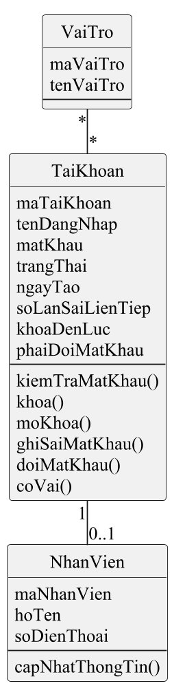
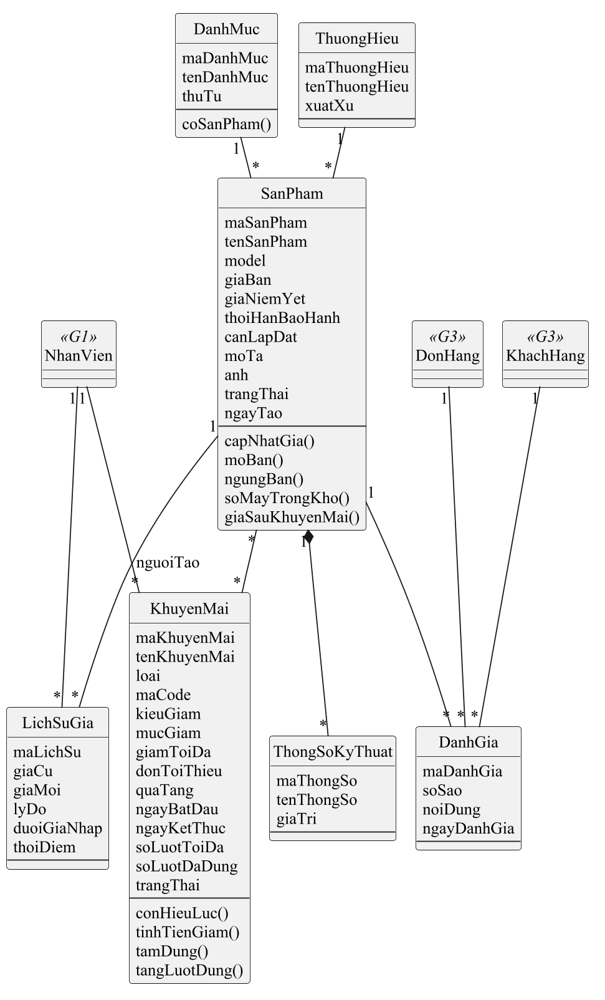
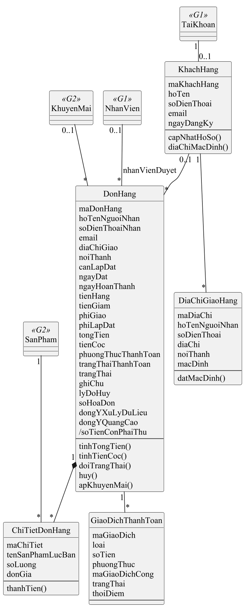
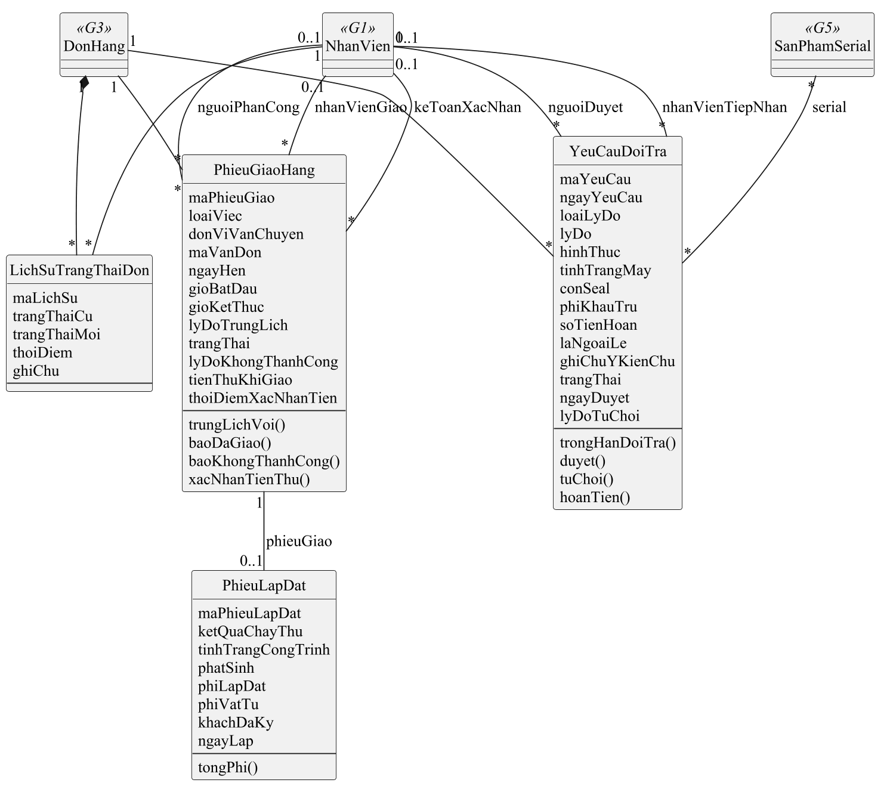
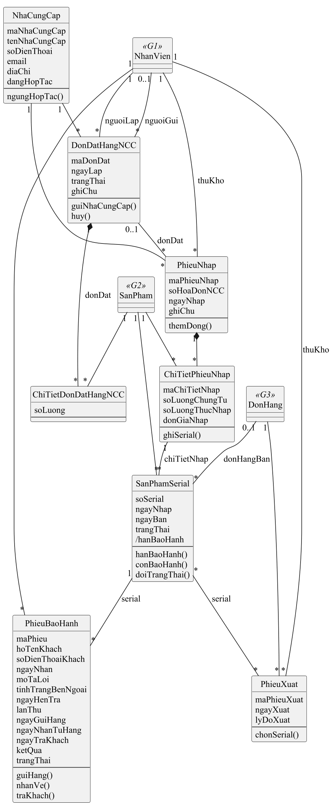
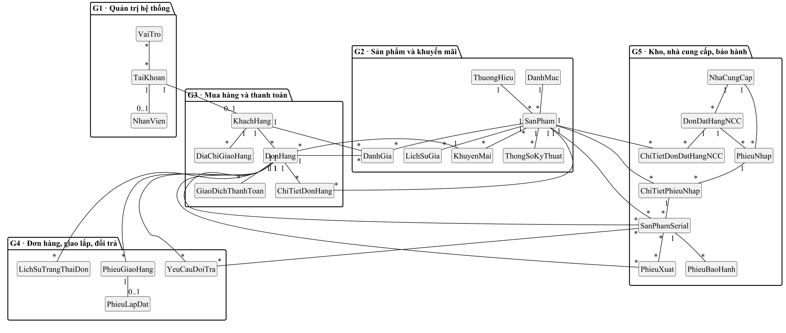
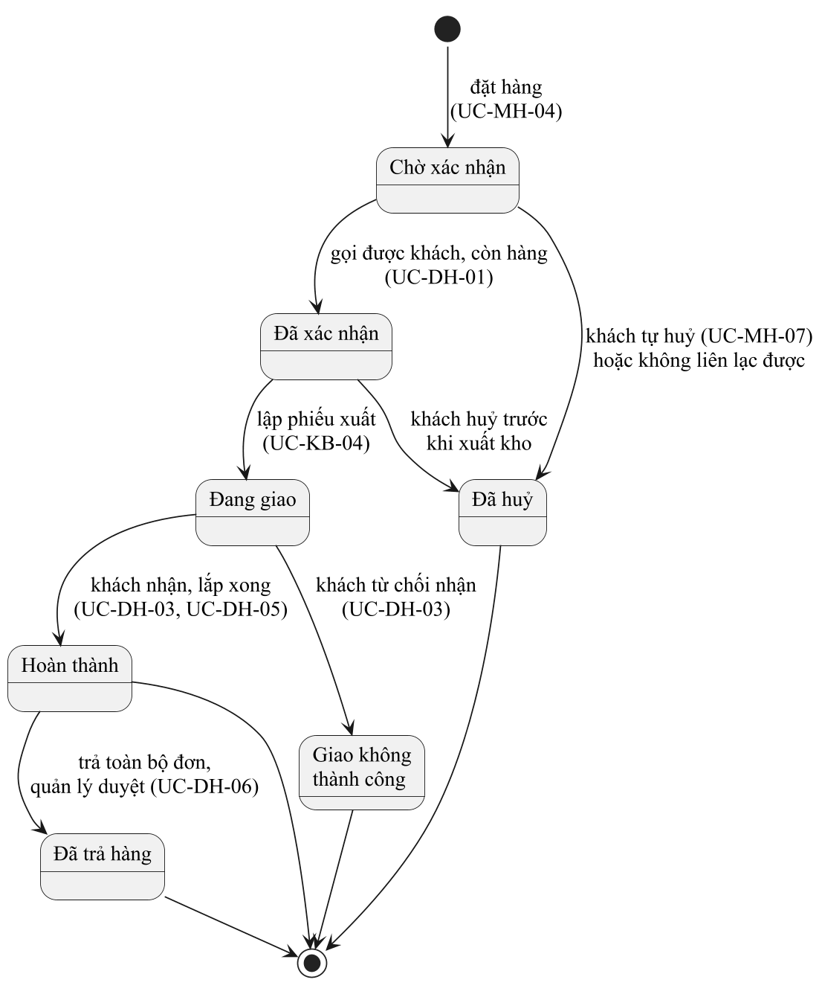
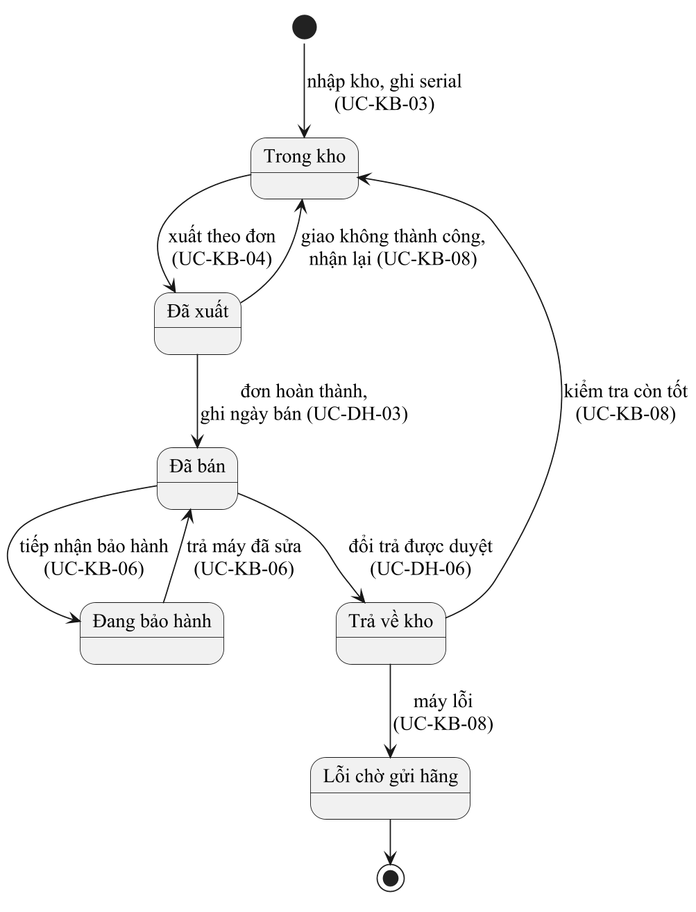
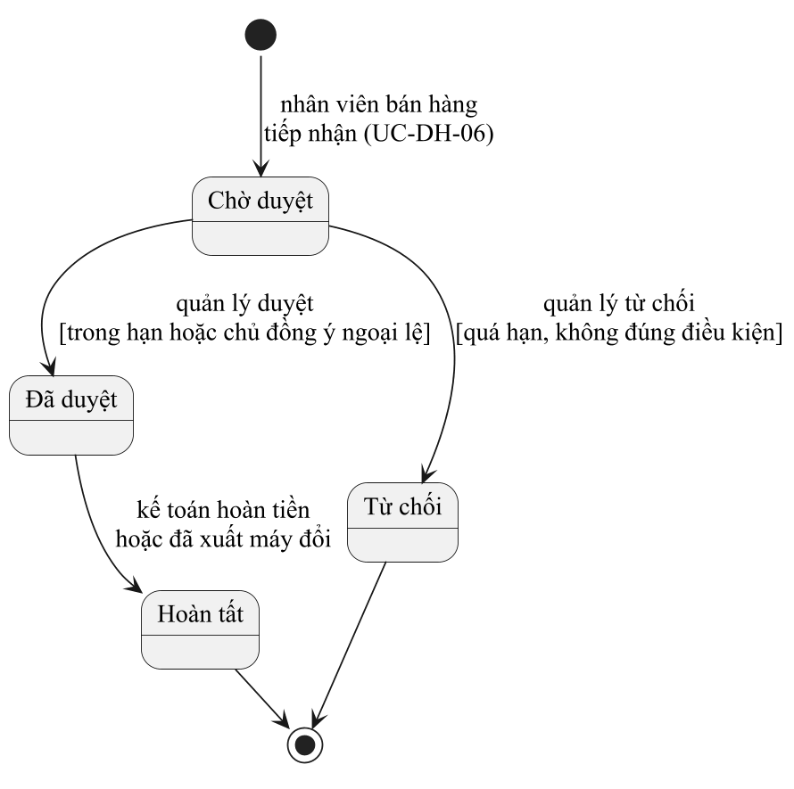
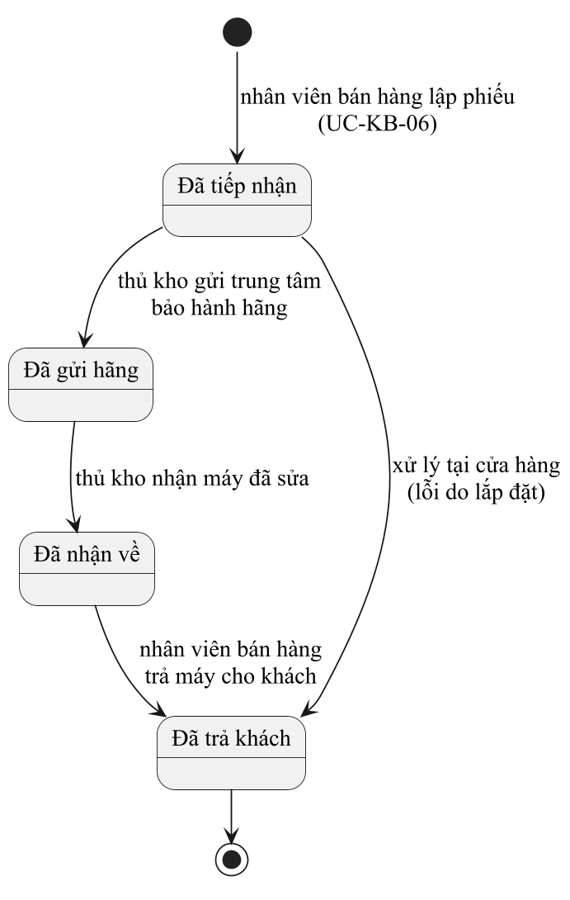

# Chương 5. Mô hình hoá cấu trúc

Bản 1.0 (14/11/2026) · nhóm 4 · đối tượng là **cửa hàng giả định** (`khao-sat/tinh-huong-gia-dinh.md`)

## 5.1 Xác định lớp

Làm theo cách tìm cụm danh từ trong đặc tả use case (mục 5.2.1 giáo trình): gạch chân danh từ trong đặc tả nghiệp vụ và đặc tả use case hệ thống của 5 gói,
bỏ danh từ trùng nghĩa, danh từ chỉ là thuộc tính hoặc vai trò người dùng, giữ lại danh từ có dữ liệu riêng cần lưu và có vòng đời.

| Danh từ trong đặc tả | Quyết định | Lý do |
|---|---|---|
| Khách hàng, khách vãng lai | Lớp `KhachHang` (chỉ khách đã đăng ký); khách vãng lai không thành lớp | Khách vãng lai chỉ để lại họ tên, số điện thoại trên đơn |
| Nhân viên bán hàng, thủ kho, kế toán, quản lý cửa hàng… | Một lớp `NhanVien` + lớp `VaiTro` | Thừa tác viên là vai trò, không phải chức vụ (C3-45); một người kiêm nhiều vai |
| Tài khoản, mật khẩu | Lớp `TaiKhoan`; mật khẩu là thuộc tính | |
| Sản phẩm, mẫu máy | Lớp `SanPham` | |
| Chiếc máy, số serial | Lớp `SanPhamSerial` | Bảo hành, đổi trả, xuất kho tính theo từng chiếc |
| Thông số kỹ thuật, kích thước khoét đá | Lớp `ThongSoKyThuat` | Số lượng thông số mỗi mẫu khác nhau, cần lọc và so sánh |
| Giá bán, giá niêm yết | Thuộc tính của `SanPham`; lớp `LichSuGia` cho các lần đổi | YC-SP-09, YC-HT-05 bắt lưu vết |
| Danh mục, thương hiệu | Lớp `DanhMuc`, `ThuongHieu` | |
| Khuyến mãi, mã giảm giá, quà tặng | Một lớp `KhuyenMai` có thuộc tính `loai`; quà tặng là thuộc tính | Hai loại dùng chung hạn, mức giảm, người duyệt |
| Đơn hàng, chi tiết đơn | Lớp `DonHang`, lớp kết hợp `ChiTietDonHang` | Đơn giá lúc bán phải giữ riêng |
| Tiền cọc, thanh toán, hoàn tiền | Lớp `GiaoDichThanhToan` | Một đơn có nhiều lần thu, hoàn; chống ghi trùng theo mã giao dịch cổng |
| Hoá đơn bán hàng | Thuộc tính `soHoaDon` của `DonHang` | Hoá đơn phát hành ở phần mềm hoá đơn điện tử (YC-PCN-04) |
| Lịch giao lắp, phiếu giao hàng | Lớp `PhieuGiaoHang` | Có người phụ trách, ngày giờ hẹn, kết quả, tiền thu khi giao |
| Biên bản lắp đặt | Lớp `PhieuLapDat` | |
| Sổ nộp tiền | Không thành lớp: thay bằng `tienThuKhiGiao`, `keToanXacNhan` trên `PhieuGiaoHang` | |
| Phiếu đổi trả | Lớp `YeuCauDoiTra` | |
| Nhà cung cấp, đơn đặt hàng | Lớp `NhaCungCap`, `DonDatHangNCC`, `ChiTietDonDatHangNCC` | |
| Phiếu nhập, phiếu xuất | Lớp `PhieuNhap`, `ChiTietPhieuNhap`, `PhieuXuat` | Mẫu 01-VT, 02-VT |
| Phiếu tiếp nhận bảo hành | Lớp `PhieuBaoHanh` | Phiếu bảo hành lúc bán không thành lớp: tính từ `ngayBan` và `thoiHanBaoHanh` |
| Báo cáo kinh doanh | Không thành lớp | Là kết quả truy vấn |
| Đánh giá | Lớp `DanhGia` | |
| Lịch sử trạng thái đơn | Lớp `LichSuTrangThaiDon` | Ai đổi, lúc nào (YC-HT-05) |
| Giỏ hàng | Không lưu CSDL | Giỏ giữ trong phiên làm việc của trình duyệt, đặt hàng xong thì thành đơn |

Kết quả: **27 lớp**, chia theo gói sở hữu. Ý nghĩa, thuộc tính, phương thức từng lớp ở [`mo-ta-lop.md`](mo-ta-lop.md).

## 5.2 Sơ đồ lớp mức phân tích theo phân hệ

Mỗi sơ đồ vẽ đủ lớp của gói, lớp của gói khác chỉ ghi tên kèm nhãn gói. Bản số hai đầu lấy từ ràng buộc dữ liệu: khoá ngoại cho phép rỗng thì đầu kia là `0..1`.
Quan hệ thành phần (hình thoi đặc) dùng cho chi tiết đơn, chi tiết phiếu nhập, chi tiết đơn đặt, thông số kỹ thuật, lịch sử trạng thái: xoá cái chứa thì xoá phần.

## 5.3 Sơ đồ lớp tổng hợp

Nối 5 phân hệ qua lớp dùng chung (`SanPham`, `DonHang`, `SanPhamSerial`, `TaiKhoan`). Các lớp nghiệp vụ đều có mối kết hợp tới `NhanVien` để ghi người thực hiện;
những đường đó đã có ở sơ đồ từng phân hệ nên không vẽ lại ở đây cho đỡ rối.

## 5.4 Sơ đồ trạng thái

Vẽ cho các lớp có vòng đời rõ (C1.2-20, C1.2-21). Mỗi mũi tên ghi sự kiện gây chuyển và use case làm việc đó; bảng chuyển trạng thái ở `phan-tich/chung/lop-va-trang-thai-chung.md`.
Website kiểm đúng các bảng này trong `DonHangBUS` và `SerialBUS`: chuyển sai trạng thái thì báo lỗi, không lưu.

