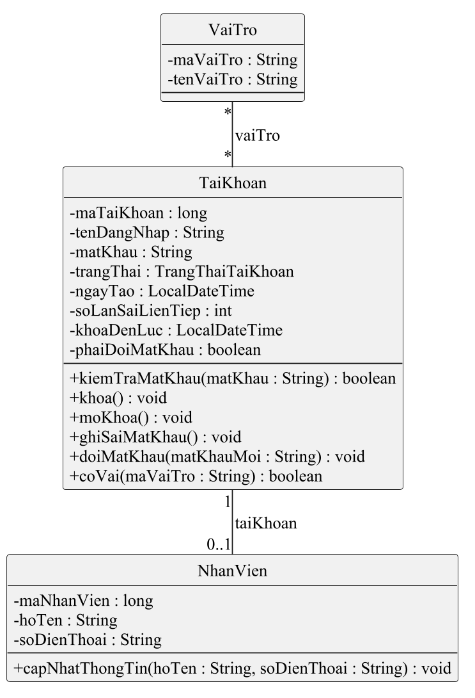
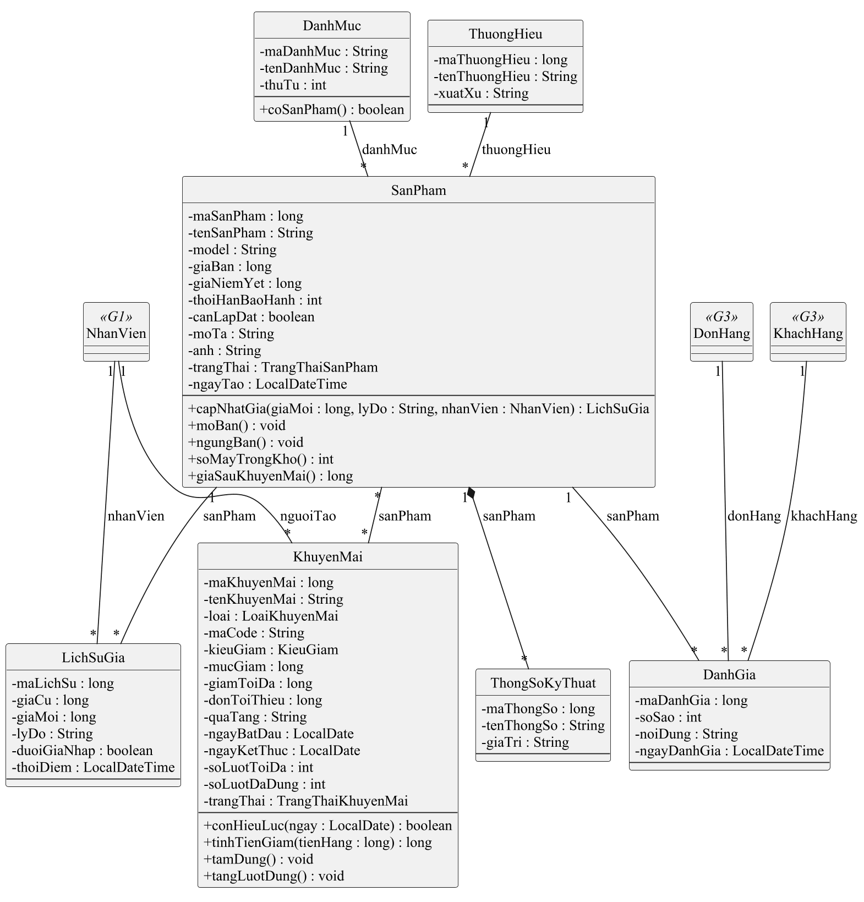
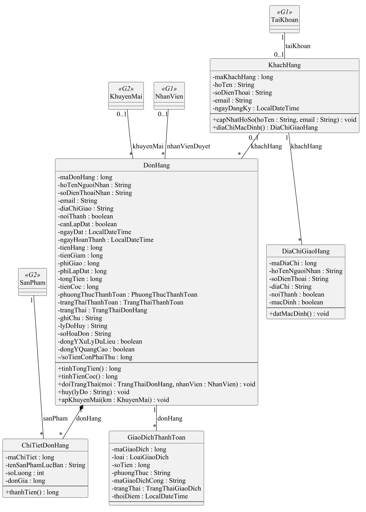
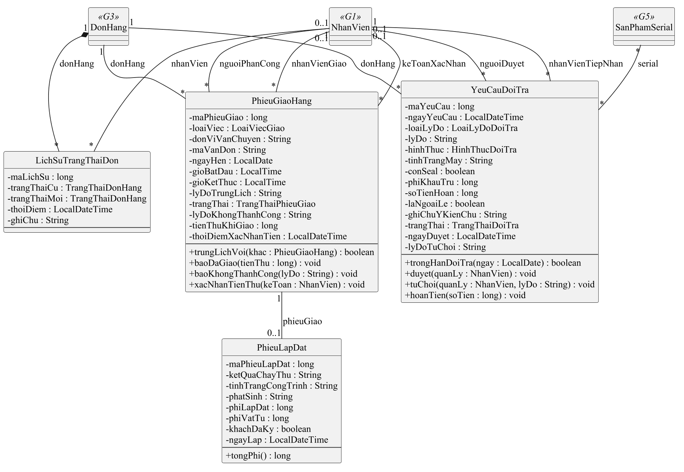
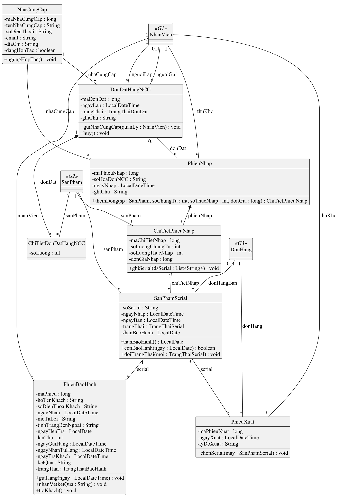
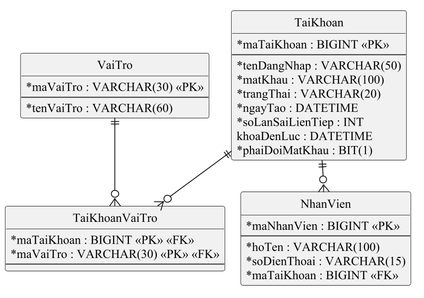
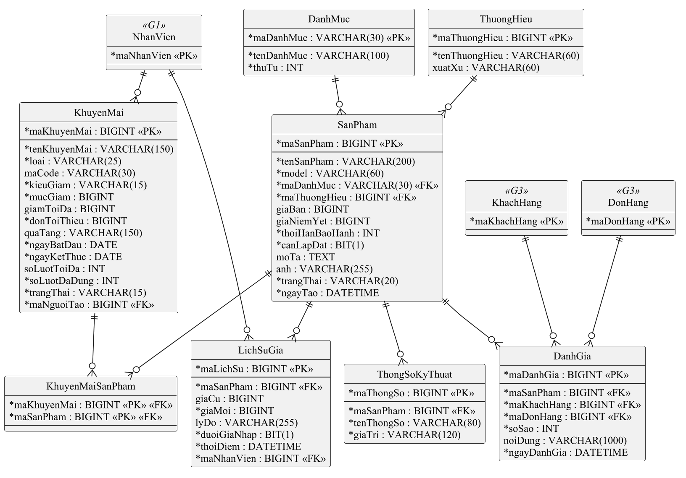
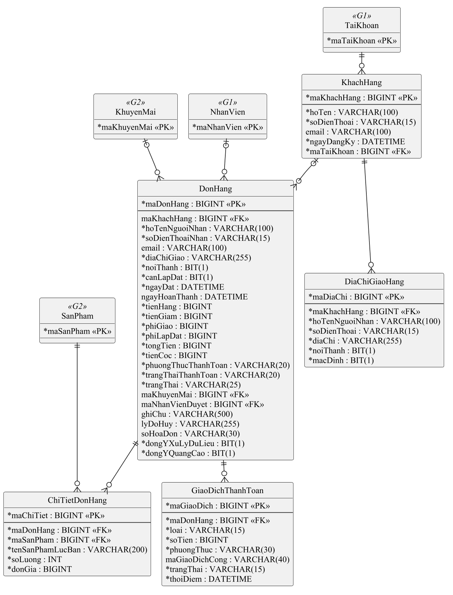
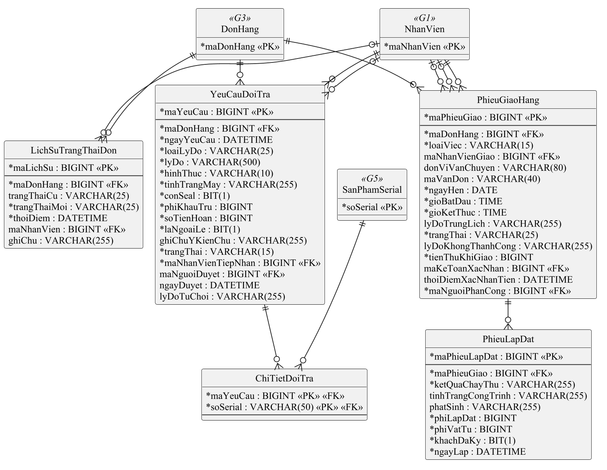
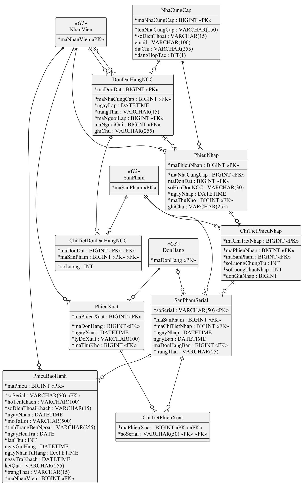

# Chương 6. Thiết kế lớp và cơ sở dữ liệu

Bản 1.0 (14/11/2026) · nhóm 4

## 6.1 Tinh chế lớp

Từ sơ đồ lớp phân tích (chương 5), mỗi lớp được bổ sung:
- **Kiểu dữ liệu**: tiền dùng `long` (đơn vị đồng, không dùng số thực để khỏi sai số); ngày dùng `LocalDate`, thời điểm `LocalDateTime`, giờ hẹn `LocalTime`;
  trạng thái và phân loại dùng kiểu liệt kê (`TrangThaiDonHang`, `TrangThaiSerial`, `LoaiKhuyenMai`…) để không gõ sai giá trị.
- **Phạm vi truy cập**: thuộc tính `-` (riêng), phương thức nghiệp vụ `+` (công khai).
- **Chiều điều hướng**: lớp phía "nhiều" giữ tham chiếu tới lớp phía "một" (ví dụ `ChiTietDonHang` biết `DonHang`); `DonHang`, `PhieuNhap`, `DonDatHangNCC` giữ thêm danh sách chi tiết vì luôn đọc cùng nhau.
- **Thuộc tính dẫn xuất** (`/soTienConPhaiThu`, `/hanBaoHanh`) không lưu, tính khi dùng.
- **Phương thức** nhận tham số rõ kiểu, ví dụ `capNhatGia(giaMoi : long, lyDo : String, nhanVien : NhanVien) : LichSuGia`.

## 6.2 Chuyển lớp sang bảng

Quy tắc theo mục 6.3 giáo trình và các quyết định của nhóm:

| Trường hợp | Cách chuyển | Ví dụ |
|---|---|---|
| Mỗi lớp | Một bảng cùng tên, mỗi thuộc tính lưu trữ một cột | `SanPham` → bảng `SanPham` |
| Quan hệ 1–n | Khoá ngoại đặt ở bảng phía nhiều | `ChiTietDonHang.maDonHang` |
| Quan hệ 1–0..1 | Khoá ngoại có ràng buộc UNIQUE | `NhanVien.maTaiKhoan`, `PhieuLapDat.maPhieuGiao` |
| Quan hệ n–n | Tách bảng trung gian, khoá chính ghép | `TaiKhoanVaiTro`, `KhuyenMaiSanPham`, `ChiTietPhieuXuat`, `ChiTietDoiTra` |
| Lớp kết hợp | Bảng riêng; có thuộc tính riêng thì có khoá riêng | `ChiTietDonHang` (khoá riêng), `ChiTietDonDatHangNCC` (khoá ghép) |
| Quan hệ thành phần | Khoá ngoại `ON DELETE CASCADE` | `ThongSoKyThuat`, `ChiTietDonHang`, `LichSuTrangThaiDon` |
| Kiểu liệt kê | Cột `VARCHAR` + ràng buộc `CHECK` liệt kê giá trị | `DonHang.trangThai` |
| Đúng/sai | `BIT(1)` | `SanPham.canLapDat` |
| Quy tắc nghiệp vụ giữ được ở CSDL | Ràng buộc `CHECK`, `UNIQUE`, `NOT NULL` | `ck_DonHang_dongY`: không có đồng ý xử lý dữ liệu thì không lưu đơn (YC-MH-04); `ck_PhieuGiao_gio`: giờ kết thúc sau giờ bắt đầu; serial là khoá chính nên không nhập trùng |
| Không xoá cứng đơn hàng | Không có chức năng xoá đơn; đơn chỉ đổi trạng thái | YC-PCN-01 |

Kết quả **31 bảng** (27 lớp + 4 bảng trung gian). Lược đồ quan hệ ở [`luoc-do-quan-he.md`](luoc-do-quan-he.md),
từ điển dữ liệu đủ từng cột (kiểu, khoá, cho rỗng, ràng buộc, ý nghĩa) ở [`tu-dien-du-lieu.md`](tu-dien-du-lieu.md).
Script tạo bảng là `website/src/main/resources/db/schema.sql`, dữ liệu mẫu `data.sql` (40 mẫu máy, 213 chiếc máy có serial, 7 đơn ở đủ các trạng thái).

**Kiểm chứng:** website chạy với `spring.jpa.hibernate.ddl-auto=validate`, nghĩa là khi khởi động Hibernate so từng lớp thực thể với từng bảng, lệch một cột là không chạy.
Website khởi động được, tức lớp thiết kế và CSDL khớp nhau.

