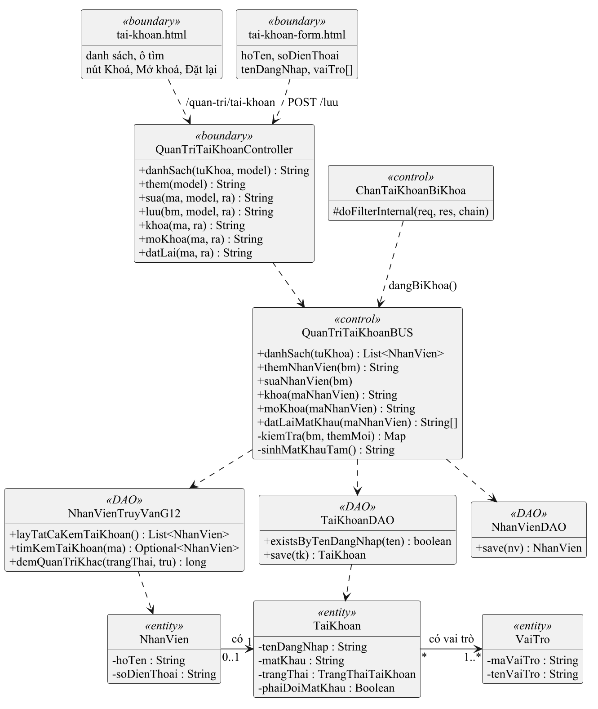
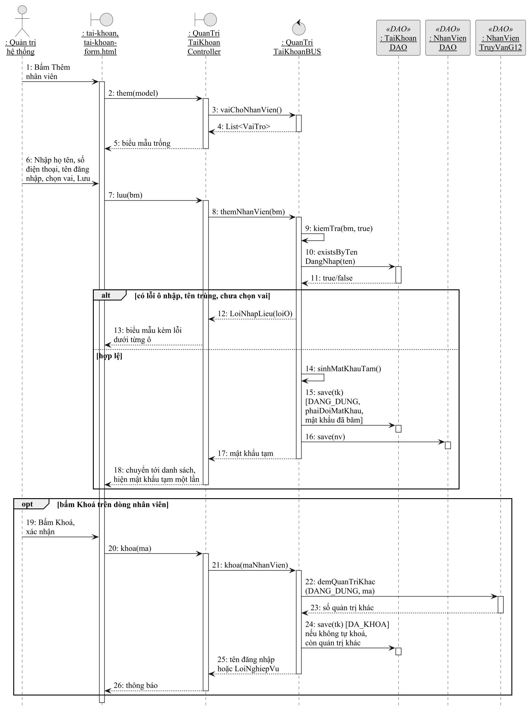
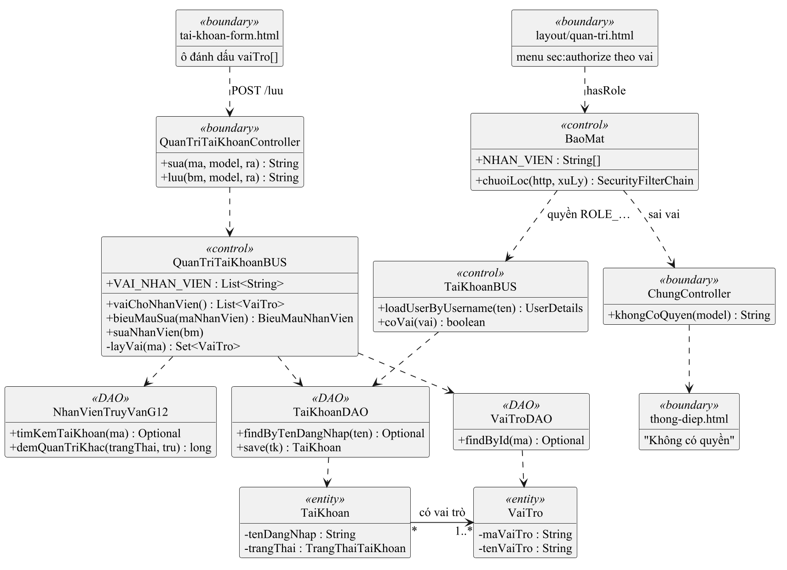
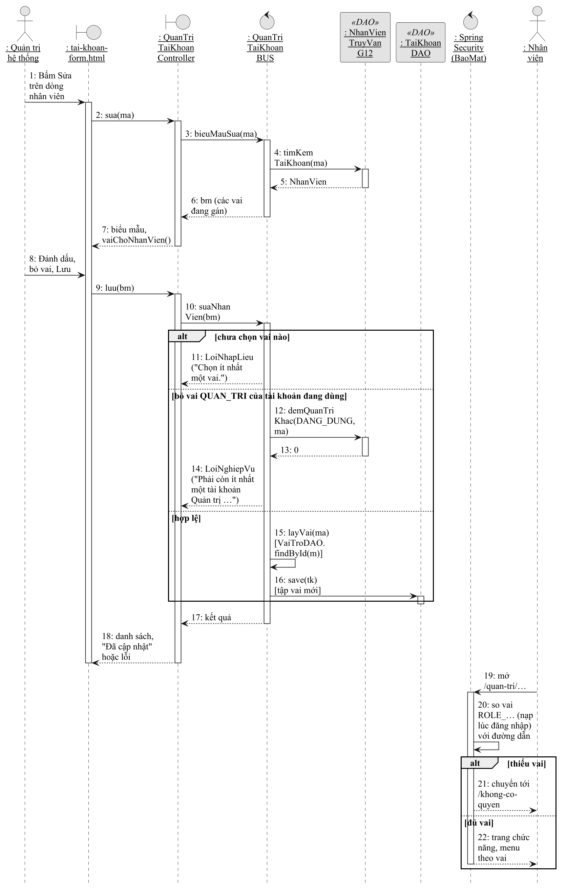
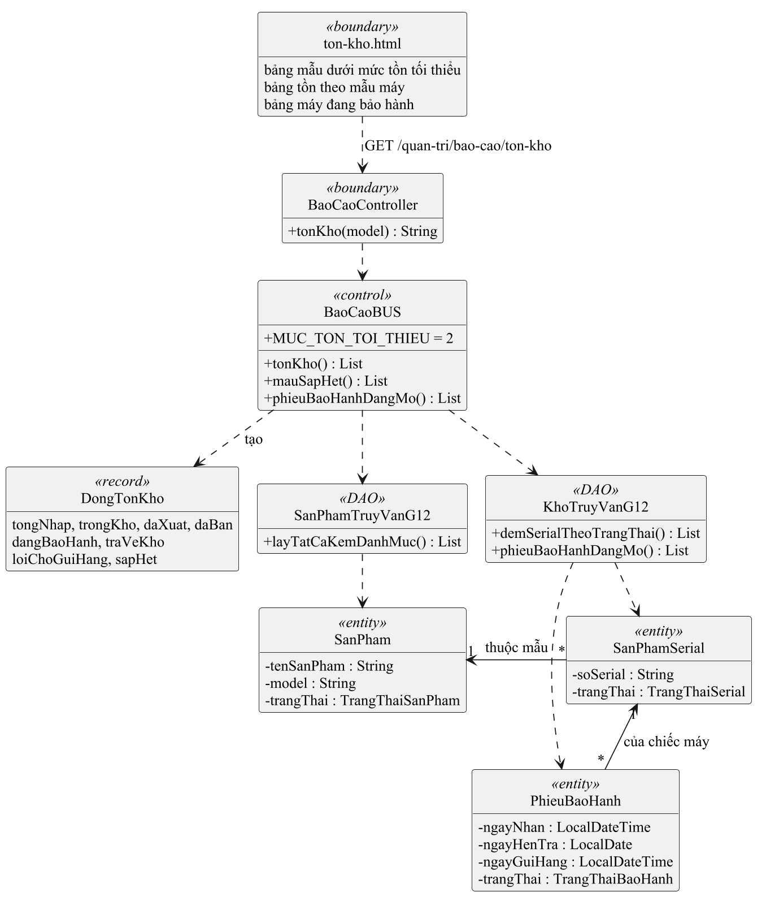
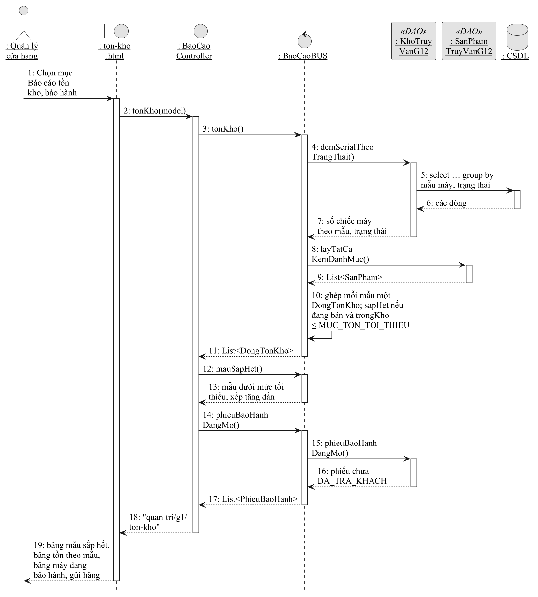
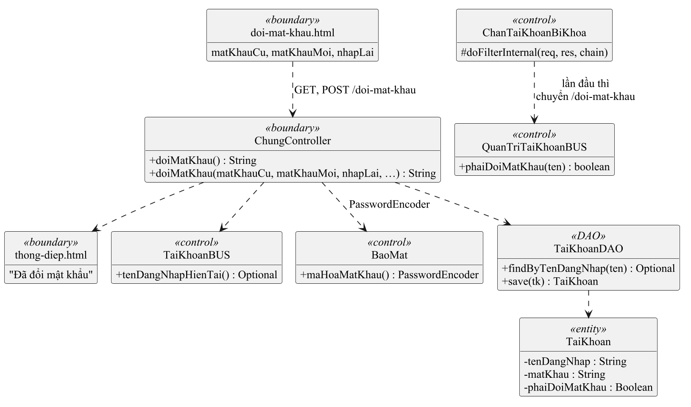
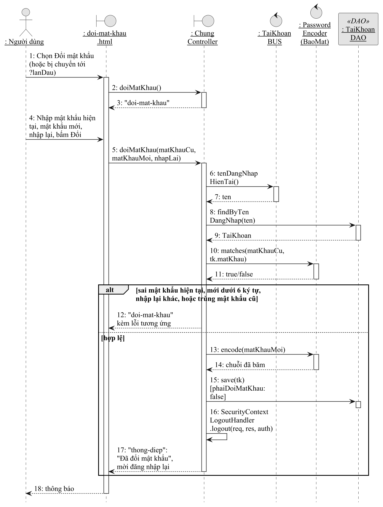

### UC-HT-02 Quản lý tài khoản nhân viên

Thêm, sửa, khoá, mở khoá và đặt lại mật khẩu đều đi qua `QuanTriTaiKhoanController` rồi vào một lớp nghiệp vụ duy nhất là `QuanTriTaiKhoanBUS`; tài khoản bị khoá được chặn ở mỗi yêu cầu bằng bộ lọc `ChanTaiKhoanBiKhoa`.

Quy tắc nghiệp vụ nằm ở `QuanTriTaiKhoanBUS`: `kiemTra()` (họ tên tối đa 100 ký tự, số điện thoại 10 chữ số bắt đầu bằng 0, tên đăng nhập 3–50 ký tự và chưa có ai dùng – luồng 3a, có ít nhất một vai trong `VAI_NHAN_VIEN` – luồng 3b, lỗi trả về theo từng ô qua `LoiNhapLieu`);
`themNhanVien()` (tạo `TaiKhoan` ở `DANG_DUNG`, mật khẩu tạm 10 ký tự do `sinhMatKhauTam()` sinh, lưu dạng băm, `phaiDoiMatKhau = true`); `khoa()` (không tự khoá chính mình, `demQuanTriKhac()` phải còn quản trị khác đang dùng – phần ngoại lệ);
`moKhoa()` (về `DANG_DUNG`, xoá bộ đếm sai và `khoaDenLuc`); `datLaiMatKhau()` (luồng 2d). Không có thao tác xoá tài khoản nhân viên, chỉ khoá, để giữ lưu vết (YC-HT-05).

### UC-HT-03 Phân quyền theo vai trò

Website không có trang phân quyền riêng: vai được gán trong biểu mẫu sửa nhân viên (dùng chung lớp với UC-HT-02), còn việc chặn theo vai do Spring Security làm theo bảng quyền khai báo trong `BaoMat`.

Quy tắc nghiệp vụ nằm ở: `QuanTriTaiKhoanBUS.suaNhanVien()` (phải chọn ít nhất một vai – luồng 2a; không bỏ được vai `QUAN_TRI` của tài khoản quản trị cuối cùng đang dùng – luồng 3a; `layVai()` chỉ nhận vai trong `VAI_NHAN_VIEN`, không gán vai Khách hàng);
`BaoMat.chuoiLoc()` (mỗi nhóm đường dẫn `/quan-tri/…` gắn với các vai được dùng, sai vai thì chuyển `/khong-co-quyen`); `TaiKhoanBUS.loadUserByUsername()` (đổi các vai thành quyền `ROLE_…` lúc đăng nhập) và các `sec:authorize` của `layout/quan-tri.html` (menu chỉ hiện mục của vai).
Phần thiếu so với đặc tả: bảng chức năng của vai cố định trong mã, không xem hoặc sửa được trên giao diện; vai mới có hiệu lực từ lần đăng nhập sau.

### UC-HT-05 Xem báo cáo tồn kho và bảo hành

Giống báo cáo doanh thu, báo cáo tồn kho không có bảng riêng: `BaoCaoBUS` đếm chiếc máy theo số serial và lấy phiếu bảo hành đang mở rồi ghép thành từng dòng `DongTonKho`.

Quy tắc nghiệp vụ nằm ở `BaoCaoBUS`: `tonKho()` (số máy mỗi mẫu đếm theo trạng thái `SanPhamSerial` – trong kho, đã xuất, đã bán, đang bảo hành, trả về kho, lỗi chờ gửi hãng; mẫu còn bán có số máy trong kho không quá `MUC_TON_TOI_THIEU = 2` thì đánh dấu `sapHet`);
`mauSapHet()` (lọc các mẫu `sapHet`, xếp tăng dần theo số trong kho); `phieuBaoHanhDangMo()` (phiếu chưa `DA_TRA_KHACH`, gồm cả máy đang gửi hãng). Phần thiếu so với đặc tả: chưa chọn kỳ, lọc danh mục, tồn đầu kỳ – cuối kỳ và xuất tệp.

### UC-HT-06 Đổi mật khẩu

Đổi mật khẩu dùng chung cho nhân viên và khách tại `/doi-mat-khau`; bộ lọc `ChanTaiKhoanBiKhoa` ép nhân viên mới tới trang này trước khi vào trang quản trị.

Quy tắc nghiệp vụ hiện nằm ở `ChungController.doiMatKhau()` chứ chưa tách ra lớp BUS: so mật khẩu hiện tại bằng `PasswordEncoder.matches()` (luồng 2a), mật khẩu mới ít nhất 6 ký tự (3a), hai lần nhập giống nhau (3b), khác mật khẩu cũ (3c), lưu bằng `encode()`, đặt `phaiDoiMatKhau = false` rồi đăng xuất phiên hiện tại;
`QuanTriTaiKhoanBUS.phaiDoiMatKhau()` cùng `ChanTaiKhoanBiKhoa` lo luồng 1a. Phần thiếu so với đặc tả: chỉ phiên đang dùng bị kết thúc, phiên của cùng tài khoản trên máy khác vẫn còn.
