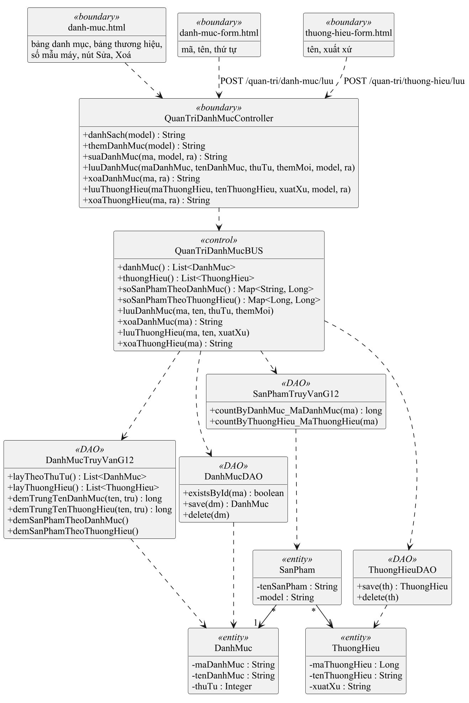
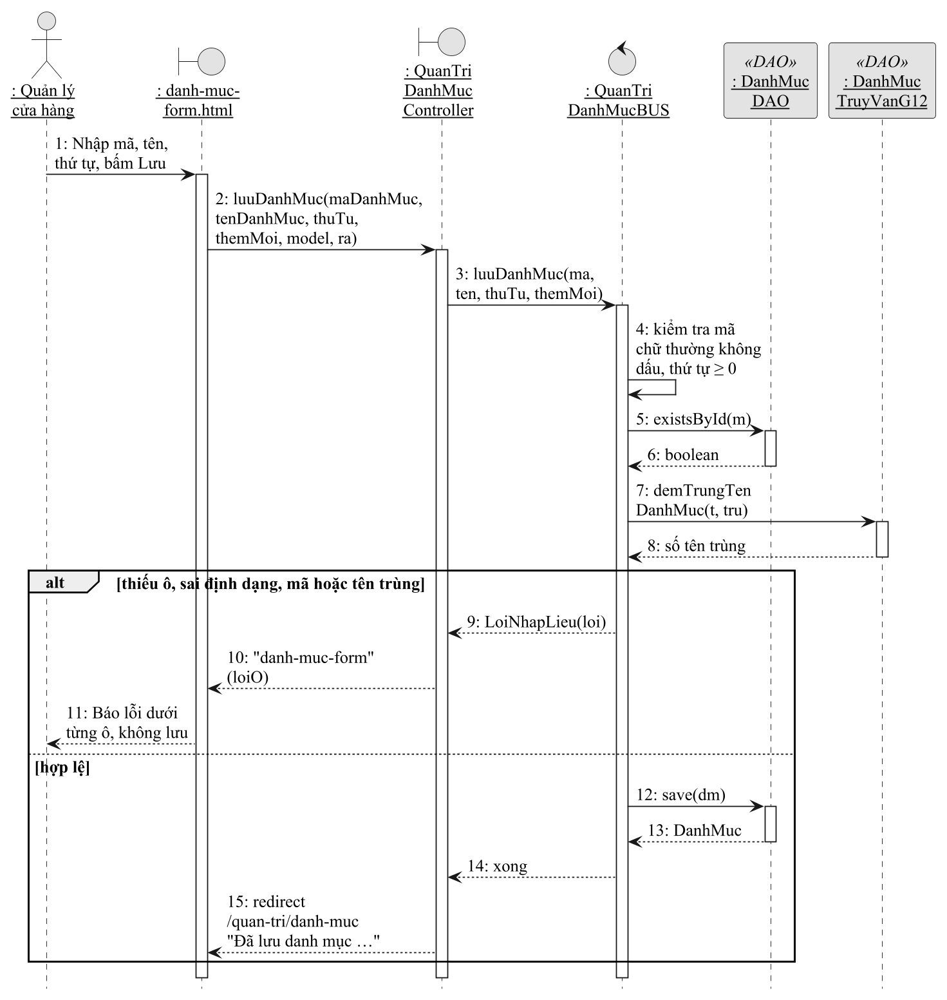
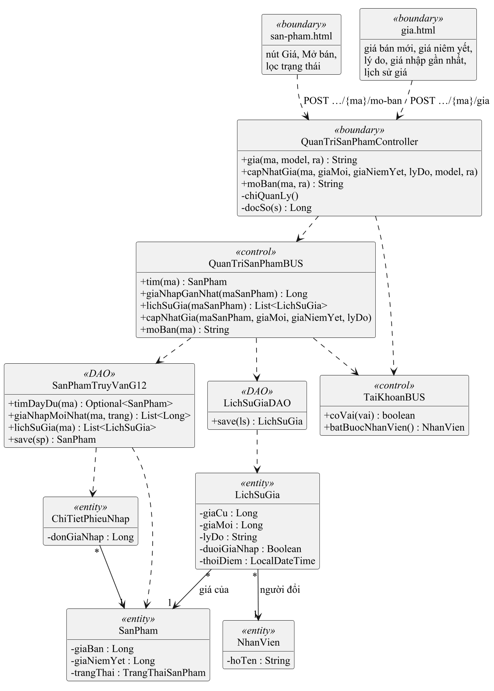
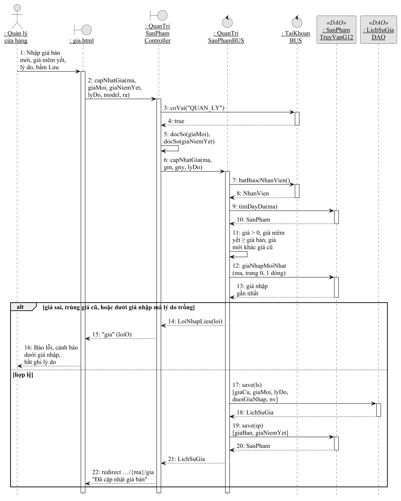
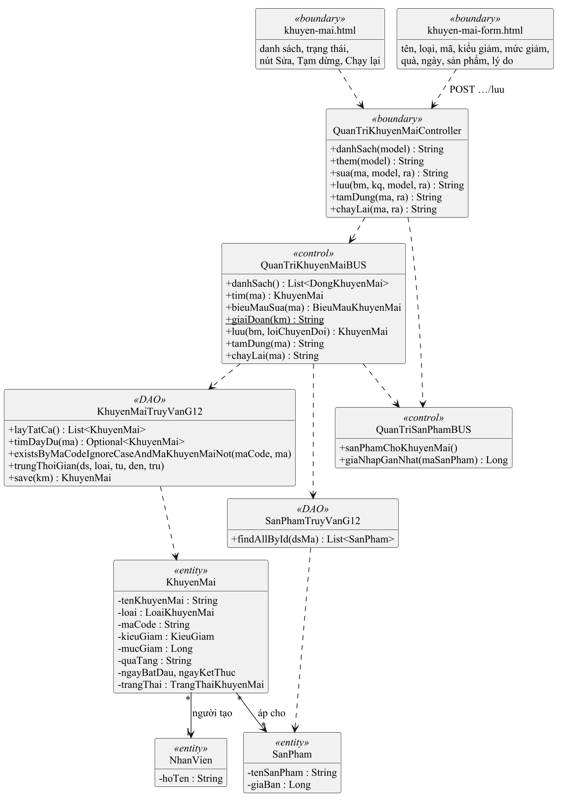
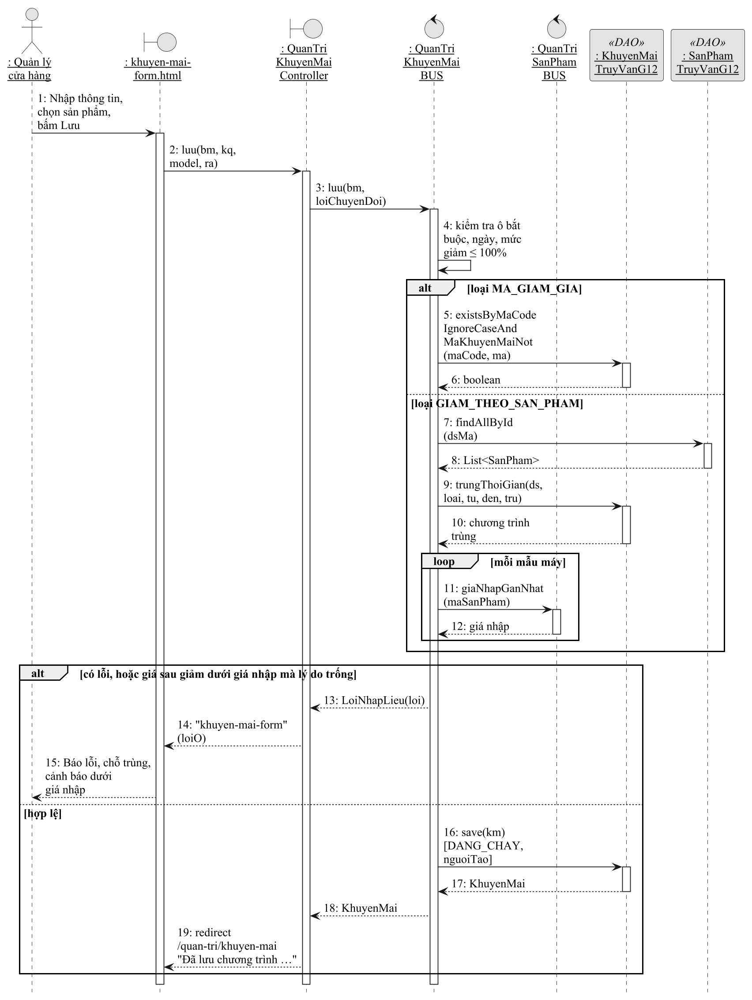
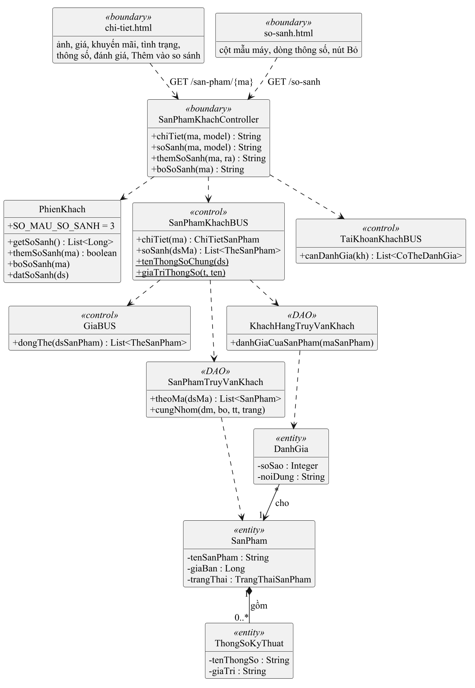
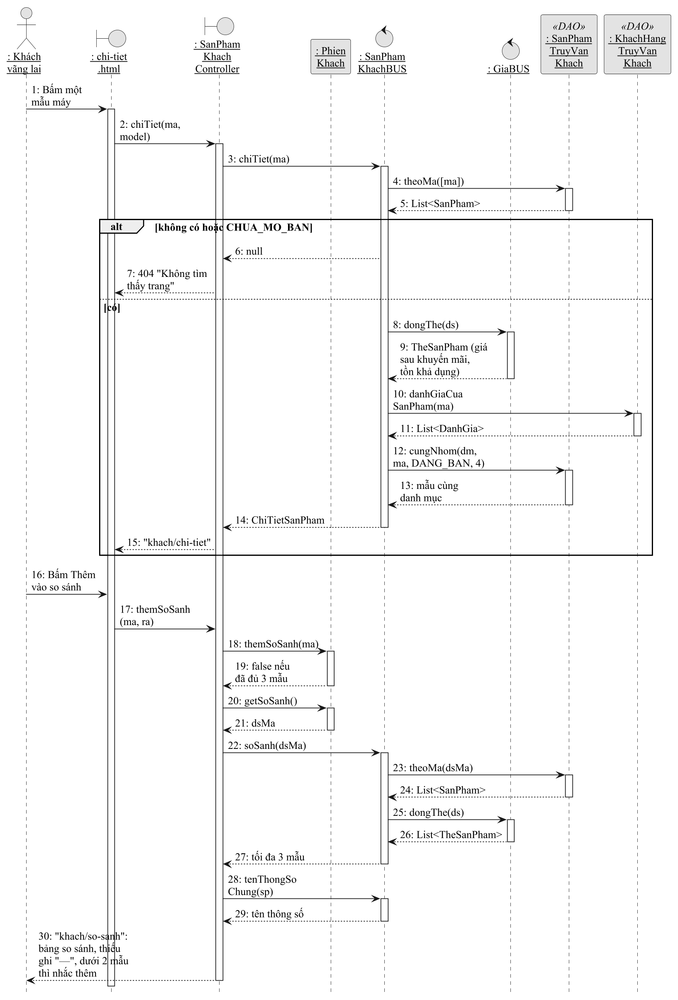
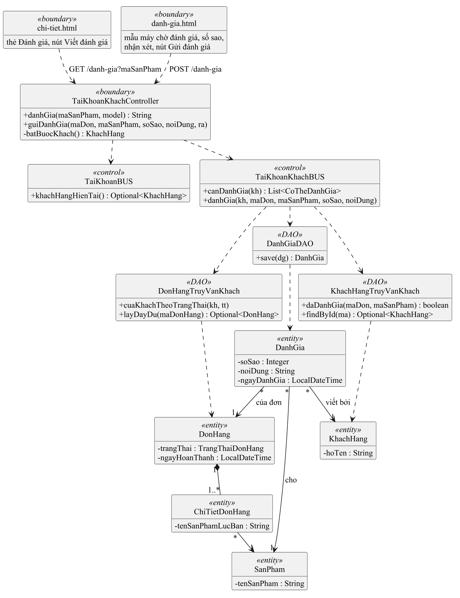
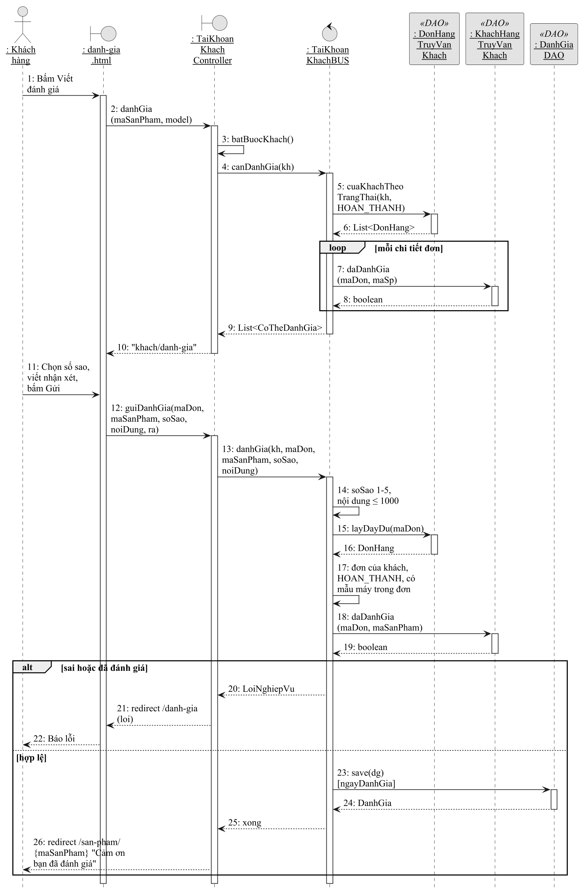

### UC-SP-01 Quản lý danh mục, thương hiệu

Quản lý cửa hàng thêm, sửa, xoá danh mục và thương hiệu trên cùng một trang `danh-muc.html`; mọi thao tác đi qua `QuanTriDanhMucController` rồi vào `QuanTriDanhMucBUS`.

Quy tắc nghiệp vụ nằm ở `QuanTriDanhMucBUS`: `luuDanhMuc()` kiểm mã danh mục chỉ gồm chữ thường không dấu, số, gạch ngang (tối đa 30 ký tự), mã chưa có (`existsById`),
tên chưa trùng không phân biệt hoa thường (`demTrungTenDanhMuc`), thứ tự là số nguyên không âm; `luuThuongHieu()` kiểm tên bắt buộc, không trùng (`demTrungTenThuongHieu`);
`xoaDanhMuc()`, `xoaThuongHieu()` đếm mẫu máy bằng `countByDanhMuc_MaDanhMuc`, `countByThuongHieu_MaThuongHieu` và từ chối xoá khi còn mẫu máy. Lỗi nhập trả về bằng `LoiNhapLieu` để báo dưới từng ô.

### UC-SP-03 Cập nhật giá bán

Quản lý cửa hàng mở trang `gia.html` của một mẫu máy từ danh sách sản phẩm; đổi giá và ghi lịch sử giá nằm trong một giao dịch của `QuanTriSanPhamBUS.capNhatGia()`.

Quy tắc nghiệp vụ nằm ở `QuanTriSanPhamBUS`: `capNhatGia()` chỉ cho vai `QUAN_LY` (kiểm hai lần, ở `chiQuanLy()` của controller và bằng `TaiKhoanBUS.coVai()` trong BUS), giá mới lớn hơn 0,
giá niêm yết để trống hoặc không thấp hơn giá bán, giá mới phải khác giá hiện tại; so với `giaNhapGanNhat()` (đơn giá nhập ở phiếu nhập mới nhất), thấp hơn mà chưa có lý do thì báo lỗi ở ô lý do;
mỗi lần đổi ghi một `LichSuGia` (giá cũ, giá mới, lý do, cờ `duoiGiaNhap`, người đổi, thời điểm). `moBan()` chỉ mở bán khi mẫu máy đã có giá.

### UC-SP-04 Quản lý khuyến mãi, mã giảm giá

Quản lý cửa hàng lập chương trình trên `khuyen-mai-form.html`; `QuanTriKhuyenMaiBUS.luu()` gom toàn bộ kiểm tra rồi lưu `KhuyenMai` cùng danh sách mẫu máy áp dụng, người tạo lấy từ `TaiKhoanBUS.batBuocNhanVien()`.

Quy tắc nghiệp vụ nằm ở `QuanTriKhuyenMaiBUS`: `giaiDoan()` tính Sắp chạy, Đang chạy, Đã kết thúc theo ngày; `luu()` không cho sửa chương trình đã kết thúc, chương trình đang chạy chỉ sửa tên và ngày kết thúc,
ngày bắt đầu không trước hôm nay, ngày kết thúc không trước ngày bắt đầu, phần trăm không quá 100; mã giảm giá 3–30 ký tự, không trùng (`existsByMaCodeIgnoreCaseAndMaKhuyenMaiNot`);
khuyến mãi theo sản phẩm không trùng thời gian với chương trình cùng loại đang chạy (`trungThoiGian`), không làm giá về 0, và nếu giá sau giảm thấp hơn `QuanTriSanPhamBUS.giaNhapGanNhat()` thì bắt ghi lý do.
`tamDung()`, `chayLai()` thay cho dừng sớm; chạy lại cũng kiểm trùng thời gian.

### UC-SP-06 Xem chi tiết, so sánh sản phẩm

Trang chi tiết và trang so sánh cùng do `SanPhamKhachController` phục vụ; giá sau khuyến mãi và tồn khả dụng dùng lại `GiaBUS.dongThe()` như UC-SP-05, danh sách so sánh giữ trong phiên (`PhienKhach`).

Quy tắc nghiệp vụ nằm ở: `SanPhamKhachBUS.chiTiet()` (mẫu máy không có hoặc `CHUA_MO_BAN` thì trả `null`, controller báo 404; kèm đánh giá và 4 mẫu `DANG_BAN` cùng danh mục);
`SanPhamKhachBUS.soSanh()` (bỏ mã trùng, lấy tối đa 3 mẫu, bỏ mẫu chưa mở bán), `tenThongSoChung()` lấy hợp tên thông số, `giaTriThongSo()` trả "—" khi mẫu không có;
`PhienKhach.themSoSanh()` từ chối khi đã đủ `SO_MAU_SO_SANH = 3`. Nút Viết đánh giá chỉ hiện khi `TaiKhoanKhachBUS.canDanhGia()` có mẫu máy này.

### UC-SP-07 Đánh giá sản phẩm

Khách hàng đã đăng nhập mở trang `danh-gia.html` (từ trang chi tiết hoặc trang tài khoản); `TaiKhoanKhachBUS` vừa lập danh sách chờ đánh giá, vừa kiểm và lưu `DanhGia`.

Quy tắc nghiệp vụ nằm ở `TaiKhoanKhachBUS`: `canDanhGia()` chỉ lấy đơn `HOAN_THANH` của chính khách và các cặp đơn, mẫu máy chưa có đánh giá (`daDanhGia`);
`danhGia()` kiểm số sao 1–5, nội dung không quá 1000 ký tự, đơn thuộc khách, đơn đã hoàn thành, mẫu máy có trong đơn, chưa đánh giá cho đơn đó; CSDL có thêm khoá duy nhất
`uq_DanhGia_don_sp (maDonHang, maSanPham)` chặn bản trùng khi gửi hai lần cùng lúc. Đường dẫn `/danh-gia/**` chỉ vai `KHACH_HANG` vào được (`BaoMat`).
