### UC-MH-01 Đăng ký tài khoản khách hàng

Khách vãng lai gửi biểu mẫu `dang-ky.html`; `TaiKhoanKhachBUS.dangKy()` kiểm dữ liệu rồi tạo tài khoản và hồ sơ khách hàng trong cùng một giao dịch.

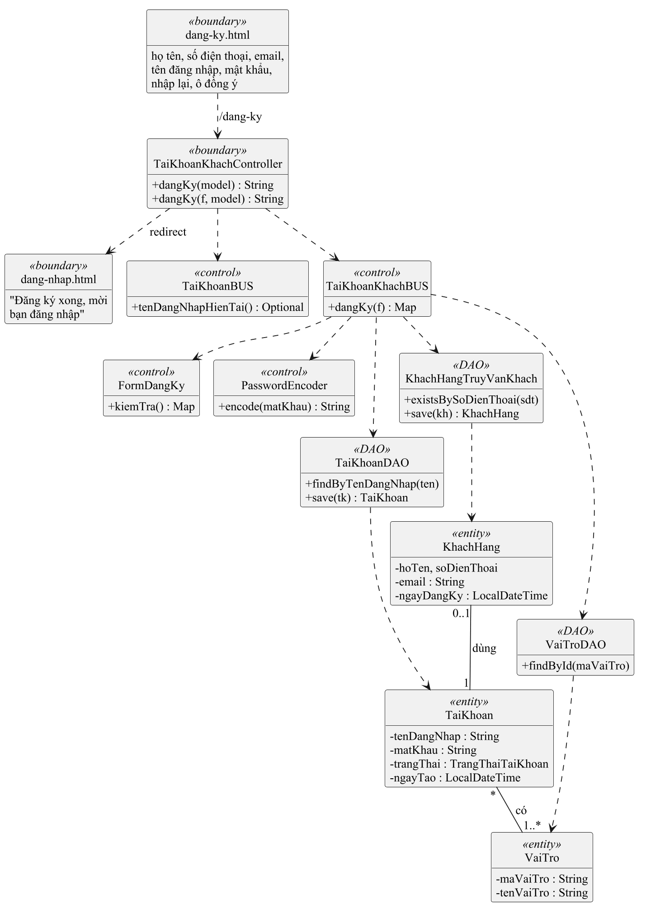

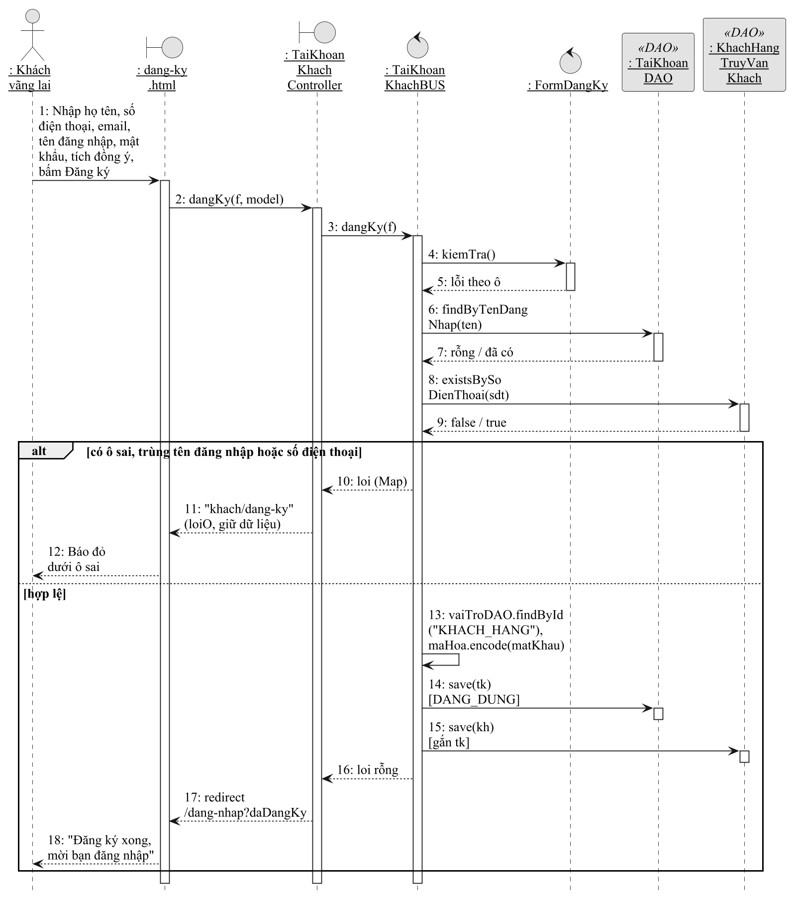

Quy tắc nghiệp vụ nằm ở: `FormDangKy.kiemTra()` (họ tên 2–60 ký tự, số điện thoại `^0\d{9}$`, email đúng dạng, tên đăng nhập 4–50 ký tự chữ không dấu, số, dấu chấm, gạch dưới, mật khẩu 6–50 ký tự, nhập lại khớp, bắt buộc tích ô đồng ý);
`TaiKhoanKhachBUS.dangKy()` (tên đăng nhập chưa có qua `TaiKhoanDAO.findByTenDangNhap()`, số điện thoại chưa đăng ký qua `KhachHangTruyVanKhach.existsBySoDienThoai()`, mật khẩu băm bằng `PasswordEncoder.encode()`,
tài khoản `DANG_DUNG`, vai trò `KHACH_HANG`, không bắt đổi mật khẩu; chạy trong `@Transactional`). `TaiKhoanKhachController.dangKy()` còn bắt `DataIntegrityViolationException` khi hai người đăng ký trùng tên cùng lúc
và chặn khách đã đăng nhập (`TaiKhoanBUS.tenDangNhapHienTai()`). Website chưa lưu lần đồng ý điều khoản (mục đích, thời điểm) như đặc tả.

### UC-MH-02 Quản lý hồ sơ, sổ địa chỉ

Mọi thao tác trên trang `tai-khoan.html` đi qua `TaiKhoanKhachController`, lấy khách đang đăng nhập bằng `TaiKhoanBUS.khachHangHienTai()` rồi gọi `TaiKhoanKhachBUS`; sơ đồ tuần tự vẽ việc thêm địa chỉ.

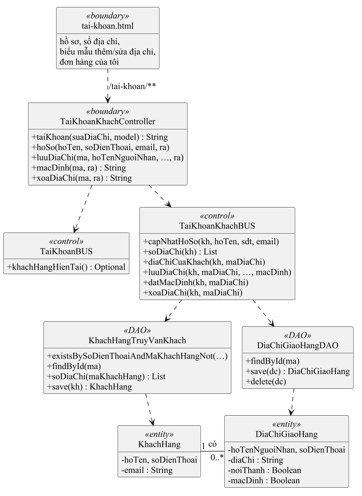

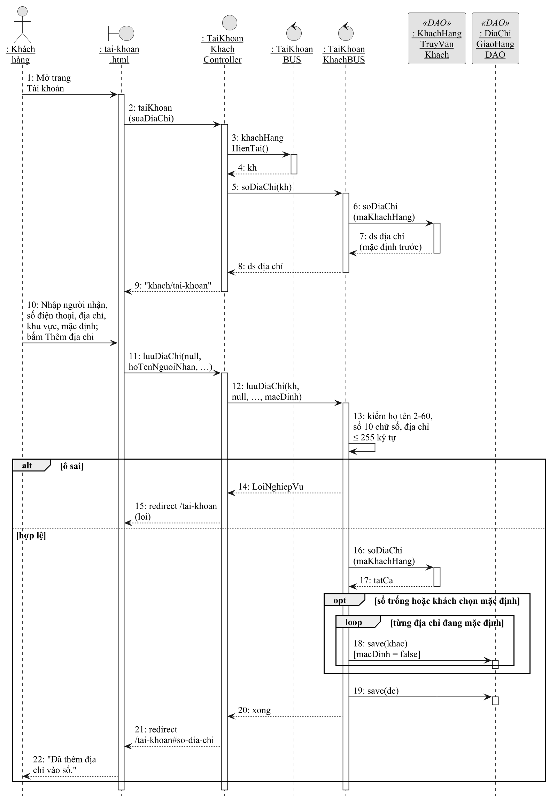

Quy tắc nghiệp vụ nằm ở `TaiKhoanKhachBUS`: `capNhatHoSo()` (họ tên 2–60 ký tự, số điện thoại 10 chữ số bắt đầu bằng 0, email đúng dạng nếu có, số điện thoại không trùng tài khoản khác qua `existsBySoDienThoaiAndMaKhachHangNot()`);
`luuDiaChi()` (ô bắt buộc, địa chỉ tối đa 255 ký tự; địa chỉ đầu tiên hoặc có tích mặc định thì thành mặc định và bỏ mặc định ở địa chỉ khác); `diaChiCuaKhach()` (địa chỉ phải thuộc khách đang đăng nhập, sai thì "Không tìm thấy địa chỉ.");
`datMacDinh()` (chỉ một địa chỉ mặc định); `xoaDiaChi()` (xoá địa chỉ mặc định thì địa chỉ đứng đầu còn lại thành mặc định). Đường dẫn `/tai-khoan/**` chỉ mở cho vai `KHACH_HANG` (cấu hình `BaoMat`).

### UC-MH-03 Quản lý giỏ hàng

Giỏ hàng là đối tượng `GioHang` gắn với phiên (`@SessionScope`), không lưu CSDL; `GioHangKhachController` nhận thao tác từ `chi-tiet.html` và `gio-hang.html`, kiểm tra nhờ `DatHangBUS`.

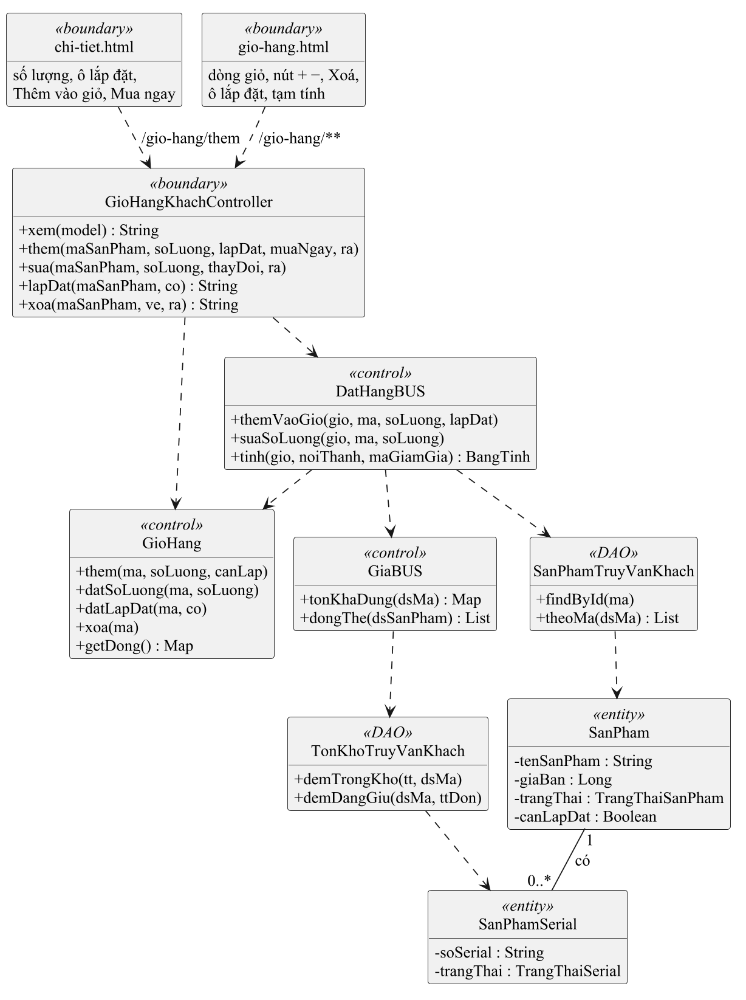

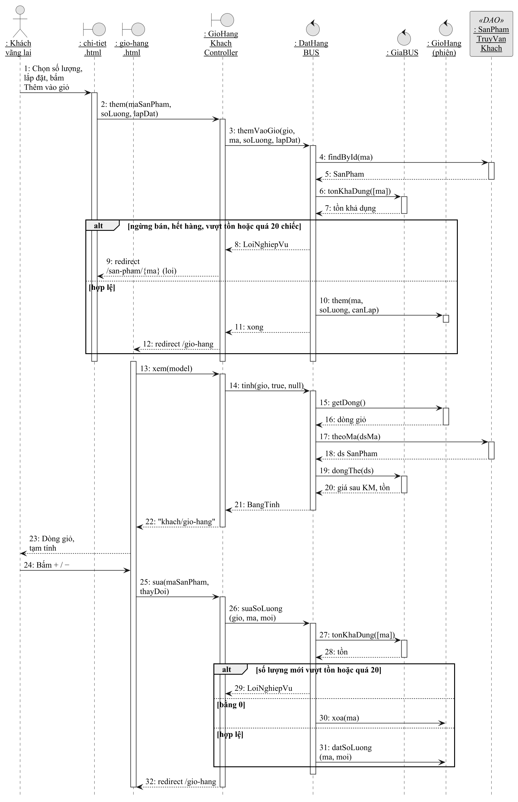

Quy tắc nghiệp vụ nằm ở: `DatHangBUS.themVaoGio()` (số lượng từ 1, mẫu máy `DANG_BAN` đã có giá, số trong giỏ cộng thêm không vượt tồn khả dụng, tối đa `SO_LUONG_TOI_DA_MOT_DONG = 20` chiếc mỗi mẫu, chỉ ghi lắp đặt với mẫu `canLapDat`);
`DatHangBUS.suaSoLuong()` (về 0 thì bỏ dòng, tăng quá tồn thì báo "Mẫu máy này chỉ còn n chiếc"); `GiaBUS.tonKhaDung()` (số chiếc `TRONG_KHO` trừ số đang giữ cho đơn `CHO_XAC_NHAN`, `DA_XAC_NHAN`);
`DatHangBUS.tinh()` cùng `GiaBUS.dongThe()` (giá sau khuyến mãi theo mẫu máy, đánh dấu dòng "Đã ngừng bán", "Tạm hết hàng", "Chỉ còn n chiếc" qua `DongGio.getLoi()`; có dòng lỗi thì ẩn nút "Tiến hành đặt hàng").

### UC-MH-06 Theo dõi đơn hàng

Khách vãng lai tra bằng số điện thoại và mã đơn ở `tra-cuu-don.html`; tra đúng thì mã đơn được ghi vào phiên (`PhienKhach.choXemDon()`) để mở `chi-tiet-don.html`. Khách hàng đã đăng nhập mở thẳng đơn từ "Đơn hàng của tôi".

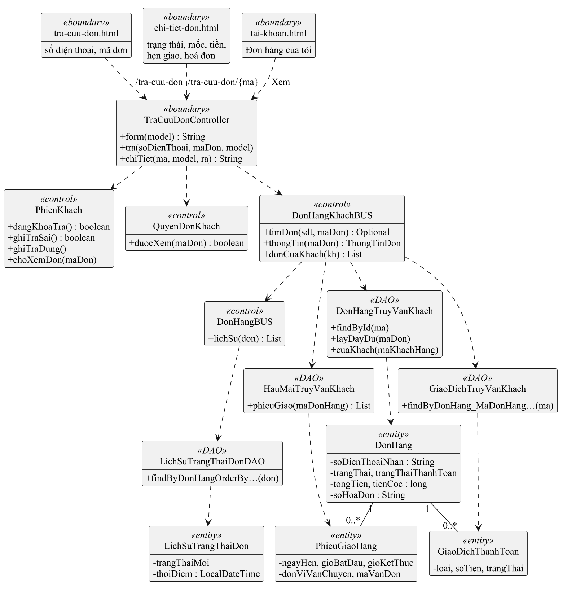

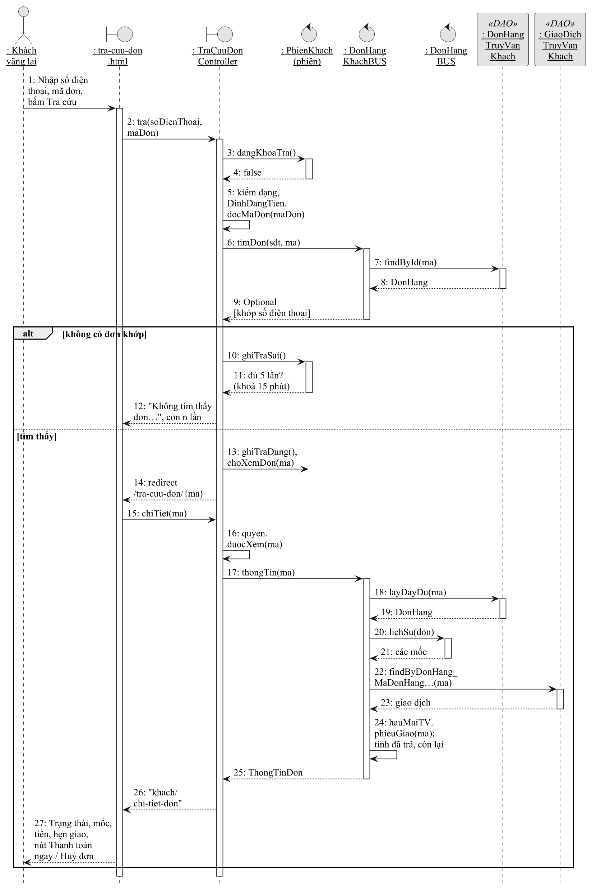

Quy tắc nghiệp vụ nằm ở: `PhienKhach.ghiTraSai()`, `dangKhoaTra()` (sai `SO_LAN_TRA_SAI_TOI_DA = 5` lần liên tiếp thì khoá tra cứu `PHUT_KHOA_TRA = 15` phút, luồng 3b); `TraCuuDonController.tra()` (báo chung "Không tìm thấy đơn…", không nói sai ô nào, luồng 3a);
`DonHangKhachBUS.timDon()` (mã đơn và số điện thoại phải khớp); `QuyenDonKhach.duocXem()` (chỉ xem được đơn đã tra đúng trong phiên hoặc đơn của tài khoản đang đăng nhập);
`DonHangKhachBUS.thongTin()` (gom lịch sử trạng thái qua `DonHangBUS.lichSu()`, giao dịch thanh toán, phiếu giao hàng có ngày giờ hẹn và mã vận đơn; tính đã trả, đã hoàn, còn lại) cùng `ThongTinDon.getDiaChiChe()` (che bớt địa chỉ người nhận; số điện thoại che ngay trên trang bằng `DinhDang.che()`).
Website tra theo `soDienThoaiNhan` (số người nhận) vì `DonHang` chưa có số điện thoại người đặt; hoá đơn chỉ hiện số hoá đơn, chưa có ký hiệu, đường dẫn tra cứu, tải, in.

### UC-MH-07 Huỷ đơn hàng

Nút "Huỷ đơn" trên `chi-tiet-don.html` gửi về `TraCuuDonController.huy()`; việc đổi trạng thái đi qua `DonHangBUS.doiTrangThai()` dùng chung với mọi màn hình đổi trạng thái đơn.

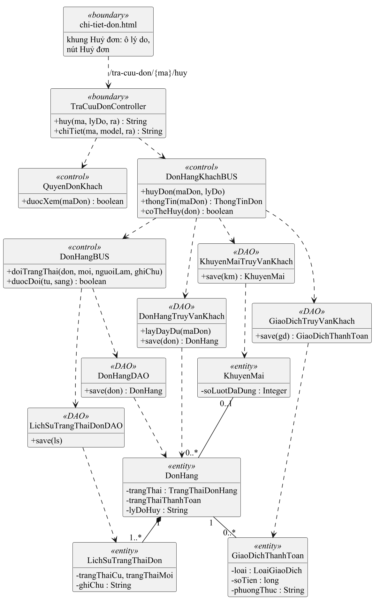

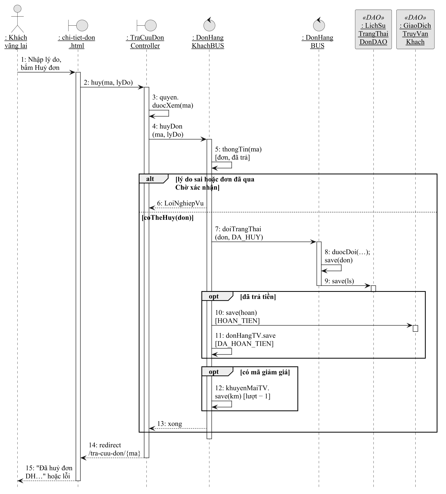

Quy tắc nghiệp vụ nằm ở `DonHangKhachBUS.huyDon()`: lý do bắt buộc, tối đa 200 ký tự; `coTheHuy()` chỉ cho đơn `CHO_XAC_NHAN` (đơn đã xác nhận báo gọi 0339 999 999, luồng 1a, 3b); đã trả tiền thì ghi `GiaoDichThanhToan` loại `HOAN_TIEN` theo phương thức của lần trả gần nhất và đơn sang `DA_HOAN_TIEN` (QĐ8, QĐ9);
mã giảm giá của đơn được trả một lượt (`soLuotDaDung − 1`). `DonHangBUS.doiTrangThai()` kiểm `duocDoi(CHO_XAC_NHAN, DA_HUY)` theo bảng chuyển trạng thái rồi ghi `LichSuTrangThaiDon` "Khách huỷ: …". Cả `huyDon()` chạy trong một `@Transactional`;
quyền huỷ kiểm ở `QuyenDonKhach.duocXem()`.

### UC-MH-08 Áp mã giảm giá

Áp mã là nút "Áp dụng mã" (`nut = "apMa"`) trên chính biểu mẫu `dat-hang.html` của UC-MH-04; controller lưu bản nháp vào phiên rồi gọi `DatHangBUS.tinh()` với mã khách nhập.

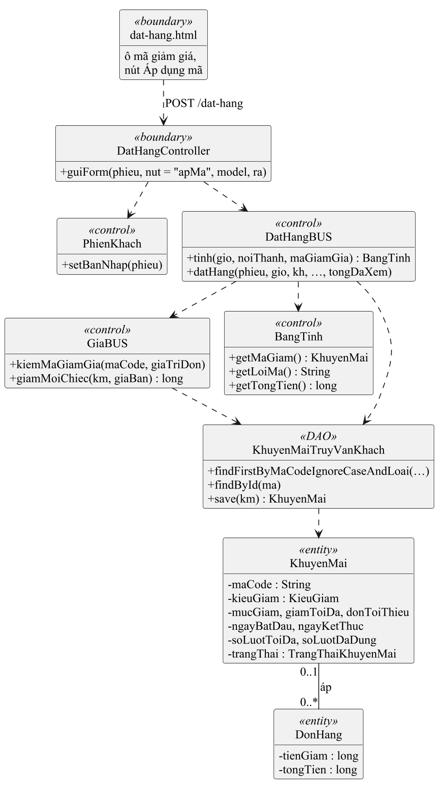

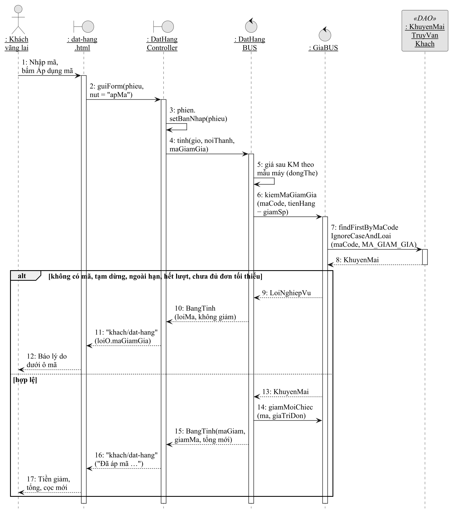

Quy tắc nghiệp vụ nằm ở `GiaBUS.kiemMaGiamGia()` (mã loại `MA_GIAM_GIA` tìm không phân biệt hoa thường; trạng thái `DANG_CHAY`, trong khoảng ngày bắt đầu, kết thúc, còn lượt, đạt `donToiThieu` – sai thì ném `LoiNghiepVu` với đúng lý do, luồng 2a, 3a–3d);
`GiaBUS.giamMoiChiec()` (phần trăm có trần `giamToiDa` hoặc số tiền cố định, không vượt giá trị đơn); `DatHangBUS.tinh()` (mỗi đơn một mã: phiếu chỉ giữ một `maGiamGia`, mã mới thay mã cũ, QĐ2);
`DatHangBUS.datHang()` (kiểm lại mã lúc đặt, luồng 5c; tăng `soLuotDaDung` khi đơn tạo xong). Tiền giảm của mã hiện được cộng thêm với khuyến mãi theo mẫu máy, khác QĐ2.
