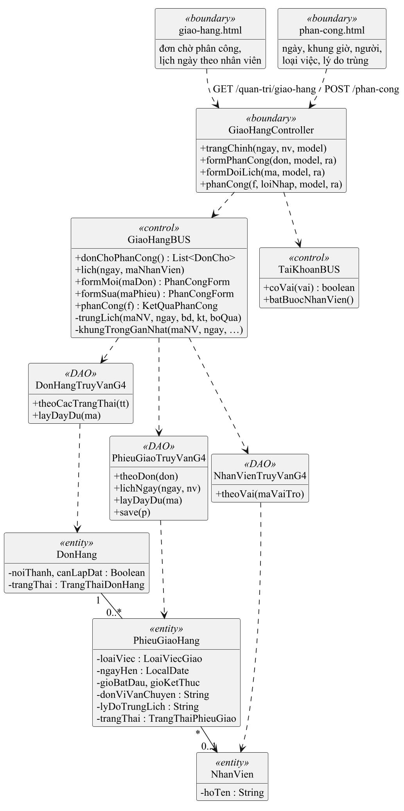
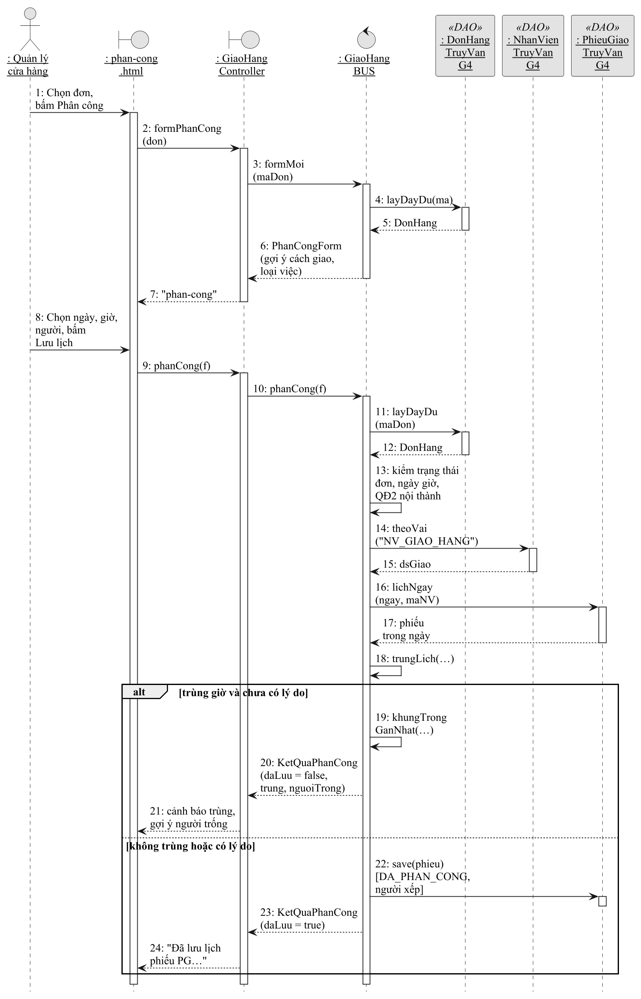
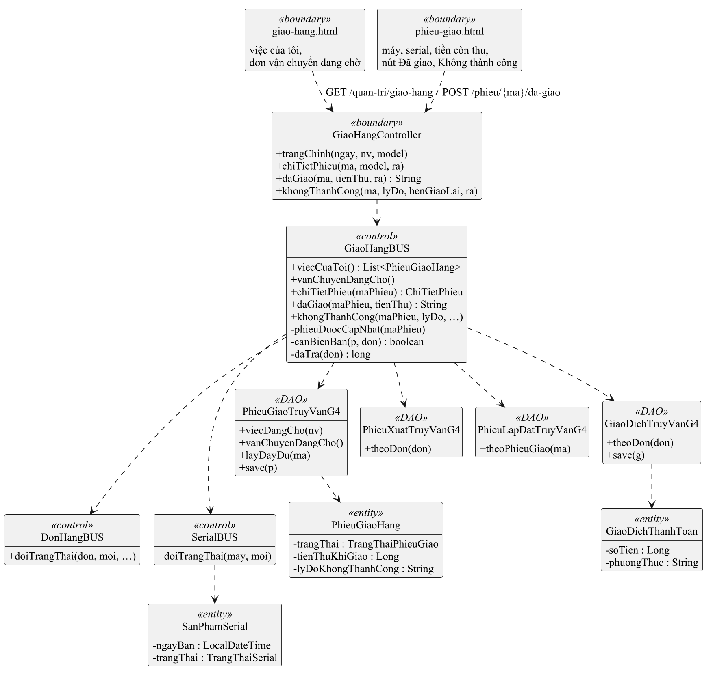
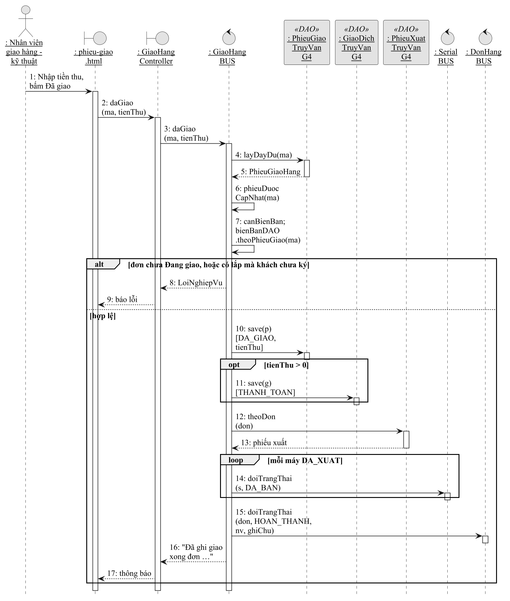
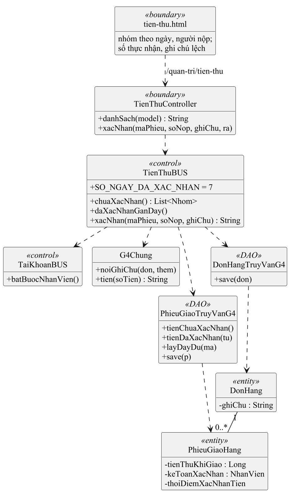
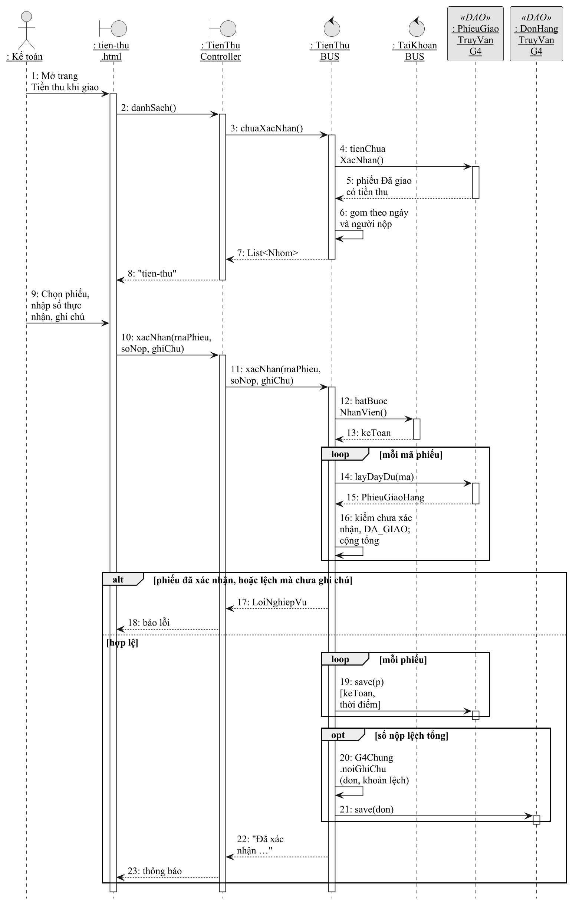
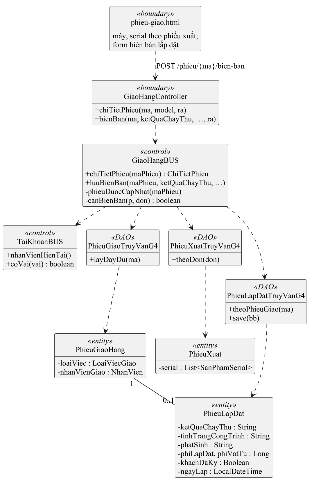
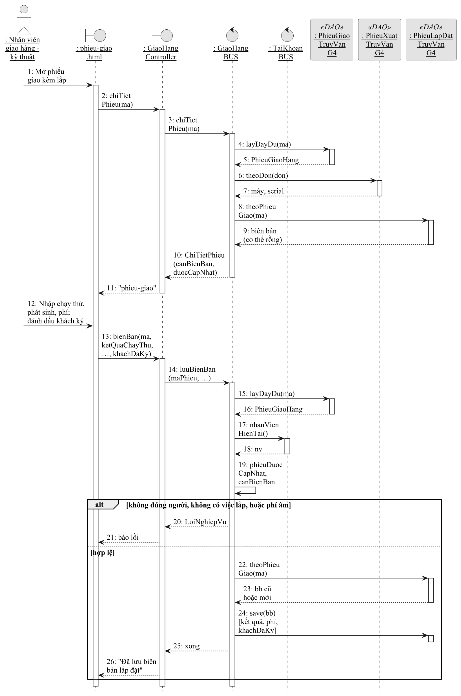

### UC-DH-02 Phân công giao hàng, lắp đặt

Quản lý cửa hàng chọn một đơn chờ phân công, chọn ngày, khung giờ, người phụ trách rồi lưu lịch; hệ thống kiểm trùng khung giờ trước khi ghi phiếu giao.

Quy tắc nghiệp vụ nằm ở `GiaoHangBUS`: `donChoPhanCong()` lấy đơn Đã xác nhận hoặc Đang giao chưa có phiếu giao còn hiệu lực; `formMoi()` gợi ý cách giao theo `noiThanh` và loại việc Giao kèm lắp khi khách chọn lắp;
`phanCong()` kiểm đơn đúng trạng thái, giờ kết thúc sau giờ bắt đầu, ngày giờ sau hiện tại (luồng 3b), QĐ2 (đơn tỉnh bắt buộc gửi đơn vị vận chuyển, đơn nội thành do nhân viên cửa hàng giao – luồng 2a),
loại việc khớp lựa chọn lắp đặt (Khảo sát lắp đặt cho luồng 2b), mỗi đơn chỉ một phiếu giao còn hiệu lực; `trungLich()` tìm phiếu giao trùng khung giờ của người được chọn (QĐ4), `khungTrongGanNhat()` gợi ý khung trống trong giờ mở cửa;
trùng mà chưa có lý do thì trả `KetQuaPhanCong(daLuu = false)` kèm người còn trống (luồng 3a), có lý do thì lưu `lyDoTrungLich`. Đổi lịch (`formSua()`, luồng 5a) chỉ cho phiếu Đã phân công và nối lịch cũ vào ghi chú đơn.
Quyền chỉ quản lý cửa hàng phân công kiểm ở `GiaoHangController` qua `TaiKhoanBUS.coVai("QUAN_LY")`.

### UC-DH-03 Cập nhật trạng thái giao hàng

Người phụ trách phiếu giao bấm "Đã giao" kèm số tiền thu khi giao; một lần lưu cập nhật phiếu giao, giao dịch thanh toán, các chiếc máy và trạng thái đơn.

Quy tắc nghiệp vụ nằm ở `GiaoHangBUS`: `phieuDuocCapNhat()` chỉ cho phiếu Đã phân công, đúng nhân viên giao hàng – kỹ thuật được phân công, hoặc nhân viên bán hàng với đơn gửi đơn vị vận chuyển (luồng 5c);
`daGiao()` đòi đơn đang `DANG_GIAO` (luồng 5a), đơn có lắp phải có `PhieuLapDat` khách đã ký (`canBienBan()`, luồng 5b), lưu `GiaoDichThanhToan` khi có tiền thu, thu đủ theo `daTra()` thì sang `DA_THANH_TOAN` (thu thiếu giữ nguyên – luồng 6a),
cấp số hoá đơn, chuyển máy `DA_XUAT` sang `DA_BAN` kèm `ngayBan` qua `SerialBUS.doiTrangThai()`, chuyển đơn sang `HOAN_THANH` qua `DonHangBUS.doiTrangThai()`;
`khongThanhCong()` bắt buộc lý do, hẹn giao lại thì chỉ ghi chú đơn (luồng 3b), còn lại chuyển đơn sang `GIAO_KHONG_THANH_CONG` (luồng 3a). Cả `daGiao()` chạy trong một giao tác nên lỗi giữa chừng không lưu gì.

### UC-DH-04 Xác nhận tiền thu khi giao

Kế toán chọn các phiếu giao của một người nộp, nhập số tiền thực nhận và xác nhận; khoản lệch phải có ghi chú.

Quy tắc nghiệp vụ nằm ở `TienThuBUS`: `chuaXacNhan()` gom các phiếu Đã giao có tiền thu chưa xác nhận theo ngày hẹn và người nộp (nhân viên hoặc đơn vị vận chuyển) và cộng tổng từng nhóm;
`xacNhan()` bắt buộc chọn ít nhất một phiếu (luồng 3a), không ghi đè phiếu đã có `keToanXacNhan` (luồng 3b), số nộp lệch tổng thì bắt buộc ghi chú (luồng 4a) rồi nối khoản lệch vào ghi chú đơn qua `G4Chung.noiGhiChu()` (luồng 4b);
`daXacNhanGanDay()` hiện các phiếu đã xác nhận trong `SO_NGAY_DA_XAC_NHAN = 7` ngày. Quyền chỉ kế toán vào trang `/quan-tri/tien-thu` đặt ở cấu hình bảo mật (`BaoMat`).

### UC-DH-05 Lập biên bản lắp đặt

Nhân viên giao hàng – kỹ thuật lập biên bản lắp đặt ngay trên trang phiếu giao, lưu lại lần nữa khi khách đã ký.

Quy tắc nghiệp vụ nằm ở `GiaoHangBUS`: `luuBienBan()` dùng `phieuDuocCapNhat()` (chỉ người được phân công, phiếu còn Đã phân công – luồng 3b), `canBienBan()` (phiếu Giao kèm lắp, hoặc phiếu giao của đơn có lắp do cửa hàng tự giao),
từ chối đơn gửi đơn vị vận chuyển (QĐ2 của BUC-08), bắt buộc kết quả chạy thử, phí lắp và phí vật tư không âm (luồng 3a), mỗi phiếu giao một `PhieuLapDat` (lưu lại thì ghi đè – luồng 5a);
`chiTietPhieu()` cộng phí vật tư và phần phí lắp vượt phí đã tính trên đơn vào số tiền gợi ý thu. Điều kiện "khách đã ký mới được báo hoàn thành" kiểm ở `daGiao()` của UC-DH-03.
Website chưa có bảng giá công lắp và vật tư, nên QĐ3, QĐ4 của BUC-08 chưa được kiểm tự động.
