### UC-KB-01 Quản lý nhà cung cấp

Thủ kho thêm, sửa nhà cung cấp trên một biểu mẫu chung; nhà cung cấp đã có chứng từ chỉ được chuyển sang ngừng hợp tác chứ không xoá được.

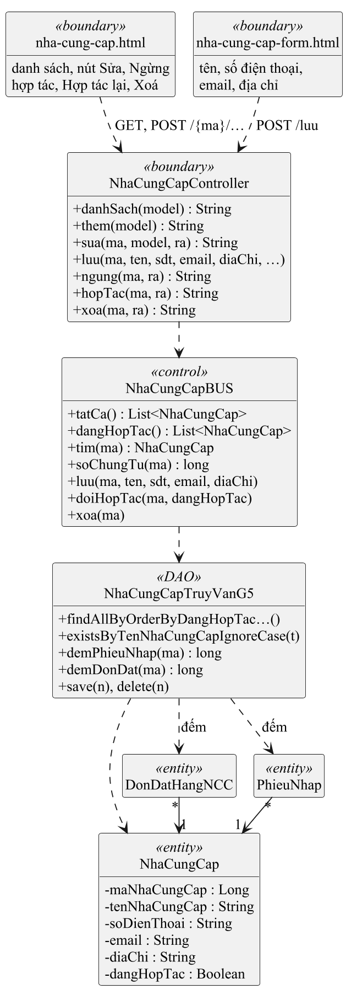

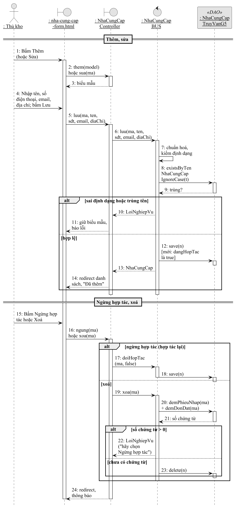

Quy tắc nghiệp vụ nằm ở `NhaCungCapBUS`: `luu()` (chuẩn hoá tên và số điện thoại, tên không trống, không quá 150 ký tự, số điện thoại bắt đầu bằng 0 và có 9–14 chữ số, email đúng định dạng – luồng 3a;
không trùng tên, không phân biệt hoa thường – luồng 4a; nhà cung cấp mới luôn `dangHopTac = true`); `doiHopTac()` (ngừng hoặc hợp tác lại – luồng 2b, 2c);
`xoa()` dùng `soChungTu()` = số phiếu nhập + số đơn đặt hàng, lớn hơn 0 thì từ chối và gợi ý ngừng hợp tác (luồng 2e). `dangHopTac()` là danh sách duy nhất mà UC-KB-02 cho chọn.

### UC-KB-02 Lập đơn đặt hàng nhà cung cấp

Thủ kho lập đề xuất từ bảng tồn kho (mẫu dưới mức tồn tối thiểu được gợi ý sẵn số lượng); quản lý cửa hàng ghi ý kiến chủ cửa hàng rồi gửi đơn, đơn đã gửi là căn cứ nhận hàng ở UC-KB-03.

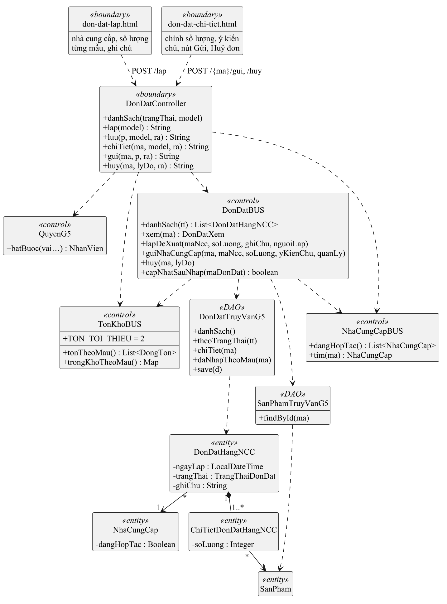

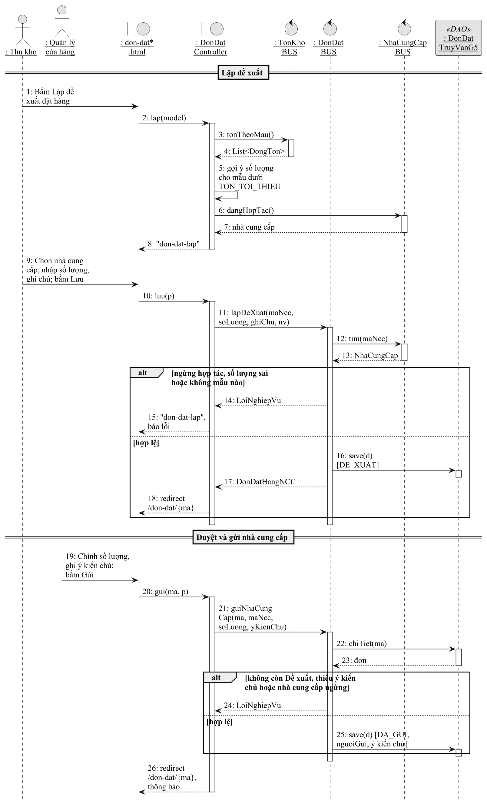

Quy tắc nghiệp vụ nằm ở `DonDatBUS`: `lapDeXuat()` (phải chọn nhà cung cấp đang hợp tác – QĐ2 của BUC-05, số lượng nguyên 0–999, ít nhất một mẫu – luồng 2a; đơn ở trạng thái `DE_XUAT`);
`guiNhaCungCap()` (chỉ đơn `DE_XUAT` – luồng 5c, bắt ghi ý kiến chủ cửa hàng – QĐ1 của BUC-05, luồng 5b; cho chỉnh số lượng, đổi nhà cung cấp, chuyển `DA_GUI` và ghi người gửi);
`huy()` (chỉ đơn `DE_XUAT` hoặc `DA_GUI` chưa có phiếu nhập, bắt ghi lý do – luồng 5d); `capNhatSauNhap()` được UC-KB-03 gọi để chuyển đơn sang `DA_NHAN` khi nhận đủ (luồng 6a).
Phân quyền theo vai nằm ở `QuyenG5.batBuoc()`: lập đề xuất là Thủ kho, gửi là Quản lý cửa hàng. Số lượng gợi ý tính ở `DonDatController` từ `TonKhoBUS.tonTheoMau()` và `TON_TOI_THIEU`.

### UC-KB-04 Lập phiếu xuất kho theo đơn

Thủ kho chọn đơn đã xác nhận, hệ thống gợi ý serial đang trong kho (máy đặt riêng cho đơn được ưu tiên); lưu phiếu thì máy sang Đã xuất và đơn sang Đang giao trong cùng một giao dịch.

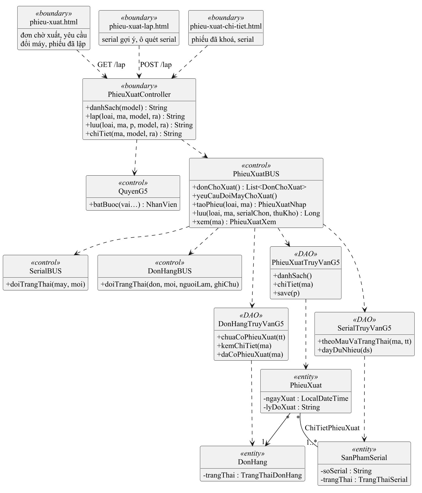

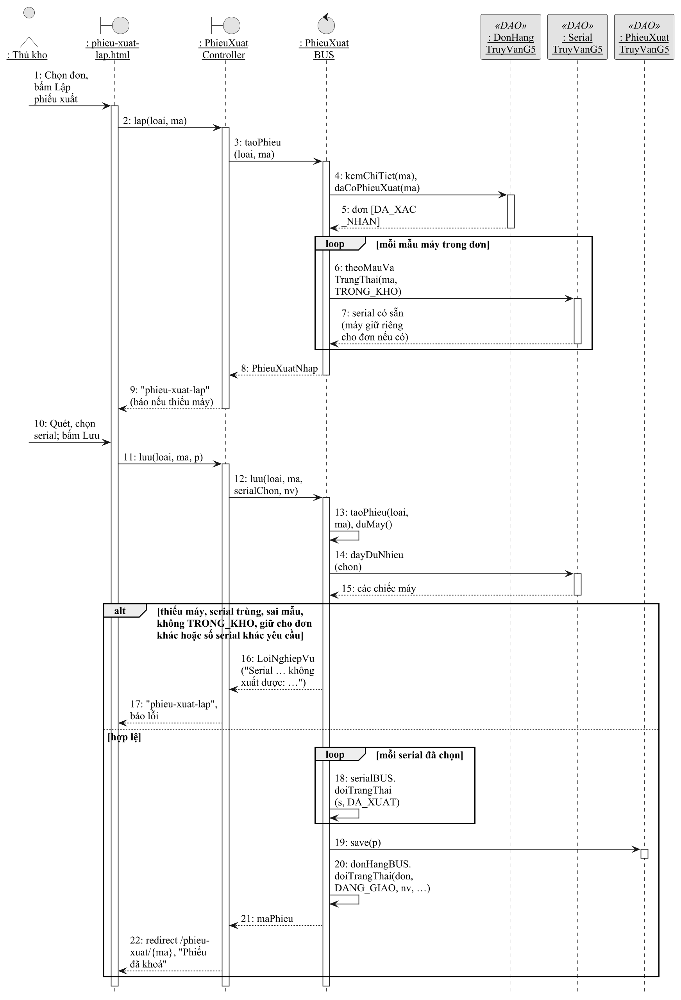

Quy tắc nghiệp vụ nằm ở `PhieuXuatBUS`: `taoPhieu()` (đơn phải `DA_XAC_NHAN` và chưa có phiếu xuất – luồng 4b; mỗi mẫu lấy serial `TRONG_KHO`, nếu có máy giữ riêng cho đơn thì chỉ lấy những máy đó – luồng 2a; thiếu máy thì `duMay()` sai – luồng 2b);
`luu()` (serial không trùng trên phiếu – luồng 3b, có trong hệ thống, đúng mẫu, đang `TRONG_KHO`, không giữ cho đơn khác – luồng 3a, số serial mỗi mẫu bằng số lượng yêu cầu – luồng 4a;
`SerialBUS.doiTrangThai()` chuyển từng máy sang `DA_XUAT`, `DonHangBUS.doiTrangThai()` chuyển đơn sang `DANG_GIAO` và ghi lịch sử; cùng `@Transactional`, lỗi thì không lưu gì).
Loại `doi` (xuất máy đổi theo yêu cầu đổi trả đã duyệt – luồng 5a) đi cùng `luu()` nhưng không đổi trạng thái đơn.

### UC-KB-05 Kiểm kê, cảnh báo tồn thấp

Bảng tồn được đếm thẳng từ serial theo mẫu và trạng thái, nên kiểm kê chỉ so số đếm thực tế với số Trong kho, không sửa số tồn.

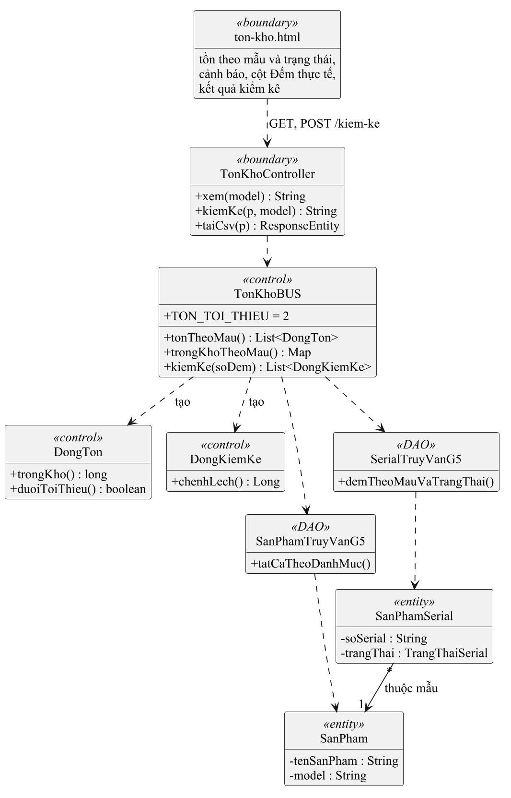

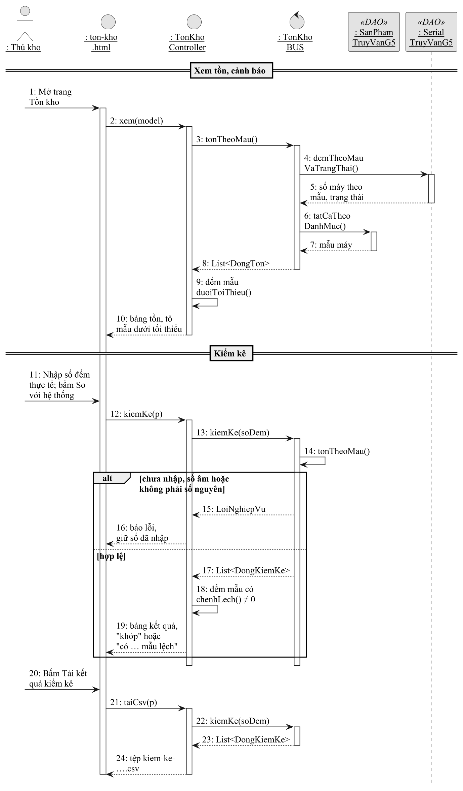

Quy tắc nghiệp vụ nằm ở `TonKhoBUS`: `tonTheoMau()` (đếm `SanPhamSerial` theo mẫu và trạng thái), `DongTon.duoiToiThieu()` (số Trong kho không quá `TON_TOI_THIEU = 2` thì cảnh báo – bước 1);
`kiemKe()` (số đếm phải là số nguyên không âm, có ít nhất một mẫu – luồng 2a, 2b; trả về `DongKiemKe` với `chenhLech()` = thực tế − hệ thống – bước 3, luồng 3a).
`TonKhoController.taiCsv()` xuất kết quả kiểm kê ra CSV làm biên bản (bước 4). Mức tồn tối thiểu đang là một hằng chung cho mọi mẫu, chưa đặt riêng từng mẫu như phân tích.

### UC-KB-07 Tra cứu bảo hành

Trang khách `/bao-hanh` không cần đăng nhập, tra theo số serial hoặc số điện thoại người nhận (lọc thêm theo mã đơn); phía nhân viên dùng `BaoHanhBUS.traCuu()` đã trình bày ở UC-KB-06.

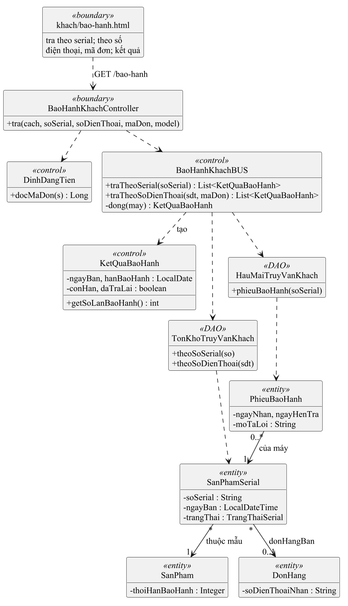

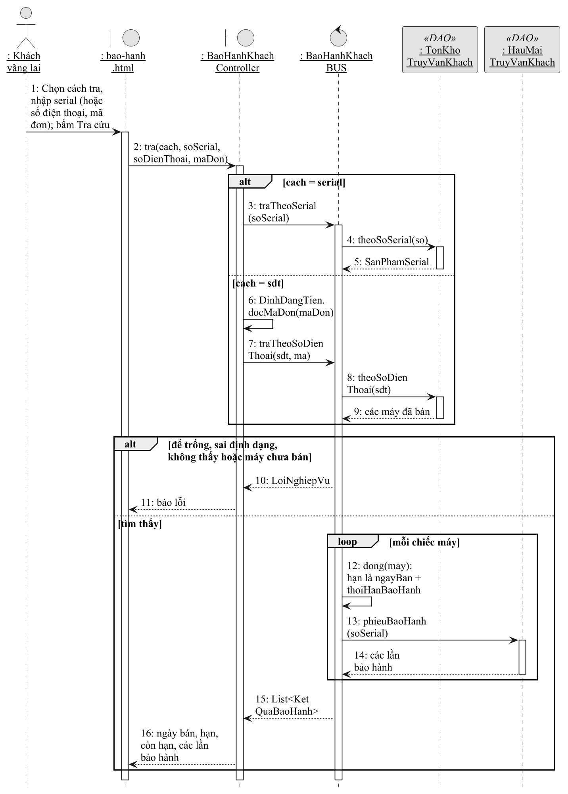

Quy tắc nghiệp vụ nằm ở `BaoHanhKhachBUS`: `traTheoSerial()` (serial không trống – luồng 2a, có trong hệ thống – luồng 3a, máy đã bán, có `ngayBan` – luồng 3c);
`traTheoSoDienThoai()` (số điện thoại 10 chữ số bắt đầu bằng 0, lọc theo mã đơn nếu có – luồng 2a, 3b); `dong()` tính hạn bảo hành = `ngayBan` + `thoiHanBaoHanh` tháng của mẫu (QĐ1 của BUC-09),
đánh dấu máy đã trả lại cửa hàng không còn bảo hành (luồng 4a) và kèm các phiếu bảo hành của máy. Mã đơn dạng `DH000012` được đọc bằng `DinhDangTien.docMaDon()` ở controller.
Trang khách chưa cộng số ngày máy nằm ở hãng vào hạn (QĐ2 của BUC-09); `BaoHanhBUS.traCuu()` phía nhân viên đã cộng.

### UC-KB-08 Nhận lại máy về kho

Thủ kho nhận lại máy từ hai nguồn: máy đã xuất của đơn giao không thành công và máy khách trả theo yêu cầu đổi trả đã duyệt; tình trạng máy ghi vào lịch sử của đơn.

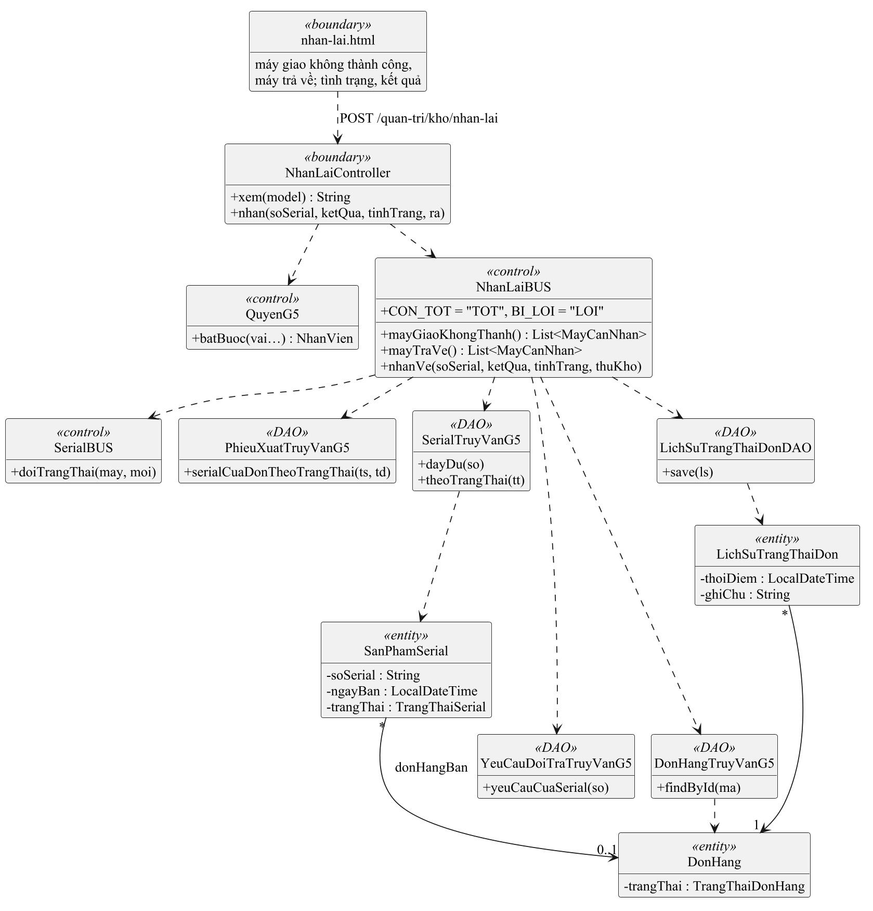

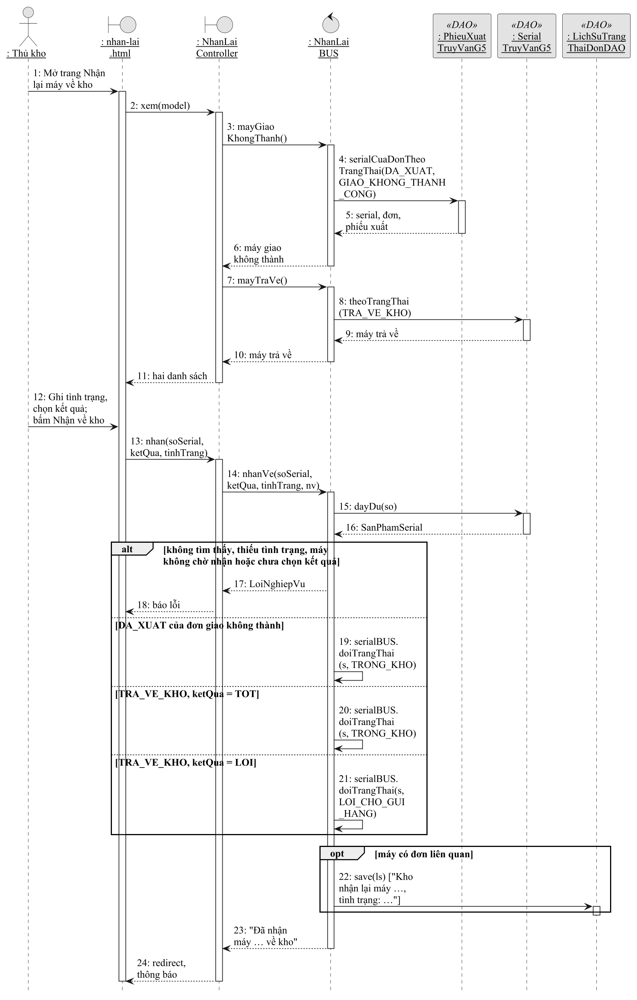

Quy tắc nghiệp vụ nằm ở `NhanLaiBUS`: `mayGiaoKhongThanh()` (serial `DA_XUAT` ở phiếu xuất mới nhất của đơn `GIAO_KHONG_THANH_CONG`), `mayTraVe()` (serial `TRA_VE_KHO`, kèm yêu cầu đổi trả);
`nhanVe()` (bắt ghi tình trạng, không quá 150 ký tự – luồng 3c; máy `DA_XUAT` phải thuộc đơn giao không thành công rồi về `TRONG_KHO`, bỏ gắn đơn và ngày bán; máy `TRA_VE_KHO` phải chọn kết quả – luồng 3d,
`TOT` về `TRONG_KHO`, `LOI` sang `LOI_CHO_GUI_HANG`; trạng thái khác thì từ chối – luồng 3b; ghi một dòng `LichSuTrangThaiDon` giữ nguyên trạng thái đơn).
Mọi lần đổi trạng thái máy đều qua `SerialBUS.doiTrangThai()`, nơi giữ bảng chuyển trạng thái hợp lệ của chiếc máy (mục 5 của `lop-va-trang-thai-chung.md`).
